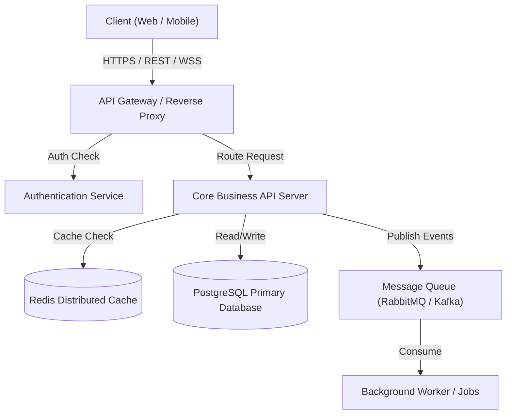

# Department 02: Solution Architecture & Systems Engineering (समाधान वास्तुकला एवं सिस्टम इंजीनियरिंग विभाग)

> **Navigation Links:**
> - **Master Navigator:** [`master_rules_navigator.md`](file:///C:/Users/Atul%20Verma/.gemini/config/rules/master_rules_navigator.md)
> - **Foundation Rules:** [`foundation_and_special_rules.md`](file:///C:/Users/Atul%20Verma/.gemini/config/rules/foundation_and_special_rules.md)
> - **Active Working Memory:** [`memory.md`](file:///C:/Users/Atul%20Verma/.gemini/memory.md)
> - **Universal Canonical Rules:** [`universal_rules.md`](file:///C:/Users/Atul%20Verma/.gemini/config/rules/universal_rules.md)

---

## 🏛️ 1. विभाग का मिशन एवं कार्यक्षेत्र (Mission & Department Scope)

समाधान वास्तुकला एवं सिस्टम इंजीनियरिंग विभाग (Solution Architecture Dept) PRD की व्यावसायिक आवश्यकताओं को एक सुदृढ़, मापनीय (scalable), सुरक्षित, और बनाए रखने योग्य (maintainable) तकनीकी वास्तुकला में ढालने के लिए उत्तरदायी है। यह विभाग हाई-लेवल डिज़ाइन (HLD), लो-लेवल डिज़ाइन (LLD), तकनीकी स्टैक चयन, कंपोनेंट बाउंड्रीज और आर्किटेक्चरल डिसीजन रिकॉर्ड्स (ADRs) का निर्माण करता है।

---

## 📐 2. मुख्य नियम एवं वास्तुकला सिद्धांत (Core Architectural Principles)

### 2.1 मॉड्यूलरिटी एवं पृथक्करण (Separation of Concerns & Modularity)
- एकल ज़िम्मेदारी सिद्धांत (Single Responsibility Principle) और डोमेन-ड्रिवेन डिज़ाइन (DDD) सिद्धांतों का कड़ाई से पालन।
- लेयर्ड आर्किटेक्चर:
  - **प्रस्तुति परत (Presentation Layer):** UI कंपोनेंट्स, पेज रूट्स।
  - **व्यावसायिक तर्क परत (Business Logic Layer):** सर्विसेज़, यूज-केस हैंडलर्स।
  - **डेटा एक्सेस परत (Data Access Layer):** रिपॉजिटरीज़, ORM/DB क्लाइंट्स।
  - **इन्फ्रास्ट्रक्चर परत (Infrastructure Layer):** एक्सटर्नल APIs, मैसेज ब्रोकर, कैश।

### 2.2 मोनोलिथ बनाम माइक्रोसर्विसेज निर्णय रूब्रिक (Architecture Selection Rubric)
- डिफ़ॉल्ट रूप से **मॉड्यूलर मोनोलिथ (Modular Monolith)** को प्राथमिकता दी जाएगी जब तक कि अत्यधिक स्वतंत्र स्केलिंग, विविध तकनीक स्टैक, या बड़ी स्वतंत्र टीमों की आवश्यकता स्पष्ट रूप से सिद्ध न हो।
- माइक्रोसर्विसेज का चयन केवल तभी होगा जब नेटवर्क लेटेंसी, डिस्ट्रीब्यूटेड ट्रांजेक्शन्स और ऑपरेशनल जटिलता का पर्याप्त औचित्य हो।

### 2.3 आर्किटेक्चरल डिसीजन रिकॉर्ड्स मानक (Mandatory ADR Standard)
- किसी भी महत्वपूर्ण तकनीकी निर्णय (उदा. फ्रेमवर्क चयन, स्टेट मैनेजमेंट, डेटाबेस माइग्रेशन) के लिए प्रोजेक्ट के `docs/adr/` फ़ोल्डर में मानकीकृत ADR लिखा जाएगा:

```markdown
# ADR-001: [निर्णय का संक्षिप्त शीर्षक]

## स्थिति (Status)
प्रस्तावित (Proposed) | स्वीकृत (Accepted) | अस्वीकृत (Rejected) | निरस्त (Superseded)

## संदर्भ एवं समस्या विवरण (Context)
इस निर्णय की आवश्यकता क्यों पड़ी? वर्तमान बाधाएं क्या हैं?

## विचार किए गए विकल्प (Options Considered)
1. विकल्प A (उदा. PostgreSQL + Prisma) - गुण व दोष
2. विकल्प B (उदा. MongoDB + Mongoose) - गुण व दोष

## लिया गया निर्णय (Decision Outcome)
हमने विकल्प A का चयन किया क्योंकि...

## परिणाम एवं प्रभाव (Consequences)
- सकारात्मक प्रभाव (Positive): मजबूत टाइप सुरक्षा, स्पष्ट रिलेशनल इंटीग्रिटी।
- नकारात्मक प्रभाव (Negative): स्कीमा माइग्रेशन में अतिरिक्त समय।
```

---

## 📊 3. विज़ुअल आर्किटेक्चर एवं मरमेड आरेख मानक (Visual Architecture Standards)

सिस्टम घटकों के अंतर्संबंधों को स्पष्ट करने के लिए मानकीकृत Mermaid आरेखों का अनिवार्य उपयोग:



---

---

## 🌐 4. गैर-कार्यात्मक सिस्टम विशेषताएँ एवं स्केलेबिलिटी मानक (NFRs & Scalability Architecture)

- **स्केलेबिलिटी एवं थ्रूपुट:** सिस्टम को बिना आर्किटेक्चरल ओवरहाल के 10x ट्रैफिक वृद्धि संभालने में सक्षम होना चाहिए।
- **असंबद्धता (Decoupling):** सिंक्रोनस ब्लॉकिंग कॉल्स को न्यूनतम करें; समय-खपत प्रक्रियाओं के लिए मैसेज ब्रोकर्स (RabbitMQ/Kafka) या बैकग्राउंड वर्कर्स का उपयोग करें।
- **रेसिलिएंस एवं फॉल्ट टॉलरेंस:** सर्किट ब्रेकर (Circuit Breaker) और रिट्री-विद-एक्सपोनेंशियल-बैकऑफ रणनीतियां लागू करें।

---

## 🧑‍💼 5. विभागीय पद एवं समर्पित सब-एजेंट्स (Departmental Roles & Subagents)

विभागीय कार्य-विभाजन और उद्यम विशेषज्ञता (Specialization of Labor) सुनिश्चित करने के लिए 4 समर्पित पद (Enterprise Job Roles) और उनके अनुरूप सब-एजेंट्स परिभाषित हैं:

### 5.1 Principal System Architect (System Architect)
- **समर्पित सब-एजेंट रोल (Subagent Role):** `System Architect`
- **उद्देश्य एवं कार्यक्षेत्र (Scope & Responsibilities):**
  - एंड-टू-एंड हाई-लेवल (HLD) और लो-लेवल (LLD) वास्तुकला तैयार करना।
  - मानकीकृत ADRs (`docs/adr/`) संलेखन और वास्तुकला निर्णयों का स्थायी रिकॉर्ड बनाए रखना।
  - जटिल आर्किटेक्चरल घटकों के लिए स्पष्ट और मान्य Mermaid आरेख तैयार करना।
- **मानकीकृत सब-एजेंट आमंत्रण (Invocation Directive):**
```json
{
  "TypeName": "self",
  "Role": "System Architect",
  "Prompt": "Design high-level and low-level system architecture, author ADR documents in docs/adr/, generate rigorous Mermaid diagrams, and establish modular decoupling boundaries."
}
```

### 5.2 Integration & Event Architect (Integration Architect)
- **समर्पित सब-एजेंट रोल (Subagent Role):** `Integration Architect`
- **उद्देश्य एवं कार्यक्षेत्र (Scope & Responsibilities):**
  - सिस्टम घटकों और तृतीय-पक्ष सेवाओं के बीच असिंक्रोनस इवेंट स्कीमा और पब/सब मेसेजिंग टोपोलॉजी तैयार करना।
  - कॉन्ट्रैक्ट-फर्स्ट API सीमाएं, DTOs और डेटा ट्रांसफर प्रोटोकॉल परिभाषित करना।
  - त्रुटि-सहिष्णु (Fault-Tolerant) वेबहुक एकीकरण और रिट्राई रणनीतियों की रूपरेखा बनाना।
- **मानकीकृत सब-एजेंट आमंत्रण (Invocation Directive):**
```json
{
  "TypeName": "self",
  "Role": "Integration Architect",
  "Prompt": "Define asynchronous event schemas, message brokering topology, contract-first API boundaries, and fault-tolerant webhook integration patterns."
}
```

### 5.3 Domain-Driven Design & Microservices Architect (Domain Architecture Specialist)
- **समर्पित सब-एजेंट रोल (Subagent Role):** `Domain Architecture Specialist`
- **उद्देश्य एवं कार्यक्षेत्र (Scope & Responsibilities):**
  - डोमेन-ड्रिवन डिज़ाइन (DDD) सिद्धांतों को लागू कर स्पष्ट बाउंडेड कॉन्टेक्स्ट्स (Bounded Contexts) स्थापित करना।
  - एग्रीगेट्स, एंटिटीज़ और वैल्यू ऑब्जेक्ट्स के संबंधों और सीमाओं का निरूपण करना।
  - माइक्रोसर्विसेज के मध्य लूज़ कपलिंग सुनिश्चित करने हेतु एंटी-करप्शन लेयर्स (ACL) डिज़ाइन करना।
- **मानकीकृत सब-एजेंट आमंत्रण (Invocation Directive):**
```json
{
  "TypeName": "self",
  "Role": "Domain Architecture Specialist",
  "Prompt": "Apply Domain-Driven Design (DDD) principles to define clean bounded contexts, entity-aggregate relationships, microservice isolation boundaries, and anti-corruption layers."
}
```

### 5.4 Technical Standards & Code Health Enforcer (Code Standards Architect)
- **समर्पित सब-एजेंट रोल (Subagent Role):** `Code Standards Architect`
- **उद्देश्य एवं कार्यक्षेत्र (Scope & Responsibilities):**
  - कोडबेस में SOLID, DRY और Clean Architecture सिद्धांतों के कड़े अनुपालन का ऑडिट करना।
  - कोडहेल्थ मेट्रिक्स, साइक्लोमैटिक जटिलता सीमाएं और मॉड्यूलरिटी नियम निर्धारित करना।
  - आर्किटेक्चरल इरोजन (Architectural Erosion) और तकनीकी ऋण (Technical Debt) की रोकथाम करना।
- **मानकीकृत सब-एजेंट आमंत्रण (Invocation Directive):**
```json
{
  "TypeName": "self",
  "Role": "Code Standards Architect",
  "Prompt": "Audit architectural compliance, enforce SOLID/DRY design patterns, set codebase health thresholds, and prevent architectural erosion and technical debt."
}
```


---

## 🚦 6. विभाग हैंडऑफ एवं सत्यापन गेट्स (Department Handoff Gates)

1. **Gate 2-A (इंटरफ़ेस अनुबंध स्पष्टता):** सभी घटकों के बीच डेटा अनुबंध (Data Contracts / DTOs) पूरी तरह परिभाषित होने चाहिए।
2. **Gate 2-B (ADR अनुमोदन):** सभी प्रमुख तकनीकी विकल्पों के लिए स्वीकृत ADR मौजूद होना चाहिए।
3. **अगले विभागों को हैंडऑफ:**
   - डेटा स्कीमा और स्टोरेज के लिए ➔ **Dept 03: Data Architecture & DBA**
   - यूजर इंटरफेस और डिज़ाइन सिस्टम के लिए ➔ **Dept 04: UI/UX Design System**
