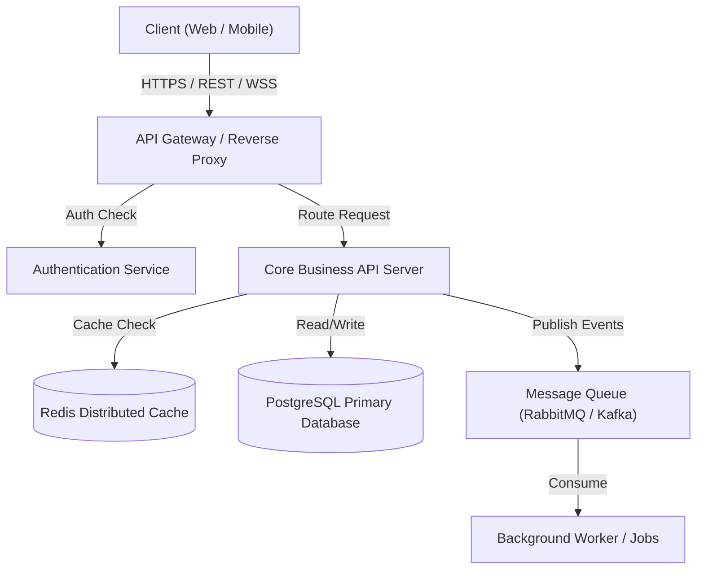

# Department 02: Solution Architecture & Systems Engineering

> **Navigation Links:**
> - **Master Navigator:** [`master_rules_navigator.md`](file:///C:/Users/Atul%20Verma/.gemini/config/rules/master_rules_navigator.md)
> - **Foundation Rules:** [`foundation_and_special_rules.md`](file:///C:/Users/Atul%20Verma/.gemini/config/rules/foundation_and_special_rules.md)
> - **Active Working Memory:** [`memory.md`](file:///C:/Users/Atul%20Verma/.gemini/memory.md)
> - **Universal Canonical Rules:** [`universal_rules.md`](file:///C:/Users/Atul%20Verma/.gemini/config/rules/archive/universal_rules.md) (Archived canonical reference)

---

## 🏛️ 1. Mission & Department Scope

The Solution Architecture & Systems Engineering Department (Dept 02) is responsible for translating the PRD business requirements into a robust, scalable, secure, and maintainable technical architecture. This department authors High-Level Designs (HLD), Low-Level Designs (LLD), oversees technology stack selection, defines component boundaries, and establishes Architecture Decision Records (ADRs).

---

## 📐 2. Core Architectural Principles

### 2.1 Separation of Concerns & Modularity
- Strict adherence to the Single Responsibility Principle and Domain-Driven Design (DDD) principles.
- Layered Architecture discipline:
  - **Presentation Layer:** UI components, page routes, client views.
  - **Business Logic Layer:** Domain services, use-case handlers, transaction workflows.
  - **Data Access Layer:** Repositories, ORM/DB clients, caching adapters.
  - **Infrastructure Layer:** External APIs, message brokers, cloud infrastructure.

### 2.2 Monolith vs. Microservices Decision Rubric
- **Modular Monolith by Default:** Prefer a modular monolith until independent scaling dimensions, heterogeneous technology stacks, or autonomous cross-functional teams explicitly necessitate distributed services.
- Microservices adoption requires rigorous justification balancing network latency, distributed transaction overhead, and operational complexity.

### 2.3 Architecture Decision Records (ADR) Standard
- For every architectural decision (e.g., framework selection, state management paradigm, database technology), author an ADR in `docs/adr/` following this standardized format:

```markdown
# ADR-001: [Concise Decision Title]

## Status
Proposed | Accepted | Rejected | Superseded

## Context & Problem Statement
Why was this decision required? What are the current architectural bottlenecks and constraints?

## Options Considered
1. Option A (e.g., PostgreSQL + Prisma) - Tradeoffs and analysis
2. Option B (e.g., MongoDB + Mongoose) - Tradeoffs and analysis

## Decision Outcome
We decided to adopt Option A because...

## Consequences
- Positive Impact: Strong type safety, guaranteed relational integrity.
- Negative Impact: Additional discipline required for schema migrations.
```

---

## 📊 3. Visual Architecture & Mermaid Diagram Standards

Mandatory usage of standardized Mermaid diagrams to articulate component topologies and data flows:



---

## 🌐 4. Non-Functional Requirements & Scalability Architecture

- **Scalability & Throughput:** Systems must handle a 10x traffic increase without requiring fundamental architectural rework.
- **Decoupling:** Minimize synchronous blocking calls; offload compute-heavy or time-consuming workflows to message brokers (RabbitMQ/Kafka) or background workers.
- **Resilience & Fault Tolerance:** Implement Circuit Breaker patterns and exponential backoff retry strategies on all distributed integrations.

---

## 🧑‍💼 5. Departmental Roles & Dedicated Subagents

To enforce specialization of labor and enterprise rigor, 4 dedicated enterprise job roles and their corresponding subagent archetypes are established:

### 5.1 Principal System Architect (System Architect)
- **Dedicated Subagent Role:** `System Architect`
- **Scope & Responsibilities:**
  - Architect end-to-end High-Level (HLD) and Low-Level (LLD) system topologies.
  - Author standardized ADRs (`docs/adr/`) and maintain architectural records.
  - Generate valid, syntax-clean Mermaid diagrams for architectural clarity.
- **Standard Subagent Invocation Directive:**
```json
{
  "TypeName": "self",
  "Role": "System Architect",
  "Prompt": "Design high-level and low-level system architecture, author ADR documents in docs/adr/, generate rigorous Mermaid diagrams, and establish modular decoupling boundaries."
}
```

### 5.2 Integration & Event Architect (Integration Architect)
- **Dedicated Subagent Role:** `Integration Architect`
- **Scope & Responsibilities:**
  - Design asynchronous event schemas and pub/sub messaging topologies between system components.
  - Define contract-first API boundaries, DTOs, and serialization formats.
  - Specify fault-tolerant webhook integration protocols and retry policies.
- **Standard Subagent Invocation Directive:**
```json
{
  "TypeName": "self",
  "Role": "Integration Architect",
  "Prompt": "Define asynchronous event schemas, message brokering topology, contract-first API boundaries, and fault-tolerant webhook integration patterns."
}
```

### 5.3 Domain-Driven Design & Microservices Architect (Domain Architecture Specialist)
- **Dedicated Subagent Role:** `Domain Architecture Specialist`
- **Scope & Responsibilities:**
  - Apply Domain-Driven Design (DDD) principles to define clear bounded contexts.
  - Map relationships and invariants across aggregates, entities, and value objects.
  - Design Anti-Corruption Layers (ACL) to preserve loose coupling between disparate domains.
- **Standard Subagent Invocation Directive:**
```json
{
  "TypeName": "self",
  "Role": "Domain Architecture Specialist",
  "Prompt": "Apply Domain-Driven Design (DDD) principles to define clean bounded contexts, entity-aggregate relationships, microservice isolation boundaries, and anti-corruption layers."
}
```

### 5.4 Technical Standards & Code Health Enforcer (Code Standards Architect)
- **Dedicated Subagent Role:** `Code Standards Architect`
- **Scope & Responsibilities:**
  - Audit codebase for strict compliance with SOLID, DRY, and Clean Architecture patterns.
  - Enforce cyclomatic complexity thresholds, code health metrics, and modular boundaries.
  - Proactively prevent architectural erosion and technical debt accumulation.
- **Standard Subagent Invocation Directive:**
```json
{
  "TypeName": "self",
  "Role": "Code Standards Architect",
  "Prompt": "Audit architectural compliance, enforce SOLID/DRY design patterns, set codebase health thresholds, and prevent architectural erosion and technical debt."
}
```

---

## 🚦 6. Department Handoff & Verification Gates

1. **Gate 2-A (Contract Clarity):** All inter-component data contracts (DTOs, schemas) must be explicitly documented.
2. **Gate 2-B (ADR Signoff):** Every major technical decision must possess an accepted ADR in `docs/adr/`.
3. **Downstream Handoff:**
   - Data schema and storage models ➔ **Dept 03: Data Architecture & DBA**
   - User interface and design system specifications ➔ **Dept 04: UI/UX Design System**
