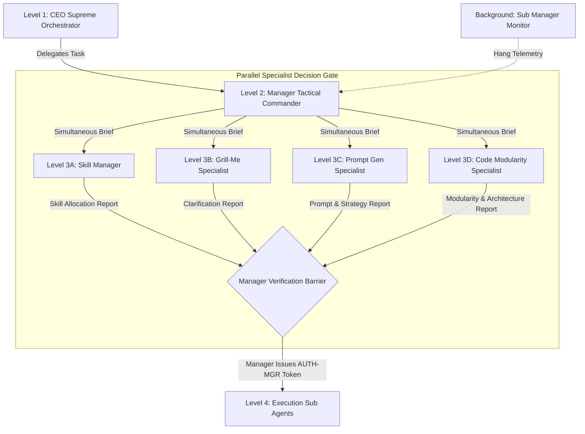

# Code Modularity and Scalable Architecture Standard

> **Authoritative Specification & Governance:**
> - **Specialist Role:** Level 3D Code Modularity & Scalable Architecture Specialist (`code_modularity_specialist`)
> - **System Architecture:** [`architecture_recommendation.md`](architecture_recommendation.md)
> - **Foundation Operating Rules:** [`foundation_core.md`](foundation_core.md)
> - **Master Rules Navigator:** [`master_rules_navigator.md`](master_rules_navigator.md)
> - **Prompt Architecture:** [`PHASE_WISE_PROMPT_GENERATION_ARCHITECTURE.md`](PHASE_WISE_PROMPT_GENERATION_ARCHITECTURE.md)
> - **Lead Department:** [`departments_archive/02_solution_architecture_dept.md`](departments_archive/02_solution_architecture_dept.md)
> - **Active Working Memory:** [`memory.md`](file:///C:/Users/Atul%20Verma/.gemini/memory.md)
> - **Developer Profile:** Atul Verma (`aiprincekumar` / `aiprincekumar010100@gmail.com` / [GitHub Profile](https://github.com/aiprincekumar))

---

## 🏛️ 1. Executive Authority & 4-Level Command Hierarchy Integration

This document establishes the authoritative system architecture, quantitative constraints, and operational governance for the **Level 3D: Code Modularity & Scalable Architecture Specialist** (`code_modularity_specialist`). Within the 4-Level Command Hierarchy, the Code Modularity Specialist operates as a co-equal advisory specialist alongside the Level 3A Skill Manager, Level 3B Grill-Me Specialist, and Level 3C Prompt Generation Specialist within the Mandatory Parallel Specialist Decision Gate.



### 1.1 Constitutional Mandate & Boundaries
- **Exclusive Reporting Line:** The Specialist reports directly and exclusively to the Level 2 Tactical Manager.
- **Strict Isolation:** The Specialist never communicates directly with the Level 1 CEO or the human User, and never issues execution directives directly to Level 4 Execution Sub Agents.
- **Non-Bypassable Governance:** The Level 2 Tactical Manager cannot bypass Level 3D. All execution subagents remain strictly paused until all four specialist reports are certified clean.

---

## 📏 2. Universal Rule 28 Quantitative Thresholds & Code Constraints

Universal Rule 28 establishes unambiguous mathematical thresholds governing source files, functions, nesting depth, and parameter counts across all programming languages and frameworks.

### 2.1 File Length & File Size Thresholds

| Threshold Level | Metric Boundary | Architectural Classification | Action Required |
| :--- | :--- | :--- | :--- |
| **Target Limit** | `< 500 lines` (`< 16 KB`) | 🟢 Optimal Maintainability | Standard development; no restructuring required. |
| **Warning Limit** | `500–700 lines` (`16–24 KB`) | 🟡 Refactoring Candidate | Document modularity split plan for next edit cycle. |
| **Mandatory Hard Split** | `> 700 lines` OR `> 24 KB` | 🔴 Hard Execution Gate | Mandatory decomposition before adding new code. |

- **Strict Enforcement Gate:** Any file exceeding 700 lines or 24 KB trips an immediate modularity violation. Execution subagents are constitutionally prohibited from appending code to such files without first decomposing them.

### 2.2 Function Complexity & Structural Constraints
- **Function Length:** `≤ 50 lines` per function. Functions exceeding 50 lines must be decomposed into focused private helpers or domain utilities.
- **Nesting Depth:** `≤ 4 levels` maximum indentation. Enforce early returns, guard clauses, and function extraction to maintain flat control flows.
- **Cyclomatic Complexity:** `≤ 10` linearly independent execution paths per function. Decompose switch ladders and nested conditional branches.
- **Parameter Count:** `≤ 4 parameters` per function. When 5 or more parameters are required, encapsulate arguments into a typed configuration object, interface, or options record.

---

## 🏗️ 3. Clean Architecture & Domain-Driven Design (DDD) Patterns

All codebase modifications and new feature implementations must adhere to Clean Architecture boundaries and Domain-Driven Design (DDD) separation of concerns.

### 3.1 Four Core Architectural Layers
1. **Presentation Layer (UI / Views):**
   - Components, pages, view models, layout templates, styling tokens, and accessible DOM structures.
   - Strictly responsible for rendering and user input capture. Zero domain logic or inline business computations allowed.
2. **Application Layer (Use Cases / Workflows):**
   - Use-case orchestrators, command/query handlers, application state machines, and transactional coordination.
   - Coordinates domain entities and invokes infrastructure ports without depending on presentation details.
3. **Domain Layer (Entities / Core Logic):**
   - Pure domain models, value objects, business rules, calculations, and domain invariants.
   - Completely framework-agnostic with zero external dependencies.
4. **Infrastructure Layer (Adapters / I/O):**
   - Database repositories, HTTP fetch clients, WebSocket connectors, external API adapters, and filesystem drivers.
   - Implements abstract interfaces defined by the domain and application layers.

### 3.2 Granular Separation of Concerns Matrix

| Module Type | Responsibility Scope | Permitted Dependencies | Forbidden Inclusions |
| :--- | :--- | :--- | :--- |
| **UI Components** | Visual rendering, layout, styling, accessibility | Hooks, types, design tokens | Direct API calls, business algorithms |
| **Domain Logic** | Business calculations, domain invariants, validation | Types, pure utility helpers | UI hooks, React/Vue APIs, DOM APIs |
| **Custom Hooks** | Component lifecycle, view-state wiring, reactive state | Services, stores, utils, types | Raw SQL, direct HTTP mutations |
| **State Management** | Global state slices, actions, selectors, reducers | Types, immutable utility helpers | Side-effect DOM manipulation |
| **Services / Clients** | HTTP communication, serialization, retries | Adapters, configuration, types | UI component instances |
| **Types / Contracts** | Data contracts, DTOs, schemas, validation types | Pure language types | Executable runtime code |
| **Utilities** | Pure deterministic helper functions | Math, string, date libraries | Stateful singletons, network I/O |

---

## 📦 4. Feature-Sliced Subfolder Topologies (+1,000 Future Lines Standard)

### 4.1 The +1,000 Future Lines Scalability Rule
Every newly created or refactored feature slice must be designed to accommodate **+1,000 future lines of code** without requiring structural reorganization, suffering file bloat, or introducing circular dependencies.

### 4.2 Standard Feature Slice Directory Topology
When a component or feature grows beyond a single file or is expected to scale, it must be organized into a dedicated feature-sliced directory:

```text
src/features/<feature_name>/
├── api/            # API endpoints, queries, mutations, DTOs
├── components/     # Focused UI sub-components (< 500 lines each)
├── hooks/          # Domain & reactive custom hooks (< 500 lines each)
├── services/       # Business workflows, adapters, domain services
├── types/          # Feature TypeScript types, interfaces, schemas
├── utils/          # Pure feature-specific helper utilities
└── index.ts        # Public API barrel export
```

### 4.3 Barrel Export Invariant
- The `index.ts` barrel export file serves as the strict public encapsulation boundary of the feature.
- External modules must import only from the feature root (`src/features/<feature_name>`).
- Direct internal deep imports into feature subfolders from other features are strictly prohibited to prevent tight coupling and circular references.

---

## ⚡ 5. Proactive Autonomous Modularity Action & Notification Standard

### 5.1 Proactive Autonomous Momentum
In accordance with Rule 7 (Autonomous Forward Momentum) and Rule 15, AI agents must take proactive architectural action when encountering files exceeding thresholds or designing complex multi-module systems. Agents autonomously choose and execute the optimal industry pattern without pausing to ask for permission.

### 5.2 Mandatory User Notification Standard
Immediately upon initiating a modular decomposition or directory restructuring, the agent must inform the user with a standardized, non-blocking notification:

> "Haan, hum is file ko modular architecture me split kar rahe hain aur ye method/directory pattern use kar rahe hain..."

### 5.3 Exception-Only User Escalations
The agent proceeds autonomously using industry-standard patterns. The agent pauses to ask the user via `ask_question` **ONLY IF** one of the following genuine exceptions occurs:
1. Two equally valid, mutually exclusive architectural patterns exist with significant project trade-offs.
2. The split introduces a public API breaking change impacting external downstream consumers.
3. The refactoring requires introducing a new external architectural dependency or framework migration.

---

## 🛡️ 6. Level 3D Modularity Assessment Gate & Report Schema

### 6.1 Assessment Gate Workflow
Before any execution subagent touches application code, the Level 3D Specialist conducts a pre-execution audit:
1. Evaluates all target files against Rule 28 thresholds (line count, file size, nesting depth, complexity).
2. Determines whether modular decomposition is required or proactive splitting should be triggered.
3. Specifies target directory topology, component boundaries, and extracted utility files.
4. Delivers the formal `Modularity & Architecture Report` to the Level 2 Manager.

### 6.2 Formal Modularity & Architecture Report Contract
The Level 3D Specialist submits its assessment in structured JSON format embedded in its advisory report:

```json
{
  "taskId": "TASK-MODULARITY-AUDIT-001",
  "specialist": "LEVEL_3D_CODE_MODULARITY_SPECIALIST",
  "status": "VERIFIED",
  "fileThresholdCompliance": "PASS",
  "inspectedFiles": [
    {
      "path": "src/features/portfolio/PortfolioCanvas.tsx",
      "lines": 320,
      "sizeKB": 11.2,
      "nestingDepth": 3,
      "status": "OPTIMAL"
    }
  ],
  "decompositionRequired": false,
  "proposedTopology": "FEATURE_SLICED",
  "plus1000LinesReady": true,
  "autonomousActionDeclared": true,
  "notificationMessage": "Haan, hum is file ko modular architecture me split kar rahe hain aur ye method/directory pattern use kar rahe hain..."
}
```

---

## 🚫 7. Anti-Patterns & Prohibited Code Smells

The following anti-patterns are strictly prohibited across all Antigravity codebases:

1. **God Files & Monolith Modules:** Files containing `> 700 lines` or merging UI, API, business logic, and state in a single file.
2. **Prop Drilling Hell:** Passing props through more than 3 component layers. Use composition, React Context, Zustand/Redux stores, or custom hook encapsulation.
3. **Inline Business Logic in Views:** Embedding complex algorithms, mathematical calculations, or data transformations (`> 20 lines`) inside JSX/templates. Extract to domain services or pure utils.
4. **Circular Dependencies:** Module A importing Module B while Module B imports Module A. Enforce Dependency Inversion (DIP) and extract shared types/interfaces to neutral contracts.
5. **Kitchen-Sink Utilities:** Dumping unrelated functions into generic `utils.js` or `helpers.ts` files. Create single-responsibility utility modules (e.g., `dateUtils.ts`, `formatUtils.ts`).
6. **Arrow Anti-Pattern (Deep Nesting):** Code nesting `> 4 levels` deep creating unreadable pyramid code. Refactor using early return guards.

---

## ✅ 8. Universal Modularity Compliance Checklist

Every execution subagent and QA verification subagent must verify compliance with this checklist:

- [ ] All modified and newly created files remain strictly `< 500 lines` (Hard limit: `< 700 lines` / `< 24 KB`).
- [ ] All functions are `≤ 50 lines` with `≤ 4` indentation levels and `≤ 10` cyclomatic complexity.
- [ ] Parameter count per function is `≤ 4` (or encapsulated into typed configuration records).
- [ ] Clear separation between Presentation, Application, Domain, and Infrastructure layers.
- [ ] Feature-sliced subfolder topology implemented for scalable features (`api/`, `components/`, `hooks/`, `services/`, `types/`, `utils/`, `index.ts`).
- [ ] Barrel export (`index.ts`) shields internal implementation from direct deep imports.
- [ ] Architecture accommodates `+1,000` future lines without degradation.
- [ ] Autonomous restructuring communicated via standard notification message.
- [ ] Zero circular dependencies and zero prop drilling `> 3` layers.
