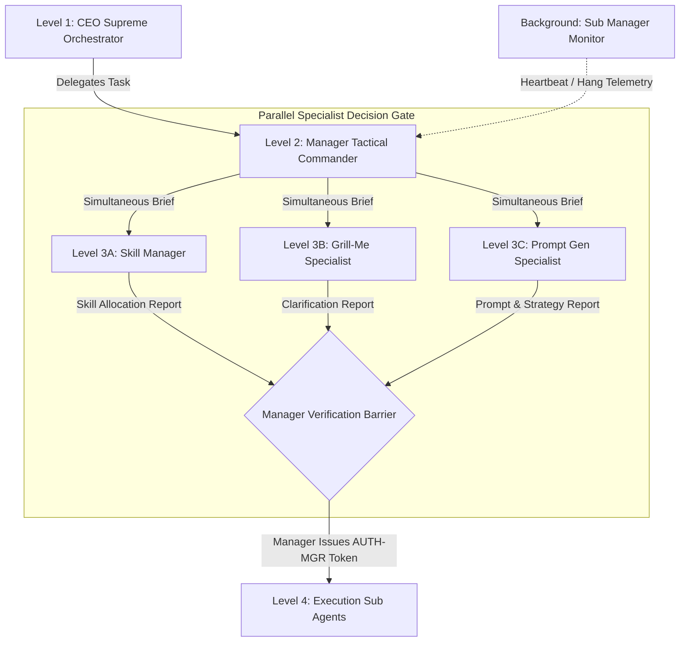
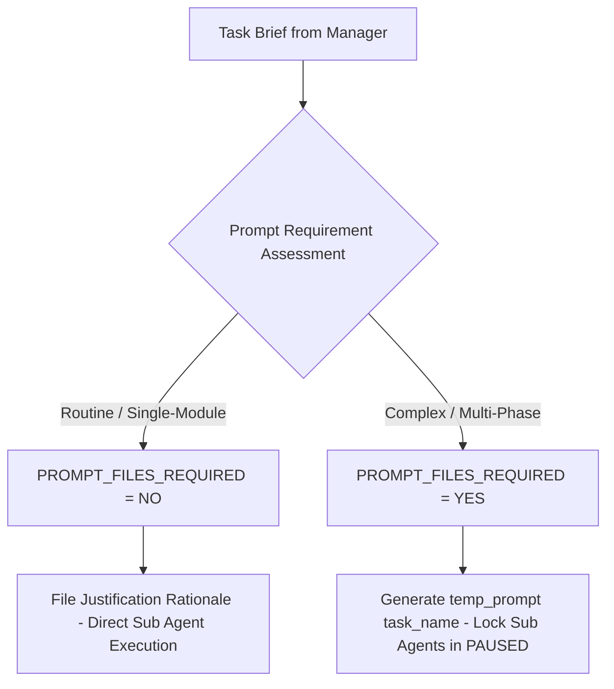
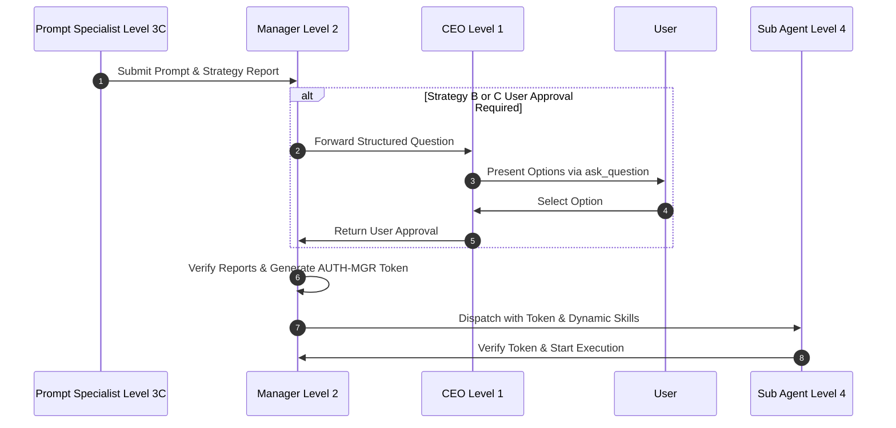

# Phase-wise Prompt Generation Architecture

> **Authoritative Specification & Governance:**
> - **Specialist Role:** Level 3C Phase-wise Prompt Generation Specialist (`prompt_generation_specialist`)
> - **System Architecture:** [`architecture_recommendation.md`](architecture_recommendation.md)
> - **Foundation Operating Rules:** [`foundation_and_special_rules.md`](foundation_and_special_rules.md)
> - **Master Rules Navigator:** [`master_rules_navigator.md`](master_rules_navigator.md)
> - **Lead Department:** [`01_product_requirements_dept.md`](01_product_requirements_dept.md)
> - **Active Working Memory:** [`memory.md`](file:///C:/Users/Atul%20Verma/.gemini/memory.md)

---

## 🏛️ 1. Executive Authority & Specialist Role

This document establishes the authoritative system architecture and governance protocol for the **Level 3C: Phase-wise Prompt Generation Specialist** (`prompt_generation_specialist`). In accordance with the 4-Level Command Hierarchy, the Prompt Generation Specialist operates as a co-equal specialized advisory agent alongside the Level 3A Skill Manager and Level 3B Grill-Me Specialist within the Mandatory Parallel Specialist Decision Gate.

### 1.1 Constitutional Mandate & Boundaries
- **Exclusive Reporting Line:** The Specialist reports directly and exclusively to the Level 2 Manager.
- **Strict Isolation:** The Specialist never contacts the Level 1 CEO or the human User directly, and never issues execution directives directly to Level 4 Sub Agents.
- **Non-Bypassable Governance:** No agent, subagent, or execution runtime may waive, bypass, or override this architecture without prior explicit User Approval recorded in the decision ledger.

---

## 🚦 2. Mandatory Prompt Requirement Assessment (PROMPT_FILES_REQUIRED)

### 2.1 Explicit Decision Requirement
Upon receiving a task brief from the Level 2 Manager, the Prompt Generation Specialist MUST perform an explicit architectural assessment to evaluate `PROMPT_FILES_REQUIRED` as either `YES` or `NO`. This decision must be explicitly declared and recorded; it can never be assumed, defaulted, or bypassed.

### 2.2 Classification & Justification Criteria

| Value | Scope & Task Profile | Mandatory Justification Criteria | Execution Path |
| :--- | :--- | :--- | :--- |
| `PROMPT_FILES_REQUIRED = NO` | Routine, localized, single-module tasks (e.g., minor bugfixes, copy changes, single unit tests, documentation typos). | Formal rationale documenting task simplicity, localized blast radius, and absence of inter-phase dependencies. | Manager approves execution directly; Sub Agents execute without prompt artifacts. |
| `PROMPT_FILES_REQUIRED = YES` | Compound, multi-module, long-running, or multi-phase tasks (e.g., new features, architectural refactors, schema migrations, full-stack epics). | Comprehensive breakdown detailing phase boundaries, technical risks, verification gates, and cross-phase dependencies. | Specialist generates complete artifact suite in `temp_prompt/<task_name>/`; Sub Agents locked in PAUSED until certification. |

### 2.3 Strict Validation Gate
If a specialist report is submitted without an explicit boolean determination (`typeof promptFilesRequired !== 'boolean'`), the decision gate state machine immediately trips to `BLOCKED`. Assuming a default value of `NO` without assessment constitutes an anti-pattern violation.

---

## 📂 3. Ephemeral Workspace Container Architecture

When `PROMPT_FILES_REQUIRED = YES`, all prompt specifications, requirements documents, and tracking boards must be generated inside a dedicated ephemeral container:

`temp_prompt/<task_name>/`

### 3.1 Comprehensive Artifact Suite
The ephemeral container must house the following structured documents:

1. **`INDEX.md` (Live Tracking Board & Problem-Solution Dossier):**
   - Executive problem-solution summary.
   - Comprehensive Phase Status Checklist (Phase #, Name, Status, Agent, QA Signoff).
   - Universal 7-Column Diagnostic Impact Matrix:

| S.No | File | Root Cause | Proposed Fix | Post-Fix Impact | Phase # | Test Gate |
| :--- | :--- | :--- | :--- | :--- | :--- | :--- |
| 1 | `src/example.ts` | Detailed defect description | Surgical correction plan | Regression risk assessment | Phase 1 | `npm test` |

2. **`SUMMARY.md` (Executive Architecture Summary):**
   - High-level initiative scope and technical objectives.
   - Cross-phase milestone roadmap and dependency topology.
   - Risk mitigation and architectural tradeoff analysis.

3. **`PRD.md` (Product Requirements Document):**
   - User personas, functional requirements (FR), non-functional requirements (NFR).
   - INVEST-compliant user stories and MoSCoW feature prioritization.
   - Rigorous Given-When-Then acceptance criteria contracts.

4. **`TRD.md` (Technical Requirements Document):**
   - Low-Level & High-Level Design (HLD/LLD) specifications.
   - Data contracts, API schema definitions, and state transition maps.
   - Security controls, authorization gates, and error budgets.

5. **`DESIGN.md` (Design System & UI Tokens):**
   - Mandatory for user-facing features: color tokens, typography scales, spacing grids.
   - WCAG 2.1 AA accessibility guidelines and interactive component states.

6. **Dedicated Phase Prompts (`phase_01_<name>.md`, `phase_02_<name>.md`, ...):**
   - Completely self-contained, standalone executable instruction sets for each phase.

### 3.2 Anatomy of a Standalone Phase Prompt
Each phase prompt file must contain all context required for an execution subagent to complete its slice without missing dependencies:
- **Phase Objective:** Unambiguous statement of what this specific phase delivers.
- **Prerequisites & Inputs:** Required files, prior phase deliverables, and environment state.
- **Technical Context & File Anchors:** Line-specific anchors linking to target files.
- **Surgical Step-by-Step Instructions:** Concrete, non-ambiguous modification steps.
- **Architectural Constraints & Boundaries:** Strict Out-of-Scope boundaries to prevent sprawl.
- **Deliverables Manifest:** List of created or edited files and documentation entries.
- **Local Verification Gate:** Deterministic commands (`npm run lint`, `npm test`, `npm run build`) that must pass 100% clean before phase signoff.

---

## 🔒 4. Execution Gate During Prompt Generation

### 4.1 Strict Subagent Lockout
While the Prompt Generation Specialist is actively researching, drafting, and validating prompt files:
- All Level 4 Execution Sub Agents remain strictly **PAUSED / UNASSIGNED**.
- No file edits, deletions, or source modifications are permitted.
- The gate state machine remains in `WAITING_FOR_SPECIALISTS` or `WAITING_FOR_BOTH_REPORTS`.

### 4.2 Gate Clearance Condition
The execution barrier is lifted ONLY when:
1. All active specialists have submitted verified reports.
2. If `PROMPT_FILES_REQUIRED = YES`, all prompt files are generated and validated on disk.
3. The Level 2 Manager inspects the artifacts, evaluates risks, and formally issues `APPROVED_FOR_EXECUTION`.

---

## 🧭 5. Execution Strategy Assessment

The Prompt Generation Specialist must evaluate the implementation scope and formally recommend one of three execution strategies:

### 5.1 Strategy A: Fully Autonomous Phase-wise Execution
- **Profile:** Well-defined scope, complete requirements, minimal ambiguity, and low external risk.
- **Workflow:** Manager delegates Phase 1 through Phase N sequentially to Sub Agents. Each phase runs local test gates; execution transitions autonomously to the next phase upon Grade A+ signoff without intermediate user pauses.
- **Target Autonomy Score:** 1.0.

### 5.2 Strategy B: Single User Consultation
- **Profile:** Standard complexity with critical upfront design choices or architectural forks.
- **Workflow:** Manager presents the complete phase-wise prompt plan to the user upfront via CEO (`ask_question`). Once user grants approval, all phases execute autonomously to completion.
- **Target Autonomy Score:** 0.8.

### 5.3 Strategy C: Phase-by-Phase User Consultation
- **Profile:** High ambiguity, exploratory spikes, multi-vendor integrations, or disruptive database migrations.
- **Workflow:** Manager presents each phase plan and deliverables to the user for formal approval before authorizing the subsequent phase.
- **Target Autonomy Score:** 0.3 - 0.5.

### 5.4 Strategy Recommendation Contract
The Specialist's report must include:
- Selected strategy (`STRATEGY_A_AUTONOMOUS`, `STRATEGY_B_SINGLE_CONSULTATION`, `STRATEGY_C_PHASE_CONSULTATION`).
- Explicit rationale and trade-off justification.
- Key dependency roster and risk analysis.
- Calculated autonomy score.

---

## 👑 6. Manager-Only Execution Release & Strict Routing

### 6.1 Unidirectional Routing Architecture
All communication and advisory handoffs follow strict unidirectional paths:

1. **Specialist to Manager:** Prompt Specialist submits `Prompt & Strategy Report` to Manager.
2. **Manager Evaluation:** Manager verifies reports from Skill Manager, Grill-Me Specialist, and Prompt Specialist.
3. **Manager to CEO (When Needed):** If Strategy B or C requires user alignment, Manager forwards questions to CEO.
4. **CEO to User:** CEO presents options using `ask_question`. User responses route back User -> CEO -> Manager.
5. **Manager Authorization:** Manager sets state to `APPROVED_FOR_EXECUTION` and generates cryptographic `AUTH-MGR-*` token.
6. **Sub Agent Verification:** Level 4 Sub Agents verify active token before touching code.

### 6.2 Strict Invariant
Sub Agents are constitutionally prohibited from executing instructions without an active, unexpired authorization token issued by the Manager.

---

## 📡 7. Sub Manager Compliance & Stalled-Task Monitoring

The background **Sub Manager** continuously inspects the active process table and decision gate state:
- **Telemetry Inspection:** Regularly polls process states via `manage_task` with action `list`.
- **Hang & Timeout Sentinel:** If prompt generation or specialist advisory remains in a waiting state for longer than the timeout threshold (default 600s), the Sub Manager raises an immediate alert to the Manager and trips the gate state to `BLOCKED`.
- **Zero Zombie Guarantee:** Stalled, crashed, or unresponsive subagent processes are flagged for immediate termination.

---

## 🧹 8. Ephemeral Lifecycle & Post-QA Hygiene

### 8.1 Knowledge Crystallization
Upon successful completion of all phases and independent QA Grade A+ certification:
1. Architectural decisions, schema changes, and defect resolutions are crystallized into [`memory.md`](file:///C:/Users/Atul%20Verma/.gemini/memory.md) and `project_feature_memory.md`.
2. All modifications are logged to the 5-tier changes log per Rule 6.
3. Commits are recorded locally per Rule 15.

### 8.2 Safe Pruning of Ephemeral Workspaces
Once all permanent records are anchored, the temporary workspace `temp_prompt/<task_name>/` is safely pruned to maintain a clean repository root and eliminate workspace clutter.
