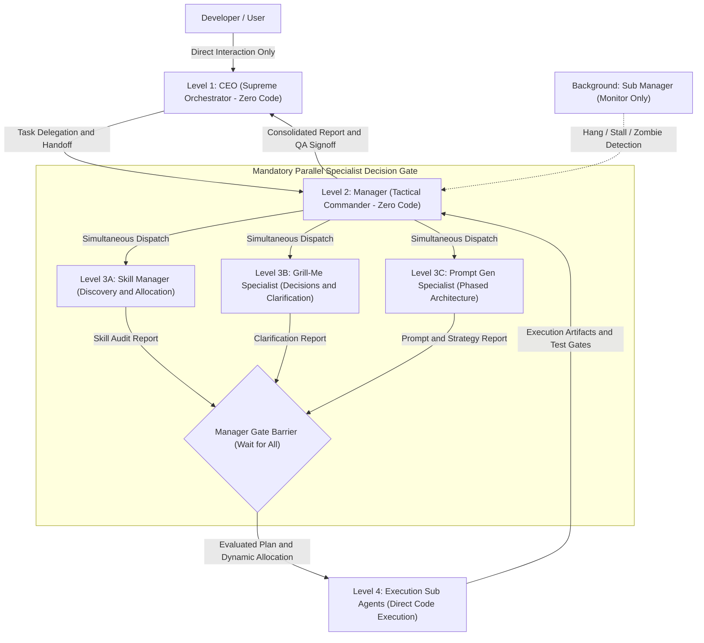
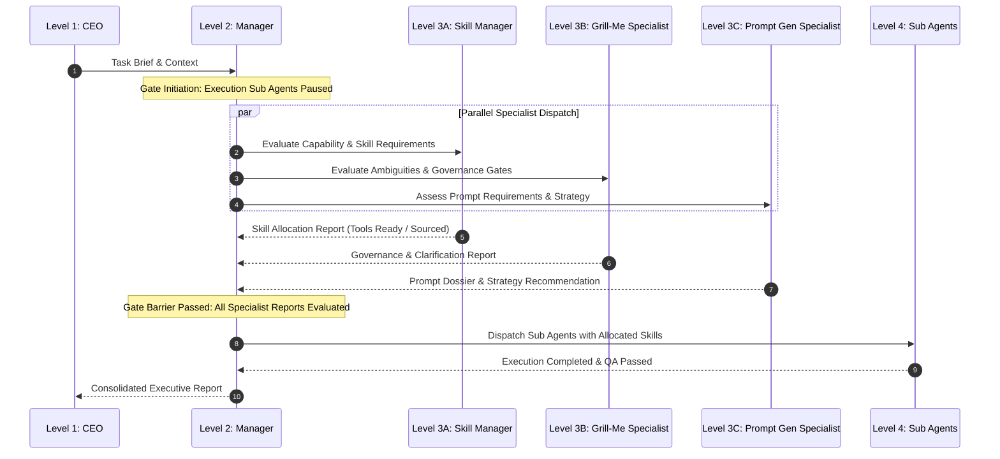
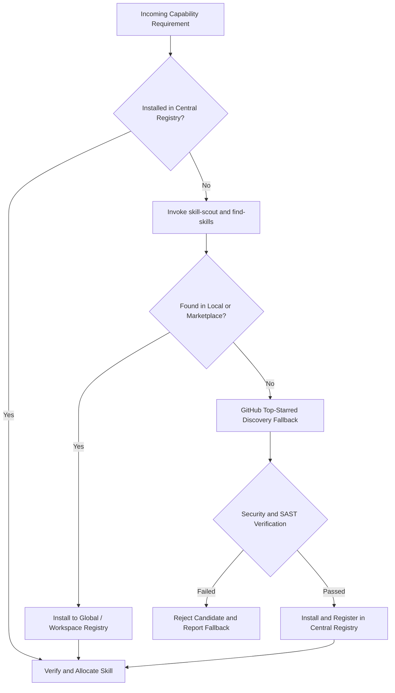

# ARCHITECTURE RECOMMENDATION

> **Universal System Architecture Reference:**
> - **Master Rules Navigator:** [`master_rules_navigator.md`](master_rules_navigator.md)
> - **Foundation Operating Rules:** [`foundation_core.md`](foundation_core.md)
> - **Prompt Architecture:** [`PHASE_WISE_PROMPT_GENERATION_ARCHITECTURE.md`](PHASE_WISE_PROMPT_GENERATION_ARCHITECTURE.md)
> - **Active Working Memory:** [`memory.md`](file:///C:/Users/Atul%20Verma/.gemini/memory.md)
> - **Developer Profile:** Atul Verma (`aiprincekumar` / `aiprincekumar010100@gmail.com` / [GitHub Profile](https://github.com/aiprincekumar))

---

## 🏛️ 1. Executive Overview & Architectural Scope

This document establishes the official enterprise architecture for autonomous subagent coordination, dynamic skill discovery, capability lifecycle governance, and the 4-Level Command Hierarchy across the Antigravity operating system. It codifies the separation of responsibilities between executive orchestration, tactical management, specialist advisory gates, and granular task execution.



---

## 🎖️ 2. The 4-Level Command Hierarchy & Operational Roles

### 2.1 Level 1: CEO (Supreme Orchestrator & User Interface)
- **Primary Function:** Sole interface with the human developer. Maintains global mission focus, high-level roadmaps, and final QA verification review.
- **Operational Boundaries:**
  - The CEO communicates exclusively with the User and the Level 2 Manager.
  - The CEO **NEVER** directly assigns tasks to Sub Agents (Level 4) or bypasses the Manager.
  - Receives consolidated completion reports from the Manager and delivers synthesized executive responses to the user.
  - When user decisions are required, presents structured questions generated by the Level 3 Grill-Me Specialist (routed via Manager) using `ask_question`.

### 2.2 Level 2: Manager (Parallel Sub-Agent Commander)
- **Primary Function:** Central tactical commander responsible for task breakdown, parallel scheduling, specialist gate coordination, dynamic skill allocation, and subagent dispatch.
- **Level 2 Manager Zero-Code Hard Lock:**
  - **Ironclad Zero-Code Prohibition:** Level 2 Tactical Manager is strictly prohibited from mutating application code, editing files, applying patches, creating assets, or writing test suites directly.
  - **Mandatory Subagent Delegation (Level 2 -> Level 4):** For ANY code writing, file editing, refactoring, bug fixing, test suite execution, or verification, Level 2 **MUST DELEGATE** to dedicated Level 4 Execution Sub-Agents via `invoke_subagent`. Direct code mutation by Level 2 is a fatal constitutional breach.
- **Operational Boundaries:**
  - Receives decomposed task directives from Level 1 CEO.
  - Enforces the **Mandatory Parallel Specialist Decision Gate**: dispatches task simultaneously to Level 3 specialists (Skill Manager, Grill-Me Specialist, Prompt Generation Specialist) and **waits for all reports**.
  - Evaluates specialist findings, resolves clarifications (via CEO), assigns dynamic skills, issues authorization tokens (`AUTH-MGR-*`), and dispatches Level 4 Sub Agents.
  - Monitors execution health via telemetry from Sub Manager (Monitor).
  - Consolidates subagent outputs, validates verification test suites, and submits a unified report to the CEO.

### 2.3 Level 3: Specialized Advisory Agents
Level 3 specialists advise the Manager before any code or file mutation occurs. They do not execute project implementation tasks directly.

#### A. Skill Manager (Skill Discovery, Verification & Allocation)
- **Primary Scope:** Audits capability requirements, discovers existing skills, resolves missing toolchains, verifies security postures, and maps optimal skill packages to target subagents.
- **Primary Tools:** Directly leverages `skill-scout` and `find-skills` as core discovery mechanisms across local repositories, installed plugin directories, and the Agent Marketplace.
- **Fallback Discovery:** When internal registries lack a required capability, autonomously discovers reputable, high-starred GitHub repositories and marketplace candidates.
- **Reporting Contract:** Delivers a structured `Skill Allocation Report` to the Manager specifying required skills, verified locations, security audits, and per-subagent assignments.

#### B. Grill-Me Specialist (User Clarification, Decision & Governance Manager)
- **Primary Scope:** Analyzes user prompts for architectural ambiguities, trade-offs, and implicit edge cases; governs the interactive question gate and Rule 15 Git verification.
- **Decision Engine:**
  - Evaluates whether user clarification is strictly necessary. For unambiguous or read-only tasks, returns an immediate "Clear to Execute" signal.
  - When essential trade-offs exist, formats concise, high-value multiple-choice questions with a recommended option marked as `(Recommended)`.
  - Routes question payloads up to the Manager -> CEO -> User via `ask_question`.
- **GitHub Rule 15 Integration:** Pre-checks upstream online existence (`git ls-remote --exit-code origin`). If the repository has never been pushed online, flags remote push questions as inactive (local-only commit cadence). If verified online, prepares the standardized 2-option interactive completion gate.
- **Reporting Contract:** Delivers a `Clarification & Governance Report` to the Manager confirming either resolution of all ambiguities or a zero-clarification clearance.

#### C. Phase-wise Prompt Generation Specialist (Phased Architecture & Strategy Governance)
- **Authoritative Specification:** Codified and governed by [`PHASE_WISE_PROMPT_GENERATION_ARCHITECTURE.md`](PHASE_WISE_PROMPT_GENERATION_ARCHITECTURE.md).
- **Primary Scope:** Evaluates prompt requirements (`PROMPT_FILES_REQUIRED` = `YES` / `NO`), architectures self-contained phase prompts and specifications in `temp_prompt/<task_name>/`, pauses execution subagents during generation, and evaluates implementation strategies (Strategy A, B, C).
- **Mandatory Assessment:** Evaluates on every task. For routine tasks (`PROMPT_FILES_REQUIRED = NO`), advises direct execution. For complex tasks (`PROMPT_FILES_REQUIRED = YES`), generates the complete ephemeral artifact suite per [`PHASE_WISE_PROMPT_GENERATION_ARCHITECTURE.md`](PHASE_WISE_PROMPT_GENERATION_ARCHITECTURE.md).
- **Reporting Contract:** Reports directly to the Manager. Never contacts CEO or User directly; Manager routes questions via CEO -> User. Never assigns execution tasks directly to Sub Agents.

### 2.4 Level 4: Execution Sub Agents (Actual Task Execution)
- **Primary Scope:** Domain-specific execution subagents (e.g., Frontend Engineers, Backend Engineers, DBA, Test Engineers, Technical Writers) operating under their respective departmental rules (`01_` through `14_`).
- **Operational Boundaries & Sole Execution Authority:**
  - Level 4 Sub Agents possess **SOLE EXECUTION AUTHORITY** to write application code, modify codebase files, create implementation assets, and run test suites.
  - Sub Agents are **NEVER** dispatched until the Manager has formally cleared the Parallel Specialist Decision Gate.
  - Sub Agents receive pre-allocated skill bindings and execute strictly within their assigned departmental scope.
  - Sub Agents report execution logs, changes, and test proofs directly back to the Manager.

### 2.5 Background Operational Role: Sub Manager (Parallel Sub-Agent Monitor)
- **Primary Scope:** Continuous, passive background health and process monitor (renamed from former Manager monitor).
- **Operational Boundaries:**
  - The Sub Manager possesses **NO** task-assignment, planning, or delegation authority.
  - Operates continuously in the background using `manage_task` with action `list` to inspect subagent process states.
  - Detects zombie processes, stalled tasks, unhandled exceptions, and port lockups (Rule 26).
  - Immediately reports telemetry alerts and hang notifications directly to the Manager for automated or corrective intervention.

---

## 🚦 3. Mandatory Parallel Specialist Decision Gate

The Parallel Specialist Decision Gate is a mandatory synchronization barrier executed on every task:



### 3.1 Gate Execution Rules
1. **Synchronous Parallel Dispatch:** When the CEO delegates a task, the Manager immediately issues identical contextual briefs to Skill Manager, Grill-Me Specialist, and Prompt Generation Specialist in parallel.
2. **Absolute Subagent Lockout:** No Level 4 Sub Agent may be invoked, queued, or instructed until all Level 3 specialist reports have been validated and required prompt files are ready.
3. **Clarification & Strategy Precedence:** If Grill-Me identifies blocking ambiguities or Prompt Gen recommends Strategy B/C user consultation, task execution is held while questions route through Manager -> CEO to User via `ask_question`. Subagent dispatch resumes only upon receiving user clarification.
4. **Tooling Readiness Mandate:** If the Skill Manager determines that a critical skill or tool is missing, subagent dispatch is held until the skill is discovered, verified, and installed.

### 3.2 Enforceable 10-State Execution Machine
The Specialist Decision Gate operates as a deterministic, enforceable state machine persisted in `.agents/state/decision_gate_state.json`:

| State # | Canonical State Name | Active Role & Trigger Event | Operational Condition & Invariant |
| :--- | :--- | :--- | :--- |
| **01** | `WAITING_FOR_SPECIALISTS` | Manager dispatches task brief | Tasks issued simultaneously to Skill Manager, Grill-Me Specialist, and Prompt Gen Specialist; subagents locked. |
| **02** | `SKILL_MANAGER_COMPLETED` | Skill Manager submits verified report | Skill Allocation Report validated; other specialists still pending. |
| **03** | `GRILL_ME_COMPLETED` | Grill-Me submits verified report | Governance Report validated; other specialists still pending. |
| **04** | `WAITING_FOR_BOTH_REPORTS` | System acknowledges first report | Active hold barrier waiting for remaining specialist reports before decision. |
| **05** | `READY_FOR_MANAGER_DECISION` | All reports validated clean | All specialist reports verified; prompt files ready (if required); awaiting Manager evaluation. |
| **06** | `WAITING_FOR_USER_CLARIFICATION` | Clarification or consultation required | Execution tasks blocked until user responds via `ask_question` (Grill-Me ambiguity or Strategy B/C consultation). |
| **07** | `APPROVED_FOR_EXECUTION` | Manager signs authorization token | **Strict Condition:** ONLY Manager can set this state and generate `AUTH-MGR-*` token. |
| **08** | `EXECUTING` | Sub Agent verifies authorization | Sub Agent validates state is `APPROVED_FOR_EXECUTION` before executing any task. |
| **09** | `BLOCKED` | Specialist error, missing report, or timeout | Execution blocked; failed/missing reports never treated as success. Sub Manager flags. |
| **10** | `COMPLETED` | QA certifies Grade A+ signoff | Final verification passed, changes logged, and state machine closed. |

### 3.3 State Machine Enforcement & Verification
- **Automated State Ledger:** Persisted at `.agents/state/decision_gate_state.json` and monitored by the Sub Manager.
- **Verification Command:** Certified via `npm run test:decision-gate`.

---

## 🗄️ 4. Central Skill Registry Architecture

The Central Skill Registry serves as the canonical Single Source of Truth (SSOT) for all capabilities within the Antigravity ecosystem.

### 4.1 Storage Topology & Precedence
Skills are indexed across three standardized tiers:
1. **Project-Local Skills (`<workspace>/.gemini/skills/`):** Highest priority; specialized for local project tooling, frameworks, and domain patterns.
2. **User Global Skills (`config/skills/` and `agent-skills/`):** Medium priority; ecosystem-wide workflows, language patterns, and engineering standards.
3. **Built-in System Skills (`builtin/skills/`):** Base fallback capabilities provided natively by the Antigravity runtime.

### 4.2 Central Skill Manifest Schema
The Skill Manager tracks available skills using a normalized index:
```json
{
  "registryVersion": "1.0.0",
  "skills": {
    "skill-scout": { "name": "skill-scout", "version": "1.2.0", "scope": "global", "verified": true }
  }
}
```

---

## 🔎 5. Skill Discovery Architecture & Tool Integration

### 5.1 Discovery Workflow Cascade
When an incoming task requires capabilities outside base runtime tools, the Skill Manager executes a 3-tier discovery cascade:



### 5.2 Deep `skill-scout` and `find-skills` Integration
- Leverages `skill-scout` to systematically query local registries, Agent Marketplace, and community hubs.
- Leverages `find-skills` for keyword, semantic, and tag-based correlation against installed skills.
- Runs token-efficient discovery by inspecting `SKILL.md` frontmatter before loading full body content.

---

## 🔒 6. Skill Verification, Security & Governance

Every newly discovered or external skill must pass strict security checks before activation:
1. **SAST Code Inspection:** Audit bundled scripts for arbitrary remote code execution and unpinned downloads.
2. **Credential & Secret Scan:** Enforce zero hardcoded tokens, API keys, or remote telemetry endpoints.
3. **Least Privilege:** Verify that the skill requests only necessary filesystem, CLI, or network capabilities.
4. **Sandbox Compliance:** External scripts must operate strictly within workspace bounds and respect Rule 0 (Zero-Scan).

---

## 📦 7. Versioning, Rollback & Lifecycle Governance

### 7.1 Semantic Versioning & Immutability
- All custom and installed skills must maintain Semantic Versioning (`MAJOR.MINOR.PATCH`) in their `SKILL.md`.
- Breaking changes mandate a MAJOR version bump and Manager compatibility review.

### 7.2 Rollback Policy
- When a newly installed skill causes subagent execution errors or test regressions, the Manager rolls back:
  1. Unload faulty skill from active subagent context.
  2. Restore the previous stable version from `Manual_Backup/` or system cache.
  3. Log incident in `project_feature_memory.md` and alert Level 1 CEO.

---

## ⚙️ 8. Dynamic Skill Allocation & Subagent Compatibility

### 8.1 Model Tier and Capability Matrix
Skills must be matched dynamically to subagents based on task complexity and model performance tiers (Rule 25):

| Task Complexity | Target Model Tier | Skill Type Mapped | Allocation Directives |
| :--- | :--- | :--- | :--- |
| **Low / Routine** | `flash_lite` | Text formatting, changelogs, git sync | Lightweight, deterministic runner scripts |
| **Medium / Feature** | `flash` | Framework engineering, TDD, UI styling | Domain skills (e.g. `react-patterns`, `shadcn-ui`) |
| **High / Complex** | `pro` | Architecture, security SAST, deep debugging | Comprehensive analysis skills, full audit suites |

### 8.2 Subagent Invocation Injection
The Manager injects allocated skills directly into subagent dispatch prompts, referencing exact filesystem paths:
`"Mandatory Skill Activated: Read and follow instructions in C:\Users\Atul Verma\.gemini\config\skills\<skill_name>\SKILL.md before execution."`

---

## 📝 9. Skill Assignment Tracking & Duplicate Prevention

### 9.1 Mandatory Audit Logging
- Every skill allocated to an active task must be recorded in Section 0 of [`memory.md`](file:///C:/Users/Atul%20Verma/.gemini/memory.md) and in the task changes log (`changes_log/`).
- Telemetry records the skill name, version, source, and invoking subagent role.

### 9.2 Zero-Duplicate Creation Guard
- Prior to creating or authoring any new skill, the Skill Manager performs a full duplicate verification check across existing global and local directories.
- If an equivalent capability exists, the creation request is rejected, and the existing skill is allocated instead.

---

## 🔮 10. Future Skill Architecture Recommendations

Recommended architectural evolutions for ecosystem scalability:
1. **Semantic Vector Indexing:** Transition to SQLite-vector embeddings for sub-millisecond intent matching.
2. **Automated Eval Harnesses:** Synthetic eval suites executing test prompts against newly installed skills.
3. **Autonomous Garbage Collection:** 30-day LRU skill pruner to archive unused experimental skills.
4. **Agent Compatibility Contracts:** JSON schema contracts for subagent tool inputs/outputs.

---

## 📋 11. Mandatory Future Prompt Generation Standard

Whenever generating system prompts, orchestration prompts, or phase execution decks, agents must strictly uphold:
1. **The 4-Level Command Hierarchy:** Level 1 CEO (Zero-Code) -> Level 2 Manager (Zero-Code) -> Level 3 Specialists (Parallel Advisory Gate) -> Level 4 Sub Agents (Exclusive Code Execution), with Sub Manager monitor.
2. **The Parallel Specialist Decision Gate:** Simultaneous dispatch to Level 3, manager barrier wait, and subagent hold until certified.
3. **Rule 15 GitHub Upstream Verification:** Suppress remote push questions for local-only repos; 2-option interactive gate for online repos.
4. **Architectural Separation:** Adherence to `memory.md` (State), [`PHASE_WISE_PROMPT_GENERATION_ARCHITECTURE.md`](PHASE_WISE_PROMPT_GENERATION_ARCHITECTURE.md) (Prompts), and `architecture_recommendation.md` (Topology).
