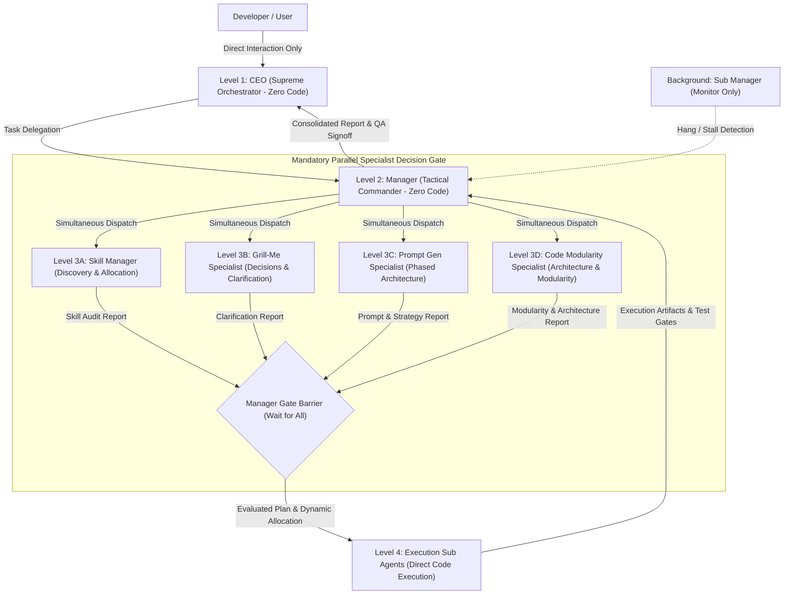
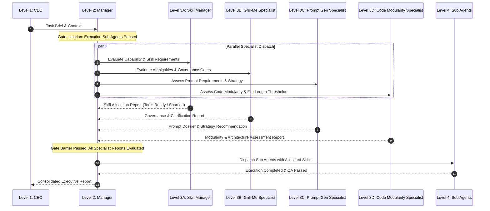
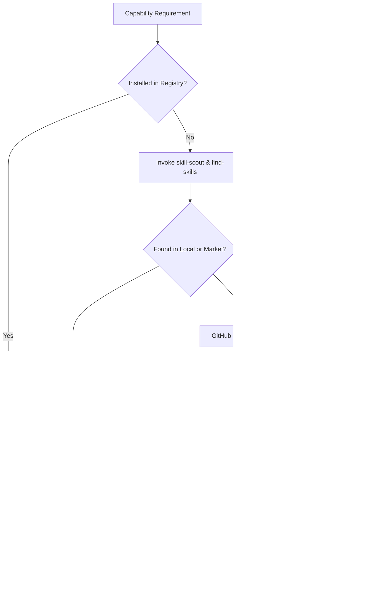

# ARCHITECTURE RECOMMENDATION

> **Universal System Architecture Reference:**
> - **Master Rules Navigator:** [`master_rules_navigator.md`](master_rules_navigator.md)
> - **Foundation Operating Rules:** [`foundation_core.md`](foundation_core.md)
> - **Prompt Architecture:** [`PHASE_WISE_PROMPT_GENERATION_ARCHITECTURE.md`](PHASE_WISE_PROMPT_GENERATION_ARCHITECTURE.md)
> - **Active Working Memory:** [`memory.md`](file:///C:/Users/Atul%20Verma/.gemini/memory.md)
> - **Developer Profile:** Atul Verma (`aiprincekumar` / `aiprincekumar010100@gmail.com` / [GitHub Profile](https://github.com/aiprincekumar))

---

## 🏛️ 1. Executive Overview & Architectural Scope

This document establishes the enterprise architecture for autonomous subagent coordination, dynamic skill discovery, and the 4-Level Command Hierarchy across Antigravity.



---

## 🎖️ 2. The 4-Level Command Hierarchy & Operational Roles

### 2.1 Level 1: CEO (Supreme Orchestrator & User Interface)
- **Primary Function:** Exclusive interface with the human developer. Maintains global vision, strategy, and final QA review.
- **Operational Boundaries:**
  - Communicates exclusively with User and Level 2 Manager; never assigns tasks directly to Level 4 Sub Agents.
  - Presents interactive questions generated by Level 3 Grill-Me Specialist (via Manager) using `ask_question`.
  - Delivers synthesized executive responses to user from consolidated Manager reports.

### 2.2 Level 2: Manager (Parallel Sub-Agent Commander)
- **Primary Function:** Central tactical commander responsible for task decomposition, parallel scheduling, specialist gate coordination, dynamic skill allocation, and subagent dispatch.
- **Level 2 Manager Zero-Code Hard Lock:**
  - **Zero-Code Prohibition:** Strictly prohibited from mutating application code, editing files, applying patches, or writing test suites directly.
  - **Mandatory Subagent Delegation:** For ANY code writing, file editing, refactoring, bug fixing, test execution, or verification, Level 2 **MUST DELEGATE** to dedicated Level 4 Execution Sub-Agents via `invoke_subagent`. Direct code mutation by Level 2 is a fatal constitutional breach.
- **Absolute Anti-Bypass Hard Lock (Zero-Skip Level 3):**
  - Constitutionally prohibited from skipping ANY Level 3 Specialist (Skill Manager, Grill-Me, Prompt Gen, Code Modularity).
  - MUST simultaneously dispatch to all four specialists and wait for all reports before issuing an authorization token (`AUTH-MGR-*`).
- **Operational Boundaries:**
  - Enforces the **Mandatory Parallel Specialist Decision Gate**: dispatches task simultaneously to Level 3 specialists and waits for all reports.
  - Evaluates specialist findings, resolves clarifications (via CEO), assigns dynamic skills, issues authorization tokens (`AUTH-MGR-*`), and dispatches Level 4 Sub Agents.
  - Monitors execution health via telemetry from Sub Manager (Monitor).
  - Consolidates subagent outputs, validates verification test suites, and submits unified reports to CEO.

### 2.3 Level 3: Specialized Advisory Agents
Level 3 specialists advise the Manager before any code or file mutation occurs. They do not execute project implementation tasks directly.

#### A. Skill Manager (Skill Discovery, Verification & Allocation)
- **Primary Scope:** Audits capabilities, discovers skills, enforces security verification, and allocates optimal skills using `skill-scout` and `find-skills`.
- **Output:** Submits formal Skill Allocation Report to Manager.

#### B. Grill-Me Specialist (User Clarification, Decision & Governance Manager)
- **Primary Scope:** Interrogates requirements, analyzes ambiguities, verifies GitHub upstream existence, and formats structured multiple-choice questions with `(Recommended)` prefix.
- **Output:** Routes clarification through Manager -> CEO to user via `ask_question`. Submits Governance Report to Manager.

#### C. Phase-wise Prompt Generation Specialist (Phased Architecture & Strategy Governance)
- **Primary Scope:** Governed by [`PHASE_WISE_PROMPT_GENERATION_ARCHITECTURE.md`](PHASE_WISE_PROMPT_GENERATION_ARCHITECTURE.md). Assesses prompt requirements (`PROMPT_FILES_REQUIRED` = `YES`/`NO`), architectures self-contained phase prompts in `temp_prompt/<task_name>/`, pauses execution subagents during generation, evaluates 3 implementation strategies (A: Autonomous, B: Single Consultation, C: Phase-by-Phase), and delivers Prompt & Strategy Report to Manager.

#### D. Code Modularity & Scalable Architecture Specialist (Modularity & File Thresholds)
- **Primary Scope:** Governed by Universal Rule 28. Audits codebases against file length thresholds (target < 500 lines, warning 500–700 lines, mandatory hard split > 700 lines or > 24 KB), enforces function length <= 50 lines and nesting depth <= 4, evaluates architectural modularity (Clean Architecture, DDD, Feature-Sliced modularity), and designs scalable directory topologies for +1,000 future lines.
- **Output:** Submits formal Modularity & Architecture Assessment Report to Manager before subagent execution.

### 2.4 Level 4: Execution Sub Agents (Actual Task Execution)
- **Sole Execution Authority:** Dedicated domain specialists operating under [`dynamic_departments_matrix.md`](dynamic_departments_matrix.md).
- **Exclusive Coding Authority:** The ONLY agents permitted to write application code, modify codebase files, create implementation assets, and run test suites.
- **Pre-requisite:** Dispatched ONLY after Manager clears Decision Gate barrier and issues authorization token (`AUTH-MGR-*`).

### 2.5 Background Operational Role: Sub Manager (Parallel Sub-Agent Monitor)
- **Primary Scope:** Continuous passive background health, lifecycle, and process monitor.
- **Operational Boundaries:**
  - Possesses **NO** task-assignment, planning, or delegation authority.
  - Inspects subagent process states using `manage_task` with action `list`.
  - Detects zombie processes, stalled tasks, unhandled exceptions, and port lockups (Rule 26).
  - Reports telemetry alerts and hang notifications directly to the Manager.
- **Server Restart Resumption & Session Recovery Protocol:**
  - **Inspection & Reconstruction:** On server restart, session reload, or `[Notice]` indicating stopped tasks, Sub Manager & Manager immediately inspect Section 0 of [`memory.md`](file:///C:/Users/Atul%20Verma/.gemini/memory.md) and `.agents/state/decision_gate_state.json` without running blind recursive scans.
  - **State & Token Reconciliation:** Verify last recorded `taskId`, `currentState`, and active `AUTH-MGR-*` token to reconstruct exact execution boundaries.
  - **Dead Lock & Port Clearance:** Inspect stopped background tasks via `manage_task` with action `list`, clean orphaned PID locks, verify port availability, and terminate stale listeners before re-binding.
  - **Deterministic Resumption:** Manager resumes pending work from exact uncompleted milestone with zero duplicated tokens, zero repeated work, and zero redundant discovery scans.

---

## 🚦 3. Mandatory Parallel Specialist Decision Gate

The Parallel Specialist Decision Gate is a mandatory synchronization barrier executed on every task:



### 3.1 Gate Execution Rules
1. **Synchronous Parallel Dispatch:** Manager immediately issues identical contextual briefs to all 4 specialists simultaneously.
2. **Absolute Subagent Lockout:** No Level 4 Sub Agent may be invoked until all Level 3 reports are validated and required prompt files are ready.
3. **Clarification Precedence:** Blocking ambiguities or Strategy B/C consultations pause execution while questions route through Manager -> CEO to User via `ask_question`.
4. **Tooling Readiness Mandate:** Missing skills hold dispatch until discovered, verified, and installed.
5. **Anti-Bypass Lockout:** Bypassing the gate or skipping any specialist triggers an immediate `BLOCKED` state (Gate State 09).

### 3.2 Enforceable 10-State Execution Machine
Deterministic state machine persisted in `.agents/state/decision_gate_state.json`:

| State # | Canonical State Name | Active Role & Trigger Event | Operational Condition & Invariant |
| :--- | :--- | :--- | :--- |
| **01** | `WAITING_FOR_SPECIALISTS` | Manager dispatches task brief | Tasks issued simultaneously to all 4 specialists; subagents locked. |
| **02** | `SKILL_MANAGER_COMPLETED` | Skill Manager submits verified report | Skill Allocation Report validated; other specialists pending. |
| **03** | `GRILL_ME_COMPLETED` | Grill-Me submits verified report | Governance Report validated; other specialists pending. |
| **04** | `WAITING_FOR_BOTH_REPORTS` | System acknowledges first report | Active hold barrier waiting for remaining specialist reports. |
| **05** | `READY_FOR_MANAGER_DECISION` | All reports validated clean | All 4 specialist reports verified; prompt files ready; awaiting Manager decision. |
| **06** | `WAITING_FOR_USER_CLARIFICATION` | Clarification or consultation required | Execution tasks blocked until user responds via `ask_question`. |
| **07** | `APPROVED_FOR_EXECUTION` | Manager signs authorization token | **Strict Condition:** ONLY Manager can set this state and generate `AUTH-MGR-*` token. |
| **08** | `EXECUTING` | Sub Agent verifies authorization | Sub Agent validates state is `APPROVED_FOR_EXECUTION` before executing any task. |
| **09** | `BLOCKED` | Specialist error, timeout, or bypass attempt | Execution blocked; failed reports, timeouts, or unauthorized attempts never treated as success. |
| **10** | `COMPLETED` | QA certifies Grade A+ signoff | Final verification passed, changes logged, and state machine closed. |

### 3.3 State Machine Enforcement & Verification
- **Automated State Ledger:** Persisted at `.agents/state/decision_gate_state.json` and monitored by Sub Manager.
- **Verification Command:** Certified via `npm run test:decision-gate`.

---

## 🗄️ 4. Central Skill Registry Architecture

Single Source of Truth (SSOT) for all capabilities within Antigravity:
1. **Project-Local Skills (`<workspace>/.gemini/skills/`):** Highest priority; specialized project patterns.
2. **User Global Skills (`config/skills/` and `agent-skills/`):** Medium priority; ecosystem workflows and standards.
3. **Built-in System Skills (`builtin/skills/`):** Base fallback runtime capabilities.

### 4.1 Central Skill Manifest Schema
Skill index tracking schema:
```json
{"registryVersion": "1.0.0", "skills": {"skill-scout": {"name": "skill-scout", "version": "1.2.0", "scope": "global", "verified": true}}}
```

---

## 🔎 5. Skill Discovery Architecture & Tool Integration

### 5.1 Discovery Workflow Cascade
When tasks require capabilities beyond base runtime tools, Skill Manager executes a 3-tier cascade:



### 5.2 Deep `skill-scout` and `find-skills` Integration
- Queries local registries, Agent Marketplace, and community hubs via `skill-scout`.
- Correlates keywords, tags, and semantics against installed capabilities via `find-skills`.
- Inspects `SKILL.md` frontmatter for token-efficient discovery before loading full body content.

---

## 🔒 6. Skill Verification, Security & Governance

1. **SAST Code Inspection:** Audit bundled scripts for remote execution and unpinned downloads.
2. **Credential & Secret Scan:** Zero hardcoded tokens, API keys, or telemetry endpoints.
3. **Least Privilege & Sandbox:** Request only necessary capabilities; operate within workspace bounds and Rule 0.

---

## 📦 7. Versioning, Rollback & Lifecycle Governance

### 7.1 Semantic Versioning & Immutability
All custom and installed skills maintain Semantic Versioning (`MAJOR.MINOR.PATCH`) in `SKILL.md`. Breaking changes mandate a MAJOR version bump and Manager review.

### 7.2 Rollback Policy
When an installed skill causes regressions, Manager unloads the faulty skill, restores the stable version from backup, logs the incident in `project_feature_memory.md`, and alerts Level 1 CEO.

---

## ⚙️ 8. Dynamic Skill Allocation & Subagent Compatibility

### 8.1 Model Tier and Capability Matrix
Skills are matched dynamically based on task complexity and model performance tiers (Rule 25):

| Task Complexity | Target Model Tier | Skill Type Mapped | Allocation Directives |
| :--- | :--- | :--- | :--- |
| **Low / Routine** | `flash_lite` | Text formatting, changelogs, git sync | Lightweight, deterministic runner scripts |
| **Medium / Feature** | `flash` | Framework engineering, TDD, UI styling | Domain skills (e.g. `react-patterns`, `shadcn-ui`) |
| **High / Complex** | `pro` | Architecture, security SAST, deep debugging | Comprehensive analysis skills, full audit suites |

### 8.2 Subagent Invocation Injection
The Manager injects allocated skills directly into subagent dispatch prompts:
`"Mandatory Skill Activated: Read and follow instructions in C:\Users\Atul Verma\.gemini\config\skills\<skill_name>\SKILL.md before execution."`

### 8.3 Anti-Skip Skill Verification Invariant
Level 4 Sub Agents cannot be invoked with unverified skills; Level 3A audit cannot be bypassed. Unverified execution triggers an immediate hold.

---

## 📝 9. Skill Assignment Tracking & Duplicate Prevention

### 9.1 Mandatory Audit Logging
Allocated skills are recorded in Section 0 of [`memory.md`](file:///C:/Users/Atul%20Verma/.gemini/memory.md) and project `changes_log/`, logging skill name, version, source, and invoking role.

### 9.2 Zero-Duplicate Creation Guard
Skill Manager verifies global and local directories before creating any skill. If an equivalent capability exists, creation is rejected and existing skill is allocated.

---

## 🔮 10. Future Skill Architecture Recommendations

1. **Semantic Vector Indexing:** SQLite-vector embeddings for fast intent matching.
2. **Automated Eval Harnesses:** Synthetic eval suites executing test prompts against newly installed skills.
3. **Autonomous Garbage Collection:** 30-day LRU skill pruner to archive unused experimental skills.
4. **Agent Compatibility Contracts:** JSON schema contracts for subagent tool inputs/outputs.

---

## 📋 11. Mandatory Future Prompt Generation Standard

Whenever generating prompts or phase execution decks, agents must strictly uphold:
1. **4-Level Hierarchy & Anti-Bypass Invariants:** Level 1 CEO (Zero-Code) -> Level 2 Manager (Zero-Code) -> Level 3 Specialists (Mandatory Zero-Skip Gate across all 4 specialists) -> Level 4 Sub Agents (Exclusive Code Execution), with Sub Manager monitor.
2. **Parallel Specialist Decision Gate:** Simultaneous dispatch to all 4 specialists, manager barrier wait, and subagent lockout until certified. Bypassing any specialist is strictly prohibited.
3. **Level 4 Exclusive Execution & Independent QA:** Exclusive codebase modification by Level 4 Subagents; mandatory independent QA signoff with exit code 0.
4. **Rule 15 GitHub Push Intelligence:** Autonomous local commits; autonomous push logic for online repos (minor <= 2 files local, significant >= 3 files push) with pre-push secret scans.
5. **Architectural Separation:** Adherence to `memory.md` (State), [`PHASE_WISE_PROMPT_GENERATION_ARCHITECTURE.md`](PHASE_WISE_PROMPT_GENERATION_ARCHITECTURE.md) (Prompts), and `architecture_recommendation.md` (Topology).
