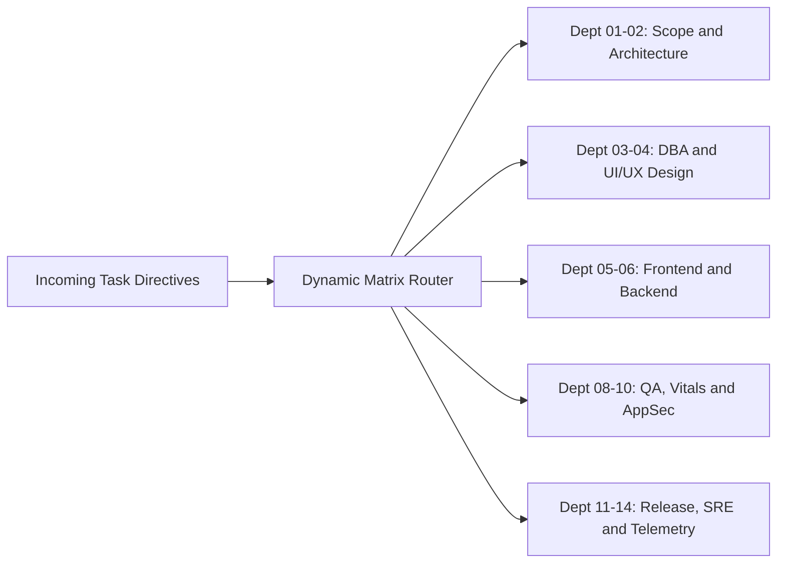

# Dynamic Departmental Rules & Skill Routing Matrix

> **Universal Dynamic Routing Matrix:**
> - **Master Navigator:** [`master_rules_navigator.md`](master_rules_navigator.md)
> - **Department Index & Archive:** [`dept_index.md`](dept_index.md)
> - **Foundation Core:** [`foundation_core.md`](foundation_core.md)
> - **Special Operations Guide:** [`special_operations_guide.md`](special_operations_guide.md)
> - **Active Working Memory:** [`memory.md`](file:///C:/Users/Atul%20Verma/.gemini/memory.md)
> - **Developer Profile:** Atul Verma (`aiprincekumar` / `aiprincekumar010100@gmail.com` / [GitHub Profile](https://github.com/aiprincekumar))

---

## 🧭 1. Executive Dynamic Routing Overview

This document provides a lean, high-density matrix mapping all 14 enterprise departments to their recommended AI models, dedicated subagent roles, core scopes, dynamic skill bindings, and on-demand deep playbooks. Subagents load domain skills just-in-time (JIT) rather than ingesting monolithic departmental rules into the global context window.

---

## 🏢 2. Universal 14-Department Dynamic Matrix

| Dept # & Name | Recommended Model | Dedicated Subagent Roles | Core Scope & Responsibilities | Dynamic Skill Pointers | Deep Playbook Reference |
| :--- | :--- | :--- | :--- | :--- | :--- |
| **Dept 01: Product Requirements** | `flash` | `Product Scope Architect`, `Business Systems Analyst`, `Technical Product Owner`, `UX Research Analyst`, `Localization Product Analyst` | PRD authoring, user stories, acceptance criteria, MoSCoW prioritization, i18n/l10n specs, phase decomposition. | `planning-and-task-breakdown`, `spec-driven-development`, `enhance-prompt`, `i18n-sync` | [`departments_archive/01_product_requirements_dept.md`](departments_archive/01_product_requirements_dept.md) |
| **Dept 02: Solution Architecture** | `pro` | `System Architect`, `Integration Architect`, `Domain Architecture Specialist`, `Code Standards Architect` | HLD/LLD architecture boundaries, MADR decision records, DDD bounded contexts, modularity. | `architecture-decision-records`, `api-design`, `backend-patterns`, `hexagonal-architecture` | [`departments_archive/02_solution_architecture_dept.md`](departments_archive/02_solution_architecture_dept.md) |
| **Dept 03: Data Architecture & DBA** | `pro` | `Database Administrator`, `Vector Database Specialist`, `Data Migration Specialist`, `Query Performance Tuner` | Relational 3NF/BCNF modeling, foreign keys, migrations, vector indexing, query tuning. | `postgres-patterns`, `mysql-patterns`, `database-migrations`, `redis-patterns`, `clickhouse-io` | [`departments_archive/03_data_architecture_dba_dept.md`](departments_archive/03_data_architecture_dba_dept.md) |
| **Dept 04: UI/UX Design System** | `flash` | `Design System Lead`, `Visual UI Designer`, `Motion Design Specialist`, `Accessibility Specialist`, `Visual QA Specialist`, `Design Token Engineer` | Semantic design tokens, DESIGN.md specs, typography scales, 60fps micro-motion, WCAG AA/AAA. | `frontend-design`, `frontend-design-direction`, `taste-design`, `design-md`, `a11y-debugging` | [`departments_archive/04_ui_ux_design_system_dept.md`](departments_archive/04_ui_ux_design_system_dept.md) |
| **Dept 05: Frontend Engineering** | `flash` / `inherit` | `Frontend Engineer`, `Frontend State Architect`, `Canvas Motion Specialist`, `Responsive Web Specialist`, `Mobile Native Specialist`, `Micro-Frontend Architect` | Modular React/Vue components, state machines, canvas/Three.js rendering, responsive layouts, Vite optimization. | `frontend-patterns`, `react-patterns`, `vite-patterns`, `shadcn-ui`, `ui-to-vue`, `bun-runtime` | [`departments_archive/05_frontend_engineering_dept.md`](departments_archive/05_frontend_engineering_dept.md) |
| **Dept 06: Backend & API Engineering** | `flash` / `pro` | `Backend API Engineer`, `Distributed Systems Engineer`, `Backend Security Engineer`, `Queue Systems Specialist`, `AI Integration Engineer`, `Real-time Systems Specialist` | REST/GraphQL APIs, OAuth2 RBAC, Redis caching, BullMQ/Kafka queues, LLM integrations, WebSockets. | `backend-patterns`, `api-design`, `api-connector-builder`, `django-patterns`, `nestjs-patterns`, `dotnet-patterns` | [`departments_archive/06_backend_api_engineering_dept.md`](departments_archive/06_backend_api_engineering_dept.md) |
| **Dept 07: Technical Documentation** | `flash_lite` | `Technical Documentation Writer`, `API Specification Specialist`, `Developer Experience Engineer`, `ADR Documentation Specialist` | Zero-drift technical documentation, OpenAPI 3.1 specifications, Swagger synchronization, runbooks. | `documentation-lookup`, `codebase-onboarding`, `documentation-and-adrs` | [`departments_archive/07_technical_documentation_dept.md`](departments_archive/07_technical_documentation_dept.md) |
| **Dept 08: Quality Assurance & Testing** | `flash` | `Automation Test Engineer`, `E2E QA Engineer`, `Load Test Engineer`, `Exploratory QA Specialist`, `DAST Security QA Engineer` | TDD test suites, unit & integration tests, Playwright E2E automation, regression gates, code simplification. | `e2e-testing`, `python-testing`, `golang-testing`, `csharp-testing`, `kotlin-testing`, `code-simplification` | [`departments_archive/08_quality_assurance_testing_dept.md`](departments_archive/08_quality_assurance_testing_dept.md) |
| **Dept 09: Performance & Web Vitals** | `pro` | `Web Vitals Engineer`, `Memory Leak Specialist`, `Bundle Optimization Engineer`, `Latency Optimization Engineer` | Core Web Vitals (LCP < 2.5s, INP < 200ms, CLS < 0.1), DevTools heap snapshots, bundle budgets. | `performance-optimization`, `memory-leak-debugging`, `debug-optimize-lcp`, `react-performance` | [`departments_archive/09_performance_web_vitals_dept.md`](departments_archive/09_performance_web_vitals_dept.md) |
| **Dept 10: AppSec & InfoSec** | `pro` | `AppSec Engineer`, `Penetration Tester`, `Secrets Governance Officer`, `Cloud Security Auditor` | SAST scans, OWASP Top 10 mitigation, secret scanning (gitleaks), CSRF/SSRF prevention, token safety. | `security-review`, `secret-scanning`, `dependency-scanning`, `django-security`, `springboot-security` | [`departments_archive/10_application_security_infosec_dept.md`](departments_archive/10_application_security_infosec_dept.md) |
| **Dept 11: Legal & License Compliance** | `flash_lite` | `Open Source License Auditor`, `Data Privacy Officer`, `IP Compliance Specialist`, `Regulatory Compliance Specialist` | Dependency license audits (MIT vs GPL), SPDX manifests, THIRD_PARTY_LICENSES.md, GDPR/HIPAA privacy. | `legal-license-compliance`, `hipaa-compliance` | [`departments_archive/11_legal_license_compliance_dept.md`](departments_archive/11_legal_license_compliance_dept.md) |
| **Dept 12: DevOps, Build & Release** | `flash_lite` | `CI/CD Pipeline Engineer`, `Build Systems Engineer`, `Release Manager`, `Containerization Specialist` | GitHub Actions CI/CD, build compiler verification, Rule 6 changes log, git-cliff token-free changelogs. | `ci-cd-and-automation`, `github-actions-efficiency`, `github-release`, `git-flow-branch-creator` | [`departments_archive/12_devops_build_release_dept.md`](departments_archive/12_devops_build_release_dept.md) |
| **Dept 13: SRE & Backup Ops** | `flash_lite` | `Antigravity Backup Specialist`, `Site Reliability Engineer`, `Disaster Recovery Specialist`, `Memory Sentinel`, `FinOps Cost Specialist`, `Chaos Resilience Specialist`, `Rule In Hindi Specialist` | Rule 5 dual backup (Manual/Daily), 10-day FIFO rotation, 1-click Rule In Hindi engine, Rule 23 memory sync. | `memory-sync-sentinel`, `continuous-agent-loop`, `unified-notifications-ops` | [`departments_archive/13_sre_backup_disaster_recovery_dept.md`](departments_archive/13_sre_backup_disaster_recovery_dept.md) |
| **Dept 14: Telemetry & Flags** | `flash` | `Telemetry Engineer`, `Feature Flag Manager`, `Metrics Dashboard Specialist`, `Incident Commander` | OpenTelemetry SDK instrumentation, structured logging, canary rollouts, kill switches, Grafana dashboards. | `dashboard-builder`, `terminal-ops` | [`departments_archive/14_telemetry_observability_feature_flags_dept.md`](departments_archive/14_telemetry_observability_feature_flags_dept.md) |

---

## ⚡ 3. Dynamic Skill Binding & JIT Execution Protocol

1. **Manager Evaluation:** Level 2 Manager inspects task requirements during the Specialist Decision Gate.
2. **Skill Allocation:** Level 3A Skill Manager allocates matching dynamic skills rather than injecting monolithic rule documents.
3. **Deep Reference Fallback:** Subagents consult [`dept_index.md`](dept_index.md) and read specific playbooks from `departments_archive/` ONLY when fine-grained departmental edge cases require verification.
