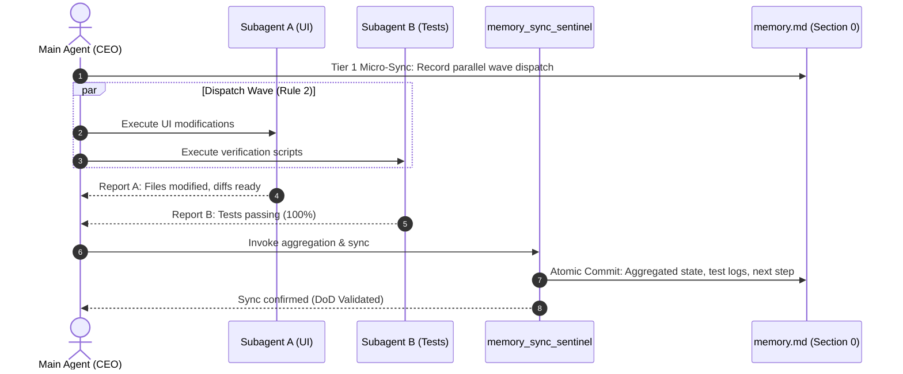

# Memory Sync Sentinel Skill (`memory-sync-sentinel`)

> **Governing Protocol:** Universal Rule 23 (Mandatory Stage-by-Stage Memory Synchronization & Zero-Scan State Preservation)  
> **Master Operational Rules:** [`GEMINI.md`](file:///c:/Users/Atul%20Verma/Desktop/AI%20Document/Interactive%20Cursor-Tracking%20Portfolio/GEMINI.md)  
> **Technical Memory Dossier:** [`memory.md`](file:///c:/Users/Atul%20Verma/Desktop/AI%20Document/Interactive%20Cursor-Tracking%20Portfolio/memory.md)  
> **Dedicated Subagent:** `memory_sync_sentinel`  
> **Related Protocols:** Universal Rule 1 (CEO Model), Universal Rule 2 (Parallel Dispatch), Universal Rule 6 (Changes Log Audit), Universal Rule 21 (Zero-Scan Bootstrap), Universal Rule 22 (`temp_prompt/` Phase Execution)

---

## 1. Project Context & Architectural Invariants

The **Interactive Cursor-Tracking Portfolio** is a cutting-edge web showcase for **Atul Verma** engineered with React 19, Tailwind CSS v4, and Vite 8. The ecosystem encompasses:
- **16 Core Architectural Modules:** From layout navigation, Hero 2.5D character stage, and 3D Studio Split Sandbox to docked AI chat, terminal CLI, and case study engines.
- **35 Custom Kinematic Cursors:** 7 thematic families running 120 FPS physics with exponential smoothing, shortest-arc heading, and aerodynamic roll.
- **Pure Procedural Web Audio Engine:** Algorithmic ADSR synthesis producing 8 discrete sound effects with spatial stereo panning and 0 external audio assets.
- **On-Device Neural LLM Worker:** Transformers.js WebGPU/WASM pipeline (`aiModelWorker.js`) with 3-tier quantization and deterministic RAG offline fallback.
- **58+ Automated Test Harnesses:** Comprehensive verification suite in `scripts/` covering zero CLS, multi-tab anti-echo, terminal commands, and AI telemetry.

Because this codebase is large and highly optimized, incoming agents must **never** perform broad, recursive repository scans (`dir /s`, recursive `grep`, blind tree walks). The technical memory file [`memory.md`](file:///c:/Users/Atul%20Verma/Desktop/AI%20Document/Interactive%20Cursor-Tracking%20Portfolio/memory.md) is the single authoritative source of truth. Under **Universal Rule 23**, this memory must remain continuously fresh, exact, and stage-synchronized at every step of execution.

---

## 2. Continuous Two-Tier Synchronization Protocol

To ensure [`memory.md`](file:///c:/Users/Atul%20Verma/Desktop/AI%20Document/Interactive%20Cursor-Tracking%20Portfolio/memory.md) reflects real-time operational reality without stalling momentum, synchronization is enforced across two distinct tiers:

```
┌─────────────────────────────────────────────────────────────────────────────┐
│                 TWO-TIER MEMORY SYNCHRONIZATION ARCHITECTURE                │
├─────────────────────────────────────────────────────────────────────────────┤
│                                                                             │
│   TIER 1: IN-FLIGHT MICRO-SYNC (Real-time Section 0 Update)                 │
│   ─────────────────────────────────────────────────────────                 │
│   Trigger: Before/after subagent delegation, atomic file edit, phase jump.  │
│   Scope: Section 0 (Live Agent State & Stateful Handoff Ledger).            │
│   Latency: Immediate (< 2 seconds). Preserves active progress & context.    │
│                                                                             │
│                                    │                                        │
│                                    ▼                                        │
│                                                                             │
│   TIER 2: MILESTONE MACRO-SYNC (Full Layer 1–4 Deep Audit)                  │
│   ─────────────────────────────────────────────────────────                 │
│   Trigger: Phase completion, test suite signoff, milestone closure.        │
│   Scope: Layers 1, 2, 3, 4 + Entry Points + Feature Matrices.               │
│   Validation: Full test pass, DoD validation, and changes_log audit.        │
│                                                                             │
└─────────────────────────────────────────────────────────────────────────────┘
```

### 2.1 Tier 1: In-Flight Micro-Sync Protocol
- **Target Section:** Section `0. Live Agent State & Stateful Handoff Ledger` in [`memory.md`](file:///c:/Users/Atul%20Verma/Desktop/AI%20Document/Interactive%20Cursor-Tracking%20Portfolio/memory.md).
- **Execution Moments:**
  1. Immediately before dispatching any subagent or batch of subagents.
  2. Immediately upon receiving subagent results or completing an atomic file modification.
  3. Immediately upon encountering any build error, test failure, or environmental issue.
  4. At each step transition within `temp_prompt/<task>/INDEX.md`.
- **Mandatory Fields to Update in Section 0:**
  - `Current Active Milestone`: Active feature or task descriptor.
  - `Where the Agent is Right Now (अभी तक कहाँ पहुँचा है एजेंट)`: Granular bullet points of currently completed items vs. in-flight work.
  - `Last Agent Action Completed`: Exact change ID, subagent outcome, or file edit just executed.
  - `Next Immediate Recommended Action (अगला तत्काल कार्य)`: Unambiguous next step for any incoming agent.
  - `Universal Protocol Adherence`: Explicit list of governed rules active in this turn.

### 2.2 Tier 2: Milestone Macro-Sync Protocol
- **Target Sections:** Entire [`memory.md`](file:///c:/Users/Atul%20Verma/Desktop/AI%20Document/Interactive%20Cursor-Tracking%20Portfolio/memory.md) (Layers 1, 2, 3, 4, Quick File Entry Points, and Governance references).
- **Execution Moments:**
  1. Completion of an architectural phase in `temp_prompt/` prior to pruning.
  2. Full test suite execution (`npm test` or `scripts/run_all_tests.mjs`).
  3. Creation or deprecation of any component, hook, worker, or test harness.
  4. Completion of a high-level task prior to final user report.
- **Mandatory Macro Actions:**
  - Update Layer 2.1 (`Implemented Features Matrix`) and Layer 2.2 (`Pending Roadmap`).
  - Update Section 2.3 (`Quick File Entry Points`) with new files, skills, or scripts.
  - Update Layer 3 (`16-Module Inventory & Asset Breakdown`) with forensic technical specs.
  - Update Layer 4 (`Automated Verification Matrix`) with test counts and pass statuses.
  - Synchronize corresponding feature records in [`docs/FEATURES_MEMORY.md`](file:///c:/Users/Atul%20Verma/Desktop/AI%20Document/Interactive%20Cursor-Tracking%20Portfolio/docs/FEATURES_MEMORY.md) and log in `changes_log/`.

---

## 3. Strict Blocking Gatekeeper (DoD Integrity)

Under Universal Rule 23, memory synchronization is **not an optional post-hoc chore**; it is an active blocking gate in the task execution lifecycle:

> [!CAUTION]
> **Blocking DoD Invariant:**  
> A task or phase **CANNOT** be considered complete, and the Definition of Done (DoD) is **STRICTLY INVALID**, if Section 0 in [`memory.md`](file:///c:/Users/Atul%20Verma/Desktop/AI%20Document/Interactive%20Cursor-Tracking%20Portfolio/memory.md) is stale, omits active state, or diverges from codebase reality. No agent may return a final completion message to the user while Section 0 reflects an older state.

### The 4-Point Sentinel Gatekeeper Checklist:
1. [ ] **Section 0 Synchronized:** Does `Where the Agent is Right Now` accurately describe the exact current state of the code?
2. [ ] **Handoff Clarity:** Does `Next Immediate Recommended Action` contain sufficient context that an agent booted 1 second from now can proceed with zero questions?
3. [ ] **Test Coverage Recorded:** Are the latest verification passes reflected with test names and scores?
4. [ ] **Rule Compliance Verified:** Are Universal Rules 1, 2, 6, 16, 21, 22, and 23 maintained without regressions?

---

## 4. Atomic Aggregation for Parallel Dispatch Waves (Universal Rule 2)

When the CEO Agent dispatches multiple specialized subagents in parallel (e.g., UI specialist, test writer, style calibrator):
1. **Parallel Execution Isolation:** Each subagent operates within its scoped file boundaries without editing [`memory.md`](file:///c:/Users/Atul%20Verma/Desktop/AI%20Document/Interactive%20Cursor-Tracking%20Portfolio/memory.md) concurrently (preventing write conflicts).
2. **Aggregated Ingestion:** As parallel subagents report completion back to the CEO, the results are collected into a unified synthesis.
3. **Atomic Commit Transaction:** The CEO (or delegated `memory_sync_sentinel`) performs a **single atomic update** to Section 0:
   - Aggregates all files modified across all subagents.
   - Summarizes parallel verification outcomes into a unified status.
   - Advances `Last Agent Action Completed` and updates `Where the Agent is Right Now`.
   - Clears parallel in-flight flags and sets the consolidated next action.



---

## 5. Immediate Failure Logging & State Preservation

When an automated build, Oxlint check, or verification test fails during development:
1. **Do Not Silent-Fail or Discard:** The failure state must **never** be concealed or left undocumented.
2. **Immediate Section 0 Failure Record:** Section 0 of [`memory.md`](file:///c:/Users/Atul%20Verma/Desktop/AI%20Document/Interactive%20Cursor-Tracking%20Portfolio/memory.md) must be immediately updated with an active incident block:
   ```markdown
   | **Active Diagnostic / Incident** | ⚠️ TEST FAILURE in `scripts/verify_xyz.mjs` — Error: Unexpected token at Line 42 of `HeroSection.jsx`. Remediation in progress. |
   ```
3. **Forensic Details Captured:**
   - Failed command / test script path.
   - Specific error stack trace / message.
   - Affected file paths.
   - Root cause hypothesis.
   - Immediate rollback or remediation plan.
4. **Resolution Transition:** Once resolved and verified, the incident block is cleared and recorded in `Last Agent Action Completed` as a successful remediation.

---

## 6. Role of Designated Subagent `memory_sync_sentinel`

The `memory_sync_sentinel` is a specialized operational subagent designed to guarantee zero-drift memory governance:

### Primary Responsibilities:
1. **Pre-Flight Validation:** Inspects [`memory.md`](file:///c:/Users/Atul%20Verma/Desktop/AI%20Document/Interactive%20Cursor-Tracking%20Portfolio/memory.md) on session startup to ensure Section 0 is fresh and accurate.
2. **In-Flight Synchronization:** Executes Tier 1 micro-syncs during multi-step workflows, bridging the gap between subagent handoffs.
3. **Atomic Parallel Aggregation:** Reconciles parallel dispatch waves and commits aggregated state in one operation.
4. **Failure State Registration:** Swiftly documents test or build failures directly into Section 0.
5. **Macro-Sync Finalization:** Performs deep Layer 1–4 updates upon milestone signoffs and verifies that all RFC-compliant forward-slash `file:///` URLs remain valid.
6. **Zero-Scan Protocol Enforcement:** Intercepts and flags any attempts to run blind recursive workspace scans.

### Invocation Directive Template:
```markdown
invoke_subagent(
  agent_name: "memory_sync_sentinel",
  prompt: "Synchronize memory.md Section 0 following completion of Phase 4 Multi-Sandbox integration. Aggregate test results from scripts/verify_phase4.mjs (13/13 PASS), record modified files (previews/SandboxPreview.jsx, src/hooks/useSandboxAutoSwitch.js), and set next immediate action to Phase 5. Ensure all file paths use RFC-compliant forward-slash file:/// URLs."
)
```

---

## 7. Hyperlink Standards & Hygiene

Every file path and link in [`memory.md`](file:///c:/Users/Atul%20Verma/Desktop/AI%20Document/Interactive%20Cursor-Tracking%20Portfolio/memory.md), [`GEMINI.md`](file:///c:/Users/Atul%20Verma/Desktop/AI%20Document/Interactive%20Cursor-Tracking%20Portfolio/GEMINI.md), and related agent documents must strictly adhere to the RFC-compliant forward-slash format:

- ✅ **Correct:** `[`src/App.jsx`](file:///c:/Users/Atul%20Verma/Desktop/AI%20Document/Interactive%20Cursor-Tracking%20Portfolio/src/App.jsx)`
- ❌ **Forbidden:** Backslashes inside URL targets (`file:///c:\Users\...`).
- ❌ **Forbidden:** Relative URLs without valid markdown anchor formatting.
