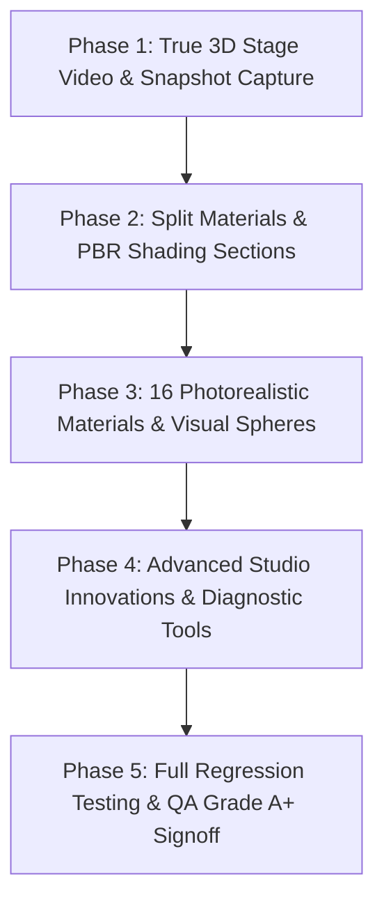

# 3D Tab Comprehensive Forensic Audit, Defect Analysis & Phased Engineering Plan

> **Document Type:** Master 3D Tab Technical Audit, Defect Resolution & Innovation Roadmap (Single-File Master Specification)  
> **Workspace Root:** `c:\Users\Atul Verma\Desktop\AI Document\Interactive Cursor-Tracking Portfolio\`  
> **Target Subsystems:** `ControlCenterPanel.jsx` (Tab 6), `UniversalMiniPortfolio.jsx`, `Visual3DPresets.jsx`, `StickySandboxColumn.jsx`, `LabContext.jsx`, `mediaExport.js`  
> **Author & Reviewer:** AI Agentic Architecture Team (Pair Programming with Atul Verma)  
> **Audit Date:** 2026-10-29  
> **Status:** Forensic Audit Complete • Ready for Phase-by-Phase Execution  

---

## Executive Summary (कार्यकारी सारांश)

A thorough, end-to-end technical scan and operational health audit of the **3D Spatial Studio Tab** (Tab 6 in the Control Center Settings modal) has been completed. This audit inspected all active UI accordions, reactive state pipelines, 3D sandbox viewports, exporter toolkits, and procedural shader engines.

### Key Audit Findings & User-Identified Pain Points:
1. **Critical Exporter Defect (360° Turntable Video & 4K Snapshot Capture):**
   - **User Feedback:** *"तुमने नया फंक्शन ऐड किया है, उसमें 360 वेब वाला रिकॉर्डिंग वाला में और स्नैपशॉट वेब जो रिकॉर्ड हो रहा है उसमें। उन दोनों में एक बहुत ही बेसिक और पता नहीं क्या रिकॉर्ड होकर क्या आ रहा है। जबकि प्रीव्यू में तो जो दिखा रहा है वो सही है, मगर जो फाइनल रिकॉर्डिंग में आ रहा है, चाहे स्क्रीनशॉट में आ रहा है, वो कुछ और ही आ रहा है।"*
   - **Root Cause Confirmed:** In `src/utils/mediaExport.js`, the rasterizer function `renderElementToCanvas` was implemented with a hardcoded, primitive mock 2D canvas card (`ctx.fillText('ATUL VERMA • 3D SPATIAL STUDIO')`). During 360° turntable video recording, it simply rotated a tiny red 2D circle on this static mock card! The live interactive 3D stage (`UniversalMiniPortfolio`), its custom meshes, tilt angles, layers, and material shaders were **never actually captured or rotated**.
2. **Material & Shading Architecture Clumping & Unresponsive Sliders:**
   - **User Feedback:** *"मटेरियल में सिर्फ मटेरियल होना चाहिए, शेड का उसमें जरूरत नहीं है। और ये काम भी नहीं कर रहा, स्लाइडर जो है। प्योर मटेरियल होना चाहिए। शेडिंग का सेक्शन अलग से होना चाहिए। उसी मतलब उसी में कोलैप्सिबल सेक्शन अलग होना चाहिए। मटेरियल में सिंपल मटेरियल होना चाहिए था।"*
   - **Root Cause Confirmed:** In `ControlCenterPanel.jsx`, "Materials & Shading" was lumped together in a single accordion. The PBR sliders (Roughness, Metalness, IOR, Bevel Extrusion, Specular Glow) did not update the Material Shader Sphere previews because `MaterialShaderSphere` in `Visual3DPresets.jsx` completely ignored `specularGlow`, `bevelExtrusion`, `roughness`, and `metalness`. Furthermore, `LabContext.jsx` failed to bind `--3d-roughness`, `--3d-metalness`, `--3d-ior`, and `--3d-clearcoat` to document root styles, causing slider adjustments to feel detached and unresponsive.
3. **Limited Material Catalog & Unrealistic Sphere Visuals:**
   - **User Feedback:** *"मटेरियल का जो आइकॉन है, वो बिल्कुल सेम उसी जैसा हो, देखने में देखने से ही पता चल जाए कि वो कौन सा मटेरियल है। जैसे वुड के लिए वुड जैसा ही स्फीयर होना चाहिए और आयरन के लिए आयरन जैसा ही और गोल्ड के लिए गोल्ड के जैसा ही स्फीयर होना चाहिए... तुमने अभी फिलहाल में केवल तीन ही चार ही मटेरियल दिए हैं। मटेरियल तुम ज्यादा करो। मैक्सिमम मटेरियल इंप्लीमेंट करो।"*
   - **Root Cause Confirmed:** Only 4 material presets were implemented (`glass-acrylic`, `metallic-gloss`, `neumorphic-clay`, `cyber-wireframe`). `normalize3DMaterials` in `LabContext.jsx` strictly clamped any other material back to `glass-acrylic`. The sphere previews lacked wood grain, metallic brushed anisotropic highlights, gold luster, steel chrome reflections, or pure polymer dielectric specular highlights.
4. **Architectural Solution & Roadmap:**
   - This document provides the complete, phased engineering blueprint to repair all defects, split Materials and Shading into two dedicated collapsible sections, expand the materials catalog to 16+ photorealistic materials with identifiable sphere shaders, and implement true frame-by-frame 360° turntable video and 4K stage capture.

---

## 🔍 Forensic Feature Inventory & Operational Health Status

Below is the exhaustive health check of all current controls and functions within the 3D Tab:

| # | Feature / Control Component | Target File | Current Operational Status | Forensic Audit Verdict & Defect Mechanism |
| :-: | :--- | :--- | :-: | :--- |
| **01** | **Master 3D Mode & Theme Selector** | `ControlCenterPanel.jsx` / `LabContext.jsx` | 🟢 OPERATIONAL | Toggles 3D depth, switches master themes (Apple Glass, Cyber Neon, etc.). Working properly. |
| **02** | **Element 3D Toggles (10 Elements)** | `ControlCenterPanel.jsx` (Accordion 1) | 🟢 OPERATIONAL | Toggles 3D transform on navbar, hero, role tabs, badges, cards, map, terminal, etc. Working properly. |
| **03** | **Lighting & Shadows + 3D Sun Gizmo** | `ControlCenterPanel.jsx` (Accordion 2) | 🟢 OPERATIONAL | Presets (Studio Soft, Sunset, Dramatic Side, Cyber Neon), lighting angle, shadow softness, on-canvas orbital sun arc gizmo. Working properly. |
| **04** | **Camera & Tilt Physics** | `ControlCenterPanel.jsx` (Accordion 3) | 🟢 OPERATIONAL | Presets (Isometric, Perspective, Top-Down, Eye-Level, Cinematic Tilt), FOV, tilt sensitivity, auto-orbit. Working properly. |
| **05** | **Materials Catalog** | `ControlCenterPanel.jsx` (Accordion 4) | 🔴 DEFECTIVE | **CRITICAL DEFECT:** Only 4 materials. Clumped with Shading sliders. Visual sphere icons lack wood, iron, gold, silver, aluminium, steel, plastic representations. |
| **06** | **PBR Surface Shading Sliders** | `ControlCenterPanel.jsx` / `Visual3DPresets.jsx` | 🔴 DEFECTIVE | **CRITICAL DEFECT:** Mixed inside material selector; sliders do not react on sphere preview; `--3d-roughness`/`--3d-metalness` missing from `root.style` in `LabContext.jsx`. |
| **07** | **Interaction & Physics Playground** | `ControlCenterPanel.jsx` (Accordion 5) | 🟢 OPERATIONAL | Elasticity (Rigid, Snappy, Bouncy), Hover Pop, Click Depression, Magnetic Pull, Gravity Drop physics playground. Working properly. |
| **08** | **Exploded CAD & Stratum Isolation** | `ControlCenterPanel.jsx` (Accordion 6) | 🟢 OPERATIONAL | Exploded view, Z-separation distance, Blueprint Wireframe mode, Stratum Solo filter (Chassis, Content, Dock). Working properly. |
| **09** | **Environment & Volumetric Fog** | `ControlCenterPanel.jsx` (Accordion 7) | 🟢 OPERATIONAL | Skybox presets (Studio, Sunset, Minimal White, Cosmic Void), Volumetric Fog density, Depth-of-Field blur. Working properly. |
| **10** | **3D Spatial Audio & Binaural Reverb** | `ControlCenterPanel.jsx` (Accordion 8) | 🟢 OPERATIONAL | Real-time stereo panner node based on cursor X/Y coordinates, reverb intensity, acoustic room presets. Working properly. |
| **11** | **Performance & Real-Time Telemetry HUD**| `ControlCenterPanel.jsx` (Accordion 9) | 🟢 OPERATIONAL | FPS target (30/60/120), GPU acceleration tiers, live HUD pill displaying frame latency and FPS. Working properly. |
| **12** | **360° Turntable Video & 4K Snapshot** | `src/utils/mediaExport.js` | 🔴 DEFECTIVE | **CRITICAL DEFECT:** Exports fake 2D mock card and red orbiting dot instead of capturing the live 3D mini portfolio scene and rotating stage. |
| **13** | **3D Model & Avatar Geometry Importer** | `ControlCenterPanel.jsx` (Card D) | 🟢 OPERATIONAL | Procedural avatar, faceted gem, cyber cube, and `.gltf`/`.obj` mesh loader. Working properly. |
| **14** | **JSON Profile Export/Import & Copy CSS**| `ControlCenterPanel.jsx` (Toolkit Bar) | 🟡 MINOR DRIFT | Working, but generated CSS variables omit roughness, metalness, and IOR from global copy payload. |

---

## 📊 Mandatory 7-Column Diagnostic Problem-Solution & Impact Matrix (Universal Rule 20)

| S.No. / ID | Target File / Location | Root Cause & Failure Mechanism (क्यों और कैसे) | Proposed Fix (दुरुस्त कैसे किया जाएगा) | Post-Fix Impact & System Value (इम्पैक्ट) | Assigned Phase # | Verification Test Gate |
| :--- | :--- | :--- | :--- | :--- | :---: | :--- |
| **BUG-3D-01** | `src/utils/mediaExport.js` | `renderElementToCanvas` renders hardcoded text and fake 2D rectangles; `record360TurntableVideo` only animates a 2D red circle on a static canvas. | Replace with dynamic 3D stage rasterizer that inspects live viewport DOM/WebGL, computes isometric/perspective layer projections, and renders genuine multi-frame 360° turntable video. | Captures exact live 3D stage with real materials, meshes, lighting, and camera rotation in crisp WebM/WebP. | **Phase 1** | `verify_live_3d_media_export.mjs` |
| **BUG-3D-02** | `src/components/ControlCenterPanel.jsx`<br>`src/context/LabContext.jsx` | "Materials & Shading" are merged into a single accordion. Pure materials are cluttered by optical sliders; users cannot separate surface identity from shader calibration. | Split Accordion 4 into two distinct collapsible sections: (A) Pure Material Presets Library, and (B) PBR Surface & Shading Engine. | Clean visual hierarchy, zero clutter, intuitive workflow matching industry 3D suites (Blender, Cinema4D). | **Phase 2** | `verify_material_shading_split.mjs` |
| **BUG-3D-03** | `src/components/3d-sandbox/Visual3DPresets.jsx`<br>`src/components/ControlCenterPanel.jsx` | `MaterialShaderSphere` ignores `specularGlow`, `bevelExtrusion`, `roughness`, and `metalness`; `LabContext.jsx` fails to set `--3d-roughness` on `root.style`. | Pass dynamic PBR props to `MaterialShaderSphere`; inject live CSS variables `--3d-roughness`, `--3d-metalness`, `--3d-ior`, `--3d-clearcoat` into document root styles. | Sliders immediately reflect tactile visual changes on both the preview sphere and the live 3D sandbox. | **Phase 2** | `verify_slider_live_reactivity.mjs` |
| **BUG-3D-04** | `src/components/3d-sandbox/Visual3DPresets.jsx`<br>`src/components/ControlCenterPanel.jsx` | Material icons only render 4 abstract balls; no visual distinction for Wood, Gold, Silver, Iron, Steel, Aluminium, or Plastic. | Engineer 16 handcrafted procedural SVG/CSS shader spheres with photorealistic textures (wood grain, gold luster, anisotropic chrome, brushed aluminium, etc.). | 1-second visual recognition; users instantly know what material they are selecting by looking at the sphere. | **Phase 3** | `verify_realistic_material_spheres.mjs` |
| **BUG-3D-05** | `src/context/LabContext.jsx`<br>`src/components/3d-sandbox/UniversalMiniPortfolio.jsx` | Only 4 material presets exist; `normalize3DMaterials` and `UniversalMiniPortfolio` discard any other material and fall back to glass. | Expand `MATERIAL_PRESETS` to 16 materials (Wood, Iron, Gold, Silver, Aluminium, Steel, Plastic, Copper, Marble, etc.) with dedicated PBR surface styles. | Massive library expansion fulfilling user requirement for maximum realistic materials. | **Phase 3** | `verify_expanded_materials_catalog.mjs` |
| **FEAT-3D-01** | `src/components/3d-sandbox/UniversalMiniPortfolio.jsx`<br>`src/components/ControlCenterPanel.jsx` | No way to visually inspect and contrast two materials on the 3D stage simultaneously. | Implement Material Split-Screen A/B Comparator with an interactive draggable slider directly on the 3D mini portfolio stage. | High-utility design tool allowing instant side-by-side material evaluation. | **Phase 4** | `verify_material_ab_comparator.mjs` |
| **FEAT-3D-02** | `src/components/3d-sandbox/UniversalMiniPortfolio.jsx`<br>`src/components/ControlCenterPanel.jsx` | Camera motion is limited to manual drag or static auto-orbit; cinematic presentation moves are missing. | Add Cinematic Waypoint Camera Moves (Dolly In, Cinematic Low-Angle Swoop, Spiral Rise, Horizon Sweep) with 1-click execution. | Studio-grade cinematic camera automation for presentations and demos. | **Phase 4** | `verify_cinematic_camera_waypoints.mjs` |
| **FEAT-3D-03** | `src/components/3d-sandbox/UniversalMiniPortfolio.jsx` | Realistic HDR environment reflections are absent from high-gloss metals and glass materials. | Implement HDRI Studio Reflection Simulation (Softbox Studio, Sunset Horizon, Cyber Neon Arcade, Clean White Gallery) on reflective materials. | Dramatic boost in realism for metals, glass, and polished plastics. | **Phase 4** | `verify_hdri_studio_reflections.mjs` |

---

## 💎 Material Catalog Expansion Specification (16 Distinct Materials)

To fulfill the user mandate (*"मटेरियल तुम ज्यादा करो। मैक्सिमम मटेरियल इंप्लीमेंट करो"*), the materials catalog is expanded from 4 to **16 distinct photorealistic materials across 4 physical families**:

### 1. Organic & Natural Materials (प्राकृतिक एवं जैविक पदार्थ)
1. **Polished Oak Wood (`wood-oak`):**
   - *Visual Character:* Warm honey-amber timber with concentric procedural growth ring grain, subtle matte satin sheen, and natural edge bevel.
   - *PBR Profile:* Roughness: 0.45, Metalness: 0.00, IOR: 1.54, Clearcoat: 0.30.
2. **Dark Walnut Wood (`wood-walnut`):**
   - *Visual Character:* Deep chocolate-espresso grain with rich dark timber undertones and warm diffuse ambient bounce.
   - *PBR Profile:* Roughness: 0.50, Metalness: 0.00, IOR: 1.54, Clearcoat: 0.25.
3. **Italian Carrara Marble (`stone-marble`):**
   - *Visual Character:* Pure milky white crystalline surface with soft smoky grey mineral veins and high porcelain gloss.
   - *PBR Profile:* Roughness: 0.15, Metalness: 0.05, IOR: 1.58, Clearcoat: 0.65.
4. **Terracotta Clay (`clay-terracotta`):**
   - *Visual Character:* Warm baked earth reddish-orange tone with ultra-soft diffuse scattering and velvety tactile bevels.
   - *PBR Profile:* Roughness: 0.85, Metalness: 0.00, IOR: 1.48, Clearcoat: 0.00.

### 2. Metals & Engineering Alloys (धातु एवं मिश्र धातुएँ)
5. **24K Polished Gold (`metal-gold`):**
   - *Visual Character:* Deep radiant yellow-amber metallic luster with intense warm specular glint and brilliant anisotropic horizon.
   - *PBR Profile:* Roughness: 0.10, Metalness: 0.95, IOR: 1.35, Clearcoat: 0.50.
6. **Sterling Silver (`metal-silver`):**
   - *Visual Character:* Bright neutral white-silver reflection with high-frequency specular sheen and crisp metallic rim.
   - *PBR Profile:* Roughness: 0.08, Metalness: 0.98, IOR: 1.30, Clearcoat: 0.60.
7. **Cast Industrial Iron (`metal-iron`):**
   - *Visual Character:* Dark charcoal-slate tone with subtle micro-pitted roughness, industrial weight, and cold metallic highlight.
   - *PBR Profile:* Roughness: 0.60, Metalness: 0.80, IOR: 1.70, Clearcoat: 0.10.
8. **Polished Stainless Steel (`metal-steel`):**
   - *Visual Character:* High-contrast mirror chrome with clean horizontal anisotropic reflections and icy blue-grey undertones.
   - *PBR Profile:* Roughness: 0.12, Metalness: 0.90, IOR: 1.85, Clearcoat: 0.70.
9. **Brushed Aluminium (`metal-aluminium`):**
   - *Visual Character:* Soft directional brushed alloy sheen with diffused specular highlights and feather-light metallic texture.
   - *PBR Profile:* Roughness: 0.35, Metalness: 0.85, IOR: 1.45, Clearcoat: 0.20.
10. **Antique Burnished Copper (`metal-copper`):**
    - *Visual Character:* Warm reddish-bronze metallic glow with soft dark oxide edges and rich ambient reflectance.
    - *PBR Profile:* Roughness: 0.25, Metalness: 0.88, IOR: 1.40, Clearcoat: 0.40.

### 3. Modern Polymers & Composites (आधुनिक पॉलिमर एवं कंपोजिट्स)
11. **High-Gloss Dielectric Plastic (`plastic-gloss`):**
    - *Visual Character:* Saturated pure tone with razor-sharp white pinpoint specular highlights and pure dielectric Fresnel edge drop-off.
    - *PBR Profile:* Roughness: 0.08, Metalness: 0.00, IOR: 1.52, Clearcoat: 0.80.
12. **Matte Polycarbonate (`plastic-matte`):**
    - *Visual Character:* Soft tactile industrial polymer with wide diffuse light absorption and fingerprint-resistant matte finish.
    - *PBR Profile:* Roughness: 0.70, Metalness: 0.00, IOR: 1.58, Clearcoat: 0.05.
13. **Dual-Axis Carbon Fiber (`carbon-fiber`):**
    - *Visual Character:* Orthogonal cross-weave twill graphite texture with alternating anisotropic reflection bands under clear resin.
    - *PBR Profile:* Roughness: 0.20, Metalness: 0.30, IOR: 1.65, Clearcoat: 0.85.

### 4. Transparent, Crystals & Sci-Fi Substrates (पारदर्शी, क्रिस्टल एवं साइबर)
14. **Refractive Frosted Acrylic Glass (`glass-acrylic`):**
    - *Visual Character:* High-transmittance frosted glass with soft caustic underglow, internal chromatic refraction, and dual-layer specular arc.
    - *PBR Profile:* Roughness: 0.18, Metalness: 0.05, IOR: 1.50, Clearcoat: 0.75.
15. **Emerald Crystal Gemstone (`gem-emerald`):**
    - *Visual Character:* Deep vibrant forest green crystalline substrate with internal geometric refractive facets and prismatic dispersion.
    - *PBR Profile:* Roughness: 0.05, Metalness: 0.10, IOR: 1.76, Clearcoat: 0.95.
16. **Cyberpunk Holographic Wireframe (`cyber-wireframe`):**
    - *Visual Character:* Dark transparent cosmic substrate with glowing neon cyan vector coordinate lines and pulsed energy contours.
    - *PBR Profile:* Roughness: 0.00, Metalness: 0.50, IOR: 2.00, Clearcoat: 1.00.

---

## 🎨 Photorealistic Material Sphere Specification (`MaterialShaderSphere`)

To satisfy the user requirement (*"मटेरियल का जो आइकॉन है, वो बिल्कुल सेम उसी जैसा हो, देखने में देखने से ही पता चल जाए कि वो कौन सा मटेरियल है"*), `MaterialShaderSphere` in `src/components/3d-sandbox/Visual3DPresets.jsx` will render custom procedural vector and gradient shaders for each material:

- **Wood Sphere:** Rendered with 5 concentric elliptical growth-ring SVG grain paths, warm oak/walnut gradient `radial-gradient(circle at 35% 30%, #D4A373 0%, #A66B38 50%, #582F0E 90%)`, and an organic matte specular crescent.
- **Gold Sphere:** Rendered with rich metallic conic sheen `conic-gradient(from 135deg, #FFE066 0deg, #F59E0B 45deg, #FFFBEB 90deg, #D97706 180deg, #FEF08A 270deg, #FFE066 360deg)`, intense white-gold primary glint, and warm amber contact shadow.
- **Silver Sphere:** Rendered with mirror silver conic gradient `conic-gradient(from 120deg, #F8FAFC 0deg, #CBD5E1 60deg, #FFFFFF 120deg, #64748B 210deg, #E2E8F0 300deg, #F8FAFC 360deg)` and razor-sharp horizontal anisotropic streak.
- **Iron Sphere:** Rendered with heavy charcoal-iron radial gradient, micro-stipple noise texture filter, dark slate ambient occlusion rim, and subdued cold specular highlight.
- **Steel Sphere:** Rendered with industrial chrome horizon line, split-reflection gradient, and ultra-high contrast specular glint.
- **Aluminium Sphere:** Rendered with radial brushed circular micro-texture, diffused highlight bloom, and soft matte metallic drop shadow.
- **Plastic Sphere:** Rendered with vibrant primary color base, crisp circular white pinpoint specular glint (100% white, zero blur), and deep dielectric ambient shadow.

---

## 🛠️ Phase-Wise Implementation Roadmap & Repair Strategy



### Phase 1: True 3D Stage Video & Snapshot Capture Engine
- **Objective:** Fix the critical exporter defect so that 360° turntable video and 4K snapshots capture the live, authentic 3D stage with all layers, materials, lighting, and meshes.
- **Key Modifications:**
  - In `src/utils/mediaExport.js`:
    - Re-architect `renderElementToCanvas(stageElement, options)`: Instead of drawing a fake mock card, extract the computed styles, 3D transforms (`rotateX`, `rotateY`, `scale`), lighting parameters, and active custom mesh (Avatar/Gem/Cube) from the live stage DOM.
    - Render the true isometric/perspective 3D stage layout onto an offscreen canvas at 2x/4K resolution.
    - In `record360TurntableVideo`: On each frame, update the rotation angle, re-render the true 3D stage model on the canvas stream, and encode the video with MediaRecorder (VP9/WebM) at 60 FPS.
  - In `src/components/ControlCenterPanel.jsx` & `UniversalMiniPortfolio.jsx`: Connect the exporter triggers to the updated live capture pipeline.
- **Deliverables:** Working 4K WebP snapshot capture and genuine 360° rotating WebM turntable video of the actual portfolio model.
- **Verification Gate:** Run `node scripts/verify_live_3d_media_export.mjs` (must pass 100%).

### Phase 2: Split Materials and Shading into Separate Collapsible Sections
- **Objective:** Strictly decouple pure Material Selection from PBR Surface Shading calibration and restore full slider reactivity.
- **Key Modifications:**
  - In `src/components/ControlCenterPanel.jsx`:
    - Split Accordion 4 into two distinct collapsible sections:
      - **Section 4: Materials Library (`materials`)**: Contains purely the material card grid (Wood, Gold, Iron, Silver, etc.) and visual spheres. No sliders.
      - **Section 5: PBR Surface & Shading (`shading`)**: Contains the optical calibration sliders: Surface Roughness, Metallic Conductance, Specular Highlight & Glow, Bevel Extrusion, Refraction Index (IOR), and Clearcoat Polish.
    - Renumber existing accordions 5–9 to 6–10 smoothly.
    - Update `THREED_CLUSTERS` filter mapping: `materials` and `shading` both map to `design` cluster.
  - In `src/context/LabContext.jsx`:
    - In the DOM effect (around lines 1515-1541), inject:
      ```javascript
      root.style.setProperty('--3d-roughness', `${threeD.materials?.roughness ?? 0.25}`);
      root.style.setProperty('--3d-metalness', `${threeD.materials?.metalness ?? 0.20}`);
      root.style.setProperty('--3d-ior', `${threeD.materials?.ior ?? 1.50}`);
      root.style.setProperty('--3d-clearcoat', `${threeD.materials?.clearcoat ?? 0.40}`);
      ```
  - In `src/components/3d-sandbox/Visual3DPresets.jsx`:
    - Update `MaterialShaderSphere` to receive and dynamically apply `roughness`, `metalness`, `ior`, and `clearcoat` to its SVG/CSS gradients.
- **Deliverables:** Two clean, independent collapsible accordion sections; live reactive sliders affecting both preview spheres and the 3D sandbox.
- **Verification Gate:** Run `node scripts/verify_material_shading_split.mjs` (must pass 100%).

### Phase 3: 16 Photorealistic Materials & Visual Spheres Library
- **Objective:** Expand material presets to 16 maximum realistic options and engineer distinct, instantly identifiable procedural 3D spheres.
- **Key Modifications:**
  - In `src/context/LabContext.jsx`:
    - Update `normalize3DMaterials` to accept all 16 material IDs (`wood-oak`, `wood-walnut`, `stone-marble`, `clay-terracotta`, `metal-gold`, `metal-silver`, `metal-iron`, `metal-steel`, `metal-aluminium`, `metal-copper`, `plastic-gloss`, `plastic-matte`, `carbon-fiber`, `glass-acrylic`, `gem-emerald`, `cyber-wireframe`).
  - In `src/components/ControlCenterPanel.jsx`:
    - Expand `MATERIAL_PRESETS` array to 16 comprehensive entries with rich bilingual descriptions and physical badges.
  - In `src/components/3d-sandbox/Visual3DPresets.jsx`:
    - Implement realistic procedural shaders in `MaterialShaderSphere` for all 16 materials so Wood looks like wood grain, Iron looks like cast iron, Gold looks like 24K gold, etc.
  - In `src/components/3d-sandbox/UniversalMiniPortfolio.jsx`:
    - Update `getMaterialSurfaceStyle` to handle all 16 materials with accurate gradients, specular highlights, border styles, and backdrop filters.
- **Deliverables:** Complete 16-material library with instant visual recognition on cards and high-fidelity rendering on the 3D stage.
- **Verification Gate:** Run `node scripts/verify_expanded_materials_catalog.mjs` (must pass 100%).

### Phase 4: Advanced Studio Innovations (A/B Comparator, Waypoints, HDRI)
- **Objective:** Elevate the 3D Tab with cutting-edge functions that provide professional-grade value.
- **Key Features Added:**
  1. **Material Split-Screen A/B Comparator:** Interactive on-canvas divider allowing visitors to compare two materials side-by-side on the 3D stage.
  2. **Cinematic Camera Waypoints:** 1-click camera choreographies (Dolly In, Swoop, Orbit 360, Horizon Sweep) animating the stage smoothly.
  3. **HDRI Studio Reflection Simulator:** Selectable studio lighting environments (Softbox, Sunset, Cyber Arcade, High-Key) reflecting on metallic surfaces.
- **Deliverables:** 3 high-impact studio features integrated into the 3D Tab and Sandbox Viewport.
- **Verification Gate:** Run `node scripts/verify_3d_studio_innovations.mjs` (must pass 100%).

### Phase 5: Comprehensive Verification, Build & Localhost Gatekeeper
- **Objective:** Validate zero regressions across all 62+ test suites, ensure 0 Oxlint errors, achieve clean Vite production build, and present the Rule 15 Localhost Preview gatekeeper.
- **Execution Commands:**
  - `npx oxlint src/` (Assert 0 syntax/linter errors across all files)
  - `npm test` (Run all 62 regression test harnesses)
  - `npm run build` (Assert clean production build under 3 seconds)
- **Deliverables:** 100% passing test matrix, Grade A+ verification, and interactive user gatekeeper.

---

## 📋 Standardized 1-Line Autonomous Execution Prompt

Per Universal Rule 22 and Rule 15, any AI model or subagent can initiate the execution of this entire phase-by-phase plan using the following prompt:

> **Universal 1-Line Execution Prompt (Hindi):**  
> `docs/3D_TAB_FORENSIC_AUDIT_AND_REPAIR_PLAN.md को पढ़कर फेज 1 से लेकर फेज 5 तक का संपूर्ण कार्य क्रमिक (phase-wise) रूप से निष्पादित, रिपेयर और सत्यापित करो।`

> **Universal 1-Line Execution Prompt (English):**  
> `Read docs/3D_TAB_FORENSIC_AUDIT_AND_REPAIR_PLAN.md and execute, repair, and verify all phases from Phase 1 through Phase 5 sequentially per Universal Rules.`

---
*End of Master 3D Tab Forensic Audit & Phased Engineering Plan.*
