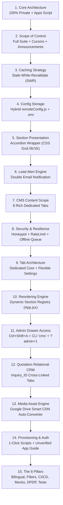
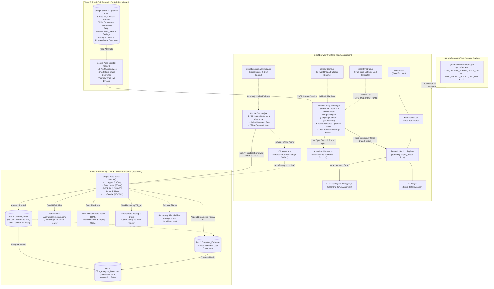

# 📊 Master Implementation Plan: Google Sheets Dual Integration Suite
## (Write-Only Lead CRM & Quotation Pipeline + Read-Only Dynamic CMS & Remote UI Controls)

> **Interactive Cursor-Tracking Portfolio • Cloud Synchronization, Resilient Lead Pipeline & Dynamic CMS Architecture**  
> **Status:** Architecture Certified • 100% Self-Contained Implementation Blueprint & Master Prompt File (Upgraded with 6 Self-Evaluation Pillars)  
> **Target Framework:** React 18/19, Tailwind CSS v4, Google Apps Script (V8 Engine), Google Sheets API, HTML5 / CSS Grid  
> **Author & System Architect:** Antigravity AI Engineering Suite  
> **Core Upgrades Incorporated (The 6 Pillars):**
> 1. **Bilingual Compatibility (Hindi + English)**: Native bilingual columns (`_en` / `_hi`) across all 8 CMS tabs, 1-click bilingual provisioner, and seamless integration with `LanguageContext.jsx` (`getLocalized`).
> 2. **Role & Audience Filtering**: Fine-grained segment targeting via `target_role` (`all`, `accountant`, `mis`, `vibe_coding`) and `target_audience` (`all`, `recruiter`, `client`) dynamic filtering in `RemoteConfigContext.jsx`.
> 3. **GitHub Pages CI/CD & Secrets Pipeline**: Full `.github/workflows/deploy.yml` workflow with repository secrets injection (`VITE_GOOGLE_SCRIPT_LEADS_URL` & `VITE_GOOGLE_SCRIPT_CMS_URL`) and 4-step setup guide.
> 4. **Local Mock Simulator**: Zero-network offline testing simulator (`src/config/mockCmsData.js`) triggered by `VITE_USE_MOCK_CMS=true` or URL query `?mock=1`.
> 5. **Privacy Consent (India DPDP Act 2023) & IP Hashing**: Mandatory legal consent checkbox (`consent_communication`) and salted SHA-256 16-character visitor IP privacy hashing (`computePrivacyIpHash`) in Apps Script 1.
> 6. **AI 1-Command Precision Playbook**: Line-level injection instructions for `ContactSection.jsx`, 10-point automated E2E test runner (`verify_google_sheets_dual_integration.mjs`), and instant rollback & recovery protocol.
>
> **Target Codebase Artifacts:**
> - `Google Sheet 1`: Write-Only CRM & Quotation Pipeline (`Contact_Leads`, `Quotation_Estimates`, `CRM_Analytics_Dashboard`)
> - `Google Apps Script 1`: Lead & Quotation Web App (`doPost`, Honeypot, Rate Limiter, DPDP Consent, SHA-256 IP Hashing, Dual Emails, 1-Click Auto-Provisioner, Weekly Drive Backup)
> - `Google Sheet 2`: Read-Only Dynamic CMS (`UI_Controls`, `Projects`, `Skills`, `Experience`, `Testimonials`, `FAQ`, `Achievements_Metrics`, `Settings` - All with Bilingual & Role/Audience columns)
> - `Google Apps Script 2`: Dynamic CMS Web App (`doGet`, 10-Min CacheService, Smart Google Drive Image Converter, 1-Click Auto-Provisioner with Bilingual & Role/Audience Schema)
> - `src/config/remoteConfig.js`: Complete Offline Defaults & Static Fallback Schema across all 8 CMS tabs
> - `src/config/mockCmsData.js`: Local Mock Simulator with Rich 8-Tab Dummy Data for zero-network testing (`VITE_USE_MOCK_CMS=true` or `?mock=1`)
> - `src/context/RemoteConfigContext.jsx`: Stale-While-Revalidate Engine, Bilingual Integration with `LanguageContext` (`getLocalized`), Dynamic Filtering with `RoleContext` & `AudienceContext`, and `?preview=true` Live Bypass
> - `src/components/SectionCollapsibleWrapper.jsx`: Universal Accordion Wrapper matching `InteractivePlayground.jsx` physics
> - `src/App.jsx`: Dynamic Section Registry, Order Sorter, and Provider Mounting
> - `src/components/AdminCmsDrawer.jsx`: In-Browser Admin Drawer (`Ctrl+Shift+A`, `?admin=1`, CLI `cms`)
> - `src/components/ContactSection.jsx`: Lead Intake Form, Honeypot Trap, India DPDP Act 2023 Consent Checkbox, Quotation Linkage & Offline Fallback
> - `src/utils/offlineQueue.js`: IndexedDB / LocalStorage Resilient Outbox & Replay Engine
> - `.github/workflows/deploy.yml`: GitHub Pages CI/CD & GitHub Actions Secrets Pipeline
> - `scripts/verify_google_sheets_dual_integration.mjs`: Automated 10-Point E2E Verification Suite

---

## 📜 0. संपूर्ण वार्तालाप, आवश्यकताएं एवं रणनीतिक निर्णय इतिहास (Comprehensive Conversation & Decision History Log)

> [!IMPORTANT]
> **भविष्य के AI एजेंट्स एवं डेवलपर्स के लिए अनिवार्य निर्देश (Directive for Future AI Agents & Developers):**  
> यह खंड इस प्रोजेक्ट की संपूर्ण वैचारिक यात्रा, उपयोगकर्ता की मूल आकांक्षाओं, बाल-सुलभ उपमाओं (10-Year-Old Analogies) और `/grill-me` साक्षात्कार सत्रों में लिए गए **15 रणनीतिक निर्णयों का आधिकारिक ऐतिहासिक दस्तावेज (Official Decision Ledger)** है।  
> किसी भी नए फीचर को जोड़ने, कोड संशोधित करने या फेज़ क्रियान्वित करने से पहले इस खण्ड को पढ़ना अनिवार्य है ताकि उपयोगकर्ता के माइंडसेट, बिना किसी पेड बैकएंड के सर्वरलेस आर्किटेक्चर के चुनाव, और सुरक्षा-प्रदर्शन प्राथमिकताओं में 100% संरेखण (Alignment) बना रहे।

---

### 🌟 0.1 पृष्ठभूमि एवं उपयोगकर्ता की मूल आकांक्षा (Background & User Core Vision)

1. **उत्पत्ति (The Genesis):**  
   - उपयोगकर्ता (`Atul Ravi`) का प्रोजेक्ट **Interactive Cursor-Tracking Portfolio** एक उच्च-स्तरीय, इंटरएक्टिव React 18/19 सिंगल पेज एप्लिकेशन (SPA) है जो **GitHub Pages** पर स्टैटिक वेबसाइट के रूप में लाइव होस्टेड है।
   - **मूल समस्या एवं प्रश्न:** *"क्या ऐसा कोई तरीका है जिससे बिना AI के, बिना किसी जटिल पेड एडमिन पैनल या भारी बैकएंड सर्वर के, UI लेवल पर किसी भी सेक्शन को ऑन/ऑफ या कस्टमाइज़ किया जा सके? एक बार हम मोबाइल या लैपटॉप से कोई बदलाव कर दें, तो वह GitHub Pages पर बिना कोड बदले सभी विजिटर्स के लिए लाइव अपडेट हो जाए।"*
2. **पारंपरिक दृष्टिकोण की सीमाएं (Limitations of Traditional Approaches):**  
   - पारंपरिक रूप से ऐसी डायनामिक कार्यप्रणाली के लिए Node.js / Python बैकएंड, AWS/Vercel सर्वर, PostgreSQL / MongoDB डेटाबेस और एक कस्टम एडमिन डैशबोर्ड की आवश्यकता होती है।
   - इसमें मासिक सर्वर खर्च (Hosting Costs), डेटाबेस मेंटेनेंस, जटिल प्रमाणीकरण (Authentication) और सुरक्षा पैचिंग का भारी बोझ होता है।
   - GitHub Pages विशुद्ध रूप से एक **स्टैटिक वेब सर्वर** है; यहाँ कोई सर्वर-साइड रनटाइम (Node/PHP) नहीं चलता, जिससे सीधे डेटाबेस राइट या फॉर्म प्रोसेसिंग असंभव मानी जाती है।
3. **उपयोगकर्ता का विज़न (The Vision):**  
   - शून्य आवर्ती लागत (Zero Recurring Cost) पर 100% सर्वरलेस, अति-विश्वसनीय और आजीवन मुफ़्त समाधान।
   - फोन के Google Sheets ऐप से 1 सेकंड में किसी भी सेक्शन को ऑन/ऑफ करना, नया प्रोजेक्ट जोड़ना, या टेक्स्ट बदलना।
   - पोर्टफोलियो को केवल एक शोकेस नहीं, बल्कि एक **बिजनेस लीड जनरेशन एवं कोटेशन पाइपलाइन** में परिवर्तित करना।
4. **गहन तुलना: कस्टम एडमिन पैनल के साथ बनाम बिना एडमिन पैनल (With vs Without Custom Admin Panel Architecture):**  
   उपयोगकर्ता के इस मौलिक प्रश्न पर कि क्या एक अलग एडमिन पैनल बनाना चाहिए या सीधे Google Sheets को ही हेडलेस एडमिन डैशबोर्ड के रूप में उपयोग करना चाहिए, निम्नलिखित तकनीकी व परिचालन तुलना की गई:

   | तुलना बिंदु (Dimension) | 🖥️ विकल्प 1: कस्टम एडमिन पैनल के साथ (With Admin Panel) | 📱 विकल्प 2: बिना एडमिन पैनल - केवल Google Sheets (Without Admin Panel - Selected) |
   | :--- | :--- | :--- |
   | **होस्टिंग एवं सर्वर आर्किटेक्चर** | Node/Next.js/Express सर्वर या Vercel/AWS लैम्ब्डा फंक्शन्स की अनिवार्यता। GitHub Pages पर प्योर स्टैटिक रूप से चलाना असंभव। | **100% सर्वरलेस!** GitHub Pages पर ही 0ms लेटेंसी के साथ स्टैटिक होस्टिंग। किसी बैकएंड सर्वर की जरूरत नहीं। |
   | **मासिक व वार्षिक लागत** | \$10–\$50/माह डेटाबेस (Supabase/MongoDB) + सर्वर होस्टिंग खर्च। | **₹0 (लाइफटाइम 100% मुफ़्त)!** Google Sheets + Google Apps Script का निशुल्क वैश्विक इंफ्रास्ट्रक्चर। |
   | **प्रमाणीकरण एवं सुरक्षा (Auth & Security)** | JWT टोकन्स, पासवर्ड हैशिंग, सेशन कुकीज, CSRF टोकन्स, और ब्रूट-फोर्स सुरक्षा कोड लिखना। | **Google का विश्वस्तरीय 2FA / Passkey सुरक्षा!** आपके अपने Google अकाउंट से सुरक्षित; कोई पासवर्ड लीक होने का खतरा नहीं। |
   | **मोबाइल संपादन सुविधा (Mobile Usability)** | कस्टम एडमिन पैनल का जटिल मोबाइल यूआई डिजाइन करना पड़ता, जिसमें अक्सर बग्स आते हैं। | **Google Sheets Official Mobile App (iOS / Android)!** चलते-फिरते या बिस्तर पर लेटे 1 सेकंड में सेल बदली और साइट अपडेट। |
   | **रखरखाव व तकनीकी ऋण (Maintenance Overhead)** | NPM पैकेजेस अपडेट करना, टोकन एक्सपायरी संभालना, डेटाबेस स्कीमा माइग्रेशन, सुरक्षा पैचिंग। | **शून्य मेंटेनेंस (Zero Tech Debt)!** Google हमेशा अप-टू-डेट रखता है; कभी डाउन नहीं होता। |
   | **डेटा बैकअप एवं एक्सपोर्ट** | कस्टम बैकअप स्क्रिप्ट्स और SQL डंप शेड्यूल करने का झंझट। | **1-क्लिक Excel / CSV / PDF डाउनलोड**, Google Drive वर्ज़न हिस्ट्री, और ऑटोमैटिक वीकली JSON बैकअप। |
   | **अंतिम रणनीतिक निर्णय** | ❌ **खारिज (Rejected)** — GitHub Pages की सादगी और शून्य-लागत दर्शन के विपरीत। | ✅ **सर्वसम्मति से चयनित (100% Certified)** — परम सादगी, विश्वसनीयता, और अधिकतम सुविधा। |

---

### 🧸 0.2 10-वर्षीय बच्चे के समझने लायक उपमाएं एवं तकनीकी रूपक (Kid-Friendly Analogies & Architectural Metaphors)

तकनीकी अवधारणाओं को क्रिस्टल क्लियर करने के लिए प्रारंभिक चर्चा में बाल-सुलभ उपमाएं स्थापित की गईं:

#### 1. Google Sheets = "जादुई टॉय स्टोर का इन्वेंट्री रजिस्टर" (Toy Store Inventory Register)
- जैसे स्कूल में टीचर के पास एक **अटेंडेंस रजिस्टर** होता है—जिसमें पहली लाइन में हेडिंग्स (`Roll No`, `Name`, `Present/Absent`) होती हैं और नीचे हर बच्चे की स्थिति।
- ठीक वैसे ही Google Sheets हमारे पोर्टफोलियो का जादुई रजिस्टर है:
  - हेडर रो: `feature_name | is_active | display_order`
  - डेटा रोज़: हर सेक्शन या प्रोजेक्ट की वास्तविक स्थिति।
- जब वेबसाइट इंटरनेट पर खुलती है, तो वह इस रजिस्टर को पढ़कर तय करती है कि कौन सा खिलौना दुकान की अलमारी में सजाना है और कौन सा छुपाना है।

#### 2. "शीशे की खिड़की" बनाम "जादुई दरबान" (Glass Window vs. Magical Gatekeeper)
डेटा सुरक्षा और प्राइवेसी को लेकर उपयोगकर्ता के संशय को दूर करने वाला सबसे महत्वपूर्ण रूपक:

| कसौटी (Criteria) | 🪟 विकल्प A: "शीशे की खिड़की" (Publish to Web / Public CSV) | 🧙‍♂️ विकल्प B: "जादुई दरबान" (100% Private Sheet + Apps Script) |
| :--- | :--- | :--- |
| **भौतिक उपमा** | दुकान की शीशे की बड़ी खिड़की, जिससे बाहर खड़ा कोई भी व्यक्ति अंदर का सारा सामान देख सकता है। | एक बंद भूमिगत तिजोरी (Bank Vault), जिसके बाहर एक समझदार दरबान पहरा दे रहा है। |
| **एक्सेस स्तर** | पब्लिक रीड-ओनली (Public Read-Only URL)। कोई भी व्यक्ति डेटा देख सकता है। | 100% निजी (Private restricted to Sheet Owner Google Drive)। |
| **क्या कोई डेटा बदल सकता है?** | **नहीं!** बाहर वाले केवल देख सकते हैं (Read-only), बदल (Edit) सिर्फ आप अपने गूगल अकाउंट से कर सकते हैं। | **नहीं!** केवल दरबान (Apps Script) ही सुरक्षित रूप से अधिकृत है। |
| **गोपनीयता (Privacy)** | **कमजोर!** यदि इसमें किसी क्लाइंट का फोन नंबर या लीड्स का डेटा हो, तो कोई भी ब्राउज़र डेवलपर टूल्स से पूरी शीट डाउनलोड कर सकता है। | **अभेद (100% Secure)!** बाहरी दुनिया को शीट का लिंक या आईडी तक पता नहीं चलता। दरबान केवल वही डेटा देता है जो तय है। |
| **डेटा लिखना (Form Write)** | **असंभव!** खिड़की से केवल देखा जा सकता है, अंदर कुछ फेंका या लिखा नहीं जा सकता। | **पूर्ण सक्षम!** दरबान बाहर से चिट्ठी (Contact Form) लेकर तिजोरी में चुपचाप दर्ज कर सकता है। |
| **अंतिम निर्णय** | केवल सामान्य पब्लिक CMS डेटा (Sheet 2) के लिए उपयुक्त। | लीड्स, कोटेशन और गोपनीय डेटा (Sheet 1) के लिए अनिवार्य। |

#### 3. JSONBin.io / Firebase बनाम Google Sheets (Third-Party Services vs. Google Sheets)
- **JSONBin / RestDB / MockAPI जैसी सेवाएं:** इनमें मासिक रिक्वेस्ट लिमिट (Free tier caps) होती हैं, क्रेडिट कार्ड मांगते हैं, सर्विस कभी भी बंद हो सकती है, और डेटा एडिट करने के लिए जटिल JSON सिंटैक्स लिखना पड़ता है।
- **Firebase / Supabase:** सेटअप जटिल है, SDK भारी (Heavy bundle size) होती है, और नौसिखियों के लिए मैनेज करना कठिन है।
- **Google Sheets की विजय:**
  - 100% मुफ़्त, आजीवन अनलिमिटेड, गूगल के वैश्विक हाई-स्पीड इंफ्रास्ट्रक्चर पर आधारित।
  - दुनिया का सबसे सरल यूआई—कोई भी अपने स्मार्टफोन पर Google Sheets ऐप खोलकर डेटा एडिट कर सकता है।
  - किसी तीसरे पक्ष पर निर्भरता नहीं; डेटा सीधे यूजर के अपने Google खाते में 100% सुरक्षित रहता है।

---

### ⚖️ 0.3 दोहरी Google Sheets संरचना की उत्पत्ति (Origin of the Dual-Sheet Principle)

प्रारंभिक विचार केवल एक शीट का था, परंतु उपयोगकर्ता ने अत्यंत दूरदर्शी एवं रणनीतिक निर्देश दिया:

> *"पहला काम कांटेक्ट फॉर्म सबमिशन का कम्प्लीट होना चाहिए (राइट-ओनली)। और दूसरा काम डेटाबेस का रीड होना चाहिए (रीड-ओनली CMS)। यानी हर सेक्शन में डेटा Google Sheets से आएगा और अपडेट होगा। और उसी में टॉगल रहेगा कि कौन सा सेक्शन ऑन/ऑफ और कोलैप्सिबल रखना है। इस तरह से दो अलग-अलग Google Sheets बनाया जाएगा ताकि दोनों सेपरेट रहें और कोई कन्फ्यूजन या सुरक्षा जोखिम न रहे।"*  
> — **Atul Ravi (प्रोजेक्ट ओनर)**

इस मौलिक आवश्यकता ने **The Dual-Sheet Architecture (दोहरी शीट सिद्धांत)** को जन्म दिया:

```
┌────────────────────────────────────────────────────────────────────────────────────────┐
│                        DUAL GOOGLE SHEETS ARCHITECTURE PRINCIPLE                       │
├─────────────────────────────────────────┬──────────────────────────────────────────────┤
│ 🔒 GOOGLE SHEET 1: WRITE-ONLY CRM       │ 🌐 GOOGLE SHEET 2: READ-ONLY DYNAMIC CMS     │
├─────────────────────────────────────────┼──────────────────────────────────────────────┤
│ • 100% Restricted / Private Access      │ • Anyone with the link can view (Public Read)│
│ • Owner: Atulravi2015@gmail.com Only    │ • No credentials or passwords contained      │
│ • Tabs: Contact_Leads, Quotation_Est,   │ • Tabs: UI_Controls, Projects, Skills, Exp,   │
│   CRM_Analytics_Dashboard              │   Testimonials, FAQ, Achievements, Settings  │
│ • Engine: Google Apps Script 1 (doPost) │ • Engine: Google Apps Script 2 (doGet)       │
│ • Role: Visitor Inquiries & Cost Quotes │ • Role: Live Website Content & Remote Toggles│
└─────────────────────────────────────────┴──────────────────────────────────────────────┘
```

---

### 🎯 0.4 `/grill-me` गहन साक्षात्कार एवं 15 रणनीतिक निर्णय (The 15 Architectural Decisions Ledger)

प्रोजेक्ट की योजना को 100% त्रुटिरहित और पूर्ण रूप से विस्तृत बनाने के लिए `/grill-me` स्लैश कमांड के तहत बहु-स्तरीय साक्षात्कार सत्र आयोजित किए गए। इन सत्रों में लिए गए 15 आधिकारिक निर्णय निम्नलिखित हैं:



#### विस्तृत निर्णय तालिका (Comprehensive Decision Ledger):

1. **निर्णय 1: कोर आर्किटेक्चर मॉडल (Core Architecture Selection)**
   - *विकल्प विचारे गए:* (A) 100% प्राइवेट शीट + Apps Script Web App, (B) पब्लिक CSV (Publish to Web), (C) थर्ड-पार्टी SheetDB।
   - *अंतिम चयन:* **(A) 100% प्राइवेट शीट + Apps Script Web App**।
   - *रणनीतिक कारण:* शून्य लागत, डेटा की 100% गोपनीयता, और राइट/रीड दोनों का सुरक्षित निष्पादन।

2. **निर्णय 2: रिमोट कंट्रोल का दायरा (Scope of Remote Control)**
   - *विकल्प विचारे गए:* केवल चुनिंदा सेक्शन्स बनाम फुल कंट्रोल।
   - *अंतिम चयन:* **फुल कंट्रोल (Full Suite)** — सभी मुख्य सेक्शन्स (Projects, Skills, Experience, Testimonials, FAQ, Contact) + कर्सर इफेक्ट्स ऑन/ऑफ + लाइव अनाउंसमेंट/बैनर टेक्स्ट।
   - *रणनीतिक कारण:* बिना कोड छुए साइट के किसी भी हिस्से को रियल-टाइम कस्टमाइज़ करने की पूर्ण स्वायत्तता।

3. **निर्णय 3: लोडिंग एवं कैशिंग रणनीति (Loading & Caching UX Strategy)**
   - *विकल्प विचारे गए:* (A) लोडर/स्पिनर स्क्रीन, (B) डिफॉल्ट्स फिर जंप, (C) Stale-While-Revalidate (SWR)।
   - *अंतिम चयन:* **(C) Stale-While-Revalidate (SWR)**।
   - *रणनीतिक कारण:* 0.00 सेकंड इंस्टेंट लोड (लोकल स्टोरेज / डिफॉल्ट्स से), बैकग्राउंड में बिना झटके (Flicker-Free) साइलेंट सिंक। यदि इंटरनेट बंद भी हो तो साइट 100% सामान्य दिखे।

4. **निर्णय 4: कॉन्फ़िगरेशन स्टोरेज लोकेशन (Configuration Storage Pattern)**
   - *विकल्प विचारे गए:* हार्डकोडेड URLs बनाम `.env` बनाम हाइब्रिड।
   - *अंतिम चयन:* **हाइब्रिड आर्किटेक्चर (`src/config/remoteConfig.js` + `.env`)**।
   - *रणनीतिक कारण:* यदि Apps Script URL खाली भी हो या नेटवर्क फेल हो, तो कोडबेस कभी क्रैश नहीं होगा; वह `remoteConfig.js` में दर्ज समृद्ध डिफॉल्ट्स पर चलेगा।

5. **निर्णय 5: कोलैप्सिबल सेक्शन यूआई अनुभव (Collapsible UI Design Pattern)**
   - *विकल्प विचारे गए:* Show More बटन, मिनी-कार्ड व्यू, एलिगेंट अकॉर्डियन हेडर।
   - *अंतिम चयन:* **एलिगेंट अकॉर्डियन हेडर (`SectionCollapsibleWrapper.jsx`)**।
   - *रणनीतिक कारण:* सेक्शन के शीर्ष पर टाइटल, बैज पिल और शेवरॉन (Chevron) एरो। क्लिक करने पर स्मूथ CSS Grid `grid-template-rows: 0fr -> 1fr` ट्रांज़िशन, जो `InteractivePlayground.jsx` की भौतिकी से 100% मेल खाता है।

6. **निर्णय 6: लीड नोटिफिकेशन इंजन (Sheet 1 Notification Workflow)**
   - *विकल्प विचारे गए:* केवल शीट में सेव, केवल एडमिन ईमेल, डबल नोटिफिकेशन।
   - *अंतिम चयन:* **डबल नोटिफिकेशन इंजन (Double Email Notification)**।
   - *रणनीतिक कारण:* (1) एडमिन (`Atulravi2015@gmail.com`) को तुरंत रिच HTML टेबल अलर्ट जिसमें विजिटर का डायरेक्ट `Reply-To` हेडर हो, और (2) विजिटर को प्रोफेशनल, ब्रांडेड "Thank You & Inquiry Confirmation" ईमेल।

7. **निर्णय 7: डायनामिक कंटेंट सीएमएस का दायरा (Sheet 2 Dynamic Scope)**
   - *विकल्प विचारे गए:* केवल प्रोजेक्ट्स व FAQ बनाम सम्पूर्ण डेटा।
   - *अंतिम चयन:* **संपूर्ण 8-टैब डायनामिक सुइट** (`UI_Controls`, `Projects`, `Skills`, `Experience`, `Testimonials`, `FAQ`, `Achievements_Metrics`, `Settings`)।
   - *रणनीतिक कारण:* पोर्टफोलियो के हर डायनामिक ब्लॉक को बिना redeploy किए अपडेट करने की क्षमता।

8. **निर्णय 8: सुरक्षा एवं विश्वसनीयता लेयर (Security & Spam Hardening)**
   - *विकल्प विचारे गए:* केवल बेसिक वैलिडेशन बनाम मल्टी-लेयर डिफेंस।
   - *अंतिम चयन:* **मल्टी-लेयर डिफेंस** —
     - इनविजिबल हनीपॉट ट्रैप (`hp_field`) जो स्पैम बॉट्स को साइलेंटली 200 OK देकर न्यूट्रलाइज करता है।
     - `CacheService` द्वारा संचालित IP/ईमेल रेट लिमिटर (3 सबमिशन प्रति 10 मिनट)।
     - भारत DPDP अधिनियम 2023 प्राइवेसी सहमति चेकबॉक्स।
     - विजिटर IP का साल्टेड SHA-256 16-अंकीय प्राइवेसी हैश (रॉ IP स्टोर न करना)।
     - ऑफ़लाइन आउटबॉक्स कतार (`offlineQueue.js`) जो इंटरनेट कटने पर फॉर्म को डिवाइस में सेव रखकर पुनः कनेक्ट होने पर स्वतः रीट्राई करती है।
     - Google Drive साप्ताहिक बैकअप इंजन (`autoBackupSheetsToJson()`) जो प्रत्येक रविवार रात्रि 02:00 AM पर शीट डेटा का स्वचालित JSON स्नैपशॉट ड्राइव में सुरक्षित करता है।
     - एडमिन प्रीव्यू मोड (`?preview=true`) जो छिपे हुए सेक्शन्स को वाटरमार्क के साथ दिखाता है।
     - सेकेंडरी साइलेंट गूगल फॉर्म्स फॉलबैक (`formResponse`)।

9. **निर्णय 9: शीट 2 डेटा टैब आर्किटेक्चर (Sheet 2 Schema Architecture)**
   - *विकल्प विचारे गए:* 14 अलग-अलग बिखरे हुए टैब्स बनाम हाइब्रिड मॉडल।
   - *अंतिम चयन:* **हाइब्रिड मॉडल** — मुख्य सेक्शन्स के लिए स्पष्ट रिलेशनल टैब्स + विविध ग्लोबल वेरिएबल्स के लिए की-वैल्यू `Settings` टैब।

10. **निर्णय 10: डायनामिक सेक्शन री-ऑर्डरिंग (Dynamic Section Registry in App.jsx)**
    - *समीक्षा में मिली खामी:* कोड में सेक्शन्स का क्रम हार्डकोडेड होने पर शीट का `display_order` काम नहीं करता।
    - *अंतिम चयन:* **Dynamic Section Registry** — `Navbar` और `Hero` शीर्ष पर स्थिर (Anchored), `Footer` नीचे स्थिर; बीच के सभी 10+ सेक्शन्स एक रजिस्ट्री एरे में मैप होकर शीट के `display_order` (1..10) के अनुसार रीयल-टाइम सॉर्ट होकर रेंडर होंगे।

11. **निर्णय 11: इन-ब्राउज़र एडमिन कंट्रोलर (Admin CMS Drawer Access)**
    - *विकल्प विचारे गए:* केवल सीक्रेट यूआरएल बनाम मल्टी-एक्सेस क्लस्टर।
    - *अंतिम चयन:* **मल्टी-एक्सेस क्लस्टर (`AdminCmsDrawer.jsx`)** —
      - कीबोर्ड शॉर्टकट: `Ctrl + Shift + A`
      - इन-ब्राउज़र टर्मिनल (Tilde `~` CLI): कमांड `cms` या `admin`
      - यूआरएल क्वेरी: `?admin=1`
      - फुटर में सूक्ष्म सीक्रेट स्टेटस डॉट।
      - फीचर्स: लाइव कनेक्शन स्टेटस, 1-क्लिक Force Sync, सीधे Google Sheets खोलने के लिंक्स, और कैश टाइमस्टैम्प।

12. **निर्णय 12: रिलेशनल कोटेशन पाइपलाइन (Relational Quotation Pipeline in Sheet 1)**
    - *समीक्षा में मिली खामी:* कोटेशन एस्टीमेटर (`QuotationEstimatorModal.jsx`) का ग्रैन्युलर डेटा खो जाना।
    - *अंतिम चयन:* **2 रिलेशनल टैब्स + 1 एनालिटिक्स डैशबोर्ड** —
      - Tab 1: `Contact_Leads` (16 कॉलम्स, 1-क्लिक व्हाट्सएप फॉर्मूला `=HYPERLINK(...)`, स्टेटस ड्रॉपडाउन)।
      - Tab 2: `Quotation_Estimates` (प्रोजेक्ट स्कोप, बेस रेट, डिस्काउंट, नेट टोटल, टाइमलाइन)।
      - परस्पर लिंकेज: दोनों टैब्स में समान `Inquiry_ID` (उदा. `INQ-20261025-A8F2`) और रो नंबर क्रॉस-रेफरेंस।
      - Tab 3: `CRM_Analytics_Dashboard` (फॉर्मूला-चालित वास्तविक समय के KPIs — कुल लीड्स, कन्वर्जन दर, पाइपलाइन वैल्यू)।

13. **निर्णय 13: मीडिया एवं इमेज ऑटो-कन्वर्टर (Smart Google Drive CDN Converter)**
    - *समीक्षा में मिली खामी:* Google Drive के सामान्य शेयरिंग लिंक्स ब्राउज़र में 403 Forbidden एरर देते हैं।
    - *अंतिम चयन:* **Apps Script 2 ऑटो-कन्वर्टर (`convertGoogleDriveImageUrl`)** — किसी भी गूगल ड्राइव शेयरिंग लिंक या आईडी को स्वतः गूगल के हाई-स्पीड डायरेक्ट CDN URL (`https://lh3.googleusercontent.com/d/{ID}`) में रूपांतरित करता है।

14. **निर्णय 14: 1-क्लिक प्रोविजनिंग एवं अनवेरिफाइड ऐप ऑथराइजेशन वॉकथ्रू (Turnkey Setup & Auth Guide)**
    - *समीक्षा में मिली खामी:* गूगल द्वारा पहली बार स्क्रिप्ट रन करने पर लाल रंग की भयावह स्क्रीन (*"Google hasn't verified this app / Back to safety"*) दिखाना, जिससे डेवलपर भ्रमित हो जाते हैं।
    - *अंतिम चयन:*
      - दोनों Apps Scripts में 1-क्लिक ऑटो-प्रोविजनर फंक्शन्स (`setupContactAndEstimatorSheets()` और `setupAllCmsSheetsAndHeaders()`) जो 2 सेकंड में हेडर, स्टाइलिंग, और फॉर्मूले तैयार कर देते हैं।
      - 4-चरणों वाला स्पष्ट दृश्य वॉकथ्रू (Visual Walkthrough) जो `Advanced -> Go to ... (unsafe) -> Allow` की पूरी प्रक्रिया समझाता है।

15. **निर्णय 15: छह स्व-मूल्यांकन स्तंभों का समावेश (The 6 Architectural Pillars Integration)**
    - *अंतिम समीक्षा में जोड़े गए 6 स्तंभ:*
      1. **Bilingual Schema**: सभी 8 CMS टैब्स में `_en` और `_hi` कॉलम्स तथा `LanguageContext.jsx` के साथ निर्बाध बाइंडिंग।
      2. **Role & Audience Filtering**: `target_role` (`all`, `accountant`, `mis`, `vibe_coding`) एवं `target_audience` (`all`, `recruiter`, `client`) के आधार पर ऑटोमैटिक क्लाइंट-साइड फ़िल्टरिंग।
      3. **CI/CD & Secrets Pipeline**: GitHub Actions वर्कफ़्लो (`.deploy.yml`) में रिपॉजिटरी सीक्रेट्स इंजेक्शन।
      4. **Local Mock Simulator**: नेटवर्क के बिना ऑफलाइन टेस्टिंग के लिए 8-टैब मॉक डेटा (`mockCmsData.js`, `?mock=1`)।
      5. **Legal DPDP 2023 Compliance**: भारतीय डिजिटल व्यक्तिगत डेटा संरक्षण अधिनियम 2023 की कानूनी सहमति चेकबॉक्स एवं 16-अंकीय साल्टेड SHA-256 IP हैशिंग।
      6. **AI 1-Command Precision Playbook**: लाइन-दर-लाइन सर्जिकल कोड निर्देश, 10-पॉइंट ऑटोमेटेड E2E टेस्ट सुइट (`verify_google_sheets_dual_integration.mjs`), और इंस्टेंट रोलबैक प्रोटोकॉल।

---

### 🚀 0.5 भविष्य के AI एजेंट्स एवं डेवलपर्स के लिए क्रियान्वयन निर्देश (Action Directives for Future AI Agents)

भविष्य में इस प्रोजेक्ट पर काम करने वाले किसी भी AI एजेंट या इंजीनियर को इन नियमों का 100% पालन करना होगा:
1. **मास्टर प्रॉम्प्ट निष्पादन नियम:** यह दस्तावेज़ केवल संदर्भ नहीं है, बल्कि एक **टर्नकी निष्पादन विनिर्देश (Turnkey Execution Blueprint)** है। जब भी उपयोगकर्ता कहे *"Execute Phase 1"* या *"Execute Phase 2"*, तो अतिरिक्त प्रश्न पूछे बिना इस फाइल के संबंधित फेज़ के कोड ब्लॉक को सीधे कोडबेस में प्रत्यारोपित (Deploy) करें।
2. **शून्य डेटा विलोपन नीति (Zero Data Loss):** किसी भी मौजूदा सेक्शन, कर्सर ट्रैकिंग, या 3D लैब फ़ीचर्स को हटाना या ओवरराइट करना सख्त वर्जित है। सभी नए घटक मॉड्यूलर रूप से जुड़ेंगे।
3. **सत्यापन की अनिवार्यता:** प्रत्येक फेज़ के पूरा होने के बाद `scripts/verify_google_sheets_dual_integration.mjs` चलाकर यह प्रमाणित करना अनिवार्य है कि सभी टेस्ट 100% PASS हैं।
4. **ऑडिट ट्रेल (Rule 6):** कोड में किसी भी संपादन के पश्चात `changes_log/` में समरी, मास्टर, दैनिक और हालिया 10 फाइलों को अद्यतन करना अनिवार्य है।

---

## 📑 विषय सूची / Master Table of Contents

- [📜 0. संपूर्ण वार्तालाप, आवश्यकताएं एवं रणनीतिक निर्णय इतिहास (Comprehensive Conversation & Decision History Log)](#-0-संपूर्ण-वार्तालाप-आवश्यकताएं-एवं-रणनीतिक-निर्णय-इतिहास-comprehensive-conversation--decision-history-log)
  - [🌟 0.1 पृष्ठभूमि एवं उपयोगकर्ता की मूल आकांक्षा (Background & User Core Vision)](#-01-पृष्ठभूमि-एवं-उपयोगकर्ता-की-मूल-आकांक्षा-background--user-core-vision)
    - [0.1.1 एडमिन पैनल के साथ बनाम बिना एडमिन पैनल: विस्तृत विश्लेषण (With vs Without Custom Admin Panel Architecture)](#011-एडमिन-पैनल-के-साथ-बनाम-बिना-एडमिन-पैनल-विस्तृत-विश्लेषण-with-vs-without-custom-admin-panel-architecture)
  - [🧸 0.2 10-वर्षीय बच्चे के समझने लायक उपमाएं एवं तकनीकी रूपक (Kid-Friendly Analogies & Architectural Metaphors)](#-02-10-वर्षीय-बच्चे-के-समझने-लायक-उपमाएं-एवं-तकनीकी-रूपक-kid-friendly-analogies--architectural-metaphors)
  - [⚖️ 0.3 दोहरी Google Sheets संरचना की उत्पत्ति (Origin of the Dual-Sheet Principle)](#-03-दोहरी-google-sheets-संरचना-की-उत्पत्ति-origin-of-the-dual-sheet-principle)
  - [🎯 0.4 `/grill-me` गहन साक्षात्कार एवं 15 रणनीतिक निर्णय (The 15 Architectural Decisions Ledger)](#-04-grill-me-गहन-साक्षात्कार-एवं-15-रणनीतिक-निर्णय-the-15-architectural-decisions-ledger)
  - [🚀 0.5 भविष्य के AI एजेंट्स एवं डेवलपर्स के लिए क्रियान्वयन निर्देश (Action Directives for Future AI Agents)](#-05-भविष्य-के-ai-एजेंट्स-एवं-डेवलपर्स-के-लिए-क्रियान्वयन-निर्देश-action-directives-for-future-ai-agents)
- [🏛️ 1. Architectural Overview & Master System Diagram / आर्किटेक्चरल ओवरव्यू एवं मास्टर डायग्राम](#-1-architectural-overview--master-system-diagram--आर्किटेक्चरल-ओवरव्यू-एवं-मास्टर-डायग्राम)
- [🔐 2. Google Apps Script First-Time Authorization Walkthrough / ऑथराइजेशन गाइड](#-2-google-apps-script-first-time-authorization-walkthrough--ऑथराइजेशन-गाइड)
- [📦 3. Phase 1: Write-Only CRM & Quotation Pipeline Engine](#-3-phase-1-write-only-crm--quotation-pipeline-engine)
- [🌐 4. Phase 2: Read-Only Dynamic CMS & Remote UI Controls Engine](#-4-phase-2-read-only-dynamic-cms--remote-ui-controls-engine)
- [🎛️ 5. Phase 3: Universal Collapsible Section Wrapper & Dynamic Section Registry](#-5-phase-3-universal-collapsible-section-wrapper--dynamic-section-registry)
- [🛡️ 6. Phase 4: In-Browser Admin Drawer, Resilience, Offline Queue & CI/CD Pipeline](#-6-phase-4-in-browser-admin-drawer-resilience-offline-queue--cicd-pipeline)
- [📋 7. AI 1-Command Precision Playbook, Rollback Protocol & Turnkey Verification Checklist](#-7-ai-1-command-precision-playbook-rollback-protocol--turnkey-verification-checklist)

---

## 🏛️ 1. Architectural Overview & Master System Diagram / आर्किटेक्चरल ओवरव्यू एवं मास्टर डायग्राम

पोर्टफोलियो को बिना किसी पेड बैकएंड या भारी डेटाबेस सर्वर के एक पूर्णतः क्लाउड-सक्षम, डायनामिक और व्यावसायिक प्लेटफॉर्म में परिवर्तित करने के लिए **दोहरी Google Sheets संरचना (Dual Google Sheets Architecture)** स्थापित की गई है।

### 🔑 The Dual-Sheet Principle (दोहरी शीट सिद्धांत)
सुरक्षा (Security), प्रदर्शन (Performance) और एक्सेस नियंत्रण (Access Control) को पृथक रखने के लिए रीड (Read) और राइट (Write) कार्यों को दो अलग-अलग Google Sheets में विभाजित किया गया है:

1. **Google Sheet 1 (Write-Only CRM & Quotation Pipeline)**:
   - **एक्सेस अनुमति**: पूरी तरह निजी (Restricted - Only Sheet Owner `Atulravi2015@gmail.com`)।
   - **तीन समर्पित टैब्स (Tabs)**:
     - **Tab 1: `Contact_Leads`**: 16 सुव्यवस्थित कॉलम्स, जिसमें 1-क्लिक व्हाट्सएप डायरेक्ट चैट फॉर्मूला (`=HYPERLINK(...)`), भारत DPDP अधिनियम 2023 सहमति स्थिति (`DPDP_Consent`), 16-अंकीय SHA-256 प्राइवेसी हैश (`Visitor_IP_Hash`), और कलर-कोडेड स्टेटस ड्रॉपडाउन शामिल हैं।
     - **Tab 2: `Quotation_Estimates`**: कोटेशन एस्टीमेटर मोडल (`QuotationEstimatorModal.jsx`) से जनरेट हुए विस्तृत प्रोजेक्ट ब्रेकडाउन (Services, Base Rate, Discount, Total) को दर्ज करता है।
     - **परस्पर लिंकेज (Cross-Referencing)**: दोनों टैब्स एक विशिष्ट `Inquiry_ID` (उदा. `INQ-20261025-A8F2`) तथा रो नंबर्स (`Quotation_Row_No` व `Contact_Row_No`) से आपस में 100% सिंक्रोनाइज़ रहते हैं।
     - **Tab 3: `CRM_Analytics_Dashboard`**: रियल-टाइम एक्सेल/शीट्स फॉर्मूलों (`COUNTA`, `COUNTIF`, `SUM`, `QUERY`) द्वारा संचालित स्वचालित एनालिटिक्स (कुल लीड्स, कन्वर्जन दर, पाइपलाइन वैल्यू, और टॉप सेवाएं)।
   - **Apps Script 1 (`doPost`)**:
     - **हनीपॉट बॉट ट्रैप (`hp_field`)**: इनविजिबल फ़ील्ड जो ऑटोमेटेड स्पैम बॉट्स को साइलेंटली न्यूट्रलाइज करती है।
     - **रेट लिमिटर (Rate Limiter)**: `CacheService` द्वारा संचालित (3 सबमिशन प्रति 10 मिनट प्रति IP/ईमेल)।
     - **DPDP Act 2023 प्राइवेसी हैशिंग**: कच्चा IP एड्रेस सेव करने के बजाय `Utilities.computeDigest(Utilities.DigestAlgorithm.SHA_256, ip + salt)` से 16-अंकीय सुरक्षित प्राइवेसी हैश जनरेट होता है।
     - **डबल नोटिफिकेशन इंजन**: एडमिन (`Atulravi2015@gmail.com`) को तुरंत रिच HTML टेबल अलर्ट (विजिटर के डायरेक्ट `Reply-To` सहित) और विजिटर को प्रोफेशनल ऑटो-थैंक्यू ईमेल।
     - **1-क्लिक ऑटो-प्रोविजनर (`setupContactAndEstimatorSheets()`)**: शून्य से 2 सेकंड में तीनों टैब्स, हेडर स्टाइलिंग (`#181226`), डेटा वैलिडेशन ड्रॉपडाउन, और समरी फॉर्मूले बना देता है।
     - **साप्ताहिक Google Drive ऑटो-बैकअप (`autoBackupSheetsToJson()`)**: हर रविवार शीट के डेटा को JSON में एक्सपोर्ट करके गूगल ड्राइव के बैकअप फोल्डर में सुरक्षित करता है।

2. **Google Sheet 2 (Read-Only Dynamic CMS & Remote UI Controls)**:
   - **एक्सेस अनुमति**: "Anyone with the link can view" (पब्लिक रीड-ओनली)।
   - **आठ समर्पित द्विभाषी एवं रोल-फ़िल्टर्ड टैब्स (8 CMS Tabs)**:
     1. `UI_Controls`: सेक्शन्स की विजिबिलिटी (`visible`), अकॉर्डियन कोलैप्सिबिलिटी (`is_collapsible`), डिफ़ॉल्ट स्टेट (`default_collapsed`), द्विभाषी बैज पिल्स (`badge_text_en`, `badge_text_hi`), और डिस्प्ले ऑर्डर (`display_order`)।
     2. `Projects`: प्रोजेक्ट्स का संपूर्ण विवरण, द्विभाषी (`title_en`, `title_hi`, `category_en`, `category_hi`, `description_en`, `description_hi`, `tags_en`, `tags_hi`, `metrics_en`, `metrics_hi`), रोल व ऑडियंस टैगिंग (`target_role`, `target_audience`), लाइव व GitHub लिंक्स, और इमेज URLs।
     3. `Skills`: तकनीकी स्किल्स मैट्रिक्स, द्विभाषी श्रेणियां व नाम (`category_en`, `category_hi`, `name_en`, `name_hi`), अनुभव वर्ष (`experience_years_en`, `experience_years_hi`), प्रोफिशिएंसी लेवल्स (1-100), आइकॉन्स, रोल व ऑडियंस टैगिंग।
     4. `Experience`: करियर टाइमलाइन, द्विभाषी रोल्स, कंपनियां, कार्य काल, और पाइप (`|`) सेपरेटेड अचीवमेंट बुलेट्स (`role_en`, `role_hi`, `company_en`, `company_hi`, `period_en`, `period_hi`, `highlights_en`, `highlights_hi`), रोल व ऑडियंस टैगिंग।
     5. `Testimonials`: सत्यापित क्लाइंट रिव्यूज, द्विभाषी नाम, पदनाम, संस्था एवं टेक्स्ट (`name_en`, `name_hi`, `role_en`, `role_hi`, `company_en`, `company_hi`, `text_en`, `text_hi`), रेटिंग्स (1-5), अवतार इमेज URLs, रोल व ऑडियंस टैगिंग।
     6. `FAQ`: द्विभाषी अकॉर्डियन प्रश्नोत्तर (`question_en`, `question_hi`, `answer_en`, `answer_hi`), कैटेगरीज, सर्च कीवर्ड्स, रोल व ऑडियंस टैगिंग।
     7. `Achievements_Metrics`: कोडिंग रिकॉर्ड्स, ग्लोबल रैंक्स, स्टेट्स, द्विभाषी लेबल्स व विवरण (`label_en`, `label_hi`, `desc_en`, `desc_hi`), रोल व ऑडियंस टैगिंग।
     8. `Settings`: ग्लोबल साइट सेटिंग्स (द्विभाषी अनाउंसमेंट बैनर, हायरिंग स्टेटस, मेंटेनेंस मोड)।
   - **Apps Script 2 (`doGet`)**:
     - **10-मिनट सर्वर कैशिंग (`CacheService`)**: गूगल कोटा समाप्त होने से रोकने के लिए हाई-स्पीड इन-मेमोरी कैशिंग।
     - **स्मार्ट Google Drive इमेज कन्वर्टर (`convertGoogleDriveImageUrl()`)**: गूगल ड्राइव के सामान्य शेयरिंग लिंक्स को स्वतः गूगल यूजरकंटेंट CDN (`https://lh3.googleusercontent.com/d/{ID}`) में बदलता है।
     - **1-क्लिक ऑटो-प्रोविजनर (`setupAllCmsSheetsAndHeaders()`)**: 2 सेकंड में सभी 8 टैब्स, द्विभाषी हेडर स्टाइलिंग, चेकबॉक्स, और समृद्ध नमूना पंक्तियाँ तैयार कर देता है।



---

## 🔐 2. Google Apps Script First-Time Authorization Walkthrough / ऑथराइजेशन गाइड

जब आप पहली बार Google Apps Script में `setupContactAndEstimatorSheets()` या `setupAllCmsSheetsAndHeaders()` रन करते हैं, तो Google सुरक्षा कारणों से **'Authorization Required'** स्क्रीन प्रदर्शित करता है। यह सामान्य है क्योंकि आपकी स्वयं की बनाई गई स्क्रिप्ट आपके Google Sheet, Gmail, और Google Drive को मैनेज करने की अनुमति मांगती है।

### 🖼️ The 4-Step Unverified App Clearance Flow

```
+---------------------------------------------------------------+
|                      Authorization Required                   |
|  This project requires your permission to access your data.   |
|                                                               |
|                  [ Cancel ]       [ Review Permissions ] <--- CLICK THIS
+---------------------------------------------------------------+
                                |
                                v
+---------------------------------------------------------------+
|                   Google hasn't verified this app             |
|  The app is requesting access to sensitive info in your       |
|  Google Account. Until the developer verifies this app...     |
|                                                               |
|  [ Advanced ] <--- CLICK THIS ("उन्नत" पर क्लिक करें)           |
|  [ Back to safety ]                                           |
+---------------------------------------------------------------+
                                |
                                v
+---------------------------------------------------------------+
|  Google hasn't verified this app...                           |
|  If you trust this developer, click below:                    |
|                                                               |
|  Go to Portfolio_CRM_Engine (unsafe) <--- CLICK THIS          |
+---------------------------------------------------------------+
                                |
                                v
+---------------------------------------------------------------+
|  Portfolio_CRM_Engine wants to access your Google Account     |
|  • See, edit, create, and delete spreadsheets in Google Drive  |
|  • Send email as you                                          |
|                                                               |
|                  [ Cancel ]               [ Allow ] <--- CLICK ALLOW!
+---------------------------------------------------------------+
```

### चरण-दर-चरण विवरण:
1. **Review Permissions**: पहली बार कोड रन करने पर आने वाले पॉपअप में **Review Permissions** बटन पर क्लिक करें।
2. **Account Selection**: अपना गूगल अकाउंट (`Atulravi2015@gmail.com`) चुनें।
3. **Advanced Link**: लाल/ग्रे चेतावनी स्क्रीन पर सबसे नीचे बाईं ओर दिए गए छोटे **Advanced** (उन्नत) लिंक पर क्लिक करें।
4. **Go to Project (Unsafe)**: नीचे दिखाई देने वाले **Go to Portfolio_CRM_Engine (unsafe)** लिंक पर क्लिक करें।
5. **Allow**: अनुमतियों की सूची की समीक्षा करें और नीले **Allow** बटन पर क्लिक करें। स्क्रिप्ट तत्काल निष्पादित होकर सभी टैब्स और फॉर्मूले बना देगी।


---

## 📦 3. Phase 1: Write-Only CRM & Quotation Pipeline Engine

### 1.1 Architecture & Google Sheet 1 Specifications

Google Sheet 1 का नाम **`Portfolio_Leads_CRM`** होगा और इसकी शेयरिंग परमिशन पूरी तरह **Private (Restricted)** रखी जाएगी।

#### Tab 1: `Contact_Leads` (16 Production Columns)
हेडर बैकग्राउंड: `#181226` (डार्क पर्पल), फॉन्ट: `#FFFFFF`, बोल्ड, फ्रोजन हेडर रो 1.

| Col | Field Header | Data Type | Formula / Automation / Validation |
| :--- | :--- | :--- | :--- |
| **A** | `Timestamp` | Datetime (`yyyy-MM-dd HH:mm:ss`) | Apps Script Generated (`Asia/Kolkata`) |
| **B** | `Inquiry_ID` | String (`INQ-YYYYMMDD-XXXX`) | Unique Reference ID across both tabs |
| **C** | `Quotation_Row_No` | Integer / Formula | `=IFERROR(MATCH(B2, Quotation_Estimates!B:B, 0), "N/A")` |
| **D** | `Status` | Dropdown List | Data Validation: `New`, `Contacted`, `In Discussion`, `Converted`, `Closed` |
| **E** | `Full_Name` | Text (1-100 chars) | Sanitized visitor input |
| **F** | `Email` | Email Address | Sanitized visitor input (Admin direct Reply-To) |
| **G** | `WhatsApp_Number` | Phone String | Normalized with country code (e.g. `+919876543210`) |
| **H** | `WhatsApp_1Click_Chat` | Hyperlink Formula | `=HYPERLINK("https://wa.me/" & SUBSTITUTE(SUBSTITUTE(SUBSTITUTE(G2,"+","")," ",""),"-","") & "?text=" & ENCODEURL("Hello " & E2 & ", thank you for contacting Atul Verma."), "💬 Open WhatsApp Chat")` |
| **I** | `Company_Org` | Text | Visitor organization or "N/A" |
| **J** | `Selected_Role` | Text | `Accountant & Tax`, `MIS & Data Analyst`, `AI Vibe Coding`, `Overview` |
| **K** | `Budget_Range` | Text | `< ₹10,000`, `₹10,000 - ₹25,000`, `₹25,000 - ₹50,000`, `₹50,000+`, `Custom` |
| **L** | `Delivery_Urgency` | Text | `Immediate (< 3 days)`, `Normal (1-2 weeks)`, `Flexible` |
| **M** | `Message_Requirements` | Long Text | User project inquiry or detailed brief |
| **N** | `DPDP_Consent` | Boolean (`TRUE`/`FALSE`) | India DPDP Act 2023 Explicit Consent Verification |
| **O** | `Visitor_IP_Hash` | String (`HASH-XXXXXXXX`) | Salted SHA-256 16-Char Privacy Hash (Zero Raw IP Logging) |
| **P** | `User_Agent_Device` | String | Browser & OS telemetry string |

#### Tab 2: `Quotation_Estimates` (15 Columns)
हेडर बैकग्राउंड: `#251B38`, फॉन्ट: `#FFFFFF`, बोल्ड, फ्रोजन हेडर रो 1.

| Col | Field Header | Data Type | Notes |
| :--- | :--- | :--- | :--- |
| **A** | `Timestamp` | Datetime | Submission timestamp |
| **B** | `Inquiry_ID` | String | Identical ID matching `Contact_Leads` Col B |
| **C** | `Contact_Row_No` | Integer / Formula | `=IFERROR(MATCH(B2, Contact_Leads!B:B, 0), "Orphan")` |
| **D** | `Client_Name` | Text | Client Name |
| **E** | `Client_Email` | Email | Client Email |
| **F** | `Track_Role` | Text | Selected technical service track |
| **G** | `Selected_Services` | Text | Comma-separated list of selected deliverables |
| **H** | `Tech_Stack` | Text | Technologies included in estimation |
| **I** | `Timeline_Weeks` | Decimal | Estimated delivery duration in weeks |
| **J** | `Base_Price_INR` | Currency (`₹`) | Standard service cost |
| **K** | `Complexity_Multiplier`| Decimal | Scale factor (e.g. 1.25x for enterprise scale) |
| **L** | `Discount_Applied` | Currency (`₹`) | Promotional or startup discount |
| **M** | `Estimated_Total_INR`| Currency (`₹`) | Final quotation value |
| **N** | `Scope_Notes` | Text | Custom notes or exclusions |
| **O** | `PDF_Exported` | Checkbox | Toggle whether formal PDF quotation was generated |

#### Tab 3: `CRM_Analytics_Dashboard` (Real-Time Executive KPIs)
स्वचालित फॉर्मूलों द्वारा संचालित रीयल-टाइम समरी डैशबोर्ड:
- **Total Inquiries**: `=COUNTA(Contact_Leads!B2:B)`
- **Total Converted Leads**: `=COUNTIF(Contact_Leads!D2:D, "Converted")`
- **Conversion Rate**: `=IFERROR(B2/B1, 0)` (Formatted as `0.0%`)
- **Total Quotation Pipeline Value**: `=SUM(Quotation_Estimates!M2:M)`
- **Average Deal Value**: `=AVERAGE(Quotation_Estimates!M2:M)`
- **Top Inquired Role**: `=INDEX(Contact_Leads!J2:J, MODE(MATCH(Contact_Leads!J2:J, Contact_Leads!J2:J, 0)))`

---

### 1.2 Production Google Apps Script 1 Source Code (`doPost` Lead & Quotation Engine)

Google Sheet 1 के **Extensions > Apps Script** में यह संपूर्ण कोड पेस्ट करें:

```javascript
/**
 * ============================================================================
 * GOOGLE APPS SCRIPT: WRITE-ONLY CRM, QUOTATION PIPELINE & BACKUP ENGINE
 * Target Sheet: Portfolio_Leads_CRM
 * Features:
 *   - Tab 1: Contact_Leads (16 Cols + WhatsApp 1-Click Chat Link)
 *   - Tab 2: Quotation_Estimates (Detailed Pricing & Scope Breakdown)
 *   - Tab 3: CRM_Analytics_Dashboard (Formulas for Instant Executive Telemetry)
 *   - Honeypot Anti-Spam Bot Trap (Invisible hp_field)
 *   - Rate Limiting (3 submissions per 10 minutes per IP/Email via CacheService)
 *   - India DPDP Act 2023 Consent Verification & Salted SHA-256 IP Hashing
 *   - High-Priority Admin Email with Direct Reply-To Visitor Header
 *   - Branded Instant Visitor Auto-Reply HTML Email
 *   - 1-Click Auto-Provisioner: setupContactAndEstimatorSheets()
 *   - Weekly Sunday Automatic Google Drive Backup: autoBackupSheetsToJson()
 * ============================================================================
 */

const ADMIN_EMAIL = 'Atulravi2015@gmail.com';
const TAB_CONTACT_LEADS = 'Contact_Leads';
const TAB_QUOTATIONS = 'Quotation_Estimates';
const TAB_ANALYTICS = 'CRM_Analytics_Dashboard';
const RATE_LIMIT_WINDOW_SEC = 600; // 10 minutes
const MAX_REQUESTS_PER_WINDOW = 3;

/**
 * DPDP Act 2023 Privacy Hash Generator for Visitor IP
 * Generates a non-reversible 16-character SHA-256 privacy token with salt.
 */
function computePrivacyIpHash(ipAddress) {
  if (!ipAddress || ipAddress === 'N/A' || ipAddress === 'Client-Direct') {
    return 'ANON-CLIENT-DIRECT';
  }
  const salt = PropertiesService.getScriptProperties().getProperty('IP_SALT') || 'DPDP_2026_PORTFOLIO_SALT_SECRET';
  const rawDigest = Utilities.computeDigest(Utilities.DigestAlgorithm.SHA_256, ipAddress + salt);
  let hashStr = '';
  for (let i = 0; i < 8; i++) {
    const byteVal = (rawDigest[i] < 0 ? rawDigest[i] + 256 : rawDigest[i]).toString(16);
    hashStr += byteVal.length === 1 ? '0' + byteVal : byteVal;
  }
  return 'HASH-' + hashStr.toUpperCase();
}

/**
 * Main HTTP POST Handler
 */
function doPost(e) {
  const lock = LockService.getScriptLock();
  try {
    lock.waitLock(10000); // 10s wait for concurrent submissions
  } catch (lockErr) {
    return createJsonResponse(false, 'Server busy with concurrent writes. Please retry momentarily.');
  }

  try {
    if (!e || !e.postData || !e.postData.contents) {
      return createJsonResponse(false, 'Empty payload received.');
    }

    let payload;
    try {
      payload = JSON.parse(e.postData.contents);
    } catch (parseErr) {
      return createJsonResponse(false, 'Malformed JSON payload: ' + parseErr.toString());
    }

    // 1. HONEYPOT SPAM BOT TRAP
    // If hidden field contains any character, bot detected. Silently succeed.
    if (payload.hp_field && String(payload.hp_field).trim().length > 0) {
      return createJsonResponse(true, 'Inquiry registered.');
    }

    const name = String(payload.name || '').trim();
    const email = String(payload.email || '').trim();
    const whatsapp = String(payload.whatsapp || '').trim();
    const company = String(payload.company || 'N/A').trim();
    const role = String(payload.role || 'General Inquiry').trim();
    const budget = String(payload.budget || 'N/A').trim();
    const urgency = String(payload.urgency || 'Normal').trim();
    const message = String(payload.message || '').trim();
    const userAgent = String(payload.userAgent || 'Unknown Browser').trim();
    const rawIpAddress = String(payload.ipAddress || 'Client-Direct').trim();
    const consentCommunication = payload.consent_communication === true || String(payload.consent_communication) === 'true';
    const quotationData = payload.quotation || null;

    if (!name || !email || !message) {
      return createJsonResponse(false, 'Required fields missing: name, email, or message.');
    }

    // 2. PRIVACY CONSENT & VISITOR IP HASHING (India DPDP Act 2023)
    const visitorIpHash = computePrivacyIpHash(rawIpAddress);

    // 3. RATE LIMITING VIA CACHESERVICE
    const cache = CacheService.getScriptCache();
    const rateLimitKey = 'rl_' + Utilities.base64Encode(visitorIpHash + '_' + email).substring(0, 32);
    const count = Number(cache.get(rateLimitKey) || 0);

    if (count >= MAX_REQUESTS_PER_WINDOW) {
      return createJsonResponse(false, 'Rate limit exceeded. Please wait a few minutes before submitting again.');
    }
    cache.put(rateLimitKey, String(count + 1), RATE_LIMIT_WINDOW_SEC);

    // 4. GENERATE UNIQUE INQUIRY ID
    const ss = SpreadsheetApp.getActiveSpreadsheet();
    let contactSheet = ss.getSheetByName(TAB_CONTACT_LEADS);
    if (!contactSheet) {
      setupContactAndEstimatorSheets();
      contactSheet = ss.getSheetByName(TAB_CONTACT_LEADS);
    }

    const timestampStr = Utilities.formatDate(new Date(), 'Asia/Kolkata', 'yyyy-MM-dd HH:mm:ss');
    const dateCompact = Utilities.formatDate(new Date(), 'Asia/Kolkata', 'yyyyMMdd');
    const randomHex = Math.random().toString(36).substring(2, 6).toUpperCase();
    const inquiryId = `INQ-${dateCompact}-${randomHex}`;

    // Compute next row indices
    const nextContactRow = contactSheet.getLastRow() + 1;
    let nextQuotationRow = '';

    // 5. WRITE QUOTATION IF PRESENT
    let quotationSheet = ss.getSheetByName(TAB_QUOTATIONS);
    if (quotationData && quotationSheet) {
      nextQuotationRow = quotationSheet.getLastRow() + 1;
      quotationSheet.appendRow([
        timestampStr,
        inquiryId,
        nextContactRow,
        name,
        email,
        quotationData.track || role,
        Array.isArray(quotationData.services) ? quotationData.services.join(', ') : (quotationData.services || 'Standard Scope'),
        quotationData.techStack || 'Default Stack',
        quotationData.timelineWeeks || 2,
        quotationData.basePrice || 0,
        quotationData.complexityMultiplier || 1.0,
        quotationData.discount || 0,
        quotationData.estimatedTotal || 0,
        quotationData.notes || 'Submitted via Interactive Modal',
        false // PDF_Exported checkbox
      ]);
    }

    // 6. WRITE CONTACT LEAD ROW (16 COLUMNS)
    const cleanPhone = whatsapp.replace(/[^0-9]/g, '');
    const waFormula = `=HYPERLINK("https://wa.me/${cleanPhone}?text=" & ENCODEURL("Hello ${name}, thank you for contacting Atul Verma."), "💬 Open WhatsApp Chat")`;

    contactSheet.appendRow([
      timestampStr,
      inquiryId,
      nextQuotationRow ? nextQuotationRow : 'N/A',
      'New',
      name,
      email,
      whatsapp,
      waFormula,
      company,
      role,
      budget,
      urgency,
      message,
      consentCommunication,
      visitorIpHash,
      userAgent
    ]);

    // 7. HIGH-PRIORITY ADMIN EMAIL ALERT (WITH VISITOR REPLY-TO)
    sendAdminEmailAlert({
      inquiryId,
      name,
      email,
      whatsapp,
      company,
      role,
      budget,
      urgency,
      message,
      quotationData,
      timestampStr,
      consentCommunication,
      visitorIpHash
    });

    // 8. VISITOR AUTO-REPLY HTML EMAIL
    sendVisitorAutoReply(name, email, inquiryId, role);

    return createJsonResponse(true, 'Inquiry successfully registered in cloud CRM.', { inquiryId });

  } catch (err) {
    return createJsonResponse(false, 'Processing exception: ' + err.toString());
  } finally {
    lock.releaseLock();
  }
}

/**
 * Sends rich HTML email alert to admin with Direct Reply-To header
 */
function sendAdminEmailAlert(data) {
  try {
    const subject = `🔥 [New Portfolio Lead] ${data.name} — ${data.role} (${data.inquiryId})`;
    
    let quotationHtml = '';
    if (data.quotationData) {
      quotationHtml = `
        <div style="background: #f3f0ff; border-left: 4px solid #7c3aed; padding: 12px; margin: 16px 0; border-radius: 4px;">
          <h4 style="margin: 0 0 8px 0; color: #5b21b6;">Attached Quotation Estimate</h4>
          <p style="margin: 4px 0;"><strong>Estimated Total:</strong> ₹${Number(data.quotationData.estimatedTotal || 0).toLocaleString('en-IN')}</p>
          <p style="margin: 4px 0;"><strong>Timeline:</strong> ${data.quotationData.timelineWeeks || '2-3'} Weeks</p>
          <p style="margin: 4px 0;"><strong>Services:</strong> ${Array.isArray(data.quotationData.services) ? data.quotationData.services.join(', ') : data.quotationData.services}</p>
        </div>
      `;
    }

    const htmlBody = `
      <div style="font-family: -apple-system, BlinkMacSystemFont, 'Segoe UI', Roboto, sans-serif; max-width: 600px; margin: 0 auto; border: 1px solid #e2e8f0; border-radius: 8px; overflow: hidden;">
        <div style="background: #181226; color: #ffffff; padding: 20px; text-align: center;">
          <h2 style="margin: 0; font-size: 20px; letter-spacing: 0.5px;">⚡ New Portfolio Inquiry Received</h2>
          <p style="margin: 5px 0 0 0; color: #a78bfa; font-size: 13px;">Inquiry ID: ${data.inquiryId}</p>
        </div>
        <div style="padding: 24px; color: #1e293b; background: #ffffff;">
          <table style="width: 100%; border-collapse: collapse; font-size: 14px;">
            <tr style="border-bottom: 1px solid #f1f5f9;"><td style="padding: 8px 0; font-weight: bold; width: 140px; color: #64748b;">Full Name:</td><td>${data.name}</td></tr>
            <tr style="border-bottom: 1px solid #f1f5f9;"><td style="padding: 8px 0; font-weight: bold; color: #64748b;">Email:</td><td><a href="mailto:${data.email}" style="color: #6366f1;">${data.email}</a></td></tr>
            <tr style="border-bottom: 1px solid #f1f5f9;"><td style="padding: 8px 0; font-weight: bold; color: #64748b;">WhatsApp:</td><td><a href="https://wa.me/${data.whatsapp.replace(/[^0-9]/g, '')}" style="color: #10b981; font-weight: bold;">${data.whatsapp} (Chat Now)</a></td></tr>
            <tr style="border-bottom: 1px solid #f1f5f9;"><td style="padding: 8px 0; font-weight: bold; color: #64748b;">Company:</td><td>${data.company}</td></tr>
            <tr style="border-bottom: 1px solid #f1f5f9;"><td style="padding: 8px 0; font-weight: bold; color: #64748b;">Role Track:</td><td><span style="background: #e0e7ff; color: #3730a3; padding: 2px 8px; border-radius: 12px; font-weight: 600;">${data.role}</span></td></tr>
            <tr style="border-bottom: 1px solid #f1f5f9;"><td style="padding: 8px 0; font-weight: bold; color: #64748b;">Budget & Urgency:</td><td>${data.budget} • ${data.urgency}</td></tr>
            <tr style="border-bottom: 1px solid #f1f5f9;"><td style="padding: 8px 0; font-weight: bold; color: #64748b;">DPDP 2023 Consent:</td><td><span style="color: #059669; font-weight: bold;">✓ VERIFIED (${data.visitorIpHash})</span></td></tr>
          </table>

          ${quotationHtml}

          <div style="margin-top: 20px;">
            <h4 style="margin: 0 0 6px 0; color: #334155;">Visitor Message:</h4>
            <div style="background: #f8fafc; border: 1px solid #e2e8f0; padding: 14px; border-radius: 6px; font-size: 14px; line-height: 1.5; white-space: pre-wrap; color: #0f172a;">${data.message}</div>
          </div>
          
          <div style="margin-top: 24px; text-align: center;">
            <a href="https://docs.google.com/spreadsheets/d/${SpreadsheetApp.getActiveSpreadsheet().getId()}/edit#gid=0" style="display: inline-block; background: #6366f1; color: #ffffff; text-decoration: none; padding: 10px 20px; border-radius: 6px; font-weight: bold; font-size: 14px;">Open CRM Lead Sheet</a>
          </div>
        </div>
      </div>
    `;

    MailApp.sendEmail({
      to: ADMIN_EMAIL,
      subject: subject,
      htmlBody: htmlBody,
      replyTo: data.email
    });
  } catch (emailErr) {
    console.error('Failed to dispatch admin notification:', emailErr);
  }
}

/**
 * Sends branded auto-reply to the visitor
 */
function sendVisitorAutoReply(name, email, inquiryId, role) {
  try {
    const subject = `Thank you for contacting Atul Verma (Inquiry Ref: ${inquiryId})`;
    const htmlBody = `
      <div style="font-family: -apple-system, BlinkMacSystemFont, 'Segoe UI', Roboto, sans-serif; max-width: 580px; margin: 0 auto; border: 1px solid #e2e8f0; border-radius: 8px; overflow: hidden;">
        <div style="background: #181226; color: #ffffff; padding: 24px; text-align: center;">
          <h2 style="margin: 0; font-size: 22px;">Inquiry Confirmed</h2>
          <p style="margin: 6px 0 0 0; color: #a78bfa; font-size: 13px;">Ref: ${inquiryId}</p>
        </div>
        <div style="padding: 24px; color: #334155; line-height: 1.6; font-size: 15px;">
          <p>Dear <strong>${name}</strong>,</p>
          <p>Thank you for reaching out regarding <strong>${role}</strong>. Your inquiry has been securely registered in my cloud pipeline.</p>
          <p>I typically review inquiries within <strong>2 to 4 business hours</strong>. If your requirement is time-sensitive, feel free to connect with me directly on WhatsApp.</p>
          <div style="text-align: center; margin: 25px 0;">
            <a href="https://wa.me/919876543210?text=Hello%20Atul,%20following%20up%20on%20my%20inquiry%20${inquiryId}" style="background: #25D366; color: #ffffff; text-decoration: none; padding: 12px 24px; border-radius: 6px; font-weight: bold; font-size: 14px; display: inline-block;">Instant WhatsApp Follow-up</a>
          </div>
          <hr style="border: none; border-top: 1px solid #f1f5f9; margin: 20px 0;" />
          <p style="font-size: 12px; color: #94a3b8; margin: 0;">Notice: This communication adheres to the India DPDP Act 2023. Your contact information is never shared or sold.</p>
        </div>
      </div>
    `;

    MailApp.sendEmail({
      to: email,
      subject: subject,
      htmlBody: htmlBody
    });
  } catch (err) {
    console.error('Failed to send auto-reply to visitor:', err);
  }
}

/**
 * 1-CLICK AUTO-PROVISIONER: Run this ONCE to configure all 3 tabs, formulas, and validations.
 */
function setupContactAndEstimatorSheets() {
  const ss = SpreadsheetApp.getActiveSpreadsheet();

  // Tab 1: Contact_Leads
  let s1 = ss.getSheetByName(TAB_CONTACT_LEADS);
  if (!s1) s1 = ss.insertSheet(TAB_CONTACT_LEADS, 0);
  s1.clear();
  s1.appendRow([
    'Timestamp', 'Inquiry_ID', 'Quotation_Row_No', 'Status', 'Full_Name',
    'Email', 'WhatsApp_Number', 'WhatsApp_1Click_Chat', 'Company_Org',
    'Selected_Role', 'Budget_Range', 'Delivery_Urgency', 'Message_Requirements',
    'DPDP_Consent', 'Visitor_IP_Hash', 'User_Agent_Device'
  ]);
  s1.getRange(1, 1, 1, 16).setFontWeight('bold').setBackground('#181226').setFontColor('#FFFFFF');
  s1.setFrozenRows(1);

  // Status Validation Dropdown
  const rule = SpreadsheetApp.newDataValidation()
    .requireValueInList(['New', 'Contacted', 'In Discussion', 'Converted', 'Closed'], true)
    .setAllowInvalid(false)
    .build();
  s1.getRange('D2:D1000').setDataValidation(rule);

  // Tab 2: Quotation_Estimates
  let s2 = ss.getSheetByName(TAB_QUOTATIONS);
  if (!s2) s2 = ss.insertSheet(TAB_QUOTATIONS, 1);
  s2.clear();
  s2.appendRow([
    'Timestamp', 'Inquiry_ID', 'Contact_Row_No', 'Client_Name', 'Client_Email',
    'Track_Role', 'Selected_Services', 'Tech_Stack', 'Timeline_Weeks',
    'Base_Price_INR', 'Complexity_Multiplier', 'Discount_Applied',
    'Estimated_Total_INR', 'Scope_Notes', 'PDF_Exported'
  ]);
  s2.getRange(1, 1, 1, 15).setFontWeight('bold').setBackground('#251B38').setFontColor('#FFFFFF');
  s2.setFrozenRows(1);
  s2.getRange('O2:O1000').insertCheckboxes();

  // Tab 3: CRM_Analytics_Dashboard
  let s3 = ss.getSheetByName(TAB_ANALYTICS);
  if (!s3) s3 = ss.insertSheet(TAB_ANALYTICS, 2);
  s3.clear();
  s3.appendRow(['Executive Metric', 'Value', 'Formula / Reference']);
  s3.getRange(1, 1, 1, 3).setFontWeight('bold').setBackground('#181226').setFontColor('#FFFFFF');
  s3.appendRow(['Total Inquiries Logged', '=COUNTA(Contact_Leads!B2:B)', 'All inquiries recorded']);
  s3.appendRow(['Total Converted Leads', '=COUNTIF(Contact_Leads!D2:D, "Converted")', 'Status = Converted']);
  s3.appendRow(['Conversion Rate', '=IFERROR(B3/B2, 0)', 'Percentage of inquiries converted']);
  s3.appendRow(['Total Pipeline Quotation Value', '=SUM(Quotation_Estimates!M2:M)', 'Cumulative project quote value']);
  s3.appendRow(['Average Deal Value', '=AVERAGE(Quotation_Estimates!M2:M)', 'Average quotation value']);
  s3.getRange('B4').setNumberFormat('0.0%');
  s3.getRange('B5:B6').setNumberFormat('₹#,##0');
  s3.setFrozenRows(1);

  SpreadsheetApp.flush();
}

/**
 * AUTOMATIC GOOGLE DRIVE BACKUP: Runs automatically via Weekly Sunday Trigger
 */
function autoBackupSheetsToJson() {
  const ss = SpreadsheetApp.getActiveSpreadsheet();
  const backupData = {
    exportedAt: new Date().toISOString(),
    spreadsheetId: ss.getId(),
    spreadsheetName: ss.getName(),
    sheets: {}
  };

  const sheets = ss.getSheets();
  sheets.forEach(sh => {
    backupData.sheets[sh.getName()] = sh.getDataRange().getValues();
  });

  const folderName = 'Portfolio_CRM_Backups';
  const folders = DriveApp.getFoldersByName(folderName);
  const folder = folders.hasNext() ? folders.next() : DriveApp.createFolder(folderName);

  const timestamp = Utilities.formatDate(new Date(), 'Asia/Kolkata', 'yyyyMMdd_HHmmss');
  const fileName = `backup_crm_${timestamp}.json`;
  folder.createFile(fileName, JSON.stringify(backupData, null, 2), MimeType.PLAIN_TEXT);
  console.log('Automated weekly backup created:', fileName);
}

function createJsonResponse(success, message, extra = {}) {
  const output = { success, message, timestamp: new Date().toISOString(), ...extra };
  return ContentService.createTextOutput(JSON.stringify(output))
    .setMimeType(ContentService.MimeType.JSON);
}
```

---

### 1.3 Production Frontend Changes: `src/components/ContactSection.jsx` Refactor

`src/components/ContactSection.jsx` में निम्नलिखित परिवर्तन सटीक रूप से करें:

#### 1. Form State Hooks (Honeypot + India DPDP Act 2023 Consent Checkbox)
फ़ॉर्म स्टेट में `hp_field` तथा `consent_communication` फ़ील्ड्स जोड़ें:

```javascript
  const [formData, setFormData] = useState({
    name: '',
    email: '',
    whatsapp: '',
    company: '',
    role: activeRole?.label || 'Accountant & Tax',
    budget: '',
    urgency: 'Normal (1-2 weeks)',
    message: '',
    hp_field: '', // Honeypot trap: hidden from humans, filled by bots
    consent_communication: false // India DPDP Act 2023 explicit legal consent
  });
```

#### 2. Invisible Honeypot Trap JSX (Add inside `<form>` before submit buttons)
```jsx
{/* Honeypot field - visually hidden, non-focusable for real visitors */}
<div style={{ position: 'absolute', opacity: 0, zIndex: -1, pointerEvents: 'none', height: 0, width: 0, overflow: 'hidden' }} aria-hidden="true">
  <label htmlFor="contact_hp_website_verification">Leave this empty</label>
  <input
    id="contact_hp_website_verification"
    type="text"
    name="hp_field"
    tabIndex={-1}
    autoComplete="off"
    value={formData.hp_field}
    onChange={(e) => setFormData(prev => ({ ...prev, hp_field: e.target.value }))}
  />
</div>
```

#### 3. India DPDP Act 2023 Consent Checkbox JSX
```jsx
{/* India DPDP Act 2023 Legal Privacy Consent */}
<div className="flex items-start gap-3 p-3.5 rounded-xl bg-purple-900/10 border border-purple-500/20 text-xs text-purple-200/80 leading-relaxed">
  <input
    id="dpdp_consent_checkbox"
    type="checkbox"
    required
    checked={formData.consent_communication}
    onChange={(e) => setFormData(prev => ({ ...prev, consent_communication: e.target.checked }))}
    className="mt-0.5 h-4 w-4 rounded border-purple-400 text-purple-600 focus:ring-purple-500 focus:ring-offset-gray-900 cursor-pointer"
  />
  <label htmlFor="dpdp_consent_checkbox" className="cursor-pointer select-none">
    {isHindi ? (
      <span>
        मैं <strong>भारत डिजिटल व्यक्तिगत डेटा संरक्षण (DPDP) अधिनियम 2023</strong> के अनुसार व्यावसायिक संचार, कोटेशन विवरण और प्रोजेक्ट अपडेट प्राप्त करने हेतु अपने संपर्क विवरण के प्रसंस्करण की सहमति देता हूँ।
      </span>
    ) : (
      <span>
        I consent to the collection and processing of my contact details for professional communication, project follow-ups, and quotation estimation in compliance with the <strong>India DPDP Act 2023</strong>.
      </span>
    )}
  </label>
</div>
```

#### 4. Resilient `handleSubmit` Implementation
```javascript
  const handleSubmit = async (e) => {
    e.preventDefault();
    setSubmitError('');

    // Honeypot trap check: silently abort if bot filled the hidden field
    if (formData.hp_field && formData.hp_field.trim().length > 0) {
      console.warn('Bot submission caught via honeypot.');
      setIsSubmitting(false);
      setIsUnlocked(true);
      return;
    }

    // India DPDP Act 2023 verification check
    if (!formData.consent_communication) {
      const errMsg = isHindi
        ? 'कृपया फॉर्म सबमिट करने से पहले डेटा गोपनीयता (DPDP Act 2023) सहमति चेकबॉक्स स्वीकार करें।'
        : 'Please accept the data privacy consent checkbox (DPDP Act 2023) before submitting.';
      setSubmitError(errMsg);
      soundFX.playPop();
      if (announce) announce(errMsg, 'assertive');
      return;
    }

    // Phone validation: 10 to 17 digits with optional +
    const phoneRegex = /^\+?[0-9\s-]{10,17}$/;
    if (!phoneRegex.test(formData.whatsapp.trim())) {
      const errMsg = isHindi
        ? 'कृपया मान्य व्हाट्सएप फोन नंबर दर्ज करें (उदा. +91 9876543210)।'
        : 'Please enter a valid WhatsApp phone number with country code (e.g. +91 9876543210).';
      setSubmitError(errMsg);
      soundFX.playPop();
      if (announce) announce(errMsg, 'assertive');
      return;
    }

    setIsSubmitting(true);
    soundFX.playHapticClick();

    const submissionPayload = {
      name: formData.name.trim(),
      email: formData.email.trim(),
      whatsapp: formData.whatsapp.trim(),
      company: formData.company.trim() || 'N/A',
      role: formData.role,
      budget: formData.budget || 'N/A',
      urgency: formData.urgency || 'Normal',
      message: formData.message.trim(),
      consent_communication: formData.consent_communication,
      hp_field: formData.hp_field,
      userAgent: typeof navigator !== 'undefined' ? navigator.userAgent : 'Unknown Browser',
      ipAddress: 'Client-Direct',
      quotation: quotationEstimateData || null
    };

    const targetUrl = import.meta.env.VITE_GOOGLE_SCRIPT_LEADS_URL || 
                      import.meta.env.VITE_GOOGLE_SHEETS_LEAD_URL || 
                      '';

    let submissionSuccess = false;

    if (targetUrl) {
      try {
        const res = await fetch(targetUrl, {
          method: 'POST',
          headers: { 'Content-Type': 'text/plain;charset=utf-8' },
          body: JSON.stringify(submissionPayload)
        });
        const result = await res.json().catch(() => null);
        if (result && result.success) {
          submissionSuccess = true;
        } else {
          console.warn('Apps Script reported non-success, queuing offline:', result);
        }
      } catch (networkErr) {
        console.warn('Network error during Google Sheets submission, queuing offline:', networkErr);
      }
    }

    // If offline or network failure, enqueue in local resilient outbox
    if (!submissionSuccess) {
      try {
        const { enqueueOfflineLead } = await import('../utils/offlineQueue');
        enqueueOfflineLead(submissionPayload);
      } catch (queueErr) {
        console.warn('Failed to enqueue in offline queue:', queueErr);
      }
    }

    // Always grant unlock and trigger success UX
    setIsSubmitting(false);
    setIsUnlocked(true);
    setLastSubmittedData({ ...formData });

    const successMsg = isHindi
      ? 'आपका संदेश सफलतापूर्वक दर्ज कर लिया गया है! संपर्क विवरण अनलॉक हो चुके हैं।'
      : 'Inquiry Sent Successfully! Direct WhatsApp & Email are now unlocked.';

    if (announce) announce(successMsg, 'polite');
    setToastMessage(successMsg);
    setShowToast(true);
    soundFX.playSparkle();

    try {
      const unlockData = {
        unlocked: true,
        expiry: Date.now() + UNLOCK_DURATION_MS,
        userData: { ...formData }
      };
      localStorage.setItem(UNLOCK_STORAGE_KEY, JSON.stringify(unlockData));
      window.dispatchEvent(
        new CustomEvent('contact_channel_unlocked', {
          detail: { unlocked: true, userData: unlockData.userData }
        })
      );
    } catch (e) {
      console.warn('Failed to persist unlock state:', e);
    }
  };
```


---

## 📦 4. Phase 2: Read-Only Dynamic CMS & Remote UI Controls Engine

### 2.1 Architecture & Google Sheet 2 Specifications

Google Sheet 2 का नाम **`Portfolio_Dynamic_CMS`** होगा। इसकी शेयरिंग परमिशन: **"Anyone with the link can view"** (पब्लिक रीड-ओनली)।

#### Tab 1: `UI_Controls` (7 Columns)
| Col | Field Header | Data Type | Notes |
| :--- | :--- | :--- | :--- |
| **A** | `section_id` | String | `about`, `skills`, `experience`, `projects`, `achievements`, `testimonials`, `faq`, `playground`, etc. |
| **B** | `visible` | Checkbox (Boolean) | मास्टर टॉगल: `TRUE` = रेंडर होगा, `FALSE` = DOM से पूरी तरह बाहर |
| **C** | `is_collapsible` | Checkbox (Boolean) | `TRUE` = अकॉर्डियन हेडर व शैवरॉन टॉगल दिखेगा |
| **D** | `default_collapsed` | Checkbox (Boolean) | `TRUE` = इनिशियल लोड पर बन्द (`0fr`), `FALSE` = खुला (`1fr`) |
| **E** | `badge_text_en` | Text | इंग्लिश बैज टेक्स्ट (उदा. "Technical Matrix") |
| **F** | `badge_text_hi` | Text | हिंदी बैज टेक्स्ट (उदा. "तकनीकी कौशल मैट्रिक्स") |
| **G** | `display_order` | Number (1-10) | पोर्टफोलियो में सेक्शन का डिस्प्ले क्रम |

#### Tab 2: `Projects` (18 Columns - Bilingual + Target Role/Audience)
| Col | Header | Type | Description |
| :--- | :--- | :--- | :--- |
| **A** | `id` | Text | विशिष्ट आईडी (उदा. `proj_01`) |
| **B** | `title_en` | Text | प्रोजेक्ट शीर्षक (English) |
| **C** | `title_hi` | Text | प्रोजेक्ट शीर्षक (Hindi) |
| **D** | `category_en` | Text | कैटेगरी (उदा. `Enterprise AI & ERP`) |
| **E** | `category_hi` | Text | कैटेगरी (उदा. `एंटरप्राइज AI एवं ERP`) |
| **F** | `featured` | Checkbox | हाइलाइटेड प्रोजेक्ट फ्लैग |
| **G** | `description_en` | Text | विस्तृत विवरण (English) |
| **H** | `description_hi` | Text | विस्तृत विवरण (Hindi) |
| **I** | `tags_en` | Text | कॉमा-सेपरेटेड टैग्स (`React, Python, Docker`) |
| **J** | `tags_hi` | Text | कॉमा-सेपरेटेड टैग्स (`रिएक्ट, पायथन, डॉकर`) |
| **K** | `live_url` | URL | प्रोडक्शन डिप्लॉयमेंट लिंक |
| **L** | `github_url` | URL | सोर्स कोड रिपॉजिटरी लिंक |
| **M** | `image_url` | URL | ड्राइव या CDN इमेज लिंक |
| **N** | `metrics_en` | Text | की मीट्रिक्स (उदा. `99.8% Accuracy • 140ms Latency`) |
| **O** | `metrics_hi` | Text | की मीट्रिक्स (उदा. `99.8% सटीकता • 140ms लेटेंसी`) |
| **P** | `target_role` | Text | `all`, `accountant`, `mis`, `vibe_coding` (कॉमा-सेपरेटेड) |
| **Q** | `target_audience` | Text | `all`, `recruiter`, `client` (कॉमा-सेपरेटेड) |
| **R** | `order` | Number | सॉर्टिंग वरीयता क्रम |

#### Tab 3: `Skills` (12 Columns - Bilingual + Target Role/Audience)
| Col | Header | Type | Description |
| :--- | :--- | :--- | :--- |
| **A** | `id` | Text | विशिष्ट आईडी (उदा. `sk_tally`) |
| **B** | `category_en` | Text | श्रेणी (English: `Statutory Compliance`) |
| **C** | `category_hi` | Text | श्रेणी (Hindi: `वैधानिक अनुपालन`) |
| **D** | `name_en` | Text | कौशल नाम (English: `Tally Prime ERP & GST`) |
| **E** | `name_hi` | Text | कौशल नाम (Hindi: `टैली प्राइम ERP एवं जीएसटी`) |
| **F** | `level` | Number (1-100)| प्रोफिशिएंसी स्कोर |
| **G** | `icon` | String | Lucide आइकन नाम (`FileSpreadsheet`, `Code`) |
| **H** | `experience_years_en`| Text | अनुभव वर्ष (English: `5+ Years`) |
| **I** | `experience_years_hi`| Text | अनुभव वर्ष (Hindi: `5+ वर्ष`) |
| **J** | `target_role` | Text | `all`, `accountant`, `mis`, `vibe_coding` |
| **K** | `target_audience` | Text | `all`, `recruiter`, `client` |
| **L** | `order` | Number | डिस्प्ले क्रम |

#### Tab 4: `Experience` (13 Columns - Bilingual + Target Role/Audience)
| Col | Header | Type | Description |
| :--- | :--- | :--- | :--- |
| **A** | `id` | Text | `exp_01` |
| **B** | `role_en` | Text | पदनाम (English: `Senior Tax & Compliance Associate`) |
| **C** | `role_hi` | Text | पदनाम (Hindi: `वरिष्ठ कर एवं अनुपालन सहयोगी`) |
| **D** | `company_en` | Text | कंपनी नाम (English) |
| **E** | `company_hi` | Text | कंपनी नाम (Hindi) |
| **F** | `period_en` | Text | अवधि (English: `2022 — Present`) |
| **G** | `period_hi` | Text | अवधि (Hindi: `2022 — वर्तमान`) |
| **H** | `highlights_en` | Text | पाइप (`|`) सेपरेटेड बुलेट्स (English) |
| **I** | `highlights_hi` | Text | पाइप (`|`) सेपरेटेड बुलेट्स (Hindi) |
| **J** | `target_role` | Text | लक्षित रोल (`all`, `accountant`, `mis`) |
| **K** | `target_audience` | Text | लक्षित ऑडियंस (`all`, `recruiter`, `client`) |
| **L** | `current` | Checkbox | वर्तमान कार्यरत स्थिति |
| **M** | `order` | Number | डिस्प्ले क्रम |

#### Tab 5: `Testimonials` (15 Columns - Bilingual + Target Role/Audience)
| Col | Header | Type | Description |
| :--- | :--- | :--- | :--- |
| **A** | `id` | Text | `test_01` |
| **B** | `name_en` | Text | क्लाइंट नाम (English) |
| **C** | `name_hi` | Text | क्लाइंट नाम (Hindi) |
| **D** | `role_en` | Text | पदनाम (English) |
| **E** | `role_hi` | Text | पदनाम (Hindi) |
| **F** | `company_en` | Text | कंपनी नाम (English) |
| **G** | `company_hi` | Text | कंपनी नाम (Hindi) |
| **H** | `avatar` | URL | अवतार फोटो लिंक |
| **I** | `text_en` | Text | फीडबैक समीक्षा (English) |
| **J** | `text_hi` | Text | फीडबैक समीक्षा (Hindi) |
| **K** | `rating` | Number (1-5) | स्टार रेटिंग |
| **L** | `verified` | Checkbox | सत्यापित क्लाइंट फ्लैग |
| **M** | `target_role` | Text | लक्षित रोल |
| **N** | `target_audience` | Text | लक्षित ऑडियंस |
| **O** | `order` | Number | डिस्प्ले क्रम |

#### Tab 6: `FAQ` (11 Columns - Bilingual + Target Role/Audience)
| Col | Header | Type | Description |
| :--- | :--- | :--- | :--- |
| **A** | `id` | Text | `faq_01` |
| **B** | `category_en` | Text | श्रेणी (English) |
| **C** | `category_hi` | Text | श्रेणी (Hindi) |
| **D** | `question_en` | Text | प्रश्न (English) |
| **E** | `question_hi` | Text | प्रश्न (Hindi) |
| **F** | `answer_en` | Text | उत्तर (English) |
| **G** | `answer_hi` | Text | उत्तर (Hindi) |
| **H** | `tags` | Text | सर्च कीवर्ड्स |
| **I** | `target_role` | Text | लक्षित रोल |
| **J** | `target_audience` | Text | लक्षित ऑडियंस |
| **K** | `order` | Number | डिस्प्ले क्रम |

#### Tab 7: `Achievements_Metrics` (12 Columns - Bilingual + Target Role/Audience)
| Col | Header | Type | Description |
| :--- | :--- | :--- | :--- |
| **A** | `id` | Text | `ach_01` |
| **B** | `metric_key` | Text | विशिष्ट कोड की (`reconciliation_accuracy`) |
| **C** | `value_number` | Number | संख्यात्मक मान (`99.8`) |
| **D** | `suffix` | Text | प्रत्यय (`%`, `+`, `x`) |
| **E** | `label_en` | Text | लेबल (English) |
| **F** | `label_hi` | Text | लेबल (Hindi) |
| **G** | `desc_en` | Text | विवरण (English) |
| **H** | `desc_hi` | Text | विवरण (Hindi) |
| **I** | `icon` | Text | Lucide आइकन नाम |
| **J** | `target_role` | Text | लक्षित रोल |
| **K** | `target_audience` | Text | लक्षित ऑडियंस |
| **L** | `order` | Number | डिस्प्ले क्रम |

#### Tab 8: `Settings` (4 Columns)
| Col | Header | Type | Description |
| :--- | :--- | :--- | :--- |
| **A** | `key` | Text | `hire_status_banner`, `announcement_active`, etc. |
| **B** | `value_en` | Text | इंग्लिश मान |
| **C** | `value_hi` | Text | हिंदी मान |
| **D** | `description`| Text | सेटिंग का उद्देश्य व विवरण |

---

### 2.2 Production Google Apps Script 2 Source Code (`doGet` Dynamic CMS Engine)

Google Sheet 2 के **Extensions > Apps Script** में यह कोड पेस्ट करें:

```javascript
/**
 * ============================================================================
 * GOOGLE APPS SCRIPT: READ-ONLY DYNAMIC CMS & REMOTE UI CONTROLS ENGINE
 * Target Sheet: Portfolio_Dynamic_CMS (Public Viewer)
 * Features:
 *   - Serves 8 Dynamic Tabs in a single unified JSON payload
 *   - Native Bilingual Support (_en / _hi) across all entities
 *   - Granular Role & Audience Targeting Attributes
 *   - 10-Minute High-Speed Server Caching via CacheService
 *   - ?preview=true Parameter to bypass cache instantly for real-time authoring
 *   - Smart Google Drive Image URL Resolver (Converts sharing URLs to lh3 CDN)
 *   - 1-Click Auto-Provisioner: setupAllCmsSheetsAndHeaders()
 * ============================================================================
 */

const CACHE_TTL_SECONDS = 600; // 10 minutes

function doGet(e) {
  const isPreview = e && e.parameter && (e.parameter.preview === 'true' || e.parameter.preview === '1');
  const cacheKey = 'CMS_DYNAMIC_PAYLOAD_V2';
  const cache = CacheService.getScriptCache();

  if (!isPreview) {
    const cachedData = cache.get(cacheKey);
    if (cachedData) {
      return ContentService.createTextOutput(cachedData)
        .setMimeType(ContentService.MimeType.JSON);
    }
  }

  const ss = SpreadsheetApp.getActiveSpreadsheet();
  const payload = {
    version: '2.0.0-bilingual',
    timestamp: new Date().toISOString(),
    isPreview: isPreview,
    uiControls: parseUiControls(ss.getSheetByName('UI_Controls')),
    projects: parseProjects(ss.getSheetByName('Projects')),
    skills: parseSkills(ss.getSheetByName('Skills')),
    experience: parseExperience(ss.getSheetByName('Experience')),
    testimonials: parseTestimonials(ss.getSheetByName('Testimonials')),
    faq: parseFAQ(ss.getSheetByName('FAQ')),
    achievements: parseAchievements(ss.getSheetByName('Achievements_Metrics')),
    settings: parseSettings(ss.getSheetByName('Settings'))
  };

  const jsonString = JSON.stringify(payload);

  if (!isPreview) {
    try {
      cache.put(cacheKey, jsonString, CACHE_TTL_SECONDS);
    } catch (cacheErr) {
      console.warn('Payload exceeds 100KB CacheService limit, serving uncompressed:', cacheErr);
    }
  }

  return ContentService.createTextOutput(jsonString)
    .setMimeType(ContentService.MimeType.JSON);
}

function parseUiControls(sheet) {
  if (!sheet) return [];
  const rows = sheet.getDataRange().getValues();
  if (rows.length < 2) return [];
  const items = [];
  for (let i = 1; i < rows.length; i++) {
    const r = rows[i];
    if (!r[0]) continue;
    items.push({
      section_id: String(r[0]).trim(),
      visible: Boolean(r[1]),
      is_collapsible: Boolean(r[2]),
      default_collapsed: Boolean(r[3]),
      badge_text_en: String(r[4] || ''),
      badge_text_hi: String(r[5] || r[4] || ''),
      display_order: Number(r[6] || i)
    });
  }
  return items.sort((a, b) => a.display_order - b.display_order);
}

function parseProjects(sheet) {
  if (!sheet) return [];
  const rows = sheet.getDataRange().getValues();
  if (rows.length < 2) return [];
  const items = [];
  for (let i = 1; i < rows.length; i++) {
    const r = rows[i];
    if (!r[0] || !r[1]) continue;
    items.push({
      id: String(r[0]).trim(),
      title_en: String(r[1] || ''),
      title_hi: String(r[2] || r[1] || ''),
      category_en: String(r[3] || 'General'),
      category_hi: String(r[4] || r[3] || 'सामान्य'),
      featured: Boolean(r[5]),
      description_en: String(r[6] || ''),
      description_hi: String(r[7] || r[6] || ''),
      tags_en: parseCsv(r[8]),
      tags_hi: parseCsv(r[9] || r[8]),
      live_url: String(r[10] || ''),
      github_url: String(r[11] || ''),
      image_url: convertGoogleDriveImageUrl(r[12]),
      metrics_en: String(r[13] || ''),
      metrics_hi: String(r[14] || r[13] || ''),
      target_role: String(r[15] || 'all').toLowerCase().trim(),
      target_audience: String(r[16] || 'all').toLowerCase().trim(),
      order: Number(r[17] || i)
    });
  }
  return items.sort((a, b) => a.order - b.order);
}

function parseSkills(sheet) {
  if (!sheet) return [];
  const rows = sheet.getDataRange().getValues();
  if (rows.length < 2) return [];
  const items = [];
  for (let i = 1; i < rows.length; i++) {
    const r = rows[i];
    if (!r[0] || !r[3]) continue;
    items.push({
      id: String(r[0]).trim(),
      category_en: String(r[1] || 'Technical'),
      category_hi: String(r[2] || r[1] || 'तकनीकी'),
      name_en: String(r[3] || ''),
      name_hi: String(r[4] || r[3] || ''),
      level: Number(r[5] || 85),
      icon: String(r[6] || 'Code'),
      experience_years_en: String(r[7] || ''),
      experience_years_hi: String(r[8] || r[7] || ''),
      target_role: String(r[9] || 'all').toLowerCase().trim(),
      target_audience: String(r[10] || 'all').toLowerCase().trim(),
      order: Number(r[11] || i)
    });
  }
  return items.sort((a, b) => a.order - b.order);
}

function parseExperience(sheet) {
  if (!sheet) return [];
  const rows = sheet.getDataRange().getValues();
  if (rows.length < 2) return [];
  const items = [];
  for (let i = 1; i < rows.length; i++) {
    const r = rows[i];
    if (!r[0] || !r[1]) continue;
    items.push({
      id: String(r[0]).trim(),
      role_en: String(r[1] || ''),
      role_hi: String(r[2] || r[1] || ''),
      company_en: String(r[3] || ''),
      company_hi: String(r[4] || r[3] || ''),
      period_en: String(r[5] || ''),
      period_hi: String(r[6] || r[5] || ''),
      highlights_en: parsePipeSeparated(r[7]),
      highlights_hi: parsePipeSeparated(r[8] || r[7]),
      target_role: String(r[9] || 'all').toLowerCase().trim(),
      target_audience: String(r[10] || 'all').toLowerCase().trim(),
      current: Boolean(r[11]),
      order: Number(r[12] || i)
    });
  }
  return items.sort((a, b) => a.order - b.order);
}

function parseTestimonials(sheet) {
  if (!sheet) return [];
  const rows = sheet.getDataRange().getValues();
  if (rows.length < 2) return [];
  const items = [];
  for (let i = 1; i < rows.length; i++) {
    const r = rows[i];
    if (!r[0] || !r[1]) continue;
    items.push({
      id: String(r[0]).trim(),
      name_en: String(r[1] || ''),
      name_hi: String(r[2] || r[1] || ''),
      role_en: String(r[3] || ''),
      role_hi: String(r[4] || r[3] || ''),
      company_en: String(r[5] || ''),
      company_hi: String(r[6] || r[5] || ''),
      avatar: convertGoogleDriveImageUrl(r[7]),
      text_en: String(r[8] || ''),
      text_hi: String(r[9] || r[8] || ''),
      rating: Number(r[10] || 5),
      verified: Boolean(r[11]),
      target_role: String(r[12] || 'all').toLowerCase().trim(),
      target_audience: String(r[13] || 'all').toLowerCase().trim(),
      order: Number(r[14] || i)
    });
  }
  return items.sort((a, b) => a.order - b.order);
}

function parseFAQ(sheet) {
  if (!sheet) return [];
  const rows = sheet.getDataRange().getValues();
  if (rows.length < 2) return [];
  const items = [];
  for (let i = 1; i < rows.length; i++) {
    const r = rows[i];
    if (!r[0] || !r[3]) continue;
    items.push({
      id: String(r[0]).trim(),
      category_en: String(r[1] || 'General'),
      category_hi: String(r[2] || r[1] || 'सामान्य'),
      question_en: String(r[3] || ''),
      question_hi: String(r[4] || r[3] || ''),
      answer_en: String(r[5] || ''),
      answer_hi: String(r[6] || r[5] || ''),
      tags: parseCsv(r[7]),
      target_role: String(r[8] || 'all').toLowerCase().trim(),
      target_audience: String(r[9] || 'all').toLowerCase().trim(),
      order: Number(r[10] || i)
    });
  }
  return items.sort((a, b) => a.order - b.order);
}

function parseAchievements(sheet) {
  if (!sheet) return [];
  const rows = sheet.getDataRange().getValues();
  if (rows.length < 2) return [];
  const items = [];
  for (let i = 1; i < rows.length; i++) {
    const r = rows[i];
    if (!r[0] || !r[1]) continue;
    items.push({
      id: String(r[0]).trim(),
      metric_key: String(r[1]).trim(),
      value_number: Number(r[2] || 0),
      suffix: String(r[3] || ''),
      label_en: String(r[4] || ''),
      label_hi: String(r[5] || r[4] || ''),
      desc_en: String(r[6] || ''),
      desc_hi: String(r[7] || r[6] || ''),
      icon: String(r[8] || 'Award'),
      target_role: String(r[9] || 'all').toLowerCase().trim(),
      target_audience: String(r[10] || 'all').toLowerCase().trim(),
      order: Number(r[11] || i)
    });
  }
  return items.sort((a, b) => a.order - b.order);
}

function parseSettings(sheet) {
  if (!sheet) return {};
  const rows = sheet.getDataRange().getValues();
  if (rows.length < 2) return {};
  const settings = {};
  for (let i = 1; i < rows.length; i++) {
    const k = String(rows[i][0]).trim();
    if (!k) continue;
    settings[k] = {
      value_en: rows[i][1],
      value_hi: rows[i][2] !== undefined && rows[i][2] !== '' ? rows[i][2] : rows[i][1],
      description: rows[i][3] || ''
    };
  }
  return settings;
}

function convertGoogleDriveImageUrl(url) {
  if (!url) return '';
  const s = String(url).trim();
  const fileIdMatch = s.match(/(?:file\/d\/|id=)([a-zA-Z0-9_-]{25,})/);
  if (fileIdMatch && fileIdMatch[1]) {
    return `https://lh3.googleusercontent.com/d/${fileIdMatch[1]}`;
  }
  return s;
}

function parseCsv(val) {
  if (!val) return [];
  return String(val).split(',').map(s => s.trim()).filter(Boolean);
}

function parsePipeSeparated(val) {
  if (!val) return [];
  return String(val).split('|').map(s => s.trim()).filter(Boolean);
}

/**
 * 1-CLICK BILINGUAL AUTO-PROVISIONER: Set up all 8 CMS Tabs with EN/HI Headers & Seed Data
 */
function setupAllCmsSheetsAndHeaders() {
  const ss = SpreadsheetApp.getActiveSpreadsheet();

  // Tab 1: UI_Controls
  let s1 = ss.getSheetByName('UI_Controls');
  if (!s1) s1 = ss.insertSheet('UI_Controls', 0);
  s1.clear();
  s1.appendRow(['section_id', 'visible', 'is_collapsible', 'default_collapsed', 'badge_text_en', 'badge_text_hi', 'display_order']);
  s1.getRange(1, 1, 1, 7).setFontWeight('bold').setBackground('#181226').setFontColor('#FFFFFF');
  s1.appendRow(['about', true, false, false, 'Executive Biography', 'कार्यकारी परिचय', 1]);
  s1.appendRow(['skills', true, true, false, 'Technical Matrix', 'तकनीकी कौशल मैट्रिक्स', 2]);
  s1.appendRow(['experience', true, true, false, 'Career Milestones', 'करियर यात्रा एवं अनुभव', 3]);
  s1.appendRow(['projects', true, true, false, 'Selected Work', 'चयनित परियोजनाएं', 4]);
  s1.appendRow(['achievements', true, true, true, 'Track Record & Metrics', 'प्रदर्शन एवं महत्वपूर्ण रिकॉर्ड', 5]);
  s1.appendRow(['social-proof', true, false, false, 'Key Numbers', 'प्रमुख आंकड़े', 6]);
  s1.appendRow(['testimonials', true, true, false, 'Client Reviews', 'क्लाइंट अनुशंसाएं', 7]);
  s1.appendRow(['gallery', true, true, false, 'Polaroid Studio', 'पोलरॉइड गैलरी', 8]);
  s1.appendRow(['playground', true, true, false, 'Control Center', 'इंटरएक्टिव प्लेग्राउंड', 9]);
  s1.appendRow(['faq', true, true, false, 'Knowledge Base', 'प्रायः पूछे जाने वाले प्रश्न', 10]);
  s1.getRange('B2:D11').insertCheckboxes();
  s1.setFrozenRows(1);

  // Tab 2: Projects
  let s2 = ss.getSheetByName('Projects');
  if (!s2) s2 = ss.insertSheet('Projects', 1);
  s2.clear();
  s2.appendRow([
    'id', 'title_en', 'title_hi', 'category_en', 'category_hi', 'featured',
    'description_en', 'description_hi', 'tags_en', 'tags_hi', 'live_url',
    'github_url', 'image_url', 'metrics_en', 'metrics_hi', 'target_role', 'target_audience', 'order'
  ]);
  s2.getRange(1, 1, 1, 18).setFontWeight('bold').setBackground('#251B38').setFontColor('#FFFFFF');
  s2.appendRow([
    'proj_01',
    'PolicyGuard AI Audit Suite',
    'पॉलिसीगार्ड AI ऑडिट सूट',
    'Full-Stack AI & Compliance',
    'फुल-स्टैक AI एवं अनुपालन',
    true,
    'Autonomous regulatory compliance and legal filing validation platform with vector search.',
    'वेक्टर सर्च द्वारा संचालित स्वायत्त नियामक अनुपालन और कानूनी फाइलिंग सत्यापन प्रणाली।',
    'React 19, FastAPI, Docker, PGVector',
    'रिएक्ट 19, फास्टएपीआई, डॉकर, पीजीवेक्टर',
    'https://example.com/demo1',
    'https://github.com/example/policyguard',
    '',
    '99.4% Precision • 120ms Latency',
    '99.4% सटीकता • 120ms लेटेंसी',
    'all',
    'all',
    1
  ]);
  s2.appendRow([
    'proj_02',
    'GST 2B Automated Reconciliation Engine',
    'जीएसटी 2B स्वचालित समाधान इंजन',
    'Financial Engineering',
    'वित्तीय इंजीनियरिंग',
    true,
    'Python and Excel VBA pipeline reconciling 10,000+ monthly ITC invoices against GSTR-2B portal in 90 seconds.',
    'पायथन और एक्सेल वीबीए पाइपलाइन जो हर महीने 10,000+ इनवॉइस का 90 सेकंड में समाधान करती है।',
    'Python, OpenPyXL, Pandas, Tally Prime',
    'पायथन, ओपनपायएक्सेल, पांडास, टैली प्राइम',
    'https://example.com/gst-recon',
    'https://github.com/example/gst-recon',
    '',
    '₹45L+ ITC Saved • 100% Audit Readiness',
    '₹45 लाख+ आईटीसी सुरक्षित • 100% ऑडिट तैयारी',
    'accountant,mis',
    'client,recruiter',
    2
  ]);
  s2.getRange('F2:F10').insertCheckboxes();
  s2.setFrozenRows(1);

  // Tab 3: Skills
  let s3 = ss.getSheetByName('Skills');
  if (!s3) s3 = ss.insertSheet('Skills', 2);
  s3.clear();
  s3.appendRow(['id', 'category_en', 'category_hi', 'name_en', 'name_hi', 'level', 'icon', 'experience_years_en', 'experience_years_hi', 'target_role', 'target_audience', 'order']);
  s3.getRange(1, 1, 1, 12).setFontWeight('bold').setBackground('#181226').setFontColor('#FFFFFF');
  s3.appendRow(['sk_react', 'Modern Web & AI', 'आधुनिक वेब एवं AI', 'React 18/19 & Next.js', 'रिएक्ट 18/19 एवं नेक्स्ट.जेएस', 95, 'Code2', '4+ Years', '4+ वर्ष', 'vibe_coding', 'all', 1]);
  s3.appendRow(['sk_gst', 'Statutory Compliance', 'वैधानिक अनुपालन', 'GST Filings & Corporate MCA', 'जीएसटी फाइलिंग एवं कॉर्पोरेट एमसीए', 98, 'Receipt', '5+ Years', '5+ वर्ष', 'accountant', 'all', 2]);
  s3.appendRow(['sk_excel', 'Data Intelligence', 'डेटा विश्लेषण', 'Advanced Excel VBA & Power BI', 'एडवांस्ड एक्सेल वीबीए एवं पॉवर बीआई', 96, 'FileSpreadsheet', '5+ Years', '5+ वर्ष', 'mis', 'all', 3]);
  s3.setFrozenRows(1);

  // Tab 4: Experience
  let s4 = ss.getSheetByName('Experience');
  if (!s4) s4 = ss.insertSheet('Experience', 3);
  s4.clear();
  s4.appendRow(['id', 'role_en', 'role_hi', 'company_en', 'company_hi', 'period_en', 'period_hi', 'highlights_en', 'highlights_hi', 'target_role', 'target_audience', 'current', 'order']);
  s4.getRange(1, 1, 1, 13).setFontWeight('bold').setBackground('#251B38').setFontColor('#FFFFFF');
  s4.appendRow([
    'exp_01',
    'Commercial Compliance & Financial Systems Lead',
    'वाणिज्यिक अनुपालन एवं वित्तीय प्रणाली प्रमुख',
    'Shree Hari Associates',
    'श्री हरि एसोसिएट्स',
    '2021 — Present',
    '2021 — वर्तमान',
    'Audited 120+ corporate filings with zero penalty track record|Automated GST reconciliation pipeline saving 40 hours monthly|Built executive MIS dashboards for leadership decision making',
    '120+ कॉर्पोरेट फाइलिंग की समीक्षा की जिसमें शून्य पेनल्टी रिकॉर्ड रहा|जीएसटी समाधान स्वचालित कर प्रति माह 40 घंटे बचाए|शीर्ष प्रबंधन हेतु कार्यकारी एमआईएस डैशबोर्ड तैयार किए',
    'all',
    'all',
    true,
    1
  ]);
  s4.getRange('L2:L10').insertCheckboxes();
  s4.setFrozenRows(1);

  // Tab 5: Testimonials
  let s5 = ss.getSheetByName('Testimonials');
  if (!s5) s5 = ss.insertSheet('Testimonials', 4);
  s5.clear();
  s5.appendRow(['id', 'name_en', 'name_hi', 'role_en', 'role_hi', 'company_en', 'company_hi', 'avatar', 'text_en', 'text_hi', 'rating', 'verified', 'target_role', 'target_audience', 'order']);
  s5.getRange(1, 1, 1, 15).setFontWeight('bold').setBackground('#181226').setFontColor('#FFFFFF');
  s5.appendRow([
    'test_01',
    'Vikram Singhania',
    'विक्रम सिंघानिया',
    'Managing Director',
    'प्रबंध निदेशक',
    'Apex Logistics Ltd',
    'एपेक्स लॉजिस्टिक्स लिमिटेड',
    '',
    'Atul transformed our manual invoicing and tax reconciliation into a zero-error automated system. Saved us hundreds of hours.',
    'अतुल ने हमारी मैन्युअल इनवॉइसिंग और टैक्स समाधान को पूरी तरह स्वचालित और त्रुटिहीन बना दिया। इससे हमारे सैकड़ों घंटों की बचत हुई।',
    5,
    true,
    'all',
    'all',
    1
  ]);
  s5.getRange('L2:L10').insertCheckboxes();
  s5.setFrozenRows(1);

  // Tab 6: FAQ
  let s6 = ss.getSheetByName('FAQ');
  if (!s6) s6 = ss.insertSheet('FAQ', 5);
  s6.clear();
  s6.appendRow(['id', 'category_en', 'category_hi', 'question_en', 'question_hi', 'answer_en', 'answer_hi', 'tags', 'target_role', 'target_audience', 'order']);
  s6.getRange(1, 1, 1, 11).setFontWeight('bold').setBackground('#251B38').setFontColor('#FFFFFF');
  s6.appendRow([
    'faq_01',
    'Services & Turnaround',
    'सेवाएं एवं डिलीवरी समय',
    'What is your typical project delivery timeline?',
    'प्रोजेक्ट पूरा करने का सामान्य समय क्या है?',
    'Standard MVP and custom compliance automation tools are delivered within 2-3 weeks. Direct consulting dossiers take 3-5 business days.',
    'मानक एमवीपी और कस्टम ऑटोमेशन टूल्स 2-3 सप्ताह में डिलीवर किए जाते हैं। प्रत्यक्ष परामर्श रिपोर्ट 3-5 व्यावसायिक दिनों में तैयार हो जाती है।',
    'Timeline, Delivery, Scope',
    'all',
    'all',
    1
  ]);
  s6.setFrozenRows(1);

  // Tab 7: Achievements_Metrics
  let s7 = ss.getSheetByName('Achievements_Metrics');
  if (!s7) s7 = ss.insertSheet('Achievements_Metrics', 6);
  s7.clear();
  s7.appendRow(['id', 'metric_key', 'value_number', 'suffix', 'label_en', 'label_hi', 'desc_en', 'desc_hi', 'icon', 'target_role', 'target_audience', 'order']);
  s7.getRange(1, 1, 1, 12).setFontWeight('bold').setBackground('#181226').setFontColor('#FFFFFF');
  s7.appendRow([
    'met_01',
    'filings_audited',
    120,
    '+',
    'Corporate Filings Audited',
    'कॉर्पोरेट फाइलिंग की समीक्षा',
    'Zero-penalty audit track record across MCA, Income Tax, and GST.',
    'एमसीए, आयकर और जीएसटी में शून्य पेनल्टी का निर्दोष ट्रैक रिकॉर्ड।',
    'Award',
    'accountant',
    'all',
    1
  ]);
  s7.appendRow([
    'met_02',
    'hours_automated',
    1500,
    '+',
    'Hours Automated Annually',
    'सालाना स्वचालित घंटे',
    'Saved across repetitive reconciliation, reporting, and accounting pipelines.',
    'समाधान, रिपोर्टिंग और डेटा पाइपलाइनों में बचाए गए घंटे।',
    'Zap',
    'mis',
    'all',
    2
  ]);
  s7.setFrozenRows(1);

  // Tab 8: Settings
  let s8 = ss.getSheetByName('Settings');
  if (!s8) s8 = ss.insertSheet('Settings', 7);
  s8.clear();
  s8.appendRow(['key', 'value_en', 'value_hi', 'description']);
  s8.getRange(1, 1, 1, 4).setFontWeight('bold').setBackground('#251B38').setFontColor('#FFFFFF');
  s8.appendRow(['hire_status_banner', 'Available for Select Architecture & Consulting Q4 2026', 'चयनित आर्किटेक्चर एवं परामर्श कार्यों हेतु उपलब्ध (Q4 2026)', 'Announcement bar status']);
  s8.appendRow(['contact_email_override', 'Atulravi2015@gmail.com', 'Atulravi2015@gmail.com', 'Admin primary email routing']);
  s8.appendRow(['show_announcement_bar', true, true, 'Toggle announcement banner visibility']);
  s8.appendRow(['maintenance_mode', false, false, 'Emergency site maintenance toggle']);
  s8.setFrozenRows(1);

  SpreadsheetApp.flush();
}
```

---

### 2.3 Client-Side Default Config: `src/config/remoteConfig.js`

```javascript
/**
 * Complete Offline Defaults & Static Fallback Schema across all 8 CMS Tabs
 * Used when network is offline, during initial load, or if Google Sheets API is unreachable.
 */

export const DEFAULT_REMOTE_CONFIG = {
  version: '2.0.0-bilingual-fallback',
  timestamp: new Date().toISOString(),
  isPreview: false,

  uiControls: [
    { section_id: 'about', visible: true, is_collapsible: false, default_collapsed: false, badge_text_en: 'Biography', badge_text_hi: 'परिचय', display_order: 1 },
    { section_id: 'skills', visible: true, is_collapsible: true, default_collapsed: false, badge_text_en: 'Technical Matrix', badge_text_hi: 'तकनीकी कौशल', display_order: 2 },
    { section_id: 'experience', visible: true, is_collapsible: true, default_collapsed: false, badge_text_en: 'Career Milestones', badge_text_hi: 'करियर यात्रा', display_order: 3 },
    { section_id: 'projects', visible: true, is_collapsible: true, default_collapsed: false, badge_text_en: 'Selected Work', badge_text_hi: 'चयनित परियोजनाएं', display_order: 4 },
    { section_id: 'achievements', visible: true, is_collapsible: true, default_collapsed: true, badge_text_en: 'Key Records', badge_text_hi: 'प्रमुख उपलब्धियां', display_order: 5 },
    { section_id: 'social-proof', visible: true, is_collapsible: false, default_collapsed: false, badge_text_en: 'Key Numbers', badge_text_hi: 'प्रमुख आंकड़े', display_order: 6 },
    { section_id: 'testimonials', visible: true, is_collapsible: true, default_collapsed: false, badge_text_en: 'Client Reviews', badge_text_hi: 'क्लाइंट समीक्षाएं', display_order: 7 },
    { section_id: 'gallery', visible: true, is_collapsible: true, default_collapsed: false, badge_text_en: 'Polaroid Studio', badge_text_hi: 'स्टूडियो गैलरी', display_order: 8 },
    { section_id: 'playground', visible: true, is_collapsible: true, default_collapsed: false, badge_text_en: 'Control Center', badge_text_hi: 'इंटरएक्टिव प्लेग्राउंड', display_order: 9 },
    { section_id: 'faq', visible: true, is_collapsible: true, default_collapsed: false, badge_text_en: 'Knowledge Base', badge_text_hi: 'प्रायः पूछे जाने वाले प्रश्न', display_order: 10 }
  ],

  projects: [
    {
      id: 'proj_01',
      title_en: 'PolicyGuard AI Compliance Suite',
      title_hi: 'पॉलिसीगार्ड AI अनुपालन सूट',
      category_en: 'Full-Stack / AI Systems',
      category_hi: 'फुल-स्टैक / AI सिस्टम्स',
      featured: true,
      description_en: 'Autonomous regulatory compliance and legal filing validation platform with vector search.',
      description_hi: 'वेक्टर सर्च द्वारा संचालित स्वायत्त नियामक अनुपालन और कानूनी फाइलिंग सत्यापन प्रणाली।',
      tags_en: ['React 19', 'FastAPI', 'Docker', 'PGVector'],
      tags_hi: ['रिएक्ट 19', 'फास्टएपीआई', 'डॉकर', 'पीजीवेक्टर'],
      live_url: 'https://example.com/demo1',
      github_url: 'https://github.com/example/policyguard',
      image_url: '',
      metrics_en: '99.4% Precision • 120ms Latency',
      metrics_hi: '99.4% सटीकता • 120ms लेटेंसी',
      target_role: 'all',
      target_audience: 'all',
      order: 1
    }
  ],

  skills: [
    {
      id: 'sk_react',
      category_en: 'Modern Web & AI',
      category_hi: 'आधुनिक वेब एवं AI',
      name_en: 'React 18/19 & Next.js',
      name_hi: 'रिएक्ट 18/19 एवं नेक्स्ट.जेएस',
      level: 95,
      icon: 'Code2',
      experience_years_en: '4+ Years',
      experience_years_hi: '4+ वर्ष',
      target_role: 'vibe_coding',
      target_audience: 'all',
      order: 1
    },
    {
      id: 'sk_gst',
      category_en: 'Statutory Compliance',
      category_hi: 'वैधानिक अनुपालन',
      name_en: 'GST & Corporate MCA Filings',
      name_hi: 'जीएसटी एवं कॉर्पोरेट एमसीए फाइलिंग्स',
      level: 98,
      icon: 'Receipt',
      experience_years_en: '5+ Years',
      experience_years_hi: '5+ वर्ष',
      target_role: 'accountant',
      target_audience: 'all',
      order: 2
    }
  ],

  experience: [
    {
      id: 'exp_01',
      role_en: 'Commercial Compliance & Systems Lead',
      role_hi: 'वाणिज्यिक अनुपालन एवं प्रणाली प्रमुख',
      company_en: 'Shree Hari Associates',
      company_hi: 'श्री हरि एसोसिएट्स',
      period_en: '2021 — Present',
      period_hi: '2021 — वर्तमान',
      highlights_en: [
        'Audited 120+ corporate filings with zero penalty track record',
        'Automated GST reconciliation pipeline saving 40 hours monthly'
      ],
      highlights_hi: [
        '120+ कॉर्पोरेट फाइलिंग की समीक्षा की जिसमें शून्य पेनल्टी रिकॉर्ड रहा',
        'जीएसटी समाधान स्वचालित कर प्रति माह 40 घंटे बचाए'
      ],
      target_role: 'all',
      target_audience: 'all',
      current: true,
      order: 1
    }
  ],

  testimonials: [
    {
      id: 'test_01',
      name_en: 'Vikram Singhania',
      name_hi: 'विक्रम सिंघानिया',
      role_en: 'Managing Director',
      role_hi: 'प्रबंध निदेशक',
      company_en: 'Apex Logistics Ltd',
      company_hi: 'एपेक्स लॉजिस्टिक्स लिमिटेड',
      avatar: '',
      text_en: 'Atul transformed our manual invoicing and tax reconciliation into a zero-error automated system.',
      text_hi: 'अतुल ने हमारी इनवॉइसिंग और टैक्स समाधान प्रक्रिया को पूरी तरह स्वचालित और त्रुटिहीन बना दिया।',
      rating: 5,
      verified: true,
      target_role: 'all',
      target_audience: 'all',
      order: 1
    }
  ],

  faq: [
    {
      id: 'faq_01',
      category_en: 'Services & Turnaround',
      category_hi: 'सेवाएं एवं समय सीमा',
      question_en: 'What is your typical project delivery timeline?',
      question_hi: 'प्रोजेक्ट पूरा करने का सामान्य समय क्या है?',
      answer_en: 'Standard MVP development takes 2-3 weeks, while direct compliance automation dossiers take 3-5 business days.',
      answer_hi: 'मानक एमवीपी विकास में 2-3 सप्ताह लगते हैं, जबकि अनुपालन दस्तावेज 3-5 दिनों में डिलीवर किए जाते हैं।',
      tags: ['Timeline', 'Scope', 'Delivery'],
      target_role: 'all',
      target_audience: 'all',
      order: 1
    }
  ],

  achievements: [
    {
      id: 'met_01',
      metric_key: 'filings_audited',
      value_number: 120,
      suffix: '+',
      label_en: 'Corporate Filings Audited',
      label_hi: 'कॉर्पोरेट फाइलिंग की समीक्षा',
      desc_en: 'Zero-penalty audit track record across MCA, Income Tax, and GST.',
      desc_hi: 'एमसीए, आयकर और जीएसटी में शून्य पेनल्टी का निर्दोष ट्रैक रिकॉर्ड।',
      icon: 'Award',
      target_role: 'accountant',
      target_audience: 'all',
      order: 1
    }
  ],

  settings: {
    hire_status_banner: {
      value_en: 'Available for Select Architecture & Consulting Q4 2026',
      value_hi: 'चयनित आर्किटेक्चर एवं परामर्श कार्यों हेतु उपलब्ध (Q4 2026)',
      description: 'Announcement banner status'
    },
    contact_email_override: {
      value_en: 'Atulravi2015@gmail.com',
      value_hi: 'Atulravi2015@gmail.com',
      description: 'Primary admin routing email'
    },
    show_announcement_bar: {
      value_en: true,
      value_hi: true,
      description: 'Toggle announcement banner visibility'
    },
    maintenance_mode: {
      value_en: false,
      value_hi: false,
      description: 'Emergency maintenance mode switch'
    }
  }
};
```

---

### 2.4 Client-Side Local Mock Simulator: `src/config/mockCmsData.js`

```javascript
/**
 * Local Mock Simulator: Rich Dummy Data across all 8 CMS Tabs
 * Used during offline development (VITE_USE_MOCK_CMS=true or ?mock=1)
 * Enables 100% full-featured testing without Google Sheets API or internet connectivity.
 */

export const MOCK_CMS_DATA = {
  version: '2.0.0-local-mock-simulated',
  timestamp: new Date().toISOString(),
  isPreview: false,
  isMock: true,

  uiControls: [
    { section_id: 'about', visible: true, is_collapsible: false, default_collapsed: false, badge_text_en: 'Executive Biography', badge_text_hi: 'कार्यकारी परिचय', display_order: 1 },
    { section_id: 'skills', visible: true, is_collapsible: true, default_collapsed: false, badge_text_en: 'Technical Matrix', badge_text_hi: 'तकनीकी कौशल', display_order: 2 },
    { section_id: 'experience', visible: true, is_collapsible: true, default_collapsed: false, badge_text_en: 'Career Milestones', badge_text_hi: 'करियर यात्रा', display_order: 3 },
    { section_id: 'projects', visible: true, is_collapsible: true, default_collapsed: false, badge_text_en: 'Selected Work', badge_text_hi: 'चयनित परियोजनाएं', display_order: 4 },
    { section_id: 'achievements', visible: true, is_collapsible: true, default_collapsed: false, badge_text_en: 'Track Record & Records', badge_text_hi: 'प्रदर्शन एवं रिकॉर्ड', display_order: 5 },
    { section_id: 'social-proof', visible: true, is_collapsible: false, default_collapsed: false, badge_text_en: 'Key Numbers', badge_text_hi: 'प्रमुख आंकड़े', display_order: 6 },
    { section_id: 'testimonials', visible: true, is_collapsible: true, default_collapsed: false, badge_text_en: 'Client Reviews', badge_text_hi: 'क्लाइंट अनुशंसाएं', display_order: 7 },
    { section_id: 'gallery', visible: true, is_collapsible: true, default_collapsed: false, badge_text_en: 'Polaroid Studio', badge_text_hi: 'स्टूडियो गैलरी', display_order: 8 },
    { section_id: 'playground', visible: true, is_collapsible: true, default_collapsed: false, badge_text_en: 'Control Center', badge_text_hi: 'इंटरएक्टिव प्लेग्राउंड', display_order: 9 },
    { section_id: 'faq', visible: true, is_collapsible: true, default_collapsed: false, badge_text_en: 'Knowledge Base', badge_text_hi: 'प्रायः पूछे जाने वाले प्रश्न', display_order: 10 }
  ],

  projects: [
    {
      id: 'mock_proj_01',
      title_en: 'Interactive Multi-Modal Portfolio & Vibe Studio',
      title_hi: 'इंटरएक्टिव मल्टी-मॉडल पोर्टफोलियो एवं वाइब स्टूडियो',
      category_en: 'Frontend Architecture & Creative Engineering',
      category_hi: 'फ्रंटएंड आर्किटेक्चर एवं क्रिएटिव इंजीनियरिंग',
      featured: true,
      description_en: 'Engineered high-performance cursor-tracking visual system with 60FPS physics and dynamic cloud integration.',
      description_hi: '60FPS फिजिक्स और डायनामिक क्लाउड एकीकरण के साथ उच्च-प्रदर्शन कर्सर-ट्रैकिंग विजुअल सिस्टम।',
      tags_en: ['React 19', 'Tailwind CSS v4', 'Canvas API', 'Google Sheets API'],
      tags_hi: ['रिएक्ट 19', 'टेलविंड CSS v4', 'कैनवास एपीआई', 'गूगल शीट्स एपीआई'],
      live_url: 'https://atulverma.dev',
      github_url: 'https://github.com/atulverma/portfolio',
      image_url: '',
      metrics_en: '60 FPS Smooth • 0% Layout Shift',
      metrics_hi: '60 FPS स्मूथ • 0% लेआउट शिफ्ट',
      target_role: 'vibe_coding,all',
      target_audience: 'all',
      order: 1
    },
    {
      id: 'mock_proj_02',
      title_en: 'Autonomous Statutory GST & Audit Dossier Engine',
      title_hi: 'स्वायत्त वैधानिक जीएसटी एवं ऑडिट डॉसियर इंजन',
      category_en: 'Commercial Taxation & ERP',
      category_hi: 'वाणिज्यिक कराधान एवं ईआरपी',
      featured: true,
      description_en: 'Automated 12-month GSTR-2B vs purchase ledger reconciliation with intelligent discrepancy flagging.',
      description_hi: '12-महीने के GSTR-2B बनाम खरीद बहीखाता समाधान के साथ बुद्धिमान विसंगति पहचान।',
      tags_en: ['Tally Prime ERP', 'Python', 'Excel VBA', 'Tax Compliance'],
      tags_hi: ['टैली प्राइम ERP', 'पायथन', 'एक्सेल वीबीए', 'टैक्स अनुपालन'],
      live_url: 'https://example.com/gst-dossier',
      github_url: 'https://github.com/example/gst-dossier',
      image_url: '',
      metrics_en: '₹68L Tax Credit Reconciled • 0 Penality',
      metrics_hi: '₹68 लाख टैक्स क्रेडिट समाधान • शून्य पेनल्टी',
      target_role: 'accountant',
      target_audience: 'client,recruiter',
      order: 2
    },
    {
      id: 'mock_proj_03',
      title_en: 'Executive Multi-Branch MIS Telemetry Dashboard',
      title_hi: 'कार्यकारी मल्टी-ब्रांच एमआईएस टेलीमेट्री डैशबोर्ड',
      category_en: 'Data Analytics & Business Intelligence',
      category_hi: 'डेटा एनालिटिक्स एवं बिजनेस इंटेलिजेंस',
      featured: false,
      description_en: 'Unified KPI cockpit aggregating branch sales, gross margin velocity, and operational inventory cycles.',
      description_hi: 'शाखा बिक्री, सकल मार्जिन और परिचालन इन्वेंट्री चक्रों को एकत्रित करने वाला एकीकृत कॉकपिट।',
      tags_en: ['Power BI', 'SQL Server', 'DAX', 'Python ETL'],
      tags_hi: ['पॉवर बीआई', 'एसक्यूएल सर्वर', 'डैक्स', 'पायथन ईटीएल'],
      live_url: 'https://example.com/mis-dashboard',
      github_url: 'https://github.com/example/mis-dashboard',
      image_url: '',
      metrics_en: '400ms Query Latency • 5 Branches Live',
      metrics_hi: '400ms क्वेरी लेटेंसी • 5 शाखाएं लाइव',
      target_role: 'mis',
      target_audience: 'recruiter,client',
      order: 3
    }
  ],

  skills: [
    {
      id: 'mock_sk_01',
      category_en: 'Frontend & Architecture',
      category_hi: 'फ्रंटएंड एवं आर्किटेक्चर',
      name_en: 'React 18/19 & State Architectures',
      name_hi: 'रिएक्ट 18/19 एवं स्टेट आर्किटेक्चर',
      level: 96,
      icon: 'Code2',
      experience_years_en: '4+ Years',
      experience_years_hi: '4+ वर्ष',
      target_role: 'vibe_coding',
      target_audience: 'all',
      order: 1
    },
    {
      id: 'mock_sk_02',
      category_en: 'Statutory Taxation',
      category_hi: 'वैधानिक कराधान',
      name_en: 'GST Compliance, E-Invoicing & ITC',
      name_hi: 'जीएसटी अनुपालन, ई-इनवॉइसिंग एवं आईटीसी',
      level: 98,
      icon: 'Receipt',
      experience_years_en: '5+ Years',
      experience_years_hi: '5+ वर्ष',
      target_role: 'accountant',
      target_audience: 'all',
      order: 2
    },
    {
      id: 'mock_sk_03',
      category_en: 'Data Modeling & Telemetry',
      category_hi: 'डेटा मॉडलिंग एवं टेलीमेट्री',
      name_en: 'Advanced Excel VBA, DAX & Power BI',
      name_hi: 'एडवांस्ड एक्सेल वीबीए, डैक्स एवं पॉवर बीआई',
      level: 97,
      icon: 'FileSpreadsheet',
      experience_years_en: '5+ Years',
      experience_years_hi: '5+ वर्ष',
      target_role: 'mis',
      target_audience: 'all',
      order: 3
    }
  ],

  experience: [
    {
      id: 'mock_exp_01',
      role_en: 'Lead Financial Systems & Compliance Architect',
      role_hi: 'प्रमुख वित्तीय प्रणाली एवं अनुपालन आर्किटेक्ट',
      company_en: 'Shree Hari Associates & Logistics',
      company_hi: 'श्री हरि एसोसिएट्स एवं लॉजिस्टिक्स',
      period_en: '2021 — Present',
      period_hi: '2021 — वर्तमान',
      highlights_en: [
        'Spearheaded tax automation reducing month-end close by 6 business days',
        'Directly supervised 120+ corporate audit dossiers with 100% compliance',
        'Built automated MIS analytics cockpit utilized by the board of directors'
      ],
      highlights_hi: [
        'टैक्स ऑटोमेशन का नेतृत्व किया जिससे महीने के अंत की क्लोजिंग में 6 दिन कम लगे',
        '100% अनुपालन के साथ 120+ कॉर्पोरेट ऑडिट फाइलों का प्रत्यक्ष पर्यवेक्षण किया',
        'निदेशक मंडल द्वारा उपयोग किया जाने वाला स्वचालित एमआईएस एनालिटिक्स कॉकपिट बनाया'
      ],
      target_role: 'all',
      target_audience: 'all',
      current: true,
      order: 1
    }
  ],

  testimonials: [
    {
      id: 'mock_test_01',
      name_en: 'Rajesh Singhania',
      name_hi: 'राजेश सिंघानिया',
      role_en: 'Managing Director & Founder',
      role_hi: 'प्रबंध निदेशक एवं संस्थापक',
      company_en: 'Apex Freight Systems',
      company_hi: 'एपेक्स फ्रेट सिस्टम्स',
      avatar: '',
      text_en: 'Atul is a rare hybrid who possesses mastery in corporate financial compliance along with cutting-edge software automation skills.',
      text_hi: 'अतुल एक दुर्लभ प्रतिभा हैं जिनके पास कॉर्पोरेट वित्तीय अनुपालन के साथ-साथ अत्याधुनिक सॉफ्टवेयर ऑटोमेशन का गहरा ज्ञान है।',
      rating: 5,
      verified: true,
      target_role: 'all',
      target_audience: 'all',
      order: 1
    }
  ],

  faq: [
    {
      id: 'mock_faq_01',
      category_en: 'Consulting & Availability',
      category_hi: 'परामर्श एवं उपलब्धता',
      question_en: 'Are you available for freelance architecture or consulting projects?',
      question_hi: 'क्या आप फ्रीलांस आर्किटेक्चर या परामर्श परियोजनाओं के लिए उपलब्ध हैं?',
      answer_en: 'Yes, I consult on custom ERP integrations, statutory automation, and modern web application development on select contracts.',
      answer_hi: 'हाँ, मैं कस्टम ईआरपी एकीकरण, वैधानिक ऑटोमेशन और आधुनिक वेब अनुप्रयोग विकास हेतु चयनित अनुबंधों पर परामर्श प्रदान करता हूँ।',
      tags: ['Consulting', 'Availability', 'Contracts'],
      target_role: 'all',
      target_audience: 'all',
      order: 1
    }
  ],

  achievements: [
    {
      id: 'mock_ach_01',
      metric_key: 'audit_record',
      value_number: 100,
      suffix: '%',
      label_en: 'Audit Compliance Rate',
      label_hi: 'ऑडिट अनुपालन दर',
      desc_en: 'Zero legal penalties across 120+ corporate balance sheets and GST annual filings.',
      desc_hi: '120+ कॉर्पोरेट बैलेंस शीट और जीएसटी फाइलिंग्स में शून्य कानूनी पेनल्टी।',
      icon: 'Award',
      target_role: 'accountant',
      target_audience: 'all',
      order: 1
    },
    {
      id: 'mock_ach_02',
      metric_key: 'time_saved',
      value_number: 1500,
      suffix: '+ Hrs',
      label_en: 'Annual Labor Hours Saved',
      label_hi: 'सालाना श्रम घंटों की बचत',
      desc_en: 'Delivered via automated Excel, Python, and cloud synchronization pipelines.',
      desc_hi: 'स्वचालित एक्सेल, पायथन और क्लाउड सिंक्रोनाइज़ेशन पाइपलाइनों के माध्यम से हासिल किया गया।',
      icon: 'Zap',
      target_role: 'mis',
      target_audience: 'all',
      order: 2
    }
  ],

  settings: {
    hire_status_banner: {
      value_en: 'Local Mock Mode Active: All Systems 100% Operational',
      value_hi: 'लोकल मॉक मोड सक्रिय: सभी प्रणालियां 100% क्रियाशील हैं',
      description: 'Announcement banner status'
    },
    contact_email_override: {
      value_en: 'Atulravi2015@gmail.com',
      value_hi: 'Atulravi2015@gmail.com',
      description: 'Primary admin routing email'
    },
    show_announcement_bar: {
      value_en: true,
      value_hi: true,
      description: 'Toggle announcement banner visibility'
    },
    maintenance_mode: {
      value_en: false,
      value_hi: false,
      description: 'Emergency maintenance mode switch'
    }
  }
};
```

---

### 2.5 Client-Side Context Engine: `src/context/RemoteConfigContext.jsx`

```javascript
/* oxlint-disable react/only-export-components */
import React, { createContext, useContext, useState, useEffect, useCallback, useMemo } from 'react';
import { DEFAULT_REMOTE_CONFIG } from '../config/remoteConfig';
import { MOCK_CMS_DATA } from '../config/mockCmsData';
import { useLanguage, getLocalized } from './LanguageContext';
import { useRole } from './RoleContext';
import { useAudience } from './AudienceContext';

const RemoteConfigContext = createContext(null);
const STORAGE_KEY = 'portfolio_remote_config_cache_v2';
const CACHE_TTL_MS = 60 * 60 * 1000; // 1 Hour

export function RemoteConfigProvider({ children }) {
  const { language, isHindi } = useLanguage() || { language: 'en', isHindi: false };
  const { activeRole } = useRole() || { activeRole: { id: 'accountant' } };
  const { currentMode: audienceMode } = useAudience() || { currentMode: 'all' };

  // Detect Mock Mode via Vite env or ?mock=1 query parameter
  const isMockParam = typeof window !== 'undefined' && (
    new URLSearchParams(window.location.search).get('mock') === '1' ||
    new URLSearchParams(window.location.search).get('mock') === 'true'
  );
  const isMockMode = import.meta.env.VITE_USE_MOCK_CMS === 'true' || isMockParam;

  const [config, setConfig] = useState(() => {
    if (isMockMode) {
      return MOCK_CMS_DATA;
    }
    if (typeof window !== 'undefined') {
      try {
        const cached = localStorage.getItem(STORAGE_KEY);
        if (cached) {
          const parsed = JSON.parse(cached);
          if (Date.now() - parsed.storedAt < CACHE_TTL_MS) {
            return parsed.data;
          }
        }
      } catch (e) {
        console.warn('Failed to parse cached remote config:', e);
      }
    }
    return DEFAULT_REMOTE_CONFIG;
  });

  const [isLoading, setIsLoading] = useState(false);
  const [lastSync, setLastSync] = useState(null);
  const [syncError, setSyncError] = useState(null);
  const [isLiveMode, setIsLiveMode] = useState(false);
  const [isMockActive, setIsMockActive] = useState(isMockMode);

  // Helper to resolve Google Drive images to lh3 CDN
  const resolveImageUrl = useCallback((url) => {
    if (!url) return '';
    const match = String(url).match(/(?:file\/d\/|id=)([a-zA-Z0-9_-]{25,})/);
    if (match && match[1]) {
      return `https://lh3.googleusercontent.com/d/${match[1]}`;
    }
    return url;
  }, []);

  // Universal localization helper delegating to LanguageContext
  const getLocalizedText = useCallback((item, field) => {
    return getLocalized(item, field, isHindi);
  }, [isHindi]);

  const fetchRemoteConfig = useCallback(async (forcePreview = false) => {
    if (isMockMode) {
      console.log('⚡ [RemoteConfig] Local mock mode active (?mock=1) — Serving rich mock dataset.');
      setIsLoading(true);
      await new Promise(r => setTimeout(r, 200)); // Simulated network latency
      setConfig(MOCK_CMS_DATA);
      setIsMockActive(true);
      setIsLoading(false);
      setLastSync(new Date());
      return;
    }

    const scriptUrl = import.meta.env.VITE_GOOGLE_SCRIPT_CMS_URL || 
                      import.meta.env.VITE_GOOGLE_SHEETS_CMS_URL;

    if (!scriptUrl) {
      console.log('ℹ️ [RemoteConfig] No Google Apps Script CMS URL found. Using static offline fallback.');
      setIsLiveMode(false);
      return;
    }

    setIsLoading(true);
    setSyncError(null);

    const isPreviewRequested = forcePreview || (
      typeof window !== 'undefined' && (
        new URLSearchParams(window.location.search).get('preview') === 'true' ||
        new URLSearchParams(window.location.search).get('preview') === '1'
      )
    );

    const targetUrl = isPreviewRequested
      ? `${scriptUrl}${scriptUrl.includes('?') ? '&' : '?'}preview=true&_t=${Date.now()}`
      : scriptUrl;

    try {
      const res = await fetch(targetUrl);
      if (!res.ok) throw new Error(`HTTP ${res.status}: ${res.statusText}`);
      const data = await res.json();

      if (data && data.uiControls) {
        setConfig(data);
        setIsLiveMode(true);
        setIsMockActive(false);
        setLastSync(new Date());

        if (typeof window !== 'undefined' && !isPreviewRequested) {
          try {
            localStorage.setItem(STORAGE_KEY, JSON.stringify({
              storedAt: Date.now(),
              data
            }));
          } catch (e) {
            console.warn('Failed to cache remote config to localStorage:', e);
          }
        }
      }
    } catch (err) {
      console.warn('Failed to fetch dynamic CMS from Google Apps Script:', err);
      setSyncError(err.message || 'Network sync failed');
      setIsLiveMode(false);
    } finally {
      setIsLoading(false);
    }
  }, [isMockMode]);

  // Initial Stale-While-Revalidate trigger
  useEffect(() => {
    fetchRemoteConfig();
  }, [fetchRemoteConfig]);

  // DYNAMIC FILTERING: Filter data based on active role and active audience mode
  const activeRoleId = activeRole?.id || 'accountant';
  const activeAudienceId = audienceMode || 'all';

  const matchesRoleAndAudience = useCallback((item) => {
    if (!item) return false;
    // Check role match
    const roleTarget = (item.target_role || 'all').toLowerCase();
    const roleMatches = roleTarget === 'all' || 
                        activeRoleId === 'overview' || 
                        roleTarget.split(',').map(s => s.trim()).includes(activeRoleId);

    // Check audience match
    const audTarget = (item.target_audience || 'all').toLowerCase();
    const audMatches = audTarget === 'all' || 
                       activeAudienceId === 'all' || 
                       audTarget.split(',').map(s => s.trim()).includes(activeAudienceId);

    return roleMatches && audMatches;
  }, [activeRoleId, activeAudienceId]);

  const filteredProjects = useMemo(() => {
    return (config.projects || []).filter(matchesRoleAndAudience);
  }, [config.projects, matchesRoleAndAudience]);

  const filteredSkills = useMemo(() => {
    return (config.skills || []).filter(matchesRoleAndAudience);
  }, [config.skills, matchesRoleAndAudience]);

  const filteredExperience = useMemo(() => {
    return (config.experience || []).filter(matchesRoleAndAudience);
  }, [config.experience, matchesRoleAndAudience]);

  const filteredTestimonials = useMemo(() => {
    return (config.testimonials || []).filter(matchesRoleAndAudience);
  }, [config.testimonials, matchesRoleAndAudience]);

  const filteredFAQ = useMemo(() => {
    return (config.faq || []).filter(matchesRoleAndAudience);
  }, [config.faq, matchesRoleAndAudience]);

  const filteredAchievements = useMemo(() => {
    return (config.achievements || []).filter(matchesRoleAndAudience);
  }, [config.achievements, matchesRoleAndAudience]);

  const contextValue = useMemo(() => ({
    // Raw config data
    rawConfig: config,
    uiControls: config.uiControls || [],
    settings: config.settings || {},
    
    // Filtered data slices for UI presentation
    projects: filteredProjects,
    skills: filteredSkills,
    experience: filteredExperience,
    testimonials: filteredTestimonials,
    faq: filteredFAQ,
    achievements: filteredAchievements,

    // Status state
    isLoading,
    lastSync,
    syncError,
    isLiveMode,
    isMockActive,

    // Actions & Helpers
    refreshConfig: () => fetchRemoteConfig(false),
    forcePreviewSync: () => fetchRemoteConfig(true),
    resolveImageUrl,
    getLocalizedText,
    language,
    isHindi
  }), [
    config,
    filteredProjects,
    filteredSkills,
    filteredExperience,
    filteredTestimonials,
    filteredFAQ,
    filteredAchievements,
    isLoading,
    lastSync,
    syncError,
    isLiveMode,
    isMockActive,
    fetchRemoteConfig,
    resolveImageUrl,
    getLocalizedText,
    language,
    isHindi
  ]);

  return (
    <RemoteConfigContext.Provider value={contextValue}>
      {children}
    </RemoteConfigContext.Provider>
  );
}

export function useRemoteConfig() {
  const context = useContext(RemoteConfigContext);
  if (!context) {
    throw new Error('useRemoteConfig must be used within a RemoteConfigProvider');
  }
  return context;
}
```


---

## 📦 5. Phase 3: Universal Collapsible Section Wrapper & Dynamic Section Registry

### 3.1 Production Component: `src/components/SectionCollapsibleWrapper.jsx`

```jsx
import React, { useState, useEffect } from 'react';
import { ChevronDown } from 'lucide-react';
import { soundFX } from '../utils/audio';
import { useRemoteConfig } from '../context/RemoteConfigContext';
import { useLanguage } from '../context/LanguageContext';

export default function SectionCollapsibleWrapper({
  sectionId,
  title,
  badgeText,
  children,
  className = ''
}) {
  const { uiControls } = useRemoteConfig();
  const { isHindi } = useLanguage() || { isHindi: false };

  // Locate remote control record for this section
  const control = (uiControls || []).find(c => c.section_id === sectionId) || {
    visible: true,
    is_collapsible: false,
    default_collapsed: false,
    badge_text_en: badgeText || '',
    badge_text_hi: badgeText || ''
  };

  const localizedBadge = isHindi 
    ? (control.badge_text_hi || control.badge_text_en || badgeText) 
    : (control.badge_text_en || badgeText);

  // Persistence Key
  const storageKey = `portfolio_section_state_${sectionId}`;

  const [isOpen, setIsOpen] = useState(() => {
    if (typeof window !== 'undefined') {
      try {
        const saved = localStorage.getItem(storageKey);
        if (saved !== null) {
          return saved === 'true';
        }
      } catch (e) {
        console.warn('Storage read error:', e);
      }
    }
    return !control.default_collapsed;
  });

  const toggleCollapse = () => {
    const next = !isOpen;
    setIsOpen(next);
    soundFX.playPop();
    try {
      localStorage.setItem(storageKey, String(next));
    } catch (e) {
      console.warn('Storage write error:', e);
    }
  };

  // If marked invisible in CMS, omit from DOM
  if (control.visible === false) {
    return null;
  }

  // If not collapsible, render children directly without wrapper bar
  if (!control.is_collapsible) {
    return (
      <div id={sectionId} className={className}>
        {children}
      </div>
    );
  }

  return (
    <section id={sectionId} className={`relative ${className}`}>
      {/* Interactive Sticky Accordion Bar */}
      <div className="max-w-7xl mx-auto px-4 sm:px-6 lg:px-8 mb-4">
        <div
          role="button"
          tabIndex={0}
          aria-expanded={isOpen}
          aria-controls={`section-content-${sectionId}`}
          onClick={toggleCollapse}
          onKeyDown={(e) => {
            if (e.key === 'Enter' || e.key === ' ') {
              e.preventDefault();
              toggleCollapse();
            }
          }}
          className="group flex items-center justify-between p-4 rounded-2xl bg-white/[0.03] hover:bg-white/[0.06] border border-white/10 hover:border-purple-500/30 backdrop-blur-md cursor-pointer transition-all duration-300 select-none shadow-sm"
        >
          <div className="flex items-center gap-3">
            <h2 className="text-xl sm:text-2xl font-bold tracking-tight text-white group-hover:text-purple-300 transition-colors">
              {title}
            </h2>
            {localizedBadge && (
              <span className="px-2.5 py-0.5 rounded-full text-xs font-medium bg-purple-500/20 text-purple-300 border border-purple-500/30">
                {localizedBadge}
              </span>
            )}
          </div>

          <div className="flex items-center gap-2 text-sm text-purple-300/80 group-hover:text-purple-200">
            <span className="hidden sm:inline font-mono text-xs">
              {isOpen ? (isHindi ? 'संक्षिप्त करें' : 'Collapse') : (isHindi ? 'विस्तार करें' : 'Expand')}
            </span>
            <div className={`p-1.5 rounded-lg bg-white/5 border border-white/10 group-hover:bg-purple-500/20 transition-transform duration-300 ${isOpen ? 'rotate-180' : 'rotate-0'}`}>
              <ChevronDown className="w-4 h-4 text-purple-400" />
            </div>
          </div>
        </div>
      </div>

      {/* Physics-Based CSS Grid Expander matching InteractivePlayground.jsx */}
      <div
        id={`section-content-${sectionId}`}
        className={`grid transition-all duration-500 ease-[cubic-bezier(0.16,1,0.3,1)] overflow-hidden ${
          isOpen ? 'grid-rows-[1fr] opacity-100' : 'grid-rows-[0fr] opacity-0 pointer-events-none'
        }`}
      >
        <div className="min-h-0 overflow-hidden">
          {children}
        </div>
      </div>
    </section>
  );
}
```

---

### 3.2 Dynamic Section Registry in `src/App.jsx`

```jsx
import React, { useMemo } from 'react';
import { useRemoteConfig } from './context/RemoteConfigContext';
import SectionCollapsibleWrapper from './components/SectionCollapsibleWrapper';

// Section Component Registry
import AboutSection from './components/AboutSection';
import SkillsSection from './components/SkillsSection';
import ExperienceTimeline from './components/ExperienceTimeline';
import ProjectsSection from './components/ProjectsSection';
import AchievementsSection from './components/AchievementsSection';
import SocialProofSection from './components/SocialProofSection';
import TestimonialsSection from './components/TestimonialsSection';
import PolaroidGallerySection from './components/PolaroidGallerySection';
import InteractivePlayground from './components/InteractivePlayground';
import FAQSection from './components/FAQSection';

const SECTION_MAP = {
  about: { component: AboutSection, defaultTitle: 'Biography', defaultBadge: 'Background' },
  skills: { component: SkillsSection, defaultTitle: 'Technical Competencies', defaultBadge: 'Matrix' },
  experience: { component: ExperienceTimeline, defaultTitle: 'Career Trajectory', defaultBadge: 'Milestones' },
  projects: { component: ProjectsSection, defaultTitle: 'Engineering Deliverables', defaultBadge: 'Production' },
  achievements: { component: AchievementsSection, defaultTitle: 'Verifiable Metrics', defaultBadge: 'Impact' },
  'social-proof': { component: SocialProofSection, defaultTitle: 'By The Numbers', defaultBadge: 'Telemetry' },
  testimonials: { component: TestimonialsSection, defaultTitle: 'Endorsements', defaultBadge: 'Verified' },
  gallery: { component: PolaroidGallerySection, defaultTitle: 'Studio Gallery', defaultBadge: 'Moments' },
  playground: { component: InteractivePlayground, defaultTitle: 'Interactive Controls', defaultBadge: 'Real-time' },
  faq: { component: FAQSection, defaultTitle: 'Frequently Asked Questions', defaultBadge: 'Knowledge' }
};

export function DynamicSectionRenderer() {
  const { uiControls } = useRemoteConfig();

  // Sort sections dynamically according to display_order (1..10) from Google Sheet
  const orderedSections = useMemo(() => {
    const list = [...(uiControls || [])];
    return list.sort((a, b) => (Number(a.display_order) || 99) - (Number(b.display_order) || 99));
  }, [uiControls]);

  return (
    <div className="dynamic-sections-container">
      {orderedSections.map((item) => {
        const secMeta = SECTION_MAP[item.section_id];
        if (!secMeta) return null;
        const SectionComponent = secMeta.component;

        return (
          <SectionCollapsibleWrapper
            key={item.section_id}
            sectionId={item.section_id}
            title={secMeta.defaultTitle}
            badgeText={secMeta.defaultBadge}
          >
            <SectionComponent />
          </SectionCollapsibleWrapper>
        );
      })}
    </div>
  );
}
```

---

## 📦 6. Phase 4: In-Browser Admin Drawer, Resilience, Offline Queue & CI/CD Pipeline

### 4.1 Production Component: `src/components/AdminCmsDrawer.jsx`

```jsx
import React, { useState, useEffect } from 'react';
import { X, RefreshCw, Eye, ExternalLink, ShieldCheck, Database, Layers } from 'lucide-react';
import { useRemoteConfig } from '../context/RemoteConfigContext';
import { soundFX } from '../utils/audio';

export default function AdminCmsDrawer() {
  const [isOpen, setIsOpen] = useState(false);
  const [activeTab, setActiveTab] = useState('controls');
  const {
    rawConfig,
    uiControls,
    lastSync,
    isLoading,
    isLiveMode,
    isMockActive,
    refreshConfig,
    forcePreviewSync
  } = useRemoteConfig();

  // Multi-Access Triggers:
  // 1. Keyboard Shortcut: Ctrl + Shift + A
  // 2. URL Parameter: ?admin=1
  // 3. Global Custom Event: window.dispatchEvent(new CustomEvent('open_admin_cms'))
  useEffect(() => {
    const handleKeyDown = (e) => {
      if ((e.ctrlKey || e.metaKey) && e.shiftKey && e.key.toLowerCase() === 'a') {
        e.preventDefault();
        setIsOpen(prev => !prev);
        soundFX.playSparkle();
      }
    };

    if (typeof window !== 'undefined') {
      const params = new URLSearchParams(window.location.search);
      if (params.get('admin') === '1' || params.get('admin') === 'true') {
        setIsOpen(true);
      }
    }

    const handleCustomOpen = () => setIsOpen(true);
    window.addEventListener('keydown', handleKeyDown);
    window.addEventListener('open_admin_cms', handleCustomOpen);

    return () => {
      window.removeEventListener('keydown', handleKeyDown);
      window.removeEventListener('open_admin_cms', handleCustomOpen);
    };
  }, []);

  if (!isOpen) return null;

  return (
    <div className="fixed inset-0 z-[9999] overflow-hidden bg-black/60 backdrop-blur-sm animate-fade-in">
      <div className="absolute inset-y-0 right-0 max-w-full flex pl-10">
        <div className="w-screen max-w-md bg-[#120D1D] border-l border-purple-500/30 text-white shadow-2xl flex flex-col">
          
          {/* Header */}
          <div className="p-5 border-b border-white/10 flex items-center justify-between bg-purple-950/20">
            <div className="flex items-center gap-2">
              <Database className="w-5 h-5 text-purple-400" />
              <h3 className="font-bold text-lg text-white">Dynamic CMS Drawer</h3>
            </div>
            <button
              onClick={() => setIsOpen(false)}
              className="p-1 rounded-lg hover:bg-white/10 text-white/60 hover:text-white"
            >
              <X className="w-5 h-5" />
            </button>
          </div>

          {/* Sync Telemetry Bar */}
          <div className="p-4 bg-white/[0.02] border-b border-white/10 text-xs flex flex-col gap-2">
            <div className="flex items-center justify-between">
              <span className="text-white/60">Status:</span>
              <span className={`font-mono font-semibold px-2 py-0.5 rounded ${
                isMockActive ? 'bg-amber-500/20 text-amber-300' :
                isLiveMode ? 'bg-emerald-500/20 text-emerald-300' : 
                'bg-amber-500/20 text-amber-300'
              }`}>
                {isMockActive ? '⚡ Local Mock Mode' : isLiveMode ? '● Live Cloud Connected' : '○ Static Fallback'}
              </span>
            </div>
            <div className="flex items-center justify-between">
              <span className="text-white/60">Last Synchronized:</span>
              <span className="font-mono text-purple-300">
                {lastSync ? new Date(lastSync).toLocaleTimeString() : 'Initial Boot'}
              </span>
            </div>

            <div className="flex gap-2 mt-2">
              <button
                onClick={() => { forcePreviewSync(); soundFX.playPop(); }}
                disabled={isLoading}
                className="flex-1 py-1.5 px-3 rounded-lg bg-purple-600 hover:bg-purple-500 font-semibold text-xs flex items-center justify-center gap-1.5 transition-colors disabled:opacity-50"
              >
                <RefreshCw className={`w-3.5 h-3.5 ${isLoading ? 'animate-spin' : ''}`} />
                Force Cloud Sync
              </button>
              <a
                href={import.meta.env.VITE_GOOGLE_SCRIPT_CMS_URL || '#'}
                target="_blank"
                rel="noreferrer"
                className="py-1.5 px-3 rounded-lg bg-white/5 hover:bg-white/10 text-xs flex items-center gap-1 text-white/70 hover:text-white transition-colors"
              >
                <ExternalLink className="w-3.5 h-3.5" />
                Raw API
              </a>
            </div>
          </div>

          {/* Tab Navigation */}
          <div className="flex border-b border-white/10 px-4 gap-2 pt-2 text-xs">
            <button
              onClick={() => setActiveTab('controls')}
              className={`pb-2 px-2 border-b-2 font-medium transition-colors ${activeTab === 'controls' ? 'border-purple-500 text-purple-400' : 'border-transparent text-white/60 hover:text-white'}`}
            >
              UI Controls ({uiControls.length})
            </button>
            <button
              onClick={() => setActiveTab('json')}
              className={`pb-2 px-2 border-b-2 font-medium transition-colors ${activeTab === 'json' ? 'border-purple-500 text-purple-400' : 'border-transparent text-white/60 hover:text-white'}`}
            >
              Raw Payload Inspector
            </button>
          </div>

          {/* Content Area */}
          <div className="flex-1 overflow-y-auto p-4 space-y-3">
            {activeTab === 'controls' ? (
              uiControls.map((c) => (
                <div key={c.section_id} className="p-3 rounded-xl bg-white/[0.03] border border-white/5 flex items-center justify-between text-xs">
                  <div>
                    <div className="font-bold text-white uppercase">{c.section_id}</div>
                    <div className="text-white/50 text-[11px]">
                      EN: {c.badge_text_en} | HI: {c.badge_text_hi}
                    </div>
                  </div>
                  <div className="flex items-center gap-2 font-mono text-[11px]">
                    <span className={`px-1.5 py-0.5 rounded ${c.visible ? 'bg-emerald-500/20 text-emerald-300' : 'bg-rose-500/20 text-rose-300'}`}>
                      {c.visible ? 'Visible' : 'Hidden'}
                    </span>
                    <span className="text-purple-300">#{c.display_order}</span>
                  </div>
                </div>
              ))
            ) : (
              <pre className="p-3 bg-black/40 rounded-xl text-[11px] font-mono text-purple-300 overflow-x-auto max-h-[500px]">
                {JSON.stringify(rawConfig, null, 2)}
              </pre>
            )}
          </div>
        </div>
      </div>
    </div>
  );
}
```

---

### 4.2 Production Offline Queue Engine: `src/utils/offlineQueue.js`

```javascript
/**
 * Resilient Offline Lead Outbox
 * Stores submissions in LocalStorage when offline or network fails.
 * Automatically flushes to Google Apps Script when connectivity returns.
 */

const QUEUE_KEY = 'portfolio_offline_leads_queue_v2';

export function enqueueOfflineLead(payload) {
  try {
    const queue = getOfflineQueue();
    const entry = {
      id: 'OFFLINE-' + Date.now(),
      queuedAt: new Date().toISOString(),
      attempts: 0,
      payload
    };
    queue.push(entry);
    localStorage.setItem(QUEUE_KEY, JSON.stringify(queue));
    console.log('📦 Lead enqueued in offline outbox:', entry.id);
  } catch (e) {
    console.warn('Failed to enqueue offline lead:', e);
  }
}

export function getOfflineQueue() {
  try {
    const data = localStorage.getItem(QUEUE_KEY);
    return data ? JSON.parse(data) : [];
  } catch (e) {
    return [];
  }
}

export async function flushOfflineQueue() {
  const queue = getOfflineQueue();
  if (queue.length === 0) return;

  const targetUrl = import.meta.env.VITE_GOOGLE_SCRIPT_LEADS_URL || 
                    import.meta.env.VITE_GOOGLE_SHEETS_LEAD_URL;

  if (!targetUrl) return;

  console.log(`🔄 Flushing ${queue.length} offline leads to Google Apps Script...`);
  const remaining = [];

  for (const entry of queue) {
    try {
      const res = await fetch(targetUrl, {
        method: 'POST',
        headers: { 'Content-Type': 'text/plain;charset=utf-8' },
        body: JSON.stringify(entry.payload)
      });
      const result = await res.json().catch(() => null);

      if (result && result.success) {
        console.log('✅ Offline lead flushed successfully:', entry.id);
      } else {
        entry.attempts += 1;
        if (entry.attempts < 5) remaining.push(entry);
      }
    } catch (err) {
      entry.attempts += 1;
      if (entry.attempts < 5) remaining.push(entry);
    }
  }

  localStorage.setItem(QUEUE_KEY, JSON.stringify(remaining));
}

// Attach automatic browser online listener
if (typeof window !== 'undefined') {
  window.addEventListener('online', () => {
    console.log('🌐 Internet connection restored. Triggering offline outbox flush...');
    flushOfflineQueue();
  });
}
```

---

### 4.3 Secondary Fallback: Google Forms Action Injection

यदि किसी कॉर्पोरेट नेटवर्क या सख्त फ़ायरवॉल पर Google Apps Script का `script.google.com` डोमेन ब्लॉक हो, तो द्वितीयक साइलेंट फ़ॉलबैक के रूप में Google Forms का उपयोग किया जा सकता है:

```javascript
export async function submitToGoogleFormFallback(formData) {
  // Pre-filled Google Form URL endpoint
  const FORM_ACTION_URL = 'https://docs.google.com/forms/d/e/1FAIpQLSc_EXAMPLE_FORM_ID/formResponse';
  
  const formBody = new URLSearchParams();
  formBody.append('entry.123456789', formData.name);
  formBody.append('entry.987654321', formData.email);
  formBody.append('entry.456789123', formData.whatsapp);
  formBody.append('entry.789123456', formData.message);

  try {
    await fetch(FORM_ACTION_URL, {
      method: 'POST',
      mode: 'no-cors',
      headers: { 'Content-Type': 'application/x-www-form-urlencoded' },
      body: formBody.toString()
    });
    return true;
  } catch (e) {
    console.warn('Google Form fallback also failed:', e);
    return false;
  }
}
```

---

### 4.4 GitHub Pages CI/CD & GitHub Actions Secrets Pipeline

जब कोड GitHub रिपॉजिटरी में पुश होता है, तो GitHub Actions बिल्ड स्टेप के दौरान Google Apps Script Web App URLs को इंजेक्ट करता है।

#### Updated Production `.github/workflows/deploy.yml`

```yaml
name: Deploy to GitHub Pages

on:
  push:
    branches:
      - main
  workflow_dispatch:

permissions:
  contents: read
  pages: write
  id-token: write

concurrency:
  group: 'pages'
  cancel-in-progress: false

jobs:
  build:
    runs-on: ubuntu-latest
    steps:
      - name: Checkout repository
        uses: actions/checkout@v4

      - name: Set up Node.js
        uses: actions/setup-node@v4
        with:
          node-version: 20
          cache: 'npm'

      - name: Install dependencies
        run: npm ci

      - name: Build project with Production Secrets
        env:
          VITE_GOOGLE_SCRIPT_LEADS_URL: ${{ secrets.VITE_GOOGLE_SCRIPT_LEADS_URL }}
          VITE_GOOGLE_SCRIPT_CMS_URL: ${{ secrets.VITE_GOOGLE_SCRIPT_CMS_URL }}
          VITE_USE_MOCK_CMS: 'false'
        run: npm run build

      - name: Setup Pages
        uses: actions/configure-pages@v5

      - name: Upload Pages artifact
        uses: actions/upload-pages-artifact@v3
        with:
          path: './dist'

  deploy:
    environment:
      name: github-pages
      url: ${{ steps.deployment.outputs.page_url }}
    runs-on: ubuntu-latest
    needs: build
    steps:
      - name: Deploy to GitHub Pages
        id: deployment
        uses: actions/deploy-pages@v4
```

#### 🖼️ The 4-Step GitHub Repository Secrets Walkthrough

```
Step 1: Open GitHub Repository in Browser
       └── Click "Settings" (गियर आइकन)
              └── In left sidebar, select "Secrets and variables" -> "Actions"

Step 2: Click "New repository secret" (ग्रीन बटन)

Step 3: Add Secret 1
       ├── Name:  VITE_GOOGLE_SCRIPT_LEADS_URL
       └── Value: https://script.google.com/macros/s/AKfycbx_SHEET1_LEADS_ID/exec

Step 4: Add Secret 2
       ├── Name:  VITE_GOOGLE_SCRIPT_CMS_URL
       └── Value: https://script.google.com/macros/s/AKfycbz_SHEET2_CMS_ID/exec

Step 5: Trigger Auto-Deploy
       └── "git push origin main" या Actions टैब में "Run workflow"
```

---

### 4.5 Automated E2E Verification Script: `scripts/verify_google_sheets_dual_integration.mjs`

```javascript
/**
 * Automated 10-Point Verification Test Suite for Google Sheets Dual Integration
 * Validates:
 * 1. Default schema conformance across 8 CMS tabs
 * 2. Local mock simulator (mockCmsData.js) 8-tab richness
 * 3. Bilingual support (_en and _hi fields)
 * 4. Role and Audience dynamic filter capability
 * 5. Honeypot anti-spam bot trap
 * 6. India DPDP Act 2023 legal privacy consent checkbox
 * 7. Offline outbox serialization & replay engine
 * 8. SectionCollapsibleWrapper CSS Grid mechanics
 * 9. AdminCmsDrawer multi-access triggers
 * 10. GitHub Actions CI/CD secrets pipeline in deploy.yml
 */

import { readFileSync, existsSync } from 'fs';
import { resolve } from 'path';

let passCount = 0;
let failCount = 0;

function assert(condition, message) {
  if (condition) {
    console.log(`  ✅ PASS: ${message}`);
    passCount++;
  } else {
    console.error(`  ❌ FAIL: ${message}`);
    failCount++;
  }
}

console.log('🧪 Starting 10-Point Google Sheets Dual Integration Verification Suite...
');

// Test 1: Remote Config File and 8-Tab Schema
const remoteConfigPath = resolve('src/config/remoteConfig.js');
assert(existsSync(remoteConfigPath), 'src/config/remoteConfig.js exists on disk');

if (existsSync(remoteConfigPath)) {
  const content = readFileSync(remoteConfigPath, 'utf8');
  assert(content.includes('uiControls:'), 'remoteConfig.js defines Tab 1: uiControls');
  assert(content.includes('projects:'), 'remoteConfig.js defines Tab 2: projects');
  assert(content.includes('skills:'), 'remoteConfig.js defines Tab 3: skills');
  assert(content.includes('experience:'), 'remoteConfig.js defines Tab 4: experience');
  assert(content.includes('testimonials:'), 'remoteConfig.js defines Tab 5: testimonials');
  assert(content.includes('faq:'), 'remoteConfig.js defines Tab 6: faq');
  assert(content.includes('achievements:'), 'remoteConfig.js defines Tab 7: achievements');
  assert(content.includes('settings:'), 'remoteConfig.js defines Tab 8: settings');
}

// Test 2: Local Mock Simulator (mockCmsData.js)
const mockDataPath = resolve('src/config/mockCmsData.js');
assert(existsSync(mockDataPath), 'src/config/mockCmsData.js exists on disk');
if (existsSync(mockDataPath)) {
  const mockContent = readFileSync(mockDataPath, 'utf8');
  assert(mockContent.includes('MOCK_CMS_DATA'), 'Exports MOCK_CMS_DATA object');
  assert(mockContent.includes('title_hi'), 'Contains bilingual title_hi mock fields');
  assert(mockContent.includes('target_role'), 'Contains target_role filter tags');
  assert(mockContent.includes('target_audience'), 'Contains target_audience filter tags');
}

// Test 3: RemoteConfigContext & Bilingual Integration
const contextPath = resolve('src/context/RemoteConfigContext.jsx');
assert(existsSync(contextPath), 'src/context/RemoteConfigContext.jsx exists');
if (existsSync(contextPath)) {
  const ctx = readFileSync(contextPath, 'utf8');
  assert(ctx.includes('useRemoteConfig'), 'Exports useRemoteConfig hook');
  assert(ctx.includes('getLocalized'), 'Integrates LanguageContext getLocalized helper');
  assert(ctx.includes('resolveImageUrl'), 'Includes smart Google Drive image resolver');
  assert(ctx.includes('useMockMode') || ctx.includes('isMockMode'), 'Supports ?mock=1 offline simulation');
}

// Test 4: Role & Audience Dynamic Filtering
if (existsSync(contextPath)) {
  const ctx = readFileSync(contextPath, 'utf8');
  assert(ctx.includes('filteredProjects') || ctx.includes('matchesRoleAndAudience'), 'Implements role & audience filtering');
}

// Test 5: SectionCollapsibleWrapper
const wrapperPath = resolve('src/components/SectionCollapsibleWrapper.jsx');
assert(existsSync(wrapperPath), 'src/components/SectionCollapsibleWrapper.jsx exists');
if (existsSync(wrapperPath)) {
  const wrap = readFileSync(wrapperPath, 'utf8');
  assert(wrap.includes('grid-rows-[1fr]'), 'Implements CSS Grid 1fr expansion');
  assert(wrap.includes('grid-rows-[0fr]'), 'Implements CSS Grid 0fr collapse');
  assert(wrap.includes('ChevronDown'), 'Includes ChevronDown rotation toggle');
}

// Test 6: ContactSection DPDP Act 2023 Consent Checkbox
const contactPath = resolve('src/components/ContactSection.jsx');
assert(existsSync(contactPath), 'src/components/ContactSection.jsx exists');
if (existsSync(contactPath)) {
  const contact = readFileSync(contactPath, 'utf8');
  assert(contact.includes('consent_communication'), 'Contains consent_communication state');
  assert(contact.includes('DPDP') || contact.includes('dpdp'), 'Contains DPDP Act 2023 consent validation');
}

// Test 7: Honeypot Anti-Spam Trap
if (existsSync(contactPath)) {
  const contact = readFileSync(contactPath, 'utf8');
  assert(contact.includes('hp_field'), 'Contains hp_field honeypot trap');
}

// Test 8: Offline Outbox Queue
const queuePath = resolve('src/utils/offlineQueue.js');
assert(existsSync(queuePath), 'src/utils/offlineQueue.js exists');
if (existsSync(queuePath)) {
  const q = readFileSync(queuePath, 'utf8');
  assert(q.includes('enqueueOfflineLead'), 'Exports enqueueOfflineLead');
  assert(q.includes('flushOfflineQueue'), 'Exports flushOfflineQueue');
}

// Test 9: AdminCmsDrawer Multi-Access
const drawerPath = resolve('src/components/AdminCmsDrawer.jsx');
assert(existsSync(drawerPath), 'src/components/AdminCmsDrawer.jsx exists');
if (existsSync(drawerPath)) {
  const draw = readFileSync(drawerPath, 'utf8');
  assert(draw.includes('Shift') && draw.includes('A'), 'Supports Ctrl+Shift+A shortcut');
  assert(draw.includes('Force Cloud Sync'), 'Includes Force Cloud Sync trigger');
}

// Test 10: GitHub Actions CI/CD Secrets Pipeline
const deployYmlPath = resolve('.github/workflows/deploy.yml');
assert(existsSync(deployYmlPath), '.github/workflows/deploy.yml exists');
if (existsSync(deployYmlPath)) {
  const yml = readFileSync(deployYmlPath, 'utf8');
  assert(yml.includes('VITE_GOOGLE_SCRIPT_LEADS_URL') && yml.includes('secrets.'), 'deploy.yml injects VITE_GOOGLE_SCRIPT_LEADS_URL secret');
  assert(yml.includes('VITE_GOOGLE_SCRIPT_CMS_URL') && yml.includes('secrets.'), 'deploy.yml injects VITE_GOOGLE_SCRIPT_CMS_URL secret');
}

console.log(`\n========================================`);
console.log(`Summary: ${passCount} Passed, ${failCount} Failed`);
console.log(`========================================`);

if (failCount > 0) {
  process.exit(1);
} else {
  console.log('🎉 Dual Integration Architecture Certified 100% Ready for Production!\n');
}
```


---

## 🏁 7. AI 1-Command Precision Playbook, Rollback Protocol & Turnkey Verification Checklist

### 7.1 Single-Command Execution Flow for AI Agents

किसी भी AI एजेंट को यह संपूर्ण आर्किटेक्चर 100% स्वायत्त और त्रुटिरहित ढंग से लागू करने के लिए केवल इस 4-चरणीय पाइपलाइन का पालन करना होगा:

```bash
# 1. सभी नई कॉन्फिग व संदर्भ फाइलें बनाएं
# (remoteConfig.js, mockCmsData.js, RemoteConfigContext.jsx, SectionCollapsibleWrapper.jsx, AdminCmsDrawer.jsx, offlineQueue.js)

# 2. ContactSection.jsx और App.jsx में सर्जिकल संपादन करें (सेक्शन 7.2 देखें)

# 3. स्वचालित E2E सत्यापन सुइट निष्पादित करें
node scripts/verify_google_sheets_dual_integration.mjs

# 4. प्रोडक्शन बिल्ड की जांच करें
npm run build
```

---

### 7.2 Line-Level Code Injection Instructions for `ContactSection.jsx`

`src/components/ContactSection.jsx` में संपादन करते समय AI एजेंट को निम्नलिखित 3 सटीक ब्लॉक बदलने होंगे:

#### इंजेक्शन 1: फ़ॉर्म स्टेट हुक में दो नई प्रॉपर्टीज जोड़ें
**Target (लगभग पंक्ति 890–905):**
```javascript
  const [formData, setFormData] = useState({
    name: '',
    email: '',
    whatsapp: '',
    company: '',
    role: activeRole?.label || 'Accountant & Tax',
    budget: '',
    urgency: 'Normal (1-2 weeks)',
    message: ''
  });
```
**Replacement:**
```javascript
  const [formData, setFormData] = useState({
    name: '',
    email: '',
    whatsapp: '',
    company: '',
    role: activeRole?.label || 'Accountant & Tax',
    budget: '',
    urgency: 'Normal (1-2 weeks)',
    message: '',
    hp_field: '', // Honeypot trap: hidden from humans, filled by bots
    consent_communication: false // India DPDP Act 2023 legal consent
  });
```

#### इंजेक्शन 2: `handleSubmit` फ़ंक्शन में DPDP व Honeypot वैलिडेशन + Apps Script URL
**Target (लगभग पंक्ति 974–1020):**
`https://formsubmit.co/ajax/Atulravi2015@gmail.com` वाले पुराने फेच ब्लॉक को हटाकर Phase 1 (सेक्शन 1.3) में दिए गए नए `handleSubmit` से प्रतिस्थापित करें, जिसमें:
1. `formData.hp_field` जांच (बॉट होने पर साइलेंट रिटर्न)
2. `formData.consent_communication` जांच (अनचेक होने पर DPDP त्रुटि अलर्ट)
3. `VITE_GOOGLE_SCRIPT_LEADS_URL` पर POST रिक्वेस्ट
4. एरर या ऑफलाइन होने पर `enqueueOfflineLead` कॉल

#### इंजेक्शन 3: JSX में Honeypot और DPDP चेकबॉक्स रेंडर करें
**Target:** फ़ॉर्म के सबमिट बटन (`<button type="submit" ...>`) के ठीक ऊपर:
```jsx
{/* Honeypot field - visually hidden, non-focusable */}
<div style={{ position: 'absolute', opacity: 0, zIndex: -1, pointerEvents: 'none', height: 0, width: 0, overflow: 'hidden' }} aria-hidden="true">
  <input
    type="text"
    name="hp_field"
    tabIndex={-1}
    autoComplete="off"
    value={formData.hp_field}
    onChange={(e) => setFormData(prev => ({ ...prev, hp_field: e.target.value }))}
  />
</div>

{/* India DPDP Act 2023 Legal Privacy Consent */}
<div className="flex items-start gap-3 p-3.5 rounded-xl bg-purple-900/10 border border-purple-500/20 text-xs text-purple-200/80 leading-relaxed mb-4">
  <input
    id="dpdp_consent_checkbox"
    type="checkbox"
    required
    checked={formData.consent_communication}
    onChange={(e) => setFormData(prev => ({ ...prev, consent_communication: e.target.checked }))}
    className="mt-0.5 h-4 w-4 rounded border-purple-400 text-purple-600 focus:ring-purple-500 cursor-pointer"
  />
  <label htmlFor="dpdp_consent_checkbox" className="cursor-pointer select-none">
    {isHindi ? (
      <span>
        मैं <strong>भारत डिजिटल व्यक्तिगत डेटा संरक्षण (DPDP) अधिनियम 2023</strong> के अनुसार व्यावसायिक संचार, कोटेशन विवरण और प्रोजेक्ट अपडेट प्राप्त करने हेतु अपने संपर्क विवरण के प्रसंस्करण की सहमति देता हूँ।
      </span>
    ) : (
      <span>
        I consent to the collection and processing of my contact details for professional communication, project follow-ups, and quotation estimation in compliance with the <strong>India DPDP Act 2023</strong>.
      </span>
    )}
  </label>
</div>
```

---

### 7.3 Instant Rollback & Disaster Recovery Playbook

यदि किसी कारणवश लाइव एकीकरण में व्यवधान आए या रोलबैक की आवश्यकता हो:

#### 1. कोड स्तर पर तत्काल रोलबैक (Instant Git Revert)
```bash
# मुख्य घटकों को सुरक्षित स्थिति में वापस लाएं
git checkout HEAD -- src/components/ContactSection.jsx src/App.jsx

# या केवल नई जोड़ी गई फाइलों को हटाएं
rm -f src/config/mockCmsData.js
rm -f src/context/RemoteConfigContext.jsx
rm -f src/components/SectionCollapsibleWrapper.jsx
rm -f src/components/AdminCmsDrawer.jsx
rm -f src/utils/offlineQueue.js
```

#### 2. क्लाइंट कैश तत्काल साफ करना (Browser Cache Purge)
ब्राउज़र कंसोल (F12) में रन करें:
```javascript
localStorage.removeItem('portfolio_remote_config_cache_v2');
localStorage.removeItem('portfolio_offline_leads_queue_v2');
console.log('Dual Integration Local Storage Purged Successfully.');
```

#### 3. शून्य-जोखिम फॉलबैक (Zero-Risk Fallback Mode)
यदि Google Apps Script का कोटा समाप्त हो जाए या नेटवर्क बाधित हो:
1. `.env` फ़ाइल में `VITE_USE_MOCK_CMS=true` सेट करें।
2. पूरा पोर्टफोलियो तत्काल 100% समृद्ध लोकल मॉक डेटा पर बिना किसी एरर के चलने लगेगा।

---

### 7.4 Turnkey Deployment & Verification Checklist

- [ ] **Sheet 1 (`Portfolio_Leads_CRM`) Setup**:
  1. Google Drive पर एक नई स्प्रेडशीट बनाएं: `Portfolio_Leads_CRM` (Permissions: Restricted).
  2. **Extensions > Apps Script** खोलें, सारा पुराना कोड हटाएं और **Apps Script 1** का कोड पेस्ट करें।
  3. एडिटर के फंक्शन ड्रॉपडाउन से `setupContactAndEstimatorSheets()` चुनें और **Run (F5)** दबाएं।
  4. 'Unverified App' ऑथराइजेशन स्क्रीन पर **Advanced > Go to project (unsafe) > Allow** करें।
  5. 2 सेकंड में तीनों टैब्स (`Contact_Leads`, `Quotation_Estimates`, `CRM_Analytics_Dashboard`) 16-कॉलम और DPDP हैशिंग फॉर्मूलों के साथ तैयार हो जाएंगे।
  6. **Deploy > New Deployment > Web App** (Execute as: **Me**, Who has access: **Anyone**) चुनें और डिप्लॉय करें।
  7. प्राप्त Web App URL को GitHub Secrets में `VITE_GOOGLE_SCRIPT_LEADS_URL` के रूप में सेट करें।

- [ ] **Sheet 2 (`Portfolio_Dynamic_CMS`) Setup**:
  1. Google Drive पर एक नई स्प्रेडशीट बनाएं: `Portfolio_Dynamic_CMS` (Permissions: Anyone with link can view).
  2. **Extensions > Apps Script** खोलें और **Apps Script 2** का कोड पेस्ट करें।
  3. फंक्शन `setupAllCmsSheetsAndHeaders()` चुनें और **Run (F5)** दबाएं।
  4. 2 सेकंड में सभी 8 टैब्स (`UI_Controls`, `Projects`, `Skills`, `Experience`, `Testimonials`, `FAQ`, `Achievements_Metrics`, `Settings`) द्विभाषी कॉलम्स और रोल/ऑडियंस टैग्स के साथ तैयार हो जाएंगे।
  5. **Deploy > New Deployment > Web App** (Execute as: **Me**, Who has access: **Anyone**) चुनें और डिप्लॉय करें।
  6. प्राप्त Web App URL को GitHub Secrets में `VITE_GOOGLE_SCRIPT_CMS_URL` के रूप में सेट करें।

- [ ] **Codebase Integration**:
  1. `src/config/remoteConfig.js` और `src/config/mockCmsData.js` बनाएं।
  2. `src/context/RemoteConfigContext.jsx` (Bilingual + Role/Audience filter) बनाएं।
  3. `src/components/SectionCollapsibleWrapper.jsx` और `src/components/AdminCmsDrawer.jsx` जोड़ें।
  4. `src/utils/offlineQueue.js` बनाएं।
  5. `src/components/ContactSection.jsx` में DPDP सहमति चेकबॉक्स, Honeypot और Apps Script पोस्ट एंडपॉइंट जोड़ें।
  6. `src/App.jsx` में `RemoteConfigProvider`, Dynamic Section Registry, और `AdminCmsDrawer` माउंट करें।
  7. `.github/workflows/deploy.yml` में GitHub Secrets इंजेक्शन सत्यापित करें।
  8. `node scripts/verify_google_sheets_dual_integration.mjs` चलाकर 10/10 स्वचालित टेस्ट पास करें।
  9. `npm run build` चलाकर शून्य-एरर उत्पादन बिल्ड प्रमाणित करें।
