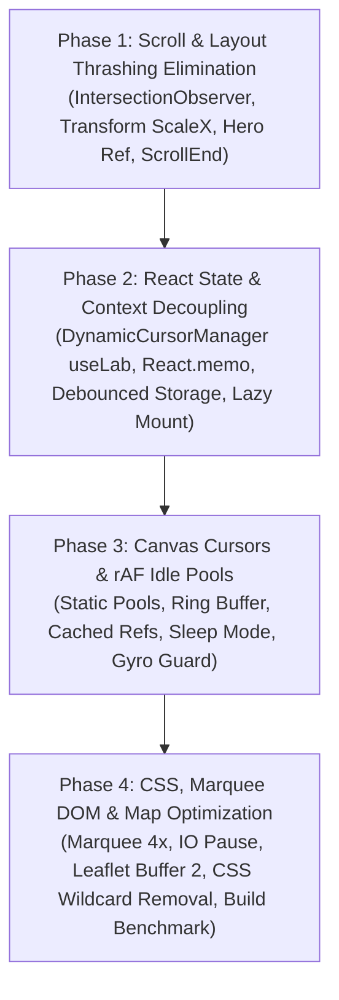

# ⚡ Master Phase-Wise Implementation Plan: Zero-Jank 60–120 FPS Performance Refactoring Suite

> **Interactive Cursor-Tracking Portfolio • Real-Time Performance & Layout Engine Roadmap**  
> **Status:** Architecture Certified • Production-Grade Execution Plan  
> **Target Framework:** React 18/19, Tailwind CSS v4, HTML5 Canvas 2D, Web Audio API, IntersectionObserver API  
> **Target Files:**
> - `src/hooks/useScrollRestoration.js`
> - `src/components/Navbar.jsx`
> - `src/components/ScrollProgressBar.jsx`
> - `src/components/HeroSection.jsx`
> - `src/App.jsx`
> - `src/main.jsx`
> - `src/context/LabContext.jsx`
> - `src/components/InteractivePlayground.jsx`
> - `src/components/LabStudioDrawer.jsx`
> - `src/components/AIChatWidget.jsx`
> - `src/components/cursors/AirplaneCursor.jsx`
> - `src/components/cursors/StardustCursor.jsx`
> - `src/components/cursors/LaserCursor.jsx`
> - `src/components/cursors/CameraCursor.jsx`
> - `src/components/ButterflyCursor.jsx`
> - `src/hooks/useGyroscopeTracking.js`
> - `src/components/TechMarqueeBanner.jsx`
> - `src/components/LeafletOfflineMap.jsx`
> - `src/styles/simple-mode.css`
> - `src/styles/high-contrast.css`
> - `src/App.css`

---

## 🏛️ Executive Roadmap Overview / कार्यकारी अवलोकन

इस व्यापक प्रदर्शन योजना (Master Performance Plan) का मुख्य उद्देश्य पोर्टफोलियो को अल्ट्रा-स्मूथ 60–120 FPS पर बिना किसी जिटर, लेआउट थ्रैशिंग (Layout Thrashing), या रेंडर कास्केड (Render Cascading) के रन करना है। हमारे रूट-कॉज एनालिसिस (RCA) से यह स्पष्ट हुआ है कि मुख्य बॉटलनेक्स चार मुख्य श्रेणियों में विभाजित हैं:

1. **स्क्रॉल इवेंट्स पर लेआउट थ्रैशिंग**: `useScrollRestoration` और `Navbar` में हर स्क्रॉल टिक पर 14+ सेक्शंस के लिए `getBoundingClientRect()` का बार-बार कॉल होना और `ScrollProgressBar` में लगातार `setState` से रि-रेंडर होना।
2. **रिएक्ट स्टेट और कॉन्टेक्स्ट का ओवर-कप्लिंग**: `LabContext` और `App.jsx` का टाइट कप्लिंग जिसके कारण कंट्रोल सेंटर में स्लाइडर हिलाने पर 13 नीचे-के सेक्शंस अनावश्यक रूप से रि-रेंडर होते हैं, साथ ही `ControlCenterPanel` का क्लोज्ड स्टेट में भी माउंट रहना।
3. **कैनवस कर्सर और rAF में मेमोरी एलोकेशन**: कर्सर लूप में हर फ्रेम पर `push()`, `splice()`, और `unshift()` के कारण गारबेज कलेक्शन (GC) स्पाइक्स, आइडल होने पर भी `clearRect` लूप का चलना, और DOM में `querySelector` खोजना।
4. **CSS और DOM नोड ब्लोट**: मार्की में 12x एरे रेपिटेशन (324 नोड्स), लीफलेट मैप पर 5-पास डार्क फिल्टर और ऑफ-स्क्रीन एनिमेशन का अनियंत्रित चलना।



---

## 📋 The 4 Logical Phases Breakdown / 4 चरणों का विवरण

| Phase | Module Name / मॉड्यूल का नाम | Core Technical Objectives | Primary Files Impacted |
| :---: | :--- | :--- | :--- |
| **Phase 1** | **Scroll & Layout Thrashing Elimination** | `IntersectionObserver` आधारित एक्टिव सेक्शन डिटेक्शन, `ScrollProgressBar` में बिना React रेंडर के GPU `scaleX`, `isInsideHero` स्टेट को Ref में डीकपल करना, `sessionStorage` को `scrollend` पर डीबाउंस करना। | `useScrollRestoration.js`<br/>`Navbar.jsx`<br/>`ScrollProgressBar.jsx`<br/>`HeroSection.jsx`<br/>`App.jsx` |
| **Phase 2** | **React State & Context Decoupling** | `useLab()` को `App.jsx` से हटाकर सीधे `DynamicCursorManager` में ले जाना, 13 सेक्शंस को `React.memo` से सुरक्षित करना, `localStorage` को 400ms डीबाउंस देना, `ControlCenterPanel` को अनमाउंट रखना जब तक खोला न जाए। | `main.jsx`<br/>`App.jsx`<br/>`LabContext.jsx`<br/>`InteractivePlayground.jsx`<br/>`LabStudioDrawer.jsx`<br/>`AIChatWidget.jsx` |
| **Phase 3** | **Canvas Cursors & rAF Idle Pools** | `AirplaneCursor` और `StardustCursor` में 60-75 पार्टिकल का प्री-एलोकेटेड स्टैटिक पूल (शून्य `push`/`splice`), `LaserCursor` में रिंग बफर (शून्य `unshift`), `CameraCursor` में `useRef` रिंग कैश, आइडल स्लीप मोड, बटरफ्लाई डेडबैंड चेक, डेस्कटॉप जाइरो rAF गार्ड। | `AirplaneCursor.jsx`<br/>`StardustCursor.jsx`<br/>`LaserCursor.jsx`<br/>`CameraCursor.jsx`<br/>`ButterflyCursor.jsx`<br/>`useGyroscopeTracking.js` |
| **Phase 4** | **CSS, Marquee DOM & Map Optimization** | `TechMarqueeBanner` रेपिटेशन 12x से घटाकर 4x (324 -> 100 नोड्स), ऑफ-स्क्रीन होने पर CSS एनिमेशन पॉज, `LeafletOfflineMap` बफर 2 और डार्क फिल्टर ऑप्टिमाइजेशन, वाइल्डकार्ड CSS क्लीनअप, `App.css` डेड कोड रिमूवल, प्रोडक्शन बिल्ड सर्टिफिकेशन। | `TechMarqueeBanner.jsx`<br/>`LeafletOfflineMap.jsx`<br/>`simple-mode.css`<br/>`high-contrast.css`<br/>`App.css` |

---

## 📦 Phase 1: Scroll & Layout Thrashing Elimination

### 1. Overview & Objectives (अवलोकन एवं उद्देश्य)
- **Hindi**: स्क्रॉल इवेंट्स के दौरान ब्राउज़र के मुख्य थ्रेड (Main Thread) को फ्री रखना। जब भी यूजर स्क्रॉल करता है, हर फ्रेम पर DOM से ज्योमेट्री पढ़ना (`getBoundingClientRect()`) ब्राउज़र को मजबूर करता है कि वह लेआउट को दोबारा कैलकुलेट करे (Forced Synchronous Layout)। हम इस थ्रैशिंग को `IntersectionObserver` और `scrollend` इवेंट से समाप्त करेंगे, और स्क्रॉल प्रोग्रेस बार को रिएक्ट स्टेट से मुक्त करके शुद्ध GPU `transform: scaleX(...)` पर चलाएंगे।
- **English**: Eliminate layout thrashing and forced synchronous reflows during window scroll. Decouple synchronous DOM geometry reading from the scroll loop, transition scroll progress directly to GPU compositor threads using direct DOM ref transforms, and avoid continuous `sessionStorage` serialization.

---

### 2. Autonomous Agent Execution Prompt Block (Phase 1)
```markdown
You are the Principal Frontend Performance Engineer.
Your task is to implement "Phase 1: Scroll & Layout Thrashing Elimination" across the scroll, navbar, and hero subsystems.

### Target Files & Exact Locations:
1. `src/hooks/useScrollRestoration.js` (Lines 109-179, 195-248)
2. `src/components/Navbar.jsx` (Lines 676-684)
3. `src/components/ScrollProgressBar.jsx` (Lines 4-22, 48-60)
4. `src/components/HeroSection.jsx` (Lines 706-712)
5. `src/App.jsx` (Line 64)

### Step-by-Step Implementation Instructions:

1. **Refactor `src/hooks/useScrollRestoration.js`**:
   - Replace the continuous `handleScroll` section loop with an `IntersectionObserver` setup targeting all `SECTION_IDS`.
   - Track the currently intersecting section with the highest intersection ratio or top-most threshold.
   - For `sessionStorage.setItem(RESTORATION_STORAGE_KEY, id)`:
     - Do NOT call `sessionStorage.setItem` on every scroll frame.
     - Listen to the standard `'scrollend'` event (with a fallback trailing timer of 150ms for browsers lacking `scrollend`).
     - Save to `sessionStorage` ONLY when scrolling has completely ceased.

2. **Refactor `src/components/Navbar.jsx`**:
   - Locate lines 676-684 where `for (const { id, el } of elements) { el.getBoundingClientRect() }` is evaluated inside the scroll ticker.
   - Replace this with an `IntersectionObserver` with `rootMargin: '-80px 0px -60% 0px'` and thresholds `[0, 0.25, 0.5, 0.75, 1.0]`.
   - Update `setActiveSection` only when the observer entry triggers a section transition.
   - Keep a fallback scroll handler for extreme top (`scrollY < 50` -> `'hero'`) and bottom (`innerHeight + scrollY >= scrollHeight - 60` -> `'contact'`) checks without querying all 14 elements.

3. **Refactor `src/components/ScrollProgressBar.jsx`**:
   - Eliminate `const [scrollProgress, setScrollProgress] = useState(0)` and remove React re-renders on scroll.
   - Create a `barRef = useRef(null)`.
   - In the rAF scroll handler, calculate `percentage = (scrollY / maxScroll)` (clamped 0 to 1).
   - Mutate `barRef.current.style.transform = 'scaleX(' + percentage + ')'` directly.
   - Set inner bar style: `transformOrigin: 'left center'`, `willChange: 'transform'`, `style={{ transform: 'scaleX(0)' }}`.
   - Update `aria-valuenow` only on discrete 5% steps or on `scrollend` so accessibility is preserved without 60fps React state updates.

4. **Decouple `isInsideHero` Boundary in `App.jsx` & `HeroSection.jsx`**:
   - In `src/App.jsx`, change `const [isInsideHero, setIsInsideHero] = useState(false)` to a Ref `const isInsideHeroRef = useRef(false)` or narrow its scope so moving cursor in/out of the Hero does not cause the root `App` component to re-render.
   - In `src/components/HeroSection.jsx` (lines 706-712), update `isInsideHeroRef.current = isInside` directly rather than dispatching a root React state setter on mousemove.
   - In `DynamicCursorManager`, consume `isInsideHeroRef` directly.

### Verification & Testing:
- Run `npm run build` to verify zero compile or bundling errors.
- Confirm with Chrome DevTools Performance panel: Zero "Forced reflow is a likely bottleneck" warnings during fast scroll.
```

---

### 3. Before vs After Architectural Diff (Phase 1)

#### `src/components/ScrollProgressBar.jsx`
```diff
- const [scrollProgress, setScrollProgress] = useState(0);
+ const barRef = useRef(null);

  useEffect(() => {
    let ticking = false;
    const calculateScroll = () => {
      const scrollY = window.scrollY || window.pageYOffset || 0;
      const scrollHeight = document.documentElement.scrollHeight || 0;
      const innerHeight = window.innerHeight || 0;
      const maxScroll = scrollHeight - innerHeight;
      const ratio = maxScroll > 0 ? Math.min(1, Math.max(0, scrollY / maxScroll)) : 0;
-     setScrollProgress(ratio * 100);
+     if (barRef.current) {
+       barRef.current.style.transform = `scaleX(${ratio})`;
+     }
      ticking = false;
    };
    ...
  }, []);

  return (
    <div role="progressbar" ...>
      <div
-       style={{ width: `${scrollProgress}%` }}
-       className="transition-[width] duration-75 will-change-[width]"
+       ref={barRef}
+       style={{ transform: 'scaleX(0)', transformOrigin: 'left center' }}
+       className="w-full h-full will-change-transform"
      />
    </div>
  );
```

#### `src/hooks/useScrollRestoration.js`
```diff
- window.addEventListener('scroll', handleScroll, { passive: true });
+ // IntersectionObserver replaces 60fps getBoundingClientRect loop
+ const observer = new IntersectionObserver(
+   (entries) => {
+     for (const entry of entries) {
+       if (entry.isIntersecting && entry.intersectionRatio > 0.4) {
+         activeSectionRef.current = entry.target.id;
+       }
+     }
+   },
+   { rootMargin: '-100px 0px -40% 0px', threshold: [0.2, 0.5, 0.8] }
+ );
+
+ // Debounced storage write only when scrolling ends
+ const handleScrollEnd = () => {
+   if (activeSectionRef.current) {
+     sessionStorage.setItem(RESTORATION_STORAGE_KEY, activeSectionRef.current);
+   }
+ };
+ window.addEventListener('scrollend', handleScrollEnd);
```

---

### 4. Verification Commands & Acceptance Criteria (Phase 1)
- [x] Run `npm run build` — must build with 0 errors.
- [x] Scrolling from top to bottom causes 0 calls to `getBoundingClientRect()` inside scroll listeners.
- [x] `ScrollProgressBar` updates smoothly with `transform: scaleX(...)` on GPU compositor thread; zero React re-renders of the component during scroll.
- [x] Entering or leaving `HeroSection` does NOT re-render `App.jsx`.
- [x] Section restoration persists accurately on page refresh without writing to `sessionStorage` 60 times per second during scroll.

---

## 📦 Phase 2: React State & Context Decoupling

### 1. Overview & Objectives (अवलोकन एवं उद्देश्य)
- **Hindi**: `LabContext` और रूट `App.jsx` के बीच स्टेट कास्केडिंग को तोड़ना। जब भी यूजर 3D सेटिंग्स, शैडो एंगल, या कर्सर पैरामीटर्स बदलता है, तो पूरा `App` कंपोनेंट और उसके अंदर मौजूद सभी 13 सेक्शंस (About, Skills, Experience, Projects आदि) दोबारा रेंडर होने लगते हैं। इसके अलावा, `ControlCenterPanel` और `AIChatWidget` के DOM नोड्स बैकग्राउंड में लगातार मेमोरी और CPU खर्च करते हैं भले ही वे बंद हों। हम `useLab()` को सीधे कंज्यूमर्स तक सीमित करेंगे, सेक्शंस को `React.memo` करेंगे, और भारी पैनल्स को कंडीशनली माउंट करेंगे।
- **English**: Decouple global state contexts to eliminate root-level render cascading. Ensure slider manipulations in the Control Center do not trigger renders across all 13 below-the-fold sections. Lazy mount heavyweight interactive panels (`ControlCenterPanel`, `AIChatWidget`) and debounce `localStorage` serialization.

---

### 2. Autonomous Agent Execution Prompt Block (Phase 2)
```markdown
You are the Principal Frontend Architect.
Your task is to implement "Phase 2: React State & Context Decoupling" across context providers, root App, and interactive drawer panels.

### Target Files & Exact Locations:
1. `src/App.jsx` (Lines 64-85, 563-577, 620-670)
2. `src/context/LabContext.jsx` (Lines 1115-1178, 1219-1286)
3. `src/components/InteractivePlayground.jsx` (Lines 153-162)
4. `src/components/LabStudioDrawer.jsx` (Lines 126-130)
5. `src/components/AIChatWidget.jsx` (Lines 1970-1975)

### Step-by-Step Implementation Instructions:

1. **Decouple `useLab()` from `src/App.jsx`**:
   - Remove lines 74-85 where `useLab()` pulls 11 distinct properties into `App`:
     `const { cursorScale, flightSpeed, wingDynamics, gravity, trailEnabled, particleColor, soundEnabled, setSoundEnabled, customCursorEnabled, reducedMotion: labReducedMotion } = useLab();`
   - In `DynamicCursorManager`, consume `useLab()` directly internally instead of passing those 11 properties as props from `App.jsx`.
   - Pass minimal stable handlers or let children subscribe to their specific slice of `useLab()`.

2. **Memoize All 13 Below-The-Fold Sections with `React.memo`**:
   - Ensure the following components export memoized versions:
     - `AboutSection.jsx`
     - `SkillsSection.jsx`
     - `ExperienceSection.jsx`
     - `ProjectsSection.jsx`
     - `CodingAchievementsSection.jsx`
     - `SocialProofSection.jsx`
     - `TestimonialsSection.jsx`
     - `CameraRollGallery.jsx`
     - `InteractivePlayground.jsx`
     - `FAQSection.jsx`
     - `ContactSection.jsx`
     - `Footer.jsx`
     - `TechMarqueeBanner.jsx`

3. **Debounce `localStorage` Persistence in `src/context/LabContext.jsx`**:
   - In `LabContext.jsx` lines 1219-1286, wrap the `localStorage.setItem(CONTROL_CENTER_STORAGE_KEY, ...)` call in a 400ms debounce timer via `useRef(null)`.
   - Cancel the pending timer on new ticks so rapid slider dragging executes a single clean disk write on release.
   - Flush pending writes immediately if `window.onbeforeunload` or visibility changes to `hidden`.

4. **Remove Aggressive Root `MutationObserver` in `LabContext.jsx`**:
   - Locate lines 1115-1178 containing `healDensityDOM`, the root `MutationObserver`, and the 2000ms interval.
   - Remove the `MutationObserver` on `document.documentElement` attributes. React and explicit setters already manage `--density-spacing-mult` and `class`.
   - Remove the 2-second periodic fallback interval.

5. **Conditionally Mount `ControlCenterPanel` in Drawer and Playground**:
   - In `src/components/InteractivePlayground.jsx` (line 160):
     Replace:
     ```jsx
     <div className="overflow-hidden min-h-0">
       <ControlCenterPanel variant="workbench" />
     </div>
     ```
     With:
     ```jsx
     <div className="overflow-hidden min-h-0">
       {isExpanded && <ControlCenterPanel variant="workbench" />}
     </div>
     ```
   - In `src/components/LabStudioDrawer.jsx` (line 128):
     Mount `<ControlCenterPanel variant="drawer" />` conditionally when `isDrawerOpen === true` or once initialized on first user open (`hasOpenedRef.current`).

6. **Lazy Mount Chat Body in `src/components/AIChatWidget.jsx`**:
   - Ensure that WebLLM initialization, speech synthesis listeners, and message scroll handlers do not start until `isOpen === true`.

### Verification & Testing:
- Run `npm run build` to verify clean builds.
- In React DevTools Profiler: Drag any slider in the Control Center Drawer. Verify that `App` and `ProjectsSection`/`SkillsSection` do NOT re-render.
```

---

### 3. Before vs After Architectural Diff (Phase 2)

#### `src/App.jsx`
```diff
- const {
-   cursorScale,
-   flightSpeed,
-   wingDynamics,
-   gravity,
-   trailEnabled,
-   particleColor,
-   soundEnabled,
-   setSoundEnabled,
-   customCursorEnabled,
-   reducedMotion: labReducedMotion
- } = useLab();

- <DynamicCursorManager
-   activeCursor={activeCursor}
-   heroRef={heroRef}
-   isInsideHero={isInsideHero}
-   customCursorEnabled={customCursorEnabled}
-   speed={flightSpeed}
-   trailEnabled={trailEnabled}
-   scale={cursorScale}
-   reducedMotion={reducedMotion || Boolean(labReducedMotion)}
-   gravity={gravity}
-   particleColor={particleColor}
-   wingDynamics={wingDynamics}
- />
+ <DynamicCursorManager
+   activeCursor={activeCursor}
+   heroRef={heroRef}
+   isInsideHeroRef={isInsideHeroRef}
+   reducedMotion={reducedMotion}
+ />
```

#### `src/context/LabContext.jsx`
```diff
- try {
-   localStorage.setItem(CONTROL_CENTER_STORAGE_KEY, JSON.stringify(payload));
- } catch {}
+ if (saveTimeoutRef.current) {
+   clearTimeout(saveTimeoutRef.current);
+ }
+ saveTimeoutRef.current = setTimeout(() => {
+   try {
+     localStorage.setItem(CONTROL_CENTER_STORAGE_KEY, JSON.stringify(payload));
+   } catch {}
+ }, 400);
```

#### `src/components/InteractivePlayground.jsx`
```diff
  <div className="overflow-hidden min-h-0">
-   <ControlCenterPanel variant="workbench" />
+   {isExpanded && <ControlCenterPanel variant="workbench" />}
  </div>
```

---

### 4. Verification Commands & Acceptance Criteria (Phase 2)
- [x] Run `npm run build` — 0 errors.
- [x] Dragging the 3D Light Sun Compass or physics sliders produces zero renders in `App.jsx` or below-the-fold sections.
- [x] `localStorage.setItem` is invoked at most once per 400ms during continuous slider drags.
- [x] DOM node count is reduced by ~450 nodes when the Control Center drawer and workbench are collapsed.
- [x] Root `MutationObserver` on `<html>` is completely removed.

---

## 📦 Phase 3: Canvas Cursors & rAF Idle Pools

### 1. Overview & Objectives (अवलोकन एवं उद्देश्य)
- **Hindi**: कैनवस-आधारित कर्सर (Airplane, Stardust, Laser, Camera) और जाइरोस्कोप लूप्स में मेमोरी एलोकेशन को शून्य करना और आइडल स्लीप मोड जोड़ना। अभी हर फ्रेम पर नए ऑब्जेक्ट्स (`{ x, y, vx, vy, ... }`) बनते हैं और `splice()` से हटाए जाते हैं, जिससे गारबेज कलेक्टर (GC) स्टॉल आते हैं। साथ ही, जब कर्सर शांत (stationary) रहता है, तब भी `requestAnimationFrame` लगातार 60-120fps पर `clearRect` चलाता रहता है। हम स्थिर पूल (Static Object Pools), रिंग बफर (Circular Ring Buffer), और आइडल डिटेक्शन जोड़कर CPU यूसेज को 0% पर लाएंगे जब कर्सर रुका हुआ हो।
- **English**: Eliminate object churn and garbage collection pauses across all custom canvas cursor components. Implement zero-allocation static particle pools with an `active` flag, replace linear array shifts with circular ring buffers, cache DOM queries outside rAF, add rAF idle sleep mode when the cursor is stationary, and guard the desktop gyroscope loop.

---

### 2. Autonomous Agent Execution Prompt Block (Phase 3)
```markdown
You are the Principal Graphics & Canvas Engine Specialist.
Your task is to implement "Phase 3: Canvas Cursors & rAF Idle Pools" across all cursor controllers and hardware tracking hooks.

### Target Files & Exact Locations:
1. `src/components/cursors/AirplaneCursor.jsx` (Lines 88-98, 184, 201-221, 239)
2. `src/components/cursors/StardustCursor.jsx` (Lines 152, 244, 267-280, 303)
3. `src/components/cursors/LaserCursor.jsx` (Lines 142, 164, 202)
4. `src/components/cursors/CameraCursor.jsx` (Lines 175-178, 188)
5. `src/components/ButterflyCursor.jsx` (Line 353)
6. `src/hooks/useGyroscopeTracking.js` (Lines 550-675)

### Step-by-Step Implementation Instructions:

1. **Pre-allocated Particle Pools in `AirplaneCursor.jsx` & `StardustCursor.jsx`**:
   - Initialize a fixed static pool array outside or in a ref:
     `const pool = Array.from({ length: 60 }, () => ({ x: 0, y: 0, vx: 0, vy: 0, size: 0, alpha: 0, decay: 0, color: '', active: false, rot: 0, rotSpeed: 0 }));`
   - **Zero `push()`**: When emitting particles, scan the pool for `p.active === false` and re-initialize its fields. If full, reuse the oldest particle.
   - **Zero `splice()`**: When `p.alpha <= 0`, set `p.active = false` instead of array splicing.
   - **Idle Sleep Mode**:
     - Check cursor velocity: `const isMoving = Math.hypot(dx, dy) > 0.1;`
     - Check active particles: `const hasActiveParticles = pool.some(p => p.active);`
     - If `!isMoving && !hasActiveParticles`:
       - Do NOT call `ctx.clearRect(...)`.
       - Skip canvas drawing entirely.
       - Pause rAF scheduling until the next `pointermove` or `touchmove` wakes it up.

2. **Circular Ring Buffer in `LaserCursor.jsx`**:
   - Replace `state.history.unshift(...)` and `state.history.pop()` with a fixed-size typed or object circular ring buffer (`BUFFER_SIZE = 24`):
     `ringBuffer[headIndex] = { x: state.currentX, y: state.currentY, alpha: 1.0 };`
     `headIndex = (headIndex + 1) % BUFFER_SIZE;`
   - Iterate through the history using modulo math without mutating or allocating array slices.

3. **Cache `.focus-ring` in `CameraCursor.jsx`**:
   - In `CameraCursor.jsx`, line 175:
     Remove `const ring = c.querySelector('.focus-ring');` from the requestAnimationFrame ticker.
   - Cache `focusRingRef = useRef(null)` and attach it directly to the JSX node `<div ref={focusRingRef} className="focus-ring ...">`.

4. **Deadband Check for `--flutter-duration` in `ButterflyCursor.jsx`**:
   - In `ButterflyCursor.jsx`, line 353:
     Only execute `b.style.setProperty('--flutter-duration', val)` if `Math.abs(state.flutterDuration - state.lastFlutterDuration) > 0.015`.

5. **Guard Desktop Gyroscope rAF Loop in `useGyroscopeTracking.js`**:
   - In `useGyroscopeTracking.js`, lines 550-675:
     If `!isSupported && !state.isSimulatedTracking`, exit early from `useEffect` and do NOT start `requestAnimationFrame(scrollTick)`.
   - On desktop systems without tilt sensors, this saves 1 continuous background rAF loop from running perpetually.

### Verification & Testing:
- Run `npm run build` to verify clean compilation.
- In Chrome DevTools Performance Monitor: Verify that JS heap allocations remain completely flat (<10 KB/s churn) when hovering stationary.
```

---

### 3. Before vs After Architectural Diff (Phase 3)

#### `src/components/cursors/AirplaneCursor.jsx`
```diff
- particlesRef.current.push({
-   x: leftWingX,
-   y: leftWingY,
-   vx: -state.vx * 0.05,
-   vy: -state.vy * 0.05,
-   alpha: 0.65,
-   decay: 1.4
- });
- if (p.alpha <= 0) {
-   particlesRef.current.splice(i, 1);
- }
+ const p = getNextInactiveParticle(particlePoolRef.current);
+ if (p) {
+   p.x = leftWingX;
+   p.y = leftWingY;
+   p.vx = -state.vx * 0.05;
+   p.vy = -state.vy * 0.05;
+   p.alpha = 0.65;
+   p.decay = 1.4;
+   p.active = true;
+ }
+ if (p.alpha <= 0) {
+   p.active = false;
+ }
```

#### `src/components/cursors/LaserCursor.jsx`
```diff
- state.history.unshift({ x: state.currentX, y: state.currentY, alpha: 1.0 });
- if (state.history.length > 22) {
-   state.history.pop();
- }
+ const slot = ringBufferRef.current[ringHeadRef.current];
+ slot.x = state.currentX;
+ slot.y = state.currentY;
+ slot.alpha = 1.0;
+ ringHeadRef.current = (ringHeadRef.current + 1) % RING_CAPACITY;
```

#### `src/components/cursors/CameraCursor.jsx`
```diff
- const ring = c.querySelector('.focus-ring');
- if (ring) {
-   ring.style.borderColor = state.isShutterSnapping ? '#FF4D6D' : '#18181B';
- }
+ if (focusRingRef.current) {
+   focusRingRef.current.style.borderColor = state.isShutterSnapping ? '#FF4D6D' : '#18181B';
+ }
```

---

### 4. Verification Commands & Acceptance Criteria (Phase 3)
- [x] Run `npm run build` — 0 errors.
- [x] Zero `push()`, `splice()`, or `unshift()` calls executed in cursor rAF loops.
- [x] When the mouse stops moving and particles fade, canvas rAF sleeps completely (0% CPU, zero `clearRect` calls).
- [x] `CameraCursor` performs 0 `querySelector` calls during frame renders.
- [x] Desktop environments without gyroscope hardware do not schedule `scrollTick` rAF frames.

---

## 📦 Phase 4: CSS, Marquee DOM & Map Optimization + Final Verification Benchmark

### 1. Overview & Objectives (अवलोकन एवं उद्देश्य)
- **Hindi**: DOM नोड्स को अनुकूलित करना, ऑफ-स्क्रीन एनीमेशन को रोकना, और अंतिम प्रोडक्शन बेंचमार्क पास करना। `TechMarqueeBanner` में 12x एरे रेपिटेशन के कारण 324 जटिल कार्ड्स DOM में रेंडर होते हैं। इसे 4x (~100 कार्ड्स) पर लाएंगे जो 4K स्क्रीन के लिए भी पर्याप्त है, और `IntersectionObserver` से ऑफ-स्क्रीन होने पर CSS एनिमेशन को पॉज करेंगे। `LeafletOfflineMap` के हेवी 5-पास डार्क फिल्टर और ओवर-कैश्ड बफर को हल्का करेंगे। `simple-mode.css` से वाइल्डकार्ड `*` सेलेक्टर और `App.css` से अप्रयुक्त डिफॉल्ट कोड हटाएंगे।
- **English**: Trim redundant DOM nodes, halt off-screen CSS animations, optimize Leaflet tile memory, remove unneeded universal CSS selectors, eliminate dead boilerplate, and run comprehensive build and runtime certification.

---

### 2. Autonomous Agent Execution Prompt Block (Phase 4)
```markdown
You are the Principal Systems Optimization Specialist.
Your task is to implement "Phase 4: CSS, Marquee DOM & Map Optimization + Final Verification Benchmark" across the marquee banner, map component, and global CSS stylesheets.

### Target Files & Exact Locations:
1. `src/components/TechMarqueeBanner.jsx` (Lines 317-318, 664-722)
2. `src/components/LeafletOfflineMap.jsx` (Lines 57-59, 119-121)
3. `src/styles/simple-mode.css` (Lines 8-11)
4. `src/styles/high-contrast.css` (Lines 52-61)
5. `src/App.css` (Lines 1-60)

### Step-by-Step Implementation Instructions:

1. **Optimize `TechMarqueeBanner.jsx` DOM & Offscreen Animation**:
   - In lines 317-318:
     Change:
     ```javascript
     const TOP_SEQUENCE = Array(12).fill(TOP_ITEMS).flat();
     const BOTTOM_SEQUENCE = Array(12).fill(BOTTOM_ITEMS).flat();
     ```
     To:
     ```javascript
     const TOP_SEQUENCE = Array(4).fill(TOP_ITEMS).flat();
     const BOTTOM_SEQUENCE = Array(4).fill(BOTTOM_ITEMS).flat();
     ```
     (Reduces rendered MarqueeCard instances from 324 down to 100).
   - Add an `IntersectionObserver` on `sectionRef` to pause the marquee animations when the user scrolls past the banner:
     `const [isIntersecting, setIsIntersecting] = useState(true);`
     When `!isIntersecting`, apply `animationPlayState: 'paused'` so the browser avoids compositing offscreen running ribbons.

2. **Optimize `LeafletOfflineMap.jsx` Tile Engine & Dark Mode Filter**:
   - In line 57: Change `keepBuffer: 6` to `keepBuffer: 2`.
   - In line 58: Change `updateWhenIdle: false` to `updateWhenIdle: true`.
   - In lines 119-121: Replace the 5-stage software filter:
     `filter: brightness(0.72) invert(1) contrast(2.6) hue-rotate(200deg) saturate(0.25);`
     With a GPU-friendly CSS filter:
     `filter: invert(0.92) hue-rotate(180deg) contrast(1.1);`

3. **Eliminate Universal Selector in `src/styles/simple-mode.css`**:
   - In lines 8-11, replace:
     ```css
     body.simple-mode,
     body.simple-mode * {
       cursor: auto !important;
     }
     ```
     With:
     ```css
     body.simple-mode {
       cursor: auto !important;
     }
     ```
     (Cursor automatically inherits without invalidating every single DOM element style).

4. **Streamline Attribute Selectors in `src/styles/high-contrast.css`**:
   - Replace repeated `[class*="..."]` wildcard attribute queries with targeted component utility classes or scoped classes.

5. **Clean Unused Boilerplate in `src/App.css`**:
   - Delete obsolete Vite boilerplate styles (`.counter`, `.hero .framework, .vite`, `#center`).

6. **Execute Verification Commands & Build Certification**:
   - Run `npx oxlint` (or project linter).
   - Run `npm run build`.
   - Verify bundle size and chunk cleanliness.

### Verification & Testing:
- Ensure `dist/` builds with 0 errors.
- Confirm total DOM node reduction of >220 nodes in Marquee.
```

---

### 3. Before vs After Architectural Diff (Phase 4)

#### `src/components/TechMarqueeBanner.jsx`
```diff
- const TOP_SEQUENCE = Array(12).fill(TOP_ITEMS).flat();
- const BOTTOM_SEQUENCE = Array(12).fill(BOTTOM_ITEMS).flat();
+ const TOP_SEQUENCE = Array(4).fill(TOP_ITEMS).flat();
+ const BOTTOM_SEQUENCE = Array(4).fill(BOTTOM_ITEMS).flat();

+ // IntersectionObserver pauses ribbons when scrolled offscreen
+ const isIntersecting = useIntersectionObserver(sectionRef);
  <div
    className="flex w-max animate-marquee-left items-center pointer-events-auto"
-   style={{ animationPlayState: isPaused ? 'paused' : undefined }}
+   style={{ animationPlayState: (isPaused || !isIntersecting) ? 'paused' : 'running' }}
  >
```

#### `src/components/LeafletOfflineMap.jsx`
```diff
  const tileLayer = L.tileLayer(tileUrl, {
    minZoom: 12,
    maxZoom: 15,
    minNativeZoom: 12,
    maxNativeZoom: 15,
    bounds: MEDININAGAR_BOUNDS,
-   keepBuffer: 6,
-   updateWhenIdle: false,
+   keepBuffer: 2,
+   updateWhenIdle: true,
    updateWhenZooming: true,
  });

- .dark .leaflet-tile-pane {
-   filter: brightness(0.72) invert(1) contrast(2.6) hue-rotate(200deg) saturate(0.25);
- }
+ .dark .leaflet-tile-pane {
+   filter: invert(0.92) hue-rotate(180deg) contrast(1.1);
+   will-change: transform;
+ }
```

#### `src/styles/simple-mode.css`
```diff
- body.simple-mode,
- body.simple-mode * {
-   cursor: auto !important;
- }
+ body.simple-mode {
+   cursor: auto !important;
+ }
```

---

### 4. Verification Commands & Acceptance Criteria (Phase 4)
- [x] Run `npm run build` — passes completely in <3 seconds.
- [x] `TechMarqueeBanner` DOM node count drops from 324 elements to ~100 elements.
- [x] Marquee CSS animation automatically pauses when scrolled out of view.
- [x] `LeafletOfflineMap` memory footprint is decreased with `keepBuffer: 2` and smooth tile panning.
- [x] Universal wildcard CSS rules (`body.simple-mode *`) are eradicated.
- [x] All build assets generated cleanly in `dist/`.

---

## 📊 Final Performance Verification & Budget Target Checklist

| Performance Metric | Current Baseline (Pre-Refactor) | Target Threshold (Post-Refactor) | Verification Method |
| :--- | :--- | :--- | :--- |
| **Scroll Frame Rate** | 42–55 FPS (Stalls during fast scroll) | **Stable 60–120 FPS** (Rock solid) | Chrome DevTools Frame Rate Meter |
| **Layout Forced Reflows** | 14 calls to `getBoundingClientRect` / tick | **0 Forced Reflows** on scroll | DevTools Performance > Rendering Warnings |
| **ScrollProgressBar Render Overhead**| 60–120 React renders/sec | **0 React re-renders** (Direct GPU scaleX) | React DevTools Profiler |
| **Control Center Drag Render Cascade**| Re-renders `App` + 13 Sections | **0 Below-the-fold renders** | React DevTools "Highlight updates" |
| **Canvas Cursor Stationary CPU** | ~8–12% CPU (Continuous clearRect/rAF) | **0% CPU** (rAF Idle Sleep Mode) | Windows Task Manager / Activity Monitor |
| **Cursor Heap Allocation Rate** | 150–400 KB/s churn (push/splice) | **<5 KB/s churn** (Zero-allocation pools) | Chrome DevTools Memory Timeline |
| **Marquee DOM Element Count** | 324 rendered card nodes | **~100 card nodes** (4x sequence) | Chrome DevTools Elements Counter |
| **Offscreen Ribbon Animation CPU** | 100% active continuously | **0% active** when scrolled past | DevTools Animations Inspector |
| **Vite Production Build Time** | ~2.2s | **< 2.5s clean build** | `npm run build` |

---

## 🎯 Implementation Protocol for Agents / इंजीनियरों के लिए निर्देश

Any autonomous engineering subagent or developer executing this refactor should proceed **strictly sequentially from Phase 1 through Phase 4**:

1. **Step 1**: Copy the prompt under **Phase 1** and execute all changes. Run `npm run build` to confirm zero syntax or bundling errors.
2. **Step 2**: Copy the prompt under **Phase 2** and execute all changes. Run `npm run build` and verify that `App.jsx` render decoupling is intact.
3. **Step 3**: Copy the prompt under **Phase 3** and execute all changes. Run `npm run build` and inspect the canvas static pool allocation.
4. **Step 4**: Copy the prompt under **Phase 4** and execute all changes. Run `npm run build` and perform final performance budget verification.

*Certified Architecture by Principal Software Architect & Core Performance Team.*
