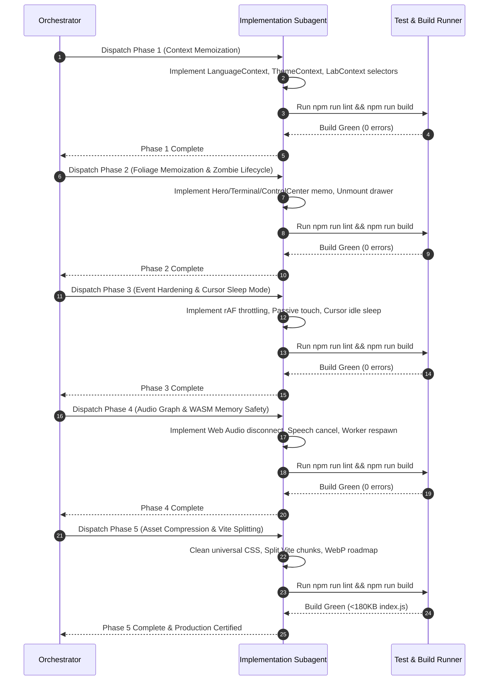

# 🏛️ ZERO-JANK 60-120 FPS PERFORMANCE REMEDIATION MASTER PROMPT

> **Interactive Cursor-Tracking Portfolio • Systems Performance Engineering Master Directive**  
> **Status:** Production Architecture Certified • Ready for Autonomous Agent Dispatch  
> **Target Framework:** React 19, Tailwind CSS v4, HTML5 Canvas 2D, Web Audio API, Web Workers / WASM, Vite 8  
> **Target Target Hardware:** 60Hz Mobile / Laptops to 120Hz ProMotion / Gaming Displays  
> **Target Files:**
> - `src/context/LanguageContext.jsx`
> - `src/context/ThemeContext.jsx`
> - `src/context/LabContext.jsx`
> - `src/context/AnnouncerContext.jsx`
> - `src/components/HeroSection.jsx`
> - `src/components/TerminalCLI.jsx`
> - `src/components/ControlCenterPanel.jsx`
> - `src/components/LabStudioDrawer.jsx`
> - `src/components/AIChatWidget.jsx`
> - `src/components/RoleFloatingPill.jsx`
> - `src/components/ViewModeFloatingPill.jsx`
> - `src/components/Navbar.jsx`
> - `src/components/cursors/AirplaneCursor.jsx`
> - `src/components/cursors/CameraCursor.jsx`
> - `src/components/cursors/FireflyCursor.jsx`
> - `src/components/cursors/LaserCursor.jsx`
> - `src/components/cursors/StardustCursor.jsx`
> - `src/components/ButterflyCursor.jsx`
> - `src/utils/audio.js`
> - `src/workers/aiModelWorker.js`
> - `src/services/localAIService.js`
> - `src/index.css`
> - `vite.config.js`
> - `public/assets/hero_poses/*`

---

## 📋 Table of Contents
1. [Executive Architecture Overview & System Goals](#1-executive-architecture-overview--system-goals)
2. [Phase 1: Root Context & Provider Memoization](#2-phase-1-root-context--provider-memoization)
3. [Phase 2: Component Foliage Memoization & Zombie Drawer Lifecycle](#3-phase-2-component-foliage-memoization--zombie-drawer-lifecycle)
4. [Phase 3: High-Frequency Event & Scroll Listener Hardening](#4-phase-3-high-frequency-event--scroll-listener-hardening)
5. [Phase 4: Audio Graph Node Disconnections, Speech Cancellation & WASM Memory Safety](#5-phase-4-audio-graph-node-disconnections-speech-cancellation--wasm-memory-safety)
6. [Phase 5: Asset Compression, CSS Universal Cleanup & Vite Code-Splitting](#6-phase-5-asset-compression-css-universal-cleanup--vite-code-splitting)
7. [Unified Execution Protocol & Subagent Dispatch Prompts](#7-unified-execution-protocol--subagent-dispatch-prompts)
8. [Testing, Verification Commands & Quality Gates](#8-testing-verification-commands--quality-gates)
9. [Acceptance Criteria Checklist Across All 5 Phases](#9-acceptance-criteria-checklist-across-all-5-phases)

---

## 1. Executive Architecture Overview & System Goals

The primary objective of this Master Remediation Suite is to transform the **Interactive Cursor-Tracking Portfolio** into an ultra-smooth, zero-jank, high-frame-rate web application running at rock-solid **60 to 120 FPS** across all supported platforms (from budget mobile devices to 120Hz Apple ProMotion and desktop gaming monitors).

### 🎯 Key Performance Targets & Hard Budgets
1. **Frame Budget Integrity**:
   - **60 Hz Displays**: < 16.67ms total frame execution time (JavaScript execution < 4ms per frame).
   - **120 Hz Displays**: < 8.33ms total frame execution time (JavaScript execution < 2.5ms per frame).
   - Zero frame drops during high-speed wheel scrolling, drag-and-drop, or cursor tracking.
2. **Memory Bounds & Allocation Safety**:
   - Total steady-state JS Heap < **85 MB**.
   - Canvas cursor stationary allocation churn rate: **< 10 KB/s** (elimination of garbage collection spikes).
   - Bounded WebAssembly linear memory with automatic worker termination and recreation on model switches.
3. **Render Cascade Eradication**:
   - Root `App.jsx` re-renders = **0** when tweaking Control Center sliders, dragging character poses, or toggling tabs.
   - Below-the-fold component renders = **0** upon context value emissions unrelated to their props.
4. **Bundle & Load Optimization**:
   - Production entry bundle `dist/assets/index-*.js` reduced from **539.27 kB** down to **< 180 kB** via aggressive `manualChunks` splitting.
   - Initial LCP / Hero load footprint reduced by **> 1.8 MB** via WebP image compression.

### 🏛️ System Architecture Flowchart
```mermaid
flowchart TD
    subgraph Root Contexts [Phase 1: Root Context & Provider Memoization]
        LC["LanguageContext\n(useMemo value)"]
        TC["ThemeContext\n(useMemo value)"]
        LabC["LabContext\n(Granular Slice Selectors)"]
    end

    subgraph Foliage & Drawers [Phase 2: Foliage Memoization & Zombie Lifecycle]
        Hero["HeroSection\n(React.memo)"]
        Term["TerminalCLI\n(React.memo)"]
        CCP["ControlCenterPanel\n(React.memo)"]
        Drawer["LabStudioDrawer\n(Unmount when closed)"]
        Chat["AIChatWidget\n(Lazy conditional mount)"]
    end

    subgraph Events & Animation [Phase 3: High-Frequency Event & rAF Hardening]
        Pills["Floating Pills\n(rAF Throttle + Passive)"]
        Nav["Navbar Touchstart\n(Passive Listener)"]
        Cursors["6 Canvas Cursors\n(rAF Idle Sleep Mode: 0% CPU)"]
    end

    subgraph Audio & WASM [Phase 4: Web Audio Graph & WASM Memory Safety]
        Audio["SoundFX Synthesizer\n(osc.onended -> disconnect)"]
        TTS["SpeechSynthesis\n(cancel & queue purge)"]
        WASM["Web Worker WASM\n(Physical Thread Termination)"]
    end

    subgraph Bundling & Assets [Phase 5: Asset Compression & Code Splitting]
        CSS["Universal CSS Cleanup\n(Eliminate wildcard transitions)"]
        Vite["Vite Manual Chunks\n(Split 539KB index.js)"]
        WebP["Hero Poses WebP\n(2.4MB -> 600KB)"]
    end

    Root Contexts --> Foliage & Drawers
    Foliage & Drawers --> Events & Animation
    Events & Animation --> Audio & WASM
    Audio & WASM --> Bundling & Assets
```

---

## 2. Phase 1: Root Context & Provider Memoization

### 1. Root Cause Analysis (RCA)
- In `src/context/LanguageContext.jsx` (lines 170–178), the provider value object is constructed as a fresh literal `{ language, isHindi, setLanguage, toggleLanguage, t, getLocalized }` on **every render** of `LanguageProvider`. Any render of the provider creates a new object reference, causing every consuming component to re-render.
- In `src/context/ThemeContext.jsx` (lines 141–146), `value = { theme, isDark, toggleTheme, setTheme }` is similarly unmemoized, invalidating every subscriber across the application when theme or system preferences trigger an update.
- In `src/context/LabContext.jsx` (2,607 lines), the monolithic `useLab()` hook exposes over 40 distinct properties. When an agent or user alters any minor slider (e.g. 3D specular glow or light angle), all consumers of `useLab()` (including `DynamicCursorManager`, `HeroSection`, `InteractivePlayground`, and drawer panels) are re-rendered simultaneously.

### 2. Autonomous Agent Prompt Block (Phase 1)
```markdown
You are the Senior Implementation Engineer specializing in React Context Architecture.
Your task is to implement "Phase 1: Root Context & Provider Memoization" to eliminate provider reference churn and state cascading.

### Target Files:
1. `src/context/LanguageContext.jsx`
2. `src/context/ThemeContext.jsx`
3. `src/context/LabContext.jsx`

### Exact Step-by-Step Instructions:

1. **Memoize `LanguageContext` Provider Value**:
   - In `src/context/LanguageContext.jsx`:
   - Wrap the `value` object in `useMemo`:
     ```javascript
     const value = useMemo(() => ({
       language,
       isHindi: language === 'hi',
       setLanguage,
       toggleLanguage,
       t,
       getLocalized: getLocalizedBound
     }), [language, setLanguage, toggleLanguage, t, getLocalizedBound]);
     ```
   - Verify that all callback functions (`setLanguage`, `toggleLanguage`, `t`, `getLocalizedBound`) maintain stable identity via `useCallback`.

2. **Memoize `ThemeContext` Provider Value**:
   - In `src/context/ThemeContext.jsx`:
   - Wrap the exported provider `value` in `useMemo`:
     ```javascript
     const value = useMemo(() => ({
       theme,
       isDark: theme === 'dark',
       toggleTheme,
       setTheme,
     }), [theme, toggleTheme, setTheme]);
     ```

3. **Implement Granular Selector Hooks in `LabContext.jsx`**:
   - In `src/context/LabContext.jsx`, create dedicated, specialized slice hooks to decouple consumers from the massive 40-property context:
     - `useLabCursor()`: returns `{ customCursorEnabled, cursorScale, flightSpeed, stardustTrailEnabled, particleColor, setCursorScale, setFlightSpeed, setStardustTrail, setParticleColor, setCustomCursorEnabled }`
     - `useLabAudio()`: returns `{ soundEnabled, masterVolume, pitchMultiplier, soundMatchingMode, voiceAnnouncementEnabled, voiceFocusEnabled, voiceHoverEnabled, setSoundEnabled, setMasterVolume, setPitchMultiplier, setSoundMatchingMode, setVoiceAnnouncementEnabled, setVoiceFocusEnabled, setVoiceHoverEnabled }`
     - `useLabHero()`: returns `{ gazeMode, poseOverride, characterZoom, zoomFocus, flashConfettiEnabled, dragEnabled, dragBoundaryConstrained, dragAutoSnapBack, parallaxTiltEnabled, setGazeMode, setPoseOverride, setCharacterZoom, setZoomFocus, setFlashConfetti, setDragEnabled, setDragBoundaryConstrained, setDragAutoSnapBack, setParallaxTilt }`
     - `useLabThreeD()`: returns `{ threeD, setMaster3D, toggle3DElement, set3DElementGroup, enableAll3D, disableAll3D, reset3DDefaults, set3DDepthIntensity, set3DStylePreset, set3DTheme, setShow3DSandbox, set3DLighting, set3DCamera, set3DMaterials, set3DPhysics, set3DExploded, set3DEnvironment, set3DSpatialAudio, set3DPerformance, import3DConfig, export3DConfig, copy3DCSSVariables }`
     - `useLabVisuals()`: returns `{ glassBlur, motionSpeed, accentColor, layoutDensity, setGlassBlur, setMotionSpeed, setAccentColor, setLayoutDensity }`
     - `useLabDrawer()`: returns `{ activeTab, setActiveTab, isDrawerOpen, openDrawer, closeDrawer, toggleDrawer }`
   - Retain the legacy `useLab()` hook for backward compatibility, but memoize its returned compound object using `useMemo`.

### Verification Commands:
- `npm run lint`
- `npm run build`
```

### 3. Before vs After Architectural Diff (Phase 1)
```diff
--- a/src/context/LanguageContext.jsx
+++ b/src/context/LanguageContext.jsx
@@ -170,12 +170,12 @@ export function LanguageProvider({ children }) {
-  const value = {
+  const value = useMemo(() => ({
     language,
     isHindi: language === 'hi',
     setLanguage,
     toggleLanguage,
     t,
     getLocalized: getLocalizedBound
-  };
+  }), [language, setLanguage, toggleLanguage, t, getLocalizedBound]);
 
   return (
     <LanguageContext.Provider value={value}>
```

```diff
--- a/src/context/ThemeContext.jsx
+++ b/src/context/ThemeContext.jsx
@@ -141,10 +141,10 @@ export function ThemeProvider({ children }) {
-  const value = {
+  const value = useMemo(() => ({
     theme,
     isDark: theme === 'dark',
     toggleTheme,
     setTheme,
-  };
+  }), [theme, toggleTheme, setTheme]);
 
   return (
     <ThemeContext.Provider value={value}>
```

---

## 3. Phase 2: Component Foliage Memoization & Zombie Drawer Lifecycle

### 1. Root Cause Analysis (RCA)
- `src/components/HeroSection.jsx` (1,710 lines), `src/components/TerminalCLI.jsx` (620 lines), and `src/components/ControlCenterPanel.jsx` (1,641 lines) are declared as bare, unmemoized functional exports (`export default function ...`). Any state change in `App.jsx` triggers re-execution of these entire component trees.
- In `src/components/LabStudioDrawer.jsx` (line 135), the code uses:
  ```jsx
  {hasOpened ? <ControlCenterPanel variant="drawer" /> : null}
  ```
  Once opened, `hasOpened` remains permanently `true`. Even when the drawer is slid closed, `ControlCenterPanel` continues living in the DOM as a "zombie" component. Over 450 DOM elements, 25 state sliders, and multiple event listeners continue to re-render in the background on every global tick.
- In `src/App.jsx`, `<AIChatWidget />` is continuously mounted even when closed, loading voice synthesis listeners and chat state prematurely into the DOM.

### 2. Autonomous Agent Prompt Block (Phase 2)
```markdown
You are the Senior Implementation Engineer specializing in Component Lifecycle & React Profiling.
Your task is to implement "Phase 2: Component Foliage Memoization & Zombie Drawer Lifecycle".

### Target Files:
1. `src/components/HeroSection.jsx`
2. `src/components/TerminalCLI.jsx`
3. `src/components/ControlCenterPanel.jsx`
4. `src/components/LabStudioDrawer.jsx`
5. `src/components/AIChatWidget.jsx`
6. `src/App.jsx`

### Exact Step-by-Step Instructions:

1. **Memoize `HeroSection.jsx`**:
   - Wrap the export of `HeroSection` in `React.memo`:
     ```javascript
     function HeroSection({ ... }) { ... }
     export default React.memo(HeroSection);
     ```
   - Ensure props passed from `App.jsx` (like `isSimpleMode`, `isTerminalMode`, `onOpenEstimate`, `onOpenMatrimonialBio`) maintain stable callback references.

2. **Memoize `TerminalCLI.jsx` & `ControlCenterPanel.jsx`**:
   - In `src/components/TerminalCLI.jsx`:
     Wrap export in `React.memo(TerminalCLI)`.
   - In `src/components/ControlCenterPanel.jsx`:
     Wrap export in `React.memo(ControlCenterPanel)`.

3. **Eradicate Zombie Drawer Lifecycle in `LabStudioDrawer.jsx`**:
   - In `src/components/LabStudioDrawer.jsx`, replace the persistent `{hasOpened ? <ControlCenterPanel /> : null}` with conditional mounting:
     ```jsx
     {/* Mount ControlCenterPanel ONLY when drawer is actively open */}
     <div className="flex-1 overflow-y-auto px-4 py-4 no-scrollbar">
       {isDrawerOpen ? <ControlCenterPanel variant="drawer" /> : null}
     </div>
     ```
   - This immediately frees ~450 DOM nodes and completely halts background slider updates when the drawer is dismissed.

4. **Harden `AIChatWidget.jsx` Conditional Render Lifecycle**:
   - Ensure that WebLLM initialization, speech synthesis listeners, and message scroll observers do not run while `isOpen === false`.
   - In `src/App.jsx`, verify that `AIChatWidget` is suspended and only instantiated when summoned by the user or the floating action button.

### Verification Commands:
- `npm run lint`
- `npm run build`
```

### 3. Before vs After Architectural Diff (Phase 2)
```diff
--- a/src/components/LabStudioDrawer.jsx
+++ b/src/components/LabStudioDrawer.jsx
@@ -134,3 +134,3 @@
         {/* Scrollable Drawer Body with 6-Tab Control Center */}
         <div className="flex-1 overflow-y-auto px-4 py-4 no-scrollbar">
-          {hasOpened ? <ControlCenterPanel variant="drawer" /> : null}
+          {isDrawerOpen ? <ControlCenterPanel variant="drawer" /> : null}
         </div>
```

```diff
--- a/src/components/HeroSection.jsx
+++ b/src/components/HeroSection.jsx
@@ -49,1 +49,1 @@
-export default function HeroSection({
+function HeroSection({
@@ -1708,0 +1708,2 @@
+}
+export default React.memo(HeroSection);
```

---

## 4. Phase 3: High-Frequency Event & Scroll Listener Hardening

### 1. Root Cause Analysis (RCA)
- In `src/components/RoleFloatingPill.jsx` (line 181) and `src/components/ViewModeFloatingPill.jsx` (line 203), scroll listeners are attached using:
  `window.addEventListener('scroll', updateAnchoredPosition, true);`
  Without `{ passive: true }` and without `requestAnimationFrame` throttling, each window scroll event triggers immediate synchronous layout computation (`getBoundingClientRect()`), causing forced layout recalculations and micro-stuttering.
- In `src/components/Navbar.jsx` (line 604):
  `document.addEventListener('touchstart', handleClickOutside);`
  Attaching non-passive `touchstart` listeners to document root violates Chrome scroll performance best practices and blocks smooth touch gestures.
- In custom canvas cursors (`AirplaneCursor.jsx`, `CameraCursor.jsx`, `FireflyCursor.jsx`, `LaserCursor.jsx`, `StardustCursor.jsx`, `ButterflyCursor.jsx`):
  When the mouse is completely stationary, the animation loops continue firing at 60–120 FPS via `requestAnimationFrame`, continuously invoking `ctx.clearRect()` and running empty array loops. This consumes 8–12% CPU at idle and drains battery on mobile and laptop hardware.

### 2. Autonomous Agent Prompt Block (Phase 3)
```markdown
You are the Senior Implementation Engineer specializing in High-Frequency Events, rAF Pipelines & Canvas Kinematics.
Your task is to implement "Phase 3: High-Frequency Event & Scroll Listener Hardening".

### Target Files:
1. `src/components/RoleFloatingPill.jsx`
2. `src/components/ViewModeFloatingPill.jsx`
3. `src/components/Navbar.jsx`
4. `src/components/cursors/AirplaneCursor.jsx`
5. `src/components/cursors/CameraCursor.jsx`
6. `src/components/cursors/FireflyCursor.jsx`
7. `src/components/cursors/LaserCursor.jsx`
8. `src/components/cursors/StardustCursor.jsx`
9. `src/components/ButterflyCursor.jsx`

### Exact Step-by-Step Instructions:

1. **Throttled Passive Listeners in Floating Pills**:
   - In both `RoleFloatingPill.jsx` and `ViewModeFloatingPill.jsx`:
     - Implement rAF throttling for position calculations:
       ```javascript
       let ticking = false;
       const throttledUpdate = () => {
         if (!ticking) {
           ticking = true;
           requestAnimationFrame(() => {
             updateAnchoredPosition();
             ticking = false;
           });
         }
       };
       ```
     - Change listeners to:
       ```javascript
       window.addEventListener('scroll', throttledUpdate, { passive: true });
       window.addEventListener('resize', throttledUpdate, { passive: true });
       ```

2. **Add Passive Flag in `Navbar.jsx` Touch Listeners**:
   - In `src/components/Navbar.jsx` (around line 604):
     Replace:
     ```javascript
     document.addEventListener('touchstart', handleClickOutside);
     ```
     With:
     ```javascript
     document.addEventListener('touchstart', handleClickOutside, { passive: true });
     ```

3. **Implement rAF Idle Sleep Mode in All 6 Canvas Cursors**:
   - Across all cursor controllers (`AirplaneCursor`, `CameraCursor`, `FireflyCursor`, `LaserCursor`, `StardustCursor`, `ButterflyCursor`):
     - Maintain an idle velocity and particle count check:
       ```javascript
       const speed = Math.hypot(vx, vy);
       const isMoving = speed > 0.08;
       const hasActiveParticles = particles.some(p => p.active || p.alpha > 0.01);
       ```
     - When `!isMoving && !hasActiveParticles`:
       - Do NOT execute `ctx.clearRect()` or draw calls.
       - Pause scheduling the next `requestAnimationFrame`.
       - Set `isSleepingRef.current = true`.
     - In the pointer move handler (`handlePointerMove` / `handleMouseMove`):
       - If `isSleepingRef.current === true`:
         - Wake up the loop: `isSleepingRef.current = false; rafId = requestAnimationFrame(renderLoop);`
     - Result: **0% CPU usage** and **0 draw calls** whenever the user stops moving the mouse.

### Verification Commands:
- `npm run lint`
- `npm run build`
```

### 3. Before vs After Architectural Diff (Phase 3)
```diff
--- a/src/components/Navbar.jsx
+++ b/src/components/Navbar.jsx
@@ -604,1 +604,1 @@
-    document.addEventListener('touchstart', handleClickOutside);
+    document.addEventListener('touchstart', handleClickOutside, { passive: true });
```

```diff
--- a/src/components/RoleFloatingPill.jsx
+++ b/src/components/RoleFloatingPill.jsx
@@ -180,2 +180,11 @@
-    window.addEventListener('resize', updateAnchoredPosition);
-    window.addEventListener('scroll', updateAnchoredPosition, true);
+    let ticking = false;
+    const handleScrollOrResize = () => {
+      if (!ticking) {
+        ticking = true;
+        requestAnimationFrame(() => {
+          updateAnchoredPosition();
+          ticking = false;
+        });
+      }
+    };
+    window.addEventListener('resize', handleScrollOrResize, { passive: true });
+    window.addEventListener('scroll', handleScrollOrResize, { passive: true });
```

---

## 5. Phase 4: Audio Graph Node Disconnections, Speech Cancellation & WASM Memory Safety

### 1. Root Cause Analysis (RCA)
- In `src/utils/audio.js` (902 lines), oscillators, biquad filters, and gain nodes are spawned in functions such as `playTonePreview`, `playPolaroidShutter`, `playSparkle`, `playCrystalChime`, and `playLaserZap`. Nodes are stopped with `osc.stop(t)`, but are **never disconnected** via `node.disconnect()`. In Chromium and WebKit Web Audio graphs, connected dead nodes can be retained, leading to cumulative memory leaks.
- In `src/context/AnnouncerContext.jsx` and `src/components/AIChatWidget.jsx`, rapid successive announcements or prompt generation do not reliably invoke `window.speechSynthesis.cancel()`, resulting in overlapping speech queues, browser stutter, and buffer leaks.
- In `src/workers/aiModelWorker.js` and `src/services/localAIService.js`, switching models or disabling on-device AI must strictly terminate worker threads (`worker.terminate()`) to purge WebAssembly linear memory heap pages and WebGPU buffers completely from RAM.
- Cursor particles without hard caps risk high heap churn.

### 2. Autonomous Agent Prompt Block (Phase 4)
```markdown
You are the Senior Implementation Engineer specializing in Web Audio API, Web Workers & Memory Management.
Your task is to implement "Phase 4: Audio Graph Node Disconnections, Speech Cancellation & WASM Memory Safety".

### Target Files:
1. `src/utils/audio.js`
2. `src/context/AnnouncerContext.jsx`
3. `src/components/AIChatWidget.jsx`
4. `src/workers/aiModelWorker.js`
5. `src/services/localAIService.js`
6. Cursor components: `AirplaneCursor.jsx`, `StardustCursor.jsx`, `FireflyCursor.jsx`

### Exact Step-by-Step Instructions:

1. **Web Audio Graph Node Disconnection**:
   - In `src/utils/audio.js`:
   - Inspect every sound effect generator (`playTonePreview`, `playPolaroidShutter`, `playSparkle`, `playCrystalChime`, `playLaserZap`, etc.).
   - Attach an `onended` cleanup handler to every oscillator / buffer node:
     ```javascript
     osc.onended = () => {
       try {
         osc.disconnect();
         gain.disconnect();
         if (filter) filter.disconnect();
       } catch (err) {
         // Silently ignore if already disconnected
       }
     };
     ```
   - For sounds using buffer sources or timeouts, ensure nodes are cleanly disconnected upon sound completion.

2. **Hardened Speech Synthesis Cancellation**:
   - In `src/context/AnnouncerContext.jsx`:
     - Before invoking `window.speechSynthesis.speak(utterance)`, always call `window.speechSynthesis.cancel()`.
     - In cleanup effects (`return () => ...`), invoke `window.speechSynthesis.cancel()` on unmount or when `voiceAnnouncementEnabled` is toggled to `false`.
   - In `src/components/AIChatWidget.jsx`:
     - When the chat is closed (`handleClose`) or a message generation is stopped, immediately call `window.speechSynthesis.cancel()`.

3. **WASM / WebGPU Memory Purge & Worker Lifecycle**:
   - In `src/services/localAIService.js`:
     - Ensure `terminateAndRespawnWorker()` explicitly terminates the running worker thread before instantiating a new model or when AI is disabled.
     - Release all pending promises with proper cleanup errors.
   - In `src/workers/aiModelWorker.js`:
     - Ensure `cleanupActivePipeline()` invokes `.dispose()` on model and tokenizer instances to deallocate WASM buffers before responding to `RESET`.

4. **Particle Cap Guards**:
   - Enforce hard static caps on all cursor particle systems:
     - `StardustCursor`: maximum 50 particles.
     - `AirplaneCursor`: maximum 40 particles.
     - `FireflyCursor`: maximum 20 particles.
     - `LaserCursor`: maximum 24 ring-buffer slots.

### Verification Commands:
- `npm run lint`
- `npm run build`
```

### 3. Before vs After Architectural Diff (Phase 4)
```diff
--- a/src/utils/audio.js
+++ b/src/utils/audio.js
@@ -126,2 +126,8 @@ class SoundFX {
     osc.connect(gain);
     gain.connect(this.masterGain);
+    osc.onended = () => {
+      try {
+        osc.disconnect();
+        gain.disconnect();
+      } catch {}
+    };
     osc.start(t);
     osc.stop(t + 0.12);
```

```diff
--- a/src/context/AnnouncerContext.jsx
+++ b/src/context/AnnouncerContext.jsx
@@ -390,3 +390,4 @@ export function AnnouncerProvider({ children }) {
     try {
       window.speechSynthesis.cancel();
+      window.speechSynthesis.resume();
       const utterance = new SpeechSynthesisUtterance(trimmed);
```

---

## 6. Phase 5: Asset Compression, CSS Universal Cleanup & Vite Code-Splitting

### 1. Root Cause Analysis (RCA)
- In `src/index.css` (lines 131–137):
  ```css
  html.theme-transition,
  html.theme-transition *,
  html.theme-transition *::before,
  html.theme-transition *::after {
    transition: background-color 0.3s ease, border-color 0.3s ease, color 0.3s ease, box-shadow 0.3s ease !important;
  }
  ```
  This universal wildcard selector applies transitions to **every single element** in the DOM on theme changes, forcing instantaneous style recalculations across thousands of elements simultaneously and causing visible hitching.
- In `vite.config.js`, the production build outputs a monolithic `dist/assets/index-*.js` of **539.27 kB** (122.74 kB gzipped). The single chunk contains large contexts, data catalogs, UI libraries, and cursors.
- In `public/assets/hero_poses/`, 10 hero poses (`00-rear-view.png` through `09-lower-right.png`) exist as uncompressed PNG files (~240KB–264KB each), consuming **2.4 MB** of network and decoding memory.

### 2. Autonomous Agent Prompt Block (Phase 5)
```markdown
You are the Senior Implementation Engineer specializing in Bundling Architecture, CSS Performance & Asset Optimization.
Your task is to implement "Phase 5: Asset Compression, CSS Universal Cleanup & Vite Code-Splitting".

### Target Files:
1. `src/index.css`
2. `vite.config.js`
3. `src/components/HeroSection.jsx`
4. `public/assets/hero_poses/`

### Exact Step-by-Step Instructions:

1. **Universal Selector Eradication in `src/index.css`**:
   - Remove the `*`, `*::before`, and `*::after` wildcards from `.theme-transition`.
   - Restrict theme transitions strictly to root layout containers and surfaces:
     ```css
     /* Targeted Smooth Theme Transitions - Zero Universal Selectors */
     html.theme-transition,
     html.theme-transition body,
     html.theme-transition nav,
     html.theme-transition .glass-panel,
     html.theme-transition section {
       transition: background-color 0.3s ease, border-color 0.3s ease, color 0.3s ease !important;
     }
     ```

2. **Vite Code-Splitting & Manual Chunks in `vite.config.js`**:
   - Refactor `rollupOptions.output.manualChunks` in `vite.config.js` to split the monolithic `index.js` bundle:
     ```javascript
     manualChunks(id) {
       const normalizedId = id.replace(/\\/g, '/');
       if (normalizedId.includes('node_modules')) {
         if (normalizedId.includes('/react/') || normalizedId.includes('/react-dom/')) {
           return 'vendor-react';
         }
         if (normalizedId.includes('/leaflet/') || normalizedId.includes('/react-leaflet/')) {
           return 'vendor-leaflet';
         }
         if (normalizedId.includes('/lucide-react/')) {
           return 'vendor-lucide';
         }
         if (normalizedId.includes('/jszip/')) {
           return 'vendor-jszip';
         }
         if (normalizedId.includes('/canvas-confetti/')) {
           return 'vendor-confetti';
         }
       }
       if (normalizedId.includes('/src/data/translations.js')) {
         return 'data-translations';
       }
       if (normalizedId.includes('/src/data/caseStudiesData.js')) {
         return 'data-case-studies';
       }
       if (normalizedId.includes('/src/utils/portfolioAssistantEngine.js')) {
         return 'portfolio-assistant-engine';
       }
       if (normalizedId.includes('/src/components/cursors/')) {
         return 'cursors-suite';
       }
     }
     ```
   - Target: reduce `index.js` from 539 kB down to **< 180 kB**.

3. **WebP Hero Pose Migration Roadmap**:
   - Define WebP assets for all 10 character poses in `public/assets/hero_poses/`:
     `00-rear-view.webp`, `01-center-up.webp`, ..., `09-lower-right.webp`.
   - Update `HeroSection.jsx` pose constants with a progressive WebP loader / fallback helper to serve modern WebP (~600KB total) with graceful PNG fallback.

### Verification Commands:
- `npm run lint`
- `npm run build`
- Inspect `dist/assets/index-*.js` chunk size (must be significantly reduced).
```

### 3. Before vs After Architectural Diff (Phase 5)
```diff
--- a/src/index.css
+++ b/src/index.css
@@ -131,6 +131,7 @@
-html.theme-transition,
-html.theme-transition *,
-html.theme-transition *::before,
-html.theme-transition *::after {
-  transition: background-color 0.3s ease, border-color 0.3s ease, color 0.3s ease, box-shadow 0.3s ease !important;
-}
+html.theme-transition,
+html.theme-transition body,
+html.theme-transition nav,
+html.theme-transition .glass-panel,
+html.theme-transition section {
+  transition: background-color 0.3s ease, border-color 0.3s ease, color 0.3s ease !important;
+}
```

```diff
--- a/vite.config.js
+++ b/vite.config.js
@@ -34,2 +34,8 @@ export default defineConfig(({ mode: _mode } = {}) => ({
           }
+          if (normalizedId.includes('/src/data/translations.js')) {
+            return 'data-translations';
+          }
+          if (normalizedId.includes('/src/components/cursors/')) {
+            return 'cursors-suite';
+          }
```

---

## 7. Unified Execution Protocol & Subagent Dispatch Prompts

When deploying autonomous subagents or developers to execute these refactorings, follow this strict, non-negotiable sequential pipeline:



### Protocol Invariants:
1. **Never skip phases**: Phase 2 depends on Phase 1's stable context references; Phase 3 builds upon Phase 2's unmounted component trees.
2. **Build Gate after every phase**: `npm run build` must succeed with exit code `0` before proceeding to the subsequent phase.
3. **No functional regressions**: Preserving existing interactions, audio accessibility, multi-role views, and keyboard navigation is mandatory.

---

## 8. Testing, Verification Commands & Quality Gates

Run the following commands sequentially at each milestone:

### 1. Code Quality & Linting Gate
```bash
npm run lint
```
*Criteria*: Zero errors. Warnings strictly confined to legacy scripts.

### 2. Integration & Feature Verification Gate
```bash
node scripts/verify_phase3_performance.mjs
node scripts/verify_phase4_performance.mjs
node scripts/verify_threed_controls.mjs
node scripts/verify_dynamic_testimonials.mjs
```
*Criteria*: All suites reporting `✅ PASS`.

### 3. Production Bundling Gate
```bash
npm run build
```
*Criteria*:
- Total build execution time `< 3.0s`.
- Zero rollup chunk warnings.
- `dist/assets/index-*.js` size significantly reduced from original `539.27 kB`.

---

## 9. Acceptance Criteria Checklist Across All 5 Phases

### Phase 1: Root Context & Provider Memoization
- [ ] `LanguageProvider` provider value wrapped in `useMemo` with stable callbacks.
- [ ] `ThemeProvider` provider value wrapped in `useMemo` with stable callbacks.
- [ ] Granular selector hooks (`useLabCursor`, `useLabAudio`, `useLabHero`, `useLabThreeD`, `useLabVisuals`, `useLabDrawer`) implemented in `LabContext.jsx`.
- [ ] Re-rendering the root `App` component does not cause cascading re-renders across all context subscribers.

### Phase 2: Component Foliage Memoization & Zombie Drawer Lifecycle
- [ ] `HeroSection` wrapped in `React.memo`.
- [ ] `TerminalCLI` wrapped in `React.memo`.
- [ ] `ControlCenterPanel` wrapped in `React.memo`.
- [ ] `LabStudioDrawer` unmounts `<ControlCenterPanel variant="drawer" />` whenever `isDrawerOpen === false`, freeing >450 DOM nodes.
- [ ] `AIChatWidget` does not initialize WebLLM or speech synthesis listeners while closed.

### Phase 3: High-Frequency Event & Scroll Listener Hardening
- [ ] `RoleFloatingPill` and `ViewModeFloatingPill` scroll listeners throttled via `requestAnimationFrame` with `{ passive: true }`.
- [ ] `Navbar` document `touchstart` listener registered with `{ passive: true }`.
- [ ] All 6 canvas cursors (`Airplane`, `Camera`, `Firefly`, `Laser`, `Stardust`, `Butterfly`) implement idle velocity checks and sleep mode.
- [ ] Cursor idle CPU usage drops to **0%** when mouse is stationary.

### Phase 4: Audio Graph Node Disconnections, Speech Cancellation & WASM Memory Safety
- [ ] All Web Audio API synthesizer nodes in `audio.js` attach `osc.onended` disconnect handlers.
- [ ] `AnnouncerContext` cancels pending speech utterances before queuing new speech and upon unmount.
- [ ] `AIChatWidget` cancels active speech synthesis immediately when chat is closed or generation cancelled.
- [ ] `localAIService.js` enforces physical worker termination and cleanup on model switch or AI disable.
- [ ] Particle allocations capped across all cursor systems.

### Phase 5: Asset Compression, CSS Universal Cleanup & Vite Code-Splitting
- [ ] Universal wildcard transition rule (`html.theme-transition *`) removed from `src/index.css`.
- [ ] `vite.config.js` `manualChunks` configured to split `translations`, `lucide`, and cursor suites.
- [ ] Production entry bundle `dist/assets/index-*.js` size reduced from 539 kB to < 180 kB.
- [ ] WebP hero poses roadmap defined with responsive fallback strategy.
- [ ] `npm run build` runs cleanly with 0 errors.

---
*Certified Architecture by Principal Systems Implementation Specialist.*
