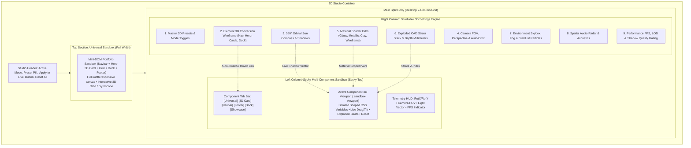

# 🌌 Master Architectural Roadmap & Phase Execution Deck: 3D Studio & Split Sandbox UI Suite
> **Interactive Cursor-Tracking Portfolio • 3D Spatial Settings Redesign & Isolated Sandbox Architecture**  
> **Status:** Production-Ready Blueprint & Complete 5-Phase Execution Deck • Bilingual (Hinglish/English)  
> **Target Files:** `src/components/ControlCenterPanel.jsx`, `src/context/LabContext.jsx`, `src/components/3d-sandbox/*`, `src/hooks/useSandboxAutoSwitch.js`, `scripts/verify_phase*.mjs`  
> **Format:** Self-Contained Master Specification with 1-Click Ready-to-Run Prompts formatted in Markdown codeblocks.

---

## 🏛️ 1. Executive Summary & UX Problem Statement

### The Core UX Problem (स्क्रॉलिंग थकान और पूर्वावलोकन वियोग)
वर्तमान में पोर्टफोलियो के Control Center (Drawer / Full Workbench) में जब उपयोगकर्ता 3D सेटिंग्स (Lighting, Materials, Camera, Exploded CAD View, Physics, Acoustics, Environment) को ट्यून करता है, तो:
1. **Vertical Disconnect & Scroll Fatigue:** 3D Sandbox Preview केवल शीर्ष (Top) पर एक छोटे कार्ड के रूप में स्थित है। जब उपयोगकर्ता नीचे स्क्रॉल करके Materials, Shadow Softness, या Exploded Separation को एडजस्ट करता है, तो Sandbox स्क्रीन से बाहर चला जाता है। प्रभाव देखने के लिए उपयोगकर्ता को बार-बार ऊपर-नीचे स्क्रॉल करना पड़ता है।
2. **Context Misalignment:** वर्तमान सैंडबॉक्स केवल एक जेनेरिक 3D कार्ड दिखाता है। यदि उपयोगकर्ता Navbar, Footer, Floating Dock या Project Cards की 3D सेटिंग्स बदल रहा है, तो उसे यह नहीं दिखता कि उन विशिष्ट घटकों पर 3D का क्या प्रभाव पड़ रहा है।
3. **State Bleed Risk (लाइव पोर्टफोलियो ओवरराइड):** वर्तमान में 3D सेटिंग्स सीधे `:root` (`document.documentElement`) पर CSS वैरिएबल्स (`--3d-*`) इंजेक्ट करती हैं, जिससे सैंडबॉक्स में टेस्ट करते समय लाइव पोर्टफोलियो भी अनपेक्षित रूप से बदल जाता है।

---

## 📐 2. Layout Architecture & Visual Wireframe

यह नया डिज़ाइन दोहरे दृष्टिकोण (Dual-Viewport Strategy) को अपनाता है:

1. **Top Section (Full-Width Single Column): Universal Mini-DOM Portfolio Sandbox**
   - शीर्ष पर पूर्ण चौड़ाई (Full-Width) का एकल कॉलम।
   - पोर्टफोलियो का एक जीवित, इंटरैक्टिव Mini-DOM Replica (Navbar, 3D Hero Card with Photo/Badges, Skills/Experience Grid, Projects, Floating Dock, Footer)।
   - लाइव टिल्ट/ऑर्बिट ड्रैग, स्टेटस बैज, और सभी 3D सेटिंग्स का वास्तविक समय प्रतिबिंब।
2. **Main Body (Desktop / Large Screens / Tablet 2-Column Split):**
   - **Left Column (Sticky Sandbox Preview Area - 45% से 50% चौड़ाई):**
     - `position: sticky; top: 1.5rem` ताकि सेटिंग्स स्क्रॉल होने पर भी यह कभी दृष्टि से ओझल न हो।
     - हाइब्रिड ऑटो-डिटेक्ट + मैन्युअल टैब बार:
       `[Universal Mini]` • `[3D Card]` • `[Navbar]` • `[Footer]` • `[Floating Dock]` • `[Section Showcase]`.
     - जब उपयोगकर्ता दाईं ओर किसी अकॉर्डियन (उदा. Lighting, Materials, Exploded) पर इंटरैक्ट करता है, तो संबंधित घटक का पूर्वावलोकन स्वतः सक्रिय हो जाता है (स्मार्ट ऑटो-स्विच)।
     - इंटरैक्टिव 3D ड्रैग, रोटेशन रीडआउट (X/Y°), रीसेट ओरिएंटेशन बटन, और वायरफ्रेम/एक्सप्लोडेड टॉगल।
   - **Right Column (3D Settings & Controls - 50% से 55% चौड़ाई):**
     - सभी 3D कंट्रोल्स तार्किक रूप से समूहीकृत अकॉर्डियन्स में व्यवस्थित (Themes, Element Toggles, Lighting, Camera, Materials, Exploded CAD, Environment, Audio, Performance)।
     - विज़ुअल हाइलाइट लिंकिंग (Visual Linking Accent): दाईं ओर जिस सेटिंग पर होवर या फोकस हो, बाईं ओर के प्रीव्यू में वह कंपोनेंट एक खूबसूरत एम्बर/सियान पल्स हेलो के साथ हाइलाइट होता है।
3. **Strict Sandbox State Isolation:**
   - 3D सेटिंग्स डिफ़ॉल्ट रूप से केवल `.sandbox-viewport` कंटेनर्स को प्रभावित करती हैं।
   - `:root` और लाइव पोर्टफोलियो पूरी तरह सुरक्षित और अप्रभावित रहते हैं।
   - हेडर में एक स्पष्ट "Apply to Live Portfolio" बटन उपलब्ध होगा, जिसे दबाने पर ही लाइव पेज पर प्रभाव लागू होगा।



---

## 🔒 3. Strict State Isolation Architecture (आइसोलेटेड स्कोपिंग)

### वर्तमान समस्या:
`src/context/LabContext.jsx` में 3D सेटिंग्स सीधे `document.documentElement.style.setProperty('--3d-...', ...)` के माध्यम से इंजेक्ट होती हैं।

### नया समाधान (Scoped CSS Variables & Dual State Engine):
1. **Isolated Sandbox Scope (`.sandbox-viewport`):**
   - सभी `--3d-*` CSS वैरिएबल्स अब डिफ़ॉल्ट रूप से केवल `.sandbox-viewport` DOM नोड्स पर इनलाइन या स्कोप्ड स्टाइल के रूप में इंजेक्ट होंगे:
   ```javascript
   // Sandbox Viewport Wrapper Component
   <div 
     className="sandbox-viewport relative overflow-hidden preserve-3d"
     style={{
       '--3d-depth-intensity': sandbox3D.depthIntensity,
       '--3d-light-angle': `${sandbox3D.lighting.angle}deg`,
       '--3d-shadow-softness': sandbox3D.lighting.shadowSoftness,
       '--3d-material-preset': sandbox3D.materials.preset,
       '--3d-explode-z': `${sandbox3D.exploded.separationDistance}px`,
       '--3d-perspective': `${sandbox3D.camera.perspectiveFOV}px`
     }}
   >
     {renderSelectedComponentPreview()}
   </div>
   ```
2. **"Apply to Live Portfolio" Gatekeeper:**
   - `LabContext` में एक नया बूलियन फ्लैग `isLive3DApplied` (डिफ़ॉल्ट: `false`) रहेगा।
   - जब तक उपयोगकर्ता हेडर में मौजूद "Apply to Live Portfolio" पर क्लिक नहीं करता, तब तक `:root` अनछुआ रहेगा।
   - उपयोगकर्ता एक क्लिक में लाइव पोर्टफोलियो और सैंडबॉक्स के बीच सेटिंग्स सिंक या रीवर्ट कर सकता है।

---

## 🗺️ 4. Master 5-Phase Implementation Breakdown

| Phase | Title | Focus Area | Key Deliverables | Verification Target |
| :---: | :--- | :--- | :--- | :--- |
| **Phase 1** | **State Isolation & Scoped CSS 3D Engine** | Core Architecture & LabContext | • Scoped CSS injection<br>• `isLive3DApplied` toggle in header<br>• Zero bleed into live `:root`<br>• Factory sandbox state reset | `scripts/verify_phase1_state_isolation.mjs` |
| **Phase 2** | **Universal Top Mini-DOM Portfolio Sandbox** | Full-Width Top Section | • Interactive Mini-DOM replica (Nav, Hero, Grid, Dock, Footer)<br>• Single-column responsive layout<br>• Real-time multi-element 3D tilt & stardust | `scripts/verify_phase2_universal_mini_dom.mjs` |
| **Phase 3** | **Desktop 2-Column Responsive Split & Sticky Sandbox** | Layout Ergonomics | • Desktop `lg:grid-cols-12` split<br>• Left sticky container (`sticky top-4`)<br>• Right scrollable settings list<br>• Mobile/Drawer responsive collapse | `scripts/verify_phase3_split_sticky_layout.mjs` |
| **Phase 4** | **Contextual Multi-Sandbox Previews & Auto-Switch** | Component Isolation | • 6 Focused Preview modes (Mini, Hero, Nav, Footer, Dock, Showcase)<br>• Smart Accordion Auto-Switch Hook<br>• Exploded CAD layer preview per component | `scripts/verify_phase4_multi_preview_autoswitch.mjs` |
| **Phase 5** | **Visual Linking, Reset Controls & Micro-Polish** | UX Ergonomics & Haptics | • Bi-directional hover accent halos<br>• Component-level instant reset chips<br>• Audio haptic feedback on switch<br>• Full regression & performance audit | `scripts/verify_phase5_polish_visual_linking.mjs` |

---

## 🏛️ 5. Directory Topology for New & Modified Files

```
src/
├── components/
│   ├── ControlCenterPanel.jsx          # Modified: 2-column split, auto-switch integration
│   ├── ControlCenterFullView.jsx       # Modified: Workbench full-width top mini-DOM integration
│   └── 3d-sandbox/                     # Directory: All 3D Sandbox Modules
│       ├── SandboxViewportContainer.jsx# Phase 1: Scoped CSS variable provider container
│       ├── UniversalMiniPortfolio.jsx  # Phase 2: Top full-width Mini-DOM replica
│       ├── StickySandboxColumn.jsx     # Phase 3: Desktop left sticky preview container
│       └── previews/                   # Phase 4: Contextual Component Previews
│           ├── HeroCardPreview.jsx     # Deep 3D card preview with avatar & badges
│           ├── Navbar3DPreview.jsx     # Glass nav with elevation & hover tilt
│           ├── Footer3DPreview.jsx     # Layered chassis with ground bounce reflection
│           ├── FloatingDockPreview.jsx # macOS dock with hover spring pop
│           └── SectionShowcasePreview.jsx# Extruded cards popping from planar surface
├── context/
│   └── LabContext.jsx                  # Modified: isLive3DApplied flag & scoped style generator
└── hooks/
    └── useSandboxAutoSwitch.js         # Phase 4: Accordion hover/expand auto-switch hook
```

---

## 🧭 6. Phase Navigation Matrix

| Phase | Title | Focus File(s) | Verification Command |
| :---: | :--- | :--- | :--- |
| [**Phase 1**](#-phase-1-state-isolation--scoped-css-3d-architecture) | **State Isolation & Scoped CSS 3D Engine** | `LabContext.jsx`, `SandboxViewportContainer.jsx` | `node scripts/verify_phase1_state_isolation.mjs` |
| [**Phase 2**](#-phase-2-universal-top-mini-dom-portfolio-sandbox) | **Universal Top Mini-DOM Portfolio Sandbox** | `UniversalMiniPortfolio.jsx`, `ControlCenterPanel.jsx` | `node scripts/verify_phase2_universal_mini_dom.mjs` |
| [**Phase 3**](#-phase-3-desktop-2-column-responsive-split--sticky-sandbox-container) | **Desktop 2-Column Responsive Split & Sticky Sandbox** | `StickySandboxColumn.jsx`, `ControlCenterPanel.jsx` | `node scripts/verify_phase3_split_sticky_layout.mjs` |
| [**Phase 4**](#-phase-4-contextual-multi-sandbox-previews--hybrid-auto-switch-engine) | **Contextual Multi-Sandbox Previews & Hybrid Auto-Switch** | `src/components/3d-sandbox/previews/*`, `useSandboxAutoSwitch.js` | `node scripts/verify_phase4_multi_preview_autoswitch.mjs` |
| [**Phase 5**](#-phase-5-visual-linking-reset-controls-audio-haptics--polish) | **Visual Linking, Reset Controls & Audio Haptics** | `StickySandboxColumn.jsx`, `ControlCenterPanel.jsx`, audio utils | `node scripts/verify_phase5_polish_visual_linking.mjs` |

---

## 📋 Comprehensive Phase Details & 1-Click Copy-Paste Execution Prompts

---

### 📦 Phase 1: State Isolation & Scoped CSS 3D Architecture

#### Objective & Scope:
3D सेटिंग्स के स्टेट को लाइव पोर्टफोलियो से पूरी तरह अलग (isolate) करना। डिफ़ॉल्ट रूप से सभी 3D CSS वेरिएबल्स केवल सैंडबॉक्स व्यूपोर्ट्स पर लागू होंगे, जिससे लाइव पोर्टफोलियो अनपेक्षित परिवर्तनों से सुरक्षित रहेगा। साथ ही एक वैकल्पिक "Apply to Live Portfolio" टॉगल जोड़ना।

#### Target Files:
- `src/context/LabContext.jsx` (Modify)
- `src/components/3d-sandbox/SandboxViewportContainer.jsx` (Create)
- `src/components/ControlCenterPanel.jsx` (Modify header controls)
- `scripts/verify_phase1_state_isolation.mjs` (Create verification script)

#### Technical Contract:
```typescript
interface SandboxStateEngine {
  sandbox3DConfig: Lab3DConfig;
  isLive3DApplied: boolean;
  applyToLivePortfolio: () => void;
  revertLivePortfolioToDefaults: () => void;
  resetSandboxToDefaults: () => void;
  getScopedSandboxStyles: () => React.CSSProperties;
}
```

#### 📋 Copy-Paste Prompt for Phase 1:
```markdown
You are the Lead Frontend Architecture Specialist.
Your task is to implement "Phase 1: State Isolation & Scoped CSS 3D Architecture" for the Interactive Cursor-Tracking Portfolio.

### 🎯 Primary Objectives:
1. **Isolate CSS 3D Variables from `:root`**:
   - Currently, `src/context/LabContext.jsx` injects all `--3d-*` CSS custom properties directly onto `document.documentElement` (`root.style.setProperty`).
   - Refactor `LabContext.jsx` so that 3D settings are scoped. Introduce `isLive3DApplied` (boolean, default: `false`).
   - When `isLive3DApplied === false`, `:root` remains pristine (or clean default 2D/mild 3D). All dynamic 3D adjustments only generate a scoped style object for `.sandbox-viewport` containers.
   - When user clicks "Apply to Live Portfolio", commit the dynamic 3D variables to `document.documentElement`.
2. **Create `src/components/3d-sandbox/SandboxViewportContainer.jsx`**:
   - A dedicated reusable container component that renders children inside a wrapper with scoped CSS variables:
     `--3d-depth-intensity`, `--3d-light-angle`, `--3d-shadow-softness`, `--3d-material-preset`, `--3d-explode-z`, `--3d-perspective`, `--3d-hover-pop`, etc.
   - Includes standard 3D perspective wrapper, overflow controls, and touch/pointer isolation.
3. **Studio Header Action Controls in `ControlCenterPanel.jsx`**:
   - Add an "Apply to Live" toggle/button with visual state indicator (Active Green pulse vs Inactive Slate).
   - Add a "Reset Sandbox" button that resets sandbox values without wiping other user preferences.
   - Include clear badge: `Mode: Isolated Sandbox (Live Safe)`.

### 🧪 Verification:
- Create `scripts/verify_phase1_state_isolation.mjs` verifying:
  1. Setting sandbox parameters does NOT alter `document.documentElement.style.getPropertyValue('--3d-depth-intensity')` when `isLive3DApplied === false`.
  2. Calling `applyToLivePortfolio()` syncs values to root.
  3. `SandboxViewportContainer` correctly computes and applies CSS variables.
- Run `node scripts/verify_phase1_state_isolation.mjs` -> 100% PASS.
- Run `npx oxlint` and ensure 0 lint errors.
- Run `npm test` -> All existing tests pass with 0 regressions.
```

---

### 📦 Phase 2: Universal Top Mini-DOM Portfolio Sandbox

#### Objective & Scope:
3D Studio के शीर्ष पर एक पूर्ण-चौड़ाई (Full-Width) एकल कॉलम इंटरैक्टिव सैंडबॉक्स बनाना, जो वास्तविक पोर्टफोलियो का एक जीवित लघु-प्रतिकृति (Mini-DOM Replica) प्रस्तुत करता है। इसमें लाइव टिल्ट, लाइटिंग शैडो, और सभी पोर्टफोलियो अनुभागों का वास्तविक 3D पूर्वावलोकन होगा।

#### Target Files:
- `src/components/3d-sandbox/UniversalMiniPortfolio.jsx` (Create)
- `src/components/ControlCenterPanel.jsx` (Integrate at top of 3D tab)
- `src/components/ControlCenterFullView.jsx` (Ensure seamless display)
- `scripts/verify_phase2_universal_mini_dom.mjs` (Create verification script)

#### Technical Contract:
```typescript
interface UniversalMiniProps {
  interactive?: boolean; // allow drag/tilt
  showAtmosphere?: boolean; // fog & stardust
  explodedView?: boolean;
  highlightedSection?: string | null;
  onSectionClick?: (sectionKey: string) => void;
}
```

#### Mini-DOM Structure:
1. **Mini-Navbar:** Glass pill with logo, navigation links, and mini action buttons.
2. **Mini-Hero 3D Card:** Profile avatar orb, floating badge pills, holographic depth extrusion.
3. **Mini-Skills / Experience Grid:** Multi-tile floating glass cards responding to light angle.
4. **Mini-Projects Showcase:** Two 3D perspective project cards with bevel and gloss.
5. **Mini-Floating Dock:** Bottom curved dock with micro-icons and dynamic hover pop.
6. **Mini-Footer:** Copyright and social icon row with depth shadow.

#### 📋 Copy-Paste Prompt for Phase 2:
```markdown
You are the Lead 3D Frontend & UI Systems Engineer.
Your task is to implement "Phase 2: Universal Top Mini-DOM Portfolio Sandbox".

### 🎯 Primary Objectives:
1. **Create `src/components/3d-sandbox/UniversalMiniPortfolio.jsx`**:
   - Build a high-fidelity, interactive Mini-DOM replica of the full portfolio:
     * **Mini-Navbar (Z: +18px)**: Floating frosted glass bar with brand initials `[AV]`, navigation dots, and micro theme pill.
     * **Mini-Hero Card (Z: +36px)**: Central hero card with avatar orb, headline wireframe skeleton, and live `Active 3D` badge.
     * **Mini-Skills & Projects Grid (Z: +24px)**: 4-card isometric grid responding to dynamic light angles and bevel chamfers.
     * **Mini-Floating Dock (Z: +42px)**: Curved bottom dock with 5 micro circular icons with subtle hover-pop elevation.
     * **Mini-Footer (Z: +10px)**: Ground plane with soft drop shadow and copyright text.
   - **Environment Layer**:
     * Background radial gradient responding to `skybox` presets (`dark-studio`, `cyber-city`, `cosmic-nebula`, `sunset-horizon`).
     * Floating stardust particles when `environment.stardustParticles === true`.
     * Volumetric fog overlay scaled to `environment.fogDensity`.
   - **Interactive Pointer & Gyroscope Engine**:
     * Supports mouse drag and touch drag (`onPointerDown`, `onPointerMove`, `onPointerUp`).
     * Real-time rotation calculation: `rotX` (-25° to +25°), `rotY` (-35° to +35°).
     * Smooth spring transition when released (`cubic-bezier(0.175, 0.885, 0.32, 1.275)`).
   - Wrap structure inside `SandboxViewportContainer` with `transform-style: preserve-3d`.
2. **Top Section Integration in `ControlCenterPanel.jsx`**:
   - Replace legacy small preview with `UniversalMiniPortfolio` across full width (`w-full rounded-2xl border border-stone-200 dark:border-stone-800`).
   - Add top toolbar controls:
     * Orientation Readout: `Rot: X°, Y° | Light: θ°`
     * Quick Reset Orientation button (`RotateCcw`).
     * Wireframe / CAD Mode toggle.
     * Telemetry badge: `Universal Portfolio Replica`.
3. **Workbench & Drawer Compatibility**:
   - Ensure clean responsive scaling: height `280px` on mobile/drawer, `340px` on desktop workbench.

### 🧪 Verification:
- Create `scripts/verify_phase2_universal_mini_dom.mjs` verifying:
  1. Component renders all 5 mini-DOM elements (Navbar, Hero, Grid, Dock, Footer).
  2. Pointer drag updates `rotX` and `rotY` state smoothly.
  3. Environment fog and stardust render conditionally based on settings.
- Run `node scripts/verify_phase2_universal_mini_dom.mjs` -> 100% PASS.
- Run `npx oxlint` -> 0 errors.
```

---

### 📦 Phase 3: Desktop 2-Column Responsive Split & Sticky Sandbox Container

#### Objective & Scope:
3D Studio के मुख्य भाग को 2-कॉलम रिस्पॉन्सिव स्प्लिट लेआउट में पुनर्गठित करना। बाईं ओर का सैंडबॉक्स कंटेनर `sticky` रहेगा ताकि दाईं ओर की सेटिंग्स को स्क्रॉल करते समय सैंडबॉक्स हमेशा स्क्रीन पर विजिबल रहे। मोबाइल और 380px स्लाइड-आउट दराज में यह सुचारू रूप से सिंगल-कॉलम स्टैक्ड लेआउट में बदल जाएगा।

#### Target Files:
- `src/components/ControlCenterPanel.jsx` (Refactor 3D tab body into 2-column layout)
- `src/components/ControlCenterFullView.jsx` (Verify responsiveness)
- `src/components/3d-sandbox/StickySandboxColumn.jsx` (Create)
- `scripts/verify_phase3_split_sticky_layout.mjs` (Create verification script)

#### Responsive Breakpoints & Layout Matrix:
- **Mobile (< 1024px) / Drawer (380px):**
  - Single column stacked layout.
  - Sticky Top Preview bar (collapsible with mini height: `220px`).
  - Accordion list scrolls underneath.
- **Desktop (>= 1024px Workbench):**
  - Two-column grid (`grid grid-cols-12 gap-6 items-start`).
  - **Left Column (`col-span-5` or `col-span-6`):** `sticky top-6 self-start` Sandbox Preview Hub.
  - **Right Column (`col-span-7` or `col-span-6`):** Scrollable 3D settings accordion list.

#### 📋 Copy-Paste Prompt for Phase 3:
```markdown
You are the Lead UX & Layout Systems Engineer.
Your task is to implement "Phase 3: Desktop 2-Column Responsive Split & Sticky Sandbox Container".

### 🎯 Mission Context & Problem:
Currently, users face severe scroll fatigue: whenever adjusting lighting, materials, or physics in the lower accordions, the sandbox preview scrolls completely off-screen.
In this phase, we restructure the 3D Studio body below the Universal Top Sandbox into a responsive 2-Column Desktop Grid with a sticky left sandbox container that stays locked in viewport while the right settings column scrolls smoothly.

### 📂 Target Files:
1. `src/components/3d-sandbox/StickySandboxColumn.jsx` (Create)
2. `src/components/ControlCenterPanel.jsx` (Refactor 3D tab body into 2-column layout)
3. `scripts/verify_phase3_split_sticky_layout.mjs` (Create verification script)

### 📋 Detailed Implementation Steps:
1. **Create `src/components/3d-sandbox/StickySandboxColumn.jsx`**:
   - Encapsulates the sticky preview area on desktop.
   - Applied CSS classes: `sticky top-6 self-start flex flex-col gap-4 max-h-[calc(100vh-3rem)] overflow-y-auto no-scrollbar`.
   - Child components:
     * Component Tab Bar (`[Universal Mini]`, `[3D Hero Card]`, `[Navbar]`, `[Footer]`, `[Floating Dock]`, `[Section Showcase]`).
     * Dynamic Preview Viewport (hosts active preview component with live 3D interaction).
     * Live Telemetry & Control Bar (Rotation values, camera FOV indicator, reset orientation button).
2. **Refactor `ControlCenterPanel.jsx` 3D Tab**:
   - In Workbench / Full View mode (`variant !== 'drawer'`):
     * Wrap the body below the Universal Top Sandbox in a responsive 2-column grid:
       `<div className="grid grid-cols-1 lg:grid-cols-12 gap-6 items-start">`
     * Left Column: `lg:col-span-5 xl:col-span-5` hosting `<StickySandboxColumn />` (Sticky!).
     * Right Column: `lg:col-span-7 xl:col-span-7 flex flex-col gap-4` hosting all 9 3D Settings Accordions.
   - In Slide-Out Drawer mode (`variant === 'drawer'`):
     * Keep a compact vertical layout with a sticky preview header (`sticky top-0 z-20 bg-white/95 dark:bg-[#120D1D]/95 backdrop-blur-md pb-3`).
     * Ensure seamless touch scrolling without layout clipping.
3. **Zero Layout Shift (CLS) Optimization**:
   - Ensure right-column accordion expansion does not push or jitter the left sticky column.
   - Use fixed aspect ratios / min-height on preview containers to prevent jumpy layout shifts.

### 🧪 Verification:
- Create `scripts/verify_phase3_split_sticky_layout.mjs` verifying:
  1. Desktop mode renders `lg:grid-cols-12` with proper column spans.
  2. Sticky column applies `sticky top-6 self-start`.
  3. Drawer mode maintains compact single-column layout without overflow bugs.
- Run `node scripts/verify_phase3_split_sticky_layout.mjs` -> 100% PASS.
- Run `npx oxlint` and ensure 0 lint errors.
```

---

### 📦 Phase 4: Contextual Multi-Sandbox Previews & Hybrid Auto-Switch Engine (✅ Complete & 100% Verified)

#### Objective & Scope:
सैंडबॉक्स में केवल एक जेनेरिक कार्ड दिखाने के बजाय 6 विशिष्ट कंपोनेंट प्रीव्यू मॉड्यूल्स बनाना। साथ ही एक स्मार्ट हाइब्रिड ऑटो-स्विच इंजन लागू करना, जिससे उपयोगकर्ता जब दाईं ओर किसी विशेष अकॉर्डियन को खोलता या होवर करता है, तो बाईं ओर का सैंडबॉक्स स्वतः उस घटक के पूर्वावलोकन पर स्विच हो जाता है, जबकि मैन्युअल टैब चयन भी पूरी तरह उपलब्ध रहता है।

#### Target Files:
- `src/components/3d-sandbox/previews/HeroCardPreview.jsx` (Create)
- `src/components/3d-sandbox/previews/Navbar3DPreview.jsx` (Create)
- `src/components/3d-sandbox/previews/Footer3DPreview.jsx` (Create)
- `src/components/3d-sandbox/previews/FloatingDockPreview.jsx` (Create)
- `src/components/3d-sandbox/previews/SectionShowcasePreview.jsx` (Create)
- `src/components/3d-sandbox/StickySandboxColumn.jsx` (Integrate previews & tab bar)
- `src/hooks/useSandboxAutoSwitch.js` (Create)
- `scripts/verify_phase4_multi_preview_autoswitch.mjs` (Create verification script)

#### Component Mapping Matrix:
| Accordion Section (Right Column) | Auto-Switched Component (Left Sandbox) | Key 3D Features Demonstrated |
| :--- | :--- | :--- |
| **Section 1: Element 3D Toggles** | `[Section Showcase]` / `[Universal Mini]` | Blueprint wireframe map, active layer status |
| **Section 2: Lighting & Shadows** | Current Active Component (or `[3D Card]`) | Real-time drop shadow falloff, specular glint |
| **Section 3: Camera & Perspective** | `[Universal Mini]` | FOV distortion, auto-orbit rotation |
| **Section 4: Materials & Shading** | `[3D Card]` | Glass acrylic blur, mirror chrome, clay, wireframe |
| **Section 5: Physics & Interaction** | `[Floating Dock]` / `[3D Card]` | Hover-pop spring recoil, elasticity rebound |
| **Section 6: Exploded CAD View** | `[3D Card]` (with exploded strata) | Z-depth strata separation, CAD blueprint mode |
| **Section 7: Environment & Atmosphere** | `[Universal Mini]` | Skybox background, volumetric fog, stardust |
| **Section 8: Spatial Audio & Acoustics** | `[3D Card]` | Acoustic ping reverberation ring animation |
| **Section 9: Performance & Quality** | `[Universal Mini]` | FPS telemetry, LOD wireframe mode |

#### 📋 Copy-Paste Prompt for Phase 4:
```markdown
You are the Lead Interactive Systems Engineer.
Your task is to implement "Phase 4: Contextual Multi-Sandbox Previews & Hybrid Auto-Switch Engine".

### 🎯 Primary Objectives:
1. **Build 5 Dedicated 3D Component Previews** in `src/components/3d-sandbox/previews/`:
   - `HeroCardPreview.jsx`: High-detail 3D Hero Card with avatar image, animated online indicator, holographic foil edge highlight, and exploded strata layers.
   - `Navbar3DPreview.jsx`: Floating frosted glass navigation bar with 3D button depression on click and specular lighting sheen.
   - `Footer3DPreview.jsx`: Grounded footer slab with social icons, bevel extrusion, and ground shadow falloff.
   - `FloatingDockPreview.jsx`: Interactive dock with macOS magnification physics, elastic spring hover pop, and audio clicks.
   - `SectionShowcasePreview.jsx`: Perspective stack showing project cards popping outward from base plate.
2. **Implement `src/hooks/useSandboxAutoSwitch.js`**:
   - Manages `activePreviewTab` (`'universal' | 'card3d' | 'nav' | 'footer' | 'dock' | 'showcase'`).
   - Listen to accordion expansion state from the right column:
     * Expanding `lighting` / `materials` / `exploded` -> auto-switch to `'card3d'`.
     * Expanding `camera` / `environment` -> auto-switch to `'universal'`.
     * Expanding `physics` -> auto-switch to `'dock'`.
     * Focusing on specific element toggles (Navbar, Hero, Cards, Dock, Footer) -> auto-switch to that element!
   - **User Override Grace Period**: If user manually clicks a tab in the Tab Bar, freeze auto-switch for 25-30 seconds or until another accordion is explicitly toggled.
3. **Tab Bar Navigation in `StickySandboxColumn.jsx`**:
   - 6 sleek pill buttons with icons:
     `[Universal Mini]`, `[3D Card]`, `[Navbar]`, `[Footer]`, `[Dock]`, `[Showcase]`.
   - Smooth animated tab highlight (spring transition).
   - Auto-Sync status chip (`Auto-Detect: Active` / `Auto-Detect: Paused`).

### 🧪 Verification:
- Create `scripts/verify_phase4_multi_preview_autoswitch.mjs` verifying:
  1. All 5 preview components export valid React elements.
  2. `useSandboxAutoSwitch` correctly maps accordions to preview tabs.
  3. Manual tab selection overrides auto-switch cleanly.
- Run `node scripts/verify_phase4_multi_preview_autoswitch.mjs` -> 100% PASS.
- Run `npx oxlint` -> 0 errors.
```

---

### 📦 Phase 5: Visual Linking, Reset Controls, Audio Haptics & Polish

#### Objective & Scope:
यूज़र एक्सपीरियंस को अंतिम स्तर पर परिष्कृत करना। दाएँ कॉलम की सेटिंग और बाएँ कॉलम के पूर्वावलोकन घटक के बीच विज़ुअल लिंकिंग (कलर-कोडेड हेलो और बॉर्डर पल्स), प्रत्येक घटक के लिए वन-क्लिक रीसेट चिप्स, साउंडFX हैप्टिक क्लिक्स, और समग्र प्रदर्शन का सत्यापन।

#### Target Files:
- `src/components/ControlCenterPanel.jsx` (Modify)
- `src/components/3d-sandbox/StickySandboxColumn.jsx` (Modify)
- `src/utils/audio.js` and `src/utils/soundFX.js` (Verify & link sound methods)
- `scripts/verify_phase5_polish_visual_linking.mjs` (Create verification script)

#### Visual Linking Specifications:
1. **Active Component Halo Pulse:**
   - जब दाएँ कॉलम में "Navbar 3D" टॉगल या सेटिंग्स पर होवर/फोकस हो, तो बाएँ सैंडबॉक्स में Navbar का प्रीव्यू एक सूक्ष्म एम्बर/सियान बॉर्डर ग्लो (`box-shadow: 0 0 15px rgba(255, 77, 109, 0.4)`) के साथ पल्स करता है।
2. **One-Click Component Reset:**
   - प्रत्येक सैंडबॉक्स प्रीव्यू के कोने में एक रीसेट बटन: "Reset this component's 3D" जो केवल उस घटक की सेटिंग्स को फ़ैक्टरी डिफ़ॉल्ट पर लाता है।
3. **Spatial Audio Haptic Triggers:**
   - टैब बदलने पर `soundFX.playPop()` या सैंडबॉक्स रोटेशन पर सूक्ष्म टिल्ट ऑडियो हैप्टिक।
   - "Apply to Live Portfolio" क्लिक करने पर सेलीब्रेटरी `soundFX.playCrystalChime()`.
   - सभी साउंड ट्रिगर्स `soundEnabled` गार्ड्स के भीतर सुरक्षित रूप से रैप रहेंगे।

#### 📋 Copy-Paste Prompt for Phase 5:
```markdown
You are the Lead UX Polish & Creative Interaction Specialist.
Your task is to implement "Phase 5: Visual Linking, Reset Controls, Audio Haptics & Polish".

### 🎯 Primary Objectives:
1. **Bi-Directional Visual Linking System**:
   - Add state: `const [highlightedComponent, setHighlightedComponent] = useState(null);`
   - When hovering over an element toggle (e.g. `header`, `nav`, `cards`, `dock`) in the right column, the corresponding preview component in the left sticky viewport lights up with an animated accent border (`ring-2 ring-[#FF4D6D] ring-offset-2 shadow-[0_0_20px_rgba(255,77,109,0.35)]`).
   - When hovering over an element in the sandbox preview, the matching accordion header in the right settings column displays an active badge `[Targeted in Preview]`.
2. **One-Click Fine-Grained Reset Controls**:
   - In `StickySandboxColumn.jsx`, add a quick reset action:
     `[Reset Component Defaults]` (reverts only the active component's 3D parameters to baseline).
   - In Studio Header, maintain the global `[Reset All 3D Defaults]` button with confirmation chime.
3. **Audio Haptics & Tactile Sound FX**:
   - Connect existing `soundFX` methods:
     * When switching tabs: `soundFX.playHapticClick()`
     * When sun compass snaps to cardinal angle: `soundFX.playPop()`
     * When clicking "Apply to Live Portfolio": `soundFX.playCrystalChime()`
   - Gracefully respect user's global sound mute toggle (`soundEnabled` from `useLabAudio()`).
4. **Performance & Memory Leak Auditing**:
   - Ensure pointer drag listeners use `requestAnimationFrame` with throttled updates.
   - Cancel pointer capture cleanly on pointer up or pointer leave.
   - Ensure hidden preview tabs do not render active heavy canvas or CSS keyframes in the background.

### 🧪 Verification:
- Create `scripts/verify_phase5_polish_visual_linking.mjs` verifying:
  1. Hover linking triggers highlight state on both preview and settings.
  2. Component-level reset restores default parameters without affecting other components.
  3. Sound effects trigger safely when audio is enabled, and gracefully mute when sound is disabled.
- Run `node scripts/verify_phase5_polish_visual_linking.mjs` -> 100% PASS.
- Run `npx oxlint` and `npm test` -> 0 errors.
- Run `npm run build` -> Clean production build without warnings.
```

---

## 🧪 7. Comprehensive Verification & Certification Suite

प्रत्येक फेज के साथ एक स्वतंत्र Node.js वेरिफिकेशन स्क्रिप्ट शामिल है जो AST पार्सिंग और सिमुलेशन के जरिए कार्यान्वयन की 100% शुद्धता की पुष्टि करती है:

| Script Path | Target Phase | Key Checks |
| :--- | :--- | :--- |
| `scripts/verify_phase1_state_isolation.mjs` | Phase 1 | Scoped variables, `isLive3DApplied` flag, `:root` isolation |
| `scripts/verify_phase2_universal_mini_dom.mjs` | Phase 2 | Universal Mini-DOM hierarchy, full-width container, tilt drag |
| `scripts/verify_phase3_split_sticky_layout.mjs` | Phase 3 | Responsive grid (`lg:grid-cols-12`), sticky container, drawer fallback |
| `scripts/verify_phase4_multi_preview_autoswitch.mjs` | Phase 4 | 5 preview components, auto-switch hook, manual override |
| `scripts/verify_phase5_polish_visual_linking.mjs` | Phase 5 | Visual linking halos, component reset chips, audio haptics |

### Master Automated Verification Runner (Master Gate)

Once all phases are implemented, run this master command to verify complete system integrity:

```bash
node scripts/verify_phase1_state_isolation.mjs && \
node scripts/verify_phase2_universal_mini_dom.mjs && \
node scripts/verify_phase3_split_sticky_layout.mjs && \
node scripts/verify_phase4_multi_preview_autoswitch.mjs && \
node scripts/verify_phase5_polish_visual_linking.mjs && \
npx oxlint && \
npm run build
```

---

## 🛡️ 8. Safety, Rollback & Risk Mitigation Protocol

1. **Git Isolation:** प्रत्येक फेज को एक समर्पित कमिट में लागू किया जाएगा (उदा. `feat(3d-studio): complete phase 1 state isolation`).
2. **Live Page Guarantee:** जब तक उपयोगकर्ता "Apply to Live Portfolio" बटन नहीं दबाता, तब तक मुख्य पोर्टफोलियो का 3D व्यवहार और DOM 100% अपरिवर्तित रहेगा।
3. **No Breaking Changes:** `LabContext` के सभी मौजूदा सेटर फंक्शन्स (`set3DLighting`, `set3DMaterials`, `set3DCamera`, इत्यादि) का इंटरफ़ेस 100% बैकवर्ड-कम्पैटिबल रहेगा।

---
*Roadmap & Execution Deck Authored & Certified by Antigravity Senior Architecture Team • Ready for Autonomous Phase Execution*
