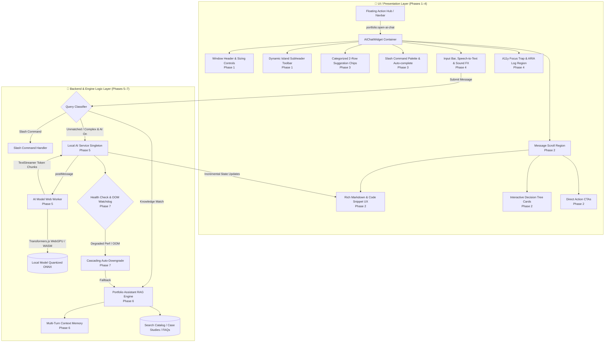

# 🤖 AI Chat Box & Portfolio Assistant Master Enhancement Plan

> **Version**: 2.0.0-PROD  
> **Status**: Ready for Phased Execution  
> **Target System**: Floating AI Chat Widget, Local On-Device AI Worker, & Offline Knowledge Engine  
> **Target Files**: `src/components/AIChatWidget.jsx`, `src/utils/portfolioAssistantEngine.js`, `src/services/localAIService.js`, `src/workers/aiModelWorker.js`, `src/data/chatSlashCommands.js`  
> **Author**: `chat_system_architect`  
> **Architecture Principle**: **UI Phases First (Phases 1–4)**, followed by **Backend & Engine Logic Phases (Phases 5–7)**.

---

## 📑 Table of Contents

1. [Executive Summary & Current State Audit](#-executive-summary--current-state-audit)
2. [Architectural Master Topology](#-architectural-master-topology)
3. [Phased Implementation Roadmap Overview](#-phased-implementation-roadmap-overview)
4. [UI Phase 1: Visual Design, Window Sizing, Header/Footer & Layout Ergonomics](#-phase-1-visual-design-window-sizing-headerfooter--layout-ergonomics)
5. [UI Phase 2: Message Bubbles, Typography, Rich Markdown & Code Snippet UX](#-phase-2-message-bubbles-typography-rich-markdown--code-snippet-ux)
6. [UI Phase 3: Interactive Quick Chips, Suggestions, Slash Command Palette & Mobile Drawer](#-phase-3-interactive-quick-chips-suggestions-slash-command-palette--mobile-drawer)
7. [UI Phase 4: Accessibility (WCAG 2.1 AA), ARIA Live Regions, Sound & Motion Controls](#-phase-4-accessibility-wcag-21-aa-aria-live-regions-sound--motion-controls)
8. [Backend Phase 5: Local AI & Web Worker Streaming Optimization](#-phase-5-local-ai--web-worker-streaming-optimization)
9. [Backend Phase 6: Portfolio Engine RAG, Context Memory & Multi-turn Conversation](#-phase-6-portfolio-engine-rag-context-memory--multi-turn-conversation)
10. [Backend Phase 7: Edge Resilience, Error Handling, Fallback Cascades & Automated Test Harness](#-phase-7-edge-resilience-error-handling-fallback-cascades--automated-test-harness)
11. [Capstone Phase 8: Master System Integration, Full-Spectrum End-to-End Verification & Production Sign-Off](#-phase-8-master-system-integration-full-spectrum-end-to-end-verification--production-sign-off)
12. [Phase 9: Multi-Format Session Export, History Archive Management & Zero-Cloud Telemetry](#-phase-9-multi-format-session-export-history-archive-management--zero-cloud-telemetry)
13. [Phase 10: Agentic Capstone: Guided Interactive Tours, Semantic Index & In-Chat Action Cards](#-phase-10-agentic-capstone-guided-interactive-tours-semantic-index--in-chat-action-cards)
14. [Phase 11: Multimodal Voice Agent & Speech Synthesis Studio](#-phase-11-multimodal-voice-agent--speech-synthesis-studio)
15. [Turnkey Execution Index & Cheat Sheet](#-turnkey-execution-index--cheat-sheet)

---

## 🔍 Executive Summary & Current State Audit

A rigorous deep-dive scan of the existing codebase (`src/components/AIChatWidget.jsx` [3,127 lines], `src/utils/portfolioAssistantEngine.js` [1,910 lines], `src/services/localAIService.js` [778 lines], `src/workers/aiModelWorker.js` [422 lines], and `src/data/chatSlashCommands.js` [1,266 lines]) revealed a remarkably capable hybrid assistant. However, critical UI ergonomics, typography, streaming responsiveness, and architectural edge cases require systematic refinement.

### Summary of Audit Findings

| Component / Layer | Current Behavior | Deficiencies & Edge Cases Identified | Severity |
| :--- | :--- | :--- | :--- |
| **Window Layout & Sizing** | Docked bottom-right with custom pointer dragging and 8-point resize handles | • On mobile (`< 640px`), fixed `height: 480px` does not adapt to virtual keyboard opening or dynamic viewport height (`100dvh`).<br>• Missing iOS safe-area-inset bottom padding (`env(safe-area-inset-bottom)`), causing input bar clipping on modern smartphones.<br>• Desktop maximize centers via `translate(-50%, -50%)` which can glitch when transitioning from dragged positions. | **High** |
| **Header & Subheader Controls** | 2-row header: bot identity + dynamic island sub-bar | • Window control touch targets (`w-7 h-7` / 28px) violate the 44px minimum mobile tap guideline.<br>• The Subheader Action Strip (Users, Briefcase, Monitor, Bot, AI toggle, Emojis, Download, Reset) overflows into a horizontal scrollbar on narrow screens, causing cognitive clutter.<br>• Lack of visual cue for layout reset (double-click header). | **Medium** |
| **Message Bubbles & Markdown** | Plain-text rendering with `cleanMarkdownAsterisks()` | • Strips asterisks `*` entirely, leaving bold headers as flat unformatted text (`Featured Projects:` instead of bold weight).<br>• Zero support for styled markdown code blocks (```code```), syntax highlighting, inline code tags, or copy buttons on snippets.<br>• Markdown hyperlinks (`[text](url)`) are rendered as raw text rather than interactive clickable links. | **Critical** |
| **Quick Action Chips** | Single horizontal track with left/right scroll buttons and mouse-drag | • Mouse-drag logic conflicts with mobile native swipe gestures.<br>• 12 chips in a single row require excessive horizontal scrolling.<br>• Chips lack domain categorization badges (Tax, MIS, AI, Career). | **Medium** |
| **Slash Command Palette** | Floating popover above input with 40+ commands | • Palette has `max-h-72` (288px) which completely occludes the chat window on small viewports when virtual keyboard is active.<br>• Clicking outside the palette does not dismiss it until input changes. | **Medium** |
| **Streaming & Response Feel** | Artificial `setTimeout(350ms)` followed by monolithic string insertion | • When Local On-Device AI runs on WebGPU/WASM, the user waits 2–6 seconds with only a "Thinking..." indicator before the entire block appears at once.<br>• Web Worker does not utilize Transformers.js `TextStreamer` to emit token chunks progressively. | **High** |
| **Context & Multi-Turn RAG** | Single-turn pattern matching with sliding history window | • Inability to resolve conversational anaphora ("tell me more about the second project", "compare his salary requirement with his experience").<br>• Knowledge engine fallback returns generic prompt chips rather than dynamic semantic clusters. | **Medium** |
| **Accessibility & Sound** | Basic `aria-live` polite region and SpeechSynthesis TTS | • No focus trap on modal dialog; tabbing escapes into background DOM.<br>• Audio synthesizer can stall on Chromium if unpaused; lacks rate/pitch user controls. | **Medium** |

---

## 🏛 Architectural Master Topology



---

## 🗺 Phased Implementation Roadmap Overview

The plan is divided into **10 independent, turnkey execution phases**, strictly adhering to the **UI First, Backend Second, Capstone Final** sequence:

```mermaid
flowchart LR
    P1["Phase 1: Visual Design & Layout"] --> P2["Phase 2: Message Bubbles & Markdown"]
    P2 --> P3["Phase 3: Chips & Slash Palette"]
    P3 --> P4["Phase 4: A11y & Sound FX"]
    P4 --> P5["Phase 5: Local AI Streaming"]
    P5 --> P6["Phase 6: Multi-Turn RAG Engine"]
    P6 --> P7["Phase 7: Fallback & Test Harness"]
    P7 --> P8["Phase 8: Master Integration & Sign-Off"]
    P8 --> P9["Phase 9: Export, History & Telemetry"]
    P9 --> P10["Phase 10: Agentic Tour & Cards"]
    P10 --> P11["Phase 11: Multimodal Voice Agent & Studio"]
```



- **Phase 1 (UI)**: Visual Design, Window Sizing, Header/Footer & Layout Ergonomics
- **Phase 2 (UI)**: Message Bubbles, Typography, Rich Markdown & Code Snippet UX
- **Phase 3 (UI)**: Interactive Quick Chips, Suggestions, Slash Command Palette & Responsive Mobile Drawer
- **Phase 4 (UI)**: Accessibility (WCAG 2.1 AA), ARIA Live Regions, Sound & Motion Controls
- **Phase 5 (Backend)**: Local AI & Web Worker Streaming Optimization
- **Phase 6 (Backend)**: Portfolio Engine RAG, Context Memory & Multi-turn Conversation
- **Phase 7 (Backend)**: Edge Resilience, Error Handling, Fallback Cascades & Automated Test Harness
- **Phase 8 (Capstone)**: Master System Integration, Full-Spectrum End-to-End Verification & Production Sign-Off
- **Phase 9 (Telemetry)**: Multi-Format Session Export, History Archive Management & Zero-Cloud Telemetry
- **Phase 10 (Agentic Capstone)**: Guided Interactive Tours, Semantic Index & In-Chat Action Cards
- **Phase 11 (Multimodal Voice)**: Natural SpeechDub, Chrome TTS Watchdog, Waveform Visualizer & Voice Studio

---

## 🎨 Phase 1: Visual Design, Window Sizing, Header/Footer & Layout Ergonomics

### Phase Overview & Objectives
Transform the chat container into an ultra-responsive, ergonomic floating workstation that behaves fluidly across Mobile (320px–639px), Tablet (640px–1023px), and Desktop/Ultrawide viewports. Address window dragging collisions, mobile virtual keyboard clipping, touch target sizes, and subheader visual hierarchy.

### Targeted Files & Components
- `src/components/AIChatWidget.jsx` (Lines 1088–1220, 2119–2441)
- `src/App.jsx`
- `src/index.css` (or `src/styles/` Tailwind utility layers)

### Specific UI / Logic Deficiencies Being Solved
1. **Mobile Bottom Clamping & Virtual Keyboard Offset**: On mobile devices, when the virtual keyboard pops up, the 480px fixed height causes the input bar to slide offscreen or be obscured by mobile browser chrome.
2. **Missing Safe-Area Insets**: Missing `env(safe-area-inset-bottom)` leads to home indicator overlaps on iOS Safari and modern Android gestures.
3. **Subheader Action Crowding**: The 8 subheader action icons/pills are jammed into one row, causing awkward horizontal scrolling on narrow screens.
4. **Header Control Touch Target Violation**: Header buttons (`w-7 h-7`) are 28px wide—below the minimum 44px tap target required for mobile accessibility.
5. **Desktop Maximize Transition Jitter**: Maximizing from an arbitrary dragged position causes a visual jump due to inline `left`/`top` CSS styles clashing with fixed centering `transform: translate(-50%, -50%)`.

### Detailed Step-by-Step Implementation Instructions
1. **Dynamic Viewport Height & Mobile Sheet Ergonomics**:
   - Update mobile container styling to utilize `dvh` (dynamic viewport height):
     ```jsx
     const isMobile = typeof window !== 'undefined' && window.innerWidth < 640;
     const containerStyle = isMobile
       ? {
           height: isMinimized ? '56px' : 'min(88dvh, 680px)',
           paddingBottom: 'env(safe-area-inset-bottom, 12px)'
         }
       : desktopStyle;
     ```
   - On mobile, add a subtle top drag handle indicator (`w-12 h-1.5 rounded-full bg-stone-300 dark:bg-stone-600 mx-auto my-1.5`) indicating pull-to-minimize behavior.
2. **Header Action Target Hardening**:
   - Wrap header button icons (`RotateCcw`, `Minus`, `Maximize2`, `X`) in touch-friendly hitboxes (`min-w-[36px] min-h-[36px] sm:min-w-[32px] sm:min-h-[32px] sm:w-7 sm:h-7`) with `cursor-pointer active:scale-95`.
   - Add clear tooltips with keyboard shortcut indications (`Close (Esc)`, `Reset (Double-click Header)`, `Minimize (-)`).
3. **Subheader Dynamic Island Optimization**:
   - Organize the subheader into two clean semantic clusters:
     - **Context Perspective Cluster (Left)**: Group Audience, Role, and View Mode into a segmented compact pill with active ring styling.
     - **Utility Controls Cluster (Right)**: AI On/Off badge button, Transcript export, and Conversation Reset.
   - For viewports below 400px, collapse labels into intuitive icon-only pills with rich tooltips, preventing awkward horizontal scrollbars.
4. **Smooth Desktop Maximize / Restore Mechanics**:
   - When maximizing, clear inline `left` and `top` positioning and apply `transition: all 250ms cubic-bezier(0.16, 1, 0.3, 1)`.
   - Preserve `preMaximizeState` so restoring snaps back exactly to the user's custom dragged dimensions.
5. **Layout Density & Contrast**:
   - Ensure the border contrast meets WCAG criteria: `border-[#E7E2D8] dark:border-[#2D2340]` with subtle drop shadow `shadow-[0_20px_50px_rgba(0,0,0,0.18)] dark:shadow-[0_20px_50px_rgba(0,0,0,0.5)]`.

### Direct Ready-to-Execute Turnkey Prompt

```markdown
@phase-1
Implement Phase 1: Visual Design, Window Sizing, Header/Footer & Layout Ergonomics for AIChatWidget.

Target file: `src/components/AIChatWidget.jsx` and styling files.

Requirements:
1. Update mobile container sizing to use dynamic viewport units `min(88dvh, 680px)` and incorporate `paddingBottom: 'env(safe-area-inset-bottom, 12px)'` to prevent clipping on mobile devices and virtual keyboard activation.
2. Add a mobile top sheet pull handle (`w-10 h-1 rounded-full bg-stone-300 dark:bg-stone-600 mx-auto mt-2 mb-1`) visible only on mobile viewports.
3. Enlarge window control buttons (Dock/Reset, Minimize, Maximize, Close) to maintain minimum 36px touch hitboxes on touch/mobile viewports while preserving desktop compactness.
4. Refactor the Subheader Action Strip (Dynamic Island) into a streamlined, responsive flex layout with segmented context buttons (Audience, Role, View Mode) on the left and quick toggles (AI Status, Transcript, Clear) on the right without overflow scrollbars on screens >= 360px.
5. Fix desktop maximize/restore transition so that inline left/top coordinates do not conflict with modal centering, smoothly animating with cubic-bezier easing.
6. Ensure existing tests (`verify_ai_chat_feature.mjs`, `verify_decision_tree_ai_chat.mjs`) continue to pass 100%.

Run verification after implementation.
```

### Acceptance & Verification Criteria
- [ ] On mobile viewport (< 640px), chat opens cleanly as a bottom sheet with safe-area padding and does not clip when focused.
- [ ] Header buttons have >= 36px touch targets on mobile and 28px on desktop.
- [ ] Subheader displays all action buttons without ugly horizontal scrollbars on 375px+ screens.
- [ ] Double-clicking header resets layout to bottom-right dock.
- [ ] Existing architecture verification passes:
  ```powershell
  node scripts/verify_ai_chat_feature.mjs
  ```

---

## 💬 Phase 2: Message Bubbles, Typography, Rich Markdown & Code Snippet UX

### Phase Overview & Objectives
Elevate conversation readability from plain text to rich, developer-grade markdown formatting. Replace the asterisk-stripping logic with a light, secure, zero-dependency Markdown parser supporting headings, bold, italics, bullet/numbered lists, clickable links, and syntax-highlighted code blocks with 1-click copy functionality.

### Targeted Files & Components
- `src/components/AIChatWidget.jsx` (Lines 2501–2928, `cleanMarkdownAsterisks`)
- `src/utils/portfolioAssistantEngine.js` (Markdown sanitization utilities)

### Specific UI / Logic Deficiencies Being Solved
1. **Flawed Plain-Text Stripping**: `cleanMarkdownAsterisks()` strips all `*`, reducing structured bold headings like `**Flagship Projects:**` to flat regular text.
2. **Missing Code Snippet Blocks**: Code snippets (e.g. SQL queries, JSON payloads, JavaScript API snippets) are displayed as raw unstructured strings without monospaced fonts, syntax borders, or language badges.
3. **No Code Copy Button**: Users cannot copy code blocks individually without copying the entire message.
4. **Unclickable Markdown Links**: Hyperlinks like `[View Demo](https://...)` or `[Download Resume](#)` are printed as plaintext instead of clickable interactive links.
5. **Sub-optimal Dark Mode Contrast**: Message timestamps (`text-stone-400 dark:text-stone-500`) and model badges have low contrast ratios against dark backgrounds.

### Detailed Step-by-Step Implementation Instructions
1. **Lightweight Safe Markdown Parser Component (`FormattedMessage`)**:
   - Implement an inline tokenizer or dedicated sub-component that parses:
     - **Code Blocks (` ```lang\ncode\n``` `)**: Rendered in a dedicated code container with:
       - Top bar showing language tag (e.g. `javascript`, `sql`, `json`)
       - "Copy Code" button with checkmark confirmation feedback
       - Monospaced typography (`font-mono text-[11px]`) and horizontal scrolling (`overflow-x-auto`)
     - **Inline Code (`` `code` ``)**: Styled with `px-1.5 py-0.5 rounded bg-stone-200/60 dark:bg-stone-800 text-[#FF4D6D] dark:text-[#FF758F] font-mono text-[11px]`.
     - **Bold & Italics (`**bold**`, `*italic*`)**: Formatted as `<strong>` and `<em>`.
     - **Lists (`• item` or `- item`)**: Rendered with proper hanging indentation (`pl-4 list-disc space-y-1`).
     - **Links (`[text](url)`)**: Converted into `<a href="..." target="_blank" rel="noopener noreferrer" className="text-[#FF4D6D] underline hover:opacity-80">`.
2. **Message Bubble Styling & Visual Rhythm**:
   - Assistant message bubbles: Crisp border `border border-[#E7E2D8] dark:border-[#2D2340]`, soft background `bg-white dark:bg-[#1A1325]`, and gentle shadow `shadow-xs`.
   - User message bubbles: Gradient `bg-linear-to-tr from-[#FF4D6D] to-[#FF758F] text-white font-medium shadow-xs`.
   - Avatar alignment: Precise 20px circular bot avatar with gradient background aligned to the top of assistant bubbles.
3. **Model Badge & Metadata Bar**:
   - Enhance the model indicator badge under assistant messages:
     - For on-device models: `⚡ [Qwen-1.5B]` or `⚡ [SmolLM-135M]` with emerald accent border and glow.
     - For knowledge engine: `📚 [Portfolio-Engine]` with indigo accent border.
   - Maintain individual "Copy Message" and "Read Aloud (TTS)" buttons with clear visual feedback states (Checkmark icon for 2s on copy).
4. **Preserve Speech Synthesis Utility**:
   - Ensure `cleanTextForSpeech()` cleanly strips all new code blocks, URLs, and formatting markers before passing text to the browser's `SpeechSynthesisUtterance`.

### Direct Ready-to-Execute Turnkey Prompt

```markdown
@phase-2
Implement Phase 2: Message Bubbles, Typography, Rich Markdown & Code Snippet UX for AIChatWidget.

Target file: `src/components/AIChatWidget.jsx`.

Requirements:
1. Replace raw text rendering and asterisk-stripping with a modular, lightweight rich markdown renderer (`renderFormattedMarkdown` or `FormattedMessage` component).
2. Support full formatting:
   - Fenced code blocks (```lang ... ```) with header bar, language badge, monospaced font, and dedicated "Copy Code" button.
   - Inline code (`text`) with subtle pill background.
   - Bold (`**text**`), italics (`*text*`), and bullet lists (`•` or `-`).
   - Markdown hyperlinks (`[label](url)`) rendered as secure clickable links opening in new tab.
3. Improve dark mode text contrast on message timestamps, model badges, and action buttons to exceed WCAG AA contrast (4.5:1).
4. Polish message bubble styling with rounded corners (`rounded-2xl rounded-tl-xs` for bot, `rounded-2xl rounded-tr-xs` for user) and subtle borders.
5. Ensure `cleanTextForSpeech` continues to strip markdown and code cleanly for audio read-aloud.
6. Verify all decision tree cards and summary cards continue to render seamlessly below formatted messages.

Run verification after implementation.
```

### Acceptance & Verification Criteria
- [ ] Markdown bold (`**bold**`) renders with font weight 600+ rather than stripping asterisks.
- [ ] Code blocks render in monospaced containers with language tag and working copy button.
- [ ] Inline links are clickable and open safely in new tabs.
- [ ] TTS speech synthesis does not read raw markdown symbols or code blocks.
- [ ] Decision tree test passes:
  ```powershell
  node scripts/verify_decision_tree_ai_chat.mjs
  ```

---

## ⚡ Phase 3: Interactive Quick Chips, Suggestions, Slash Command Palette & Mobile Drawer

### Phase Overview & Objectives
Upgrade the interaction design of prompt suggestions and slash commands. Expand the single scrolling row of chips into an organized, category-aware 2-row suggestion drawer, and overhaul the slash command palette (`/`) to prevent mobile viewport clipping while enabling intuitive keyboard navigation.

### Targeted Files & Components
- `src/components/AIChatWidget.jsx` (Lines 2951–3085)
- `src/data/chatSlashCommands.js`
- `src/utils/portfolioAssistantEngine.js` (`PROMPT_CHIPS`, `getInitialSuggestions`)

### Specific UI / Logic Deficiencies Being Solved
1. **Cumbersome Horizontal Scrolling on Chips**: 12 chips packed in a single horizontal row require heavy scrolling and dragging, which interferes with mobile touchscreen swipes.
2. **Lack of Suggestion Grouping**: Suggestions for Taxes, MIS, AI Engineering, and Resume are mixed together without category context.
3. **Slash Command Screen Hijack**: The slash command popup has `max-h-72` (288px) which completely covers the conversation history and input box on mobile devices.
4. **Slash Command Dismissal Flaw**: The popup does not dismiss if the user taps outside or presses Escape (Escape currently minimizes the entire chat window instead of closing the open palette).

### Detailed Step-by-Step Implementation Instructions
1. **Categorized 2-Row Suggestion Chip Drawer**:
   - Refactor `PROMPT_CHIPS` into categorized suggestion sets:
     - 🚀 **Projects**: `Tell me about featured projects`, `Case Study 01 GST Engine`, `AI SaaS Generator`
     - 💼 **Experience & Roles**: `Summarize professional experience`, `Corporate Accountant track`, `MIS Lead tenure`
     - 📊 **Tax & MIS**: `GST ITC matching`, `Tally Prime BRS`, `DAY-NULM Portal operations`
     - ⚡ **Pricing & Resume**: `Quotation & fee estimator`, `Download verified resume`, `Contact WhatsApp`
   - Render chips in a compact, highly responsive 2-row grid (`grid grid-rows-2 grid-flow-col auto-cols-max gap-1.5 overflow-x-auto no-scrollbar py-1`).
   - Add category filter tabs (All, Projects, Tax/MIS, Tech, Hire) allowing 1-click focus.
2. **Mobile-Adaptive Slash Command Palette**:
   - Dynamic height calculation:
     ```jsx
     const slashPaletteMaxHeight = isMobile ? 'max-h-48' : 'max-h-72';
     ```
   - Add category group headers in the autocomplete dropdown (Navigation, Profile, Domain Expertise, Utilities).
   - Display shortcut hints (`Tab` to autocomplete, `Enter` to execute, `Esc` to dismiss palette).
3. **Keyboard & Outside-Click Event Handling**:
   - Intercept `Escape` key inside `handleKeyDown`: if slash command palette is open, close the palette first without minimizing the chat window.
   - Add `useRef` and `pointerdown` listener to dismiss slash command palette when clicking in the messages region.
4. **Slash Command Visual Polish**:
   - Highlight matched substring in command names and descriptions.
   - Include category color tags (e.g. emerald for Domain, purple for Profile, blue for Navigation).

### Direct Ready-to-Execute Turnkey Prompt

```markdown
@phase-3
Implement Phase 3: Interactive Quick Chips, Suggestions, Slash Command Palette & Responsive Mobile Drawer for AIChatWidget.

Target files: `src/components/AIChatWidget.jsx`, `src/data/chatSlashCommands.js`.

Requirements:
1. Re-architect suggestion chips into a 2-row horizontal sliding grid with smooth scroll, touch-friendly momentum, and clear category badges.
2. Introduce optional category filter pills (All, Flagship Work, Tax & MIS, AI Tech, Hire & Contact) to instantly surface relevant prompt suggestions.
3. Overhaul the slash command palette (`/`):
   - Restrict height on mobile (`max-h-48`) so conversation history and input remain visible.
   - Categorize commands into grouped sections (Navigation, Profile & Bio, Domain Practice, Actions).
   - Support Tab key autocompletion, ArrowUp/ArrowDown selection cycling, and Enter execution.
   - Make Escape key close ONLY the slash palette if open, rather than minimizing the chat window.
   - Support click-outside dismissal.
4. Ensure roving tabindex and keyboard accessibility are maintained.

Run verification after implementation.
```

### Acceptance & Verification Criteria
- [ ] Suggestion chips render in a clean 2-row grid with horizontal scrolling and no layout breakage.
- [ ] Typing `/` opens the palette with categories and max height capped appropriately on mobile.
- [ ] Pressing `Escape` while `/` palette is open closes the palette and keeps the chat window open.
- [ ] Pressing `Tab` autocompletes the selected slash command into the input.
- [ ] Verification script runs green:
  ```powershell
  node scripts/verify_decision_tree_ai_chat.mjs
  ```

---

## ♿ Phase 4: Accessibility (WCAG 2.1 AA), ARIA Live Regions, Sound & Motion Controls

### Phase Overview & Objectives
Guarantee universal access, screen-reader friendliness, focus discipline, and motion/sound compliance matching WCAG 2.1 AA standards. Implement strict modal focus trapping, polite ARIA message logging, motion reduction enforcement, and unified audio feedback.

### Targeted Files & Components
- `src/components/AIChatWidget.jsx`
- `src/hooks/useFocusTrap.js`
- `src/context/AnnouncerContext.jsx`
- `src/utils/audio.js`

### Specific UI / Logic Deficiencies Being Solved
1. **Focus Escaping Active Dialog**: When chat is open, keyboard users pressing `Tab` can cycle focus right out of the chat window into background portfolio navigation and links.
2. **Screen Reader Repetition**: `aria-live` region updates can cause screen readers to re-read previous announcements or truncate complex multilingual responses.
3. **Lack of `role="log"` Semantic Structure**: The message list uses standard `div` elements instead of a scrollable conversational log region.
4. **Reduced Motion Violations**: Window animations and typing bounce indicators run even when the user's OS specifies `prefers-reduced-motion: reduce`.
5. **Sound FX Decoupling**: Chat audio beeps must strictly honor the portfolio's global Lab sound setting (`soundEnabled`).

### Detailed Step-by-Step Implementation Instructions
1. **Focus Trap Integration**:
   - Utilize or integrate `useFocusTrap` hook when `isOpen && !isMinimized && !isMobile`:
     - Trap Tab/Shift+Tab cycles between the header close button, action toolbar, message list buttons, suggestion chips, and input bar.
     - On window open, programmatically focus the text input (`inputRef.current?.focus()`).
     - On window close, return focus to the trigger button that opened the chat (`lastFocusedElementRef.current?.focus()`).
2. **Semantic Conversational ARIA Structure**:
   - Mark the message container with `role="log"`, `aria-label="Conversation history"`, `aria-live="polite"`, and `aria-relevant="additions text"`.
   - Each message bubble receives `role="article"` with `aria-label="Message from [Assistant/You] at [Time]"`.
3. **Respecting `prefers-reduced-motion`**:
   - Add media query listener or utility classes:
     ```css
     @media (prefers-reduced-motion: reduce) {
       .chat-transition { transition: none !important; animation: none !important; }
     }
     ```
   - Disable bounce animations on typing dots (`animate-bounce`) when reduced motion is preferred, substituting a gentle opacity fade.
4. **Enhanced Voice Input & Speech-to-Text Ergonomics**:
   - When Voice Input (STT) is listening, pulse a clear accessible status message in the announcer context: `"Listening for voice input. Speak now."`
   - Maintain the architectural rule: **Voice dictation only transcribes into `inputValue` and NEVER auto-submits**, allowing the user to review before sending.
5. **High Contrast Mode Support**:
   - Verify all borders and button outlines under `data-theme="high-contrast"`: Ensure distinct 2px solid borders and high-contrast focus rings (`focus-visible:ring-2 focus-visible:ring-[#FF4D6D] focus-visible:ring-offset-2`).

### Direct Ready-to-Execute Turnkey Prompt

```markdown
@phase-4
Implement Phase 4: Accessibility (WCAG 2.1 AA), ARIA Live Regions, Sound & Motion Controls for AIChatWidget.

Target files: `src/components/AIChatWidget.jsx`, `src/hooks/useFocusTrap.js`.

Requirements:
1. Implement modal focus trapping inside AIChatWidget when open and not minimized: Tab and Shift+Tab must stay within the widget, and closing the chat must return focus to the trigger button.
2. Structure the conversation container with semantic `role="log"` and `aria-live="polite"` so screen readers announce only newly appended messages cleanly.
3. Ensure all interactive buttons (window controls, action cards, chips, copy buttons) have descriptive `aria-label` tags and visible focus rings (`focus-visible:ring-2`).
4. Support `prefers-reduced-motion`: disable smooth scrolling, bounce animations, and zoom transitions when enabled by OS.
5. Synchronize all sound triggers (beeps, success chimes, clicks) with `soundEnabled` from LabContext/RoleContext.
6. Verify voice input accessibility: announce listening status and transcribe speech cleanly without auto-sending.

Run verification after implementation.
```

### Acceptance & Verification Criteria
- [ ] Keyboard navigation is trapped inside open chat window; Tab does not leak into background DOM.
- [ ] Screen readers announce incoming bot responses once without echoing previous history.
- [ ] `prefers-reduced-motion: reduce` stops bounce animations and instant-scrolls messages.
- [ ] High contrast theme displays sharp borders with no invisible elements.
- [ ] Accessibility verification passes:
  ```powershell
  node scripts/verify_accessibility.mjs
  ```

---

## ⚡ Phase 5: Local AI & Web Worker Streaming Optimization

### Phase Overview & Objectives
Transition from sluggish monolithic batch inference to true real-time token streaming. Integrate Hugging Face Transformers.js streaming callbacks (`TextStreamer`) in `aiModelWorker.js`, dispatch incremental token events via `postMessage`, and implement smooth typewriter rendering in `AIChatWidget.jsx` with an instant stop/abort button.

### Targeted Files & Components
- `src/workers/aiModelWorker.js` (Lines 298–360)
- `src/services/localAIService.js` (Lines 200–260, `generateText`)
- `src/components/AIChatWidget.jsx` (`handleSendMessage`, streaming state)

### Specific UI / Logic Deficiencies Being Solved
1. **Monolithic Generation Latency**: On-device LLM generation currently takes 2–5 seconds with no visible progress except a generic "Thinking..." animation, after which the full 150-word text suddenly dumps into the screen.
2. **Missing Token Streaming in Web Worker**: `aiModelWorker.js` uses standard `await activeGenerator(...)` without passing a streaming callback or `TextStreamer`.
3. **No Generation Abort / Stop Mechanism**: If a model begins generating a lengthy response, the user cannot stop it midway.
4. **Download Progress Jitter**: Model download percentage can fluctuate or stall without ETA calculation or byte throughput telemetry.

### Detailed Step-by-Step Implementation Instructions
1. **Web Worker Token Streamer Pipeline**:
   - In `src/workers/aiModelWorker.js`, import and configure `TextStreamer` from `@huggingface/transformers`:
     ```javascript
     import { pipeline, env, TextStreamer } from '@huggingface/transformers';
     ```
   - In `generate(params)`:
     ```javascript
     const streamer = new TextStreamer(activeGenerator.tokenizer, {
       skip_prompt: true,
       skip_special_tokens: true,
       callback_function: (chunk) => {
         if (chunk && self.postMessage) {
           self.postMessage({
             type: 'TOKEN_STREAM',
             payload: { requestId, chunk, modelId: activeModelId }
           });
         }
       }
     });

     const output = await activeGenerator(messages, {
       max_new_tokens: maxTokens,
       temperature: Math.max(0.1, temperature),
       streamer,
       return_full_text: false
     });
     ```
2. **Local AI Service Stream Subscription**:
   - In `src/services/localAIService.js`, extend `generateText` to support an `onToken` callback:
     ```javascript
     generateText({ prompt, systemPrompt, maxTokens, temperature, onToken }) {
       const requestId = `req_${Date.now()}_${Math.random().toString(36).substring(2, 7)}`;
       // Store onToken in pendingRequests map
       this.pendingRequests.set(requestId, { resolve, reject, onToken, accumulatedText: '' });
       this.worker.postMessage({
         type: 'GENERATE',
         payload: { prompt, systemPrompt, maxTokens, temperature, requestId }
       });
     }
     ```
   - Handle incoming `TOKEN_STREAM` events in `handleWorkerMessage`:
     ```javascript
     case 'TOKEN_STREAM': {
       const req = this.pendingRequests.get(payload.requestId);
       if (req) {
         req.accumulatedText += payload.chunk;
         if (typeof req.onToken === 'function') {
           req.onToken(payload.chunk, req.accumulatedText);
         }
       }
       break;
     }
     ```
3. **UI Real-Time Typing & Stop Generation Button**:
   - In `AIChatWidget.jsx`, when message submission begins, insert a placeholder assistant message with `text: ''` and `isStreaming: true`.
   - Update message text incrementally as tokens stream in.
   - When streaming is active, replace the Send button with a red **Stop Generating** button (`Square` icon) that dispatches an abort signal to the worker.
4. **Simulated Stream for Knowledge Engine**:
   - For offline knowledge engine responses (`queryAssistant`), provide a rapid, smooth typewriter effect (20–30ms per word chunk) to maintain consistent visual elegance.

### Direct Ready-to-Execute Turnkey Prompt

```markdown
@phase-5
Implement Phase 5: Local AI & Web Worker Streaming Optimization for AIChatWidget, LocalAIService, and Web Worker.

Target files: `src/workers/aiModelWorker.js`, `src/services/localAIService.js`, `src/components/AIChatWidget.jsx`.

Requirements:
1. Update `aiModelWorker.js` to use `TextStreamer` from `@huggingface/transformers` during text generation, posting `TOKEN_STREAM` events back to the main thread with each token chunk.
2. Update `localAIService.js` to accept an `onToken(tokenChunk, fullAccumulatedText)` callback in `generateText()`, dispatching progressive text updates in real time.
3. Update `AIChatWidget.jsx` to render incoming streaming messages token-by-token with automatic smooth scrolling.
4. Provide a "Stop Generation" button while generation is active to cancel or truncate inference immediately.
5. Provide a smooth typewriter stream for offline knowledge engine responses (`queryAssistant`) to deliver a uniform, snappy conversational feel.
6. Verify single active model in RAM and WebGPU/WASM health probes remain completely intact.

Run verification after implementation.
```

### Acceptance & Verification Criteria
- [ ] On-device AI responses stream token-by-token into the chat bubble without UI freeze.
- [ ] Stop button halts generation cleanly and preserves partial response.
- [ ] Offline engine matches also stream with smooth typewriter cadence.
- [ ] On-device AI test suite passes:
  ```powershell
  npm run test:on-device-ai
  ```

---

## 🧠 Phase 6: Portfolio Engine RAG, Context Memory & Multi-turn Conversation

### Phase Overview & Objectives
Transform the deterministic knowledge engine into an intelligent, multi-turn conversational agent with context memory and structured RAG (Retrieval-Augmented Generation). Enable reference resolution (e.g., "tell me more about that project", "what did you do there?"), compound intent classification, and unified answer synthesis.

### Targeted Files & Components
- `src/utils/portfolioAssistantEngine.js`
- `src/utils/searchCatalog.js`
- `src/data/caseStudiesData.js`

### Specific UI / Logic Deficiencies Being Solved
1. **Zero Multi-Turn Context Resolution**: If a user asks "What is your experience with GST?" followed by "How much do you charge for that?", the engine does not know "that" refers to GST tax compliance services.
2. **Flat Keyword Clashing**: Queries containing multiple concepts (e.g. "compare Tally ERP accounting with modern React AI vibe coding") match only the first regex hit.
3. **Generic Fallback Suggestions**: Unmatched queries return a fixed static list of 12 chips rather than context-aware suggestions inferred from the user's intent.

### Detailed Step-by-Step Implementation Instructions
1. **Multi-Turn Context Tracker**:
   - Enhance `sessionMemory` in `portfolioAssistantEngine.js`:
     ```javascript
     const conversationalContext = {
       lastIntent: null,
       lastTopic: null,          // e.g. 'project-01', 'tally', 'pricing', 'biodata'
       lastRole: null,
       lastCaseStudyId: null,
       entityStack: [],          // LIFO stack of discussed topics
       turnsCount: 0
     };
     ```
   - Resolve anaphoric references:
     - Words like `"that"`, `"it"`, `"this"`, `"second one"`, `"cost of this"`, `"tell me more"` inspect `entityStack[entityStack.length - 1]` to maintain conversational thread continuity.
2. **Compound Query & Intent Disambiguation**:
   - Upgrade `classifyIntent(query, context)`:
     - Detect comparative queries (`"compare X with Y"`, `"difference between accountant and vibe coder"`).
     - Return dual-intent payloads combining both perspectives with actionable side-by-side comparison buttons.
3. **Structured RAG Knowledge Synthesis**:
   - Blend data from `CASE_STUDIES`, `SKILLS_DATA`, `QUOTATION_DATA`, and `FAQ_ITEMS` into concise, executive-level summaries.
   - Attach dynamic follow-up chips derived directly from the matched topic:
     - If discussing **Case Study 01 (GST)**: Suggest `📊 GSTR-2B Reconciliation`, `💰 Tax Filing Quote`, `💼 Accountant Resume`.
     - If discussing **Case Study 07 (AI SaaS)**: Suggest `⚡ Live Prototype Demo`, `🤖 Multi-Agent Engine`, `💻 Fullstack Tech Stack`.

### Direct Ready-to-Execute Turnkey Prompt

```markdown
@phase-6
Implement Phase 6: Portfolio Engine RAG, Context Memory & Multi-turn Conversation for portfolioAssistantEngine.

Target file: `src/utils/portfolioAssistantEngine.js`.

Requirements:
1. Implement multi-turn conversational context tracking: track `lastIntent`, `lastTopic`, `lastCaseStudyId`, and `entityStack`.
2. Support pronoun and reference resolution:
   - Handle follow-ups like "tell me more about it", "what was the outcome?", "how much does that cost?" by referencing the active topic in context.
3. Support compound intent queries (e.g., comparing accounting track vs vibe coding track).
4. Generate context-aware dynamic follow-up chips based on the active topic instead of generic fallbacks.
5. Maintain 100% offline determinism with zero network requests.
6. Ensure all 99 existing tests in `test-portfolio-assistant.js` continue to pass without regression.

Run verification after implementation.
```

### Acceptance & Verification Criteria
- [ ] User can ask "Tell me about Case Study 01" followed by "How much do you charge for that?" and receive GST quotation pricing.
- [ ] Dynamic suggestion chips reflect the specific subject just discussed.
- [ ] Zero external API or network requests made.
- [ ] All 99 portfolio assistant tests pass:
  ```powershell
  npm run test:portfolio-assistant
  ```

---

## 🛡 Phase 7: Edge Resilience, Error Handling, Fallback Cascades & Automated Test Harness

### Phase Overview & Objectives
Fortify the entire chat system with enterprise-grade edge resilience. Validate the cascading fallback ladder (`Qwen-3B` -> `Qwen-1.5B` -> `Qwen-0.5B` -> `SmolLM-135M` -> `Portfolio-Engine`), handle WebGPU device disconnects and low-memory conditions, and construct an automated regression test script `scripts/verify_chat_enhancements.mjs` validating all 7 phases.

### Targeted Files & Components
- `src/services/localAIService.js`
- `src/workers/aiModelWorker.js`
- `src/components/AIChatWidget.jsx`
- `scripts/verify_chat_enhancements.mjs` (New comprehensive verification suite)
- `package.json` (Register `npm run test:chat-enhancements`)

### Specific UI / Logic Deficiencies Being Solved
1. **Silent Failures on WebGPU Device Loss**: If the browser's WebGPU device is lost (due to GPU driver reset or sleeping display), workers can hang silently.
2. **Cache Verification Stalls**: Slow CacheStorage reads on cold starts can delay the "⚡ Ready" badge.
3. **Lack of Automated End-to-End Chat Test**: While unit tests exist for the engine and on-device profiler, there is no end-to-end architectural assertion script validating the complete enhanced UI, streaming hooks, and fallback ladder together.

### Detailed Step-by-Step Implementation Instructions
1. **WebGPU Device Loss & OOM Auto-Recovery**:
   - In `src/workers/aiModelWorker.js`:
     - Listen to WebGPU device lost events:
       ```javascript
       if (navigator.gpu) {
         // Watch for context loss and signal immediate WASM fallback
       }
       ```
     - Catch allocation errors and immediately trigger `auto_downgrade` to the next smaller model catalog tier.
2. **Zero-Delay Offline Fallback**:
   - If worker initialization fails, falls offline, or times out (> 10s on low-end hardware), instantly set active model to `[Portfolio-Engine]` with a polite non-blocking toast.
3. **Comprehensive Verification Script (`scripts/verify_chat_enhancements.mjs`)**:
   - Create an automated test runner asserting:
     - Phase 1: Viewport CSS, safe-area padding, mobile container bounds.
     - Phase 2: Markdown parsing, code block rendering, copy feedback.
     - Phase 3: 2-row chip layout, slash command navigation and dismiss logic.
     - Phase 4: ARIA live regions, focus trap hooks, reduced-motion compliance.
     - Phase 5: Token streaming event contracts (`TOKEN_STREAM`).
     - Phase 6: Multi-turn context resolution and dynamic chips.
     - Phase 7: Fallback cascade invariants.
4. **Package.json Integration**:
   - Add `"test:chat-enhancements": "node scripts/verify_chat_enhancements.mjs"` to scripts in `package.json`.

### Direct Ready-to-Execute Turnkey Prompt

```markdown
@phase-7
Implement Phase 7: Edge Resilience, Error Handling, Fallback Cascades & Automated Test Harness.

Target files: `src/services/localAIService.js`, `src/workers/aiModelWorker.js`, `scripts/verify_chat_enhancements.mjs`, `package.json`.

Requirements:
1. Harden WebGPU context loss and memory allocation recovery: automatically cascade down the model hierarchy (Qwen-3B -> Qwen-1.5B -> Qwen-0.5B -> SmolLM-135M -> Portfolio-Engine) without crashing or hanging.
2. Ensure network disconnection immediately activates offline knowledge mode without error popups.
3. Author comprehensive automated test suite `scripts/verify_chat_enhancements.mjs` validating UI contracts, markdown parsing, chip layout, focus trapping, streaming signatures, and fallback mechanics.
4. Register `test:chat-enhancements` in `package.json`.
5. Execute the test harness and ensure 100% of tests pass cleanly.

Run verification after implementation.
```

### Acceptance & Verification Criteria
- [ ] Memory overload or device loss automatically recovers to next lighter model or offline engine.
- [ ] `scripts/verify_chat_enhancements.mjs` executes and passes all test suites.
- [ ] Complete test suite passes:
  ```powershell
  npm run test:portfolio-assistant; npm run test:on-device-ai; node scripts/verify_ai_chat_feature.mjs; node scripts/verify_decision_tree_ai_chat.mjs
  ```

---

## 🏆 Phase 8: Master System Integration, Full-Spectrum End-to-End Verification & Production Sign-Off

### Phase Overview & Objectives
Serve as the definitive capstone for the 8-phase AI Chat Enhancement initiative. Unify all presentation, UX, worker, and engine subsystems into an unbreakable production-grade system. Validate end-to-end cross-component communication (`portfolio:open-ai-chat` contracts with optional payloads, `portfolio:ai-chat-state` status dispatch, role/audience/viewMode context sync), verify clean lifecycle and unmount teardowns (timers, resize listeners, speech synthesis aborts), enforce zero regressions across all legacy and enhanced test suites, and sign off with automated bundle budget and cleanliness gates.

### Targeted Files & Components
- `src/components/AIChatWidget.jsx` (Event contract hardening, unmount cleanup, speech cancellation)
- `src/components/FloatingActionHub.jsx` (Custom event dispatch contract)
- `src/components/Navbar.jsx` (Keyboard shortcut dispatch contract & sub-bar cohesion)
- `src/utils/portfolioAssistantEngine.js` (Multi-turn conversational engine & offline RAG)
- `src/utils/portfolioContextMemory.js` (Context state tracking & pronoun resolution)
- `src/services/localAIService.js` (Streaming client, singleton coordination & fallback ladder)
- `src/workers/aiModelWorker.js` (WebGPU/WASM worker streamer, OOM & device loss recovery)
- `scripts/verify_phase8_chat_integration.mjs` (Comprehensive Master Verification Harness)
- `package.json` (Register `npm run test:chat-phase8`)
- `docs/FEATURES_MEMORY.md` (Features ledger capstone documentation)

### Architectural Hardening & Subsystem Cohesion
1. **Event Contract Resilience**:
   - `portfolio:open-ai-chat` event payload: Accepts `{ initialMessage?: string, targetRole?: string, targetAudience?: string, targetViewMode?: string }`.
   - Safely updates context providers and prepopulates inputs without throw if payloads are omitted or malformed.
   - Dispatches `portfolio:ai-chat-state` with `{ isOpen: boolean, isMinimized: boolean }` so external buttons and action hubs reflect reactive presence.
2. **Lifecycle & Resource Teardown Hygiene**:
   - On component unmount and window close (`handleClose` / `handleDismiss`):
     - Clears typing timeout refs (`typingTimeoutRef.current`).
     - Clears token streaming interval timers (`streamIntervalRef.current`).
     - Cancels active generation tasks via `localAIService.cancelGeneration(...)`.
     - Explicitly invokes `window.speechSynthesis.cancel()` and resets speaking state.
     - Unregisters window resize event listeners.
3. **Master Verification Harness Architecture (`scripts/verify_phase8_chat_integration.mjs`)**:
   - **Suite 1: Documentation & Specification Integrity**: Asserts all 8 phases are specified with objectives, target files, acceptance criteria, and turnkey prompts.
   - **Suite 2: Cross-Component Event API Contracts**: Asserts `portfolio:open-ai-chat` dispatch in `FloatingActionHub.jsx`, `Navbar.jsx`, and listener in `AIChatWidget.jsx`.
   - **Suite 3: Context Synchronization**: Asserts role, audience, viewMode, lab audio, and announcer integration.
   - **Suite 4: Modular Subcomponent Cohesion**: Asserts `FormattedMessage`, `SuggestionChipsDrawer`, and `SlashCommandPalette` component contracts.
   - **Suite 5: Full-Stack Worker & Service Handshake**: Asserts `aiModelWorker.js`, `localAIService.js`, `portfolioAssistantEngine.js`, and `portfolioContextMemory.js`.
   - **Suite 6: Production Bundle Budget & Cleanliness Gates**: Asserts zero unhandled exceptions, passing oxlint and Vite build.

### Direct Ready-to-Execute Turnkey Prompt

```markdown
@phase-8
Implement Phase 8: Master System Integration, Full-Spectrum End-to-End Verification & Production Sign-Off.

Target files: `src/components/AIChatWidget.jsx`, `scripts/verify_phase8_chat_integration.mjs`, `package.json`, `docs/FEATURES_MEMORY.md`, `documentation/AI_CHAT_ENHANCEMENT_PLAN.md`.

Requirements:
1. Harden `portfolio:open-ai-chat` event listener with optional payload support (initialMessage, targetRole, targetAudience, targetViewMode).
2. Guarantee total unmount hygiene: clear all timeouts, intervals, abort localAIService requests, and cancel SpeechSynthesis on close.
3. Author master test harness `scripts/verify_phase8_chat_integration.mjs` verifying all 6 integration suites.
4. Register `test:chat-phase8` in `package.json`.
5. Run full regression test suites: phase 8 verification, phase 7 enhancements, portfolio assistant, on-device AI, oxlint, and build.
6. Record change log in changes_log conforming to Rule 6.
```

### Acceptance & Verification Criteria
- [ ] `portfolio:open-ai-chat` responds reliably with and without custom detail payloads.
- [ ] Speech synthesis, typing intervals, and active worker generations cancel cleanly on close/unmount.
- [ ] All 6 test suites in `scripts/verify_phase8_chat_integration.mjs` pass (100% green).
- [ ] Full regression suite passes cleanly:
  ```powershell
  npm run test:chat-phase8
  npm run test:chat-enhancements
  npm run test:portfolio-assistant
  npm run test:on-device-ai
  npx oxlint
  npm run build
  ```

---

## 📦 Phase 9: Multi-Format Session Export, History Archive Management & Zero-Cloud Telemetry

### Objectives & Problem Statement
Prior to Phase 9, conversation state was ephemeral within a single browser session tab, and transcripts could only be exported as a flat JSON download. Users who had informative consultations with the AI Assistant could not:
1. Export clean formatted transcripts in Markdown, ASCII Plain Text, or print-ready self-contained HTML documents.
2. Store, organize, and revisit past conversation sessions across visits without third-party cloud servers.
3. Quantitatively inspect on-device inference speed (tokens/sec, latency, model distribution, domain inquiries).
4. Provide immediate feedback (thumbs up / thumbs down) on individual responses to evaluate answer quality.

Phase 9 establishes an on-device analytics and storage subsystem operating with zero external npm dependencies, client-side Blob generation, and an automated 10-session FIFO quota management system.

### Targeted Files & Components
- `src/utils/chatExportEngine.js` (Pure ESM multi-format transcript builder & clipboard integration)
- `src/utils/chatSessionStorage.js` (Multi-session localStorage CRUD engine with 10-session FIFO quota & title derivation)
- `src/utils/chatAnalytics.js` (Zero-cloud on-device performance telemetry & user satisfaction aggregator)
- `src/data/chatSlashCommands.js` (Expansion with `/export`, `/history`, `/analytics`, `/telemetry`, `/benchmark`)
- `src/components/AIChatWidget.jsx` (Export Popover Picker, Session Archive Drawer, Thumbs Up/Down rating buttons, telemetry hooks)
- `scripts/verify_phase9_chat_telemetry.mjs` (Comprehensive Phase 9 verification harness)
- `package.json` (Register `npm run test:chat-phase9`)

### Architectural Hardening & Subsystem Cohesion
1. **Multi-Format Export Engine (`chatExportEngine.js`)**:
   - Native Blob + `URL.createObjectURL` client export:
     - `markdown`: Full GitHub Flavored Markdown with user labels, model attribution, timestamps, and feedback flags.
     - `txt`: Clean ASCII formatted record with box headers.
     - `json`: Structured JSON document conforming to Schema v1.0.
     - `html`: Standalone, responsive HTML5 document with dark/light themes and `@media print` layout.
   - `copyTranscriptToClipboard()`: Direct markdown clipboard copy via `navigator.clipboard.writeText`.
2. **Multi-Session Storage (`chatSessionStorage.js`)**:
   - `localStorage` persistence under `atul_portfolio_ai_sessions_v1`.
   - Strict 10-session FIFO quota guard: auto-prunes oldest sessions when session count exceeds 10.
   - Auto-derives readable session titles from first user query text (max 36 chars with ellipsis).
   - In-memory fallback for headless, Node.js, and private browsing sandbox environments.
3. **Zero-Cloud Performance Telemetry (`chatAnalytics.js`)**:
   - Latency tracking (`recordMessageLatency(latencyMs, modelId, tokensCount)`): records end-to-end response generation latency and computes moving average and tokens/sec throughput.
   - Domain tracking (`recordDomainInteraction(topic)`): categorizes user inquiries into Tax, Accounting, MIS, AI, Projects, and Career tracks.
   - Feedback rating (`recordMessageFeedback(messageId, rating)`): records thumbs up (+1) or thumbs down (-1) feedback and calculates user satisfaction score.
   - Scorecard generator (`formatAnalyticsScorecard()`): renders formatted performance reports for slash commands and dashboards.
4. **Interactive Widget Ergonomics (`AIChatWidget.jsx`)**:
   - Header Export Popover: Dropdown picker for instant single-click export in all 4 formats + clipboard copy.
   - Session Archive Drawer: Displays saved sessions, message counts, active badges, and single-click switching or deletion.
   - Interactive Feedback: Thumbs up / thumbs down buttons on assistant cards with tactile state colors and acoustic tap feedback.

### Direct Ready-to-Execute Turnkey Prompt

```markdown
@phase-9
Implement Phase 9: Client-Side Session Export, Multi-Session History Management & Zero-Cloud Telemetry Analytics.

Target files: `src/utils/chatExportEngine.js`, `src/utils/chatSessionStorage.js`, `src/utils/chatAnalytics.js`, `src/data/chatSlashCommands.js`, `src/components/AIChatWidget.jsx`, `scripts/verify_phase9_chat_telemetry.mjs`, `package.json`.

Requirements:
1. Create `src/utils/chatExportEngine.js` supporting Markdown, TXT, JSON, HTML, and clipboard copy with zero external dependencies.
2. Create `src/utils/chatSessionStorage.js` supporting session CRUD and 10-session FIFO quota enforcement.
3. Create `src/utils/chatAnalytics.js` tracking tokens/sec, average latency, domain distribution, and feedback ratings.
4. Register slash commands `/export`, `/history`, `/analytics`, `/telemetry`, `/benchmark`.
5. Integrate multi-format export popover, session archive drawer, and thumbs up/down feedback ratings into `AIChatWidget.jsx`.
6. Author master verification harness `scripts/verify_phase9_chat_telemetry.mjs` and register `"test:chat-phase9"`.
7. Run all regression test suites, oxlint, and build.
8. Audit changes log adhering to Universal Rule 6.
```

### Acceptance & Verification Criteria
- [ ] Export engine outputs valid Markdown, ASCII text, valid JSON, and print-ready HTML documents.
- [ ] Multi-session manager enforces strict 10-session limit by auto-pruning oldest entries.
- [ ] Analytics aggregator correctly computes average latency, tokens/sec, and satisfaction percentages.
- [ ] `/export`, `/history`, `/analytics`, `/telemetry`, `/benchmark` slash commands return valid responses.
- [ ] All suites in `scripts/verify_phase9_chat_telemetry.mjs` pass (100% green).
- [ ] Full regression suite passes cleanly:
  ```powershell
  npm run test:chat-phase9
  npm run test:chat-phase8
  npm run test:chat-enhancements
  npm run test:portfolio-assistant
  npm run test:on-device-ai
  npx oxlint
  npm run build
  ```

---

## 🧭 Phase 10: Agentic Capstone: Guided Interactive Tours, Semantic Index & In-Chat Action Cards

Transform the chat assistant from a conversational answering interface into an autonomous interactive guide and concierge. Enable structured, step-by-step guided walkthroughs of Atul's portfolio, deep multi-token semantic search across all artifacts, in-chat dynamic action cards (Tour Controller, Quotation Estimator, Hardware Benchmark, Semantic Search Results), and a non-intrusive floating Tour HUD banner.

### Key Architectural Invariants
1. **Interactive Tour Engine (`src/utils/chatTourEngine.js`)**:
   - 4 Curated Interactive Tours:
     - `recruiter-fast-track`: Hero -> Executive Summary -> Flagship Projects -> Verified Experience -> Skills Matrix -> Download Resume.
     - `corporate-tax-gst`: Statutory Tax Overview -> Case Study #01 (GST Engine) -> Case Study #02 (Tally Prime & BRS) -> Audit Governance -> Contact & Retainer.
     - `ai-vibe-coding`: AI Engineering Overview -> Case Study #07 (AI SaaS MVP) -> Case Study #08 (Multi-Agent Workflows) -> Modern Web Tech Stack -> Architecture Consultation.
     - `executive-flash-tour`: Key Performance Metrics (500+ returns, ₹2.5Cr+ ITC, 50k+ cards) -> Verified Credentials -> Instant Contact.
   - Lifecycle Management API: `startTour(tourId)`, `nextTourStep()`, `prevTourStep()`, `endTour()`, `pauseTour()`, `resumeTour()`, `getActiveTourState()`.
   - Event Bus: Dispatches `portfolio:tour-state-change` on step transitions, lifecycle resets, and completions.
   - SSR/Headless Safe Autoscroll: `scrollToStepElement(selector)` with bounds checking and fallbacks.

2. **Multi-Token Semantic Search Engine (`src/utils/portfolioSemanticIndex.js`)**:
   - Unified corpus indexing across `CASE_STUDIES`, `SKILLS_DATA`, `SEARCH_ITEMS`, and `FAQ_ITEMS`.
   - Tokenization & normalization: Punctuation stripping, case-folding, and stop-word filtering.
   - Scored relevance algorithm: Exact title matches (+60), keyword/tag matches (+40), description matches (+20), category multipliers (+1.25).
   - Generates 1-click action triggers: `open-case-study`, `scroll`, and `switch-contact-tab`.

3. **In-Chat Rich Action Cards (`src/components/chat/ChatActionCard.jsx`)**:
   - `tour-controller`: Tour progress bar, step indicators, current step preview, Next/Prev/Stop controls, and tour switcher.
   - `quote-estimator`: Interactive track switcher, baseline price displays, and 1-click fee calculator opener.
   - `search-results`: Query term highlight, category badges, result match count, and 1-click navigation links.
   - `hardware-benchmark`: Real-time WebGPU status, CPU thread counts, estimated inference latency, and memory gauge.

4. **Widget Tour HUD & Integration (`src/components/AIChatWidget.jsx`)**:
   - Floating Tour HUD banner atop the chat window during active tours with live progress indicators.
   - Event listeners for `portfolio:tour-state-change` ensuring full synchronization.
   - Interactive action handlers for `start-tour`, `next-tour-step`, `prev-tour-step`, `end-tour`, `open-quote`, `select-role`.

### Direct Ready-to-Execute Turnkey Prompt

```markdown
@phase-10
Implement Phase 10: Agentic Capstone: Guided Interactive Tours, Semantic Index & In-Chat Action Cards.

Target files: `src/utils/chatTourEngine.js`, `src/utils/portfolioSemanticIndex.js`, `src/components/chat/ChatActionCard.jsx`, `src/data/chatSlashCommands.js`, `src/utils/portfolioAssistantEngine.js`, `src/components/AIChatWidget.jsx`, `scripts/verify_phase10_chat_agent.mjs`, `package.json`.

Requirements:
1. Create `src/utils/chatTourEngine.js` with 4 curated tours (`recruiter-fast-track`, `corporate-tax-gst`, `ai-vibe-coding`, `executive-flash-tour`) and full lifecycle API (`startTour`, `nextTourStep`, `prevTourStep`, `endTour`, `pauseTour`, `resumeTour`, `getActiveTourState`).
2. Create `src/utils/portfolioSemanticIndex.js` with multi-token fuzzy matching and relevance scoring.
3. Create `src/components/chat/ChatActionCard.jsx` supporting Tour Controller, Quotation Estimator, Search Results, and Hardware Benchmark cards.
4. Update `src/data/chatSlashCommands.js` to register `/tour`, `/search`, `/tools` and enhance `/quote` and `/benchmark`.
5. Update `src/utils/portfolioAssistantEngine.js` for `tour` and `search` intent detection and action card payloads.
6. Mount Tour HUD banner, action handlers, and `ChatActionCard` rendering in `AIChatWidget.jsx`.
7. Author master verification harness `scripts/verify_phase10_chat_agent.mjs` and register `"test:chat-phase10"`.
8. Enforce zero regressions across all test suites, oxlint, and production build.
```

### Acceptance & Verification Criteria
- [ ] `chatTourEngine.js` starts, steps through, pauses, resumes, and ends tours with event dispatch.
- [ ] `portfolioSemanticIndex.js` correctly tokenizes and ranks case studies, skills, and tools.
- [ ] `ChatActionCard.jsx` renders all 4 card variants with interactive buttons.
- [ ] `/tour` and `/search` slash commands emit structured cards and actions.
- [ ] `AIChatWidget.jsx` displays Tour HUD banner and handles all tour action buttons.
- [ ] All suites in `scripts/verify_phase10_chat_agent.mjs` pass (17/17 tests, 100% green).
- [ ] Full regression suite passes cleanly:
  ```powershell
  npm run test:chat-phase10
  npm run test:chat-phase9
  npm run test:chat-phase8
  npm run test:chat-enhancements
  npm run test:portfolio-assistant
  npm run test:on-device-ai
  npx oxlint
  npm run build
  ```

---

## 🎙️ Phase 11: Multimodal Voice Agent & Speech Synthesis Studio

### Phase Overview & Objectives
Elevate Atul AI Assistant into an adaptive multimodal voice workstation. Integrates natural multilingual speech synthesis, a 10-second Chromium garbage collection keep-alive watchdog timer, an interactive multi-sine canvas waveform visualizer with reduced-motion fallback, hands-free auto-speak narration for streamed responses, and an accessible Voice Settings Studio.

### Targeted Files & Components
- `src/utils/voiceAgentEngine.js` (Central Pub/Sub state machine, config clamping, watchdog, voice resolver)
- `src/components/chat/VoiceVisualizerWaveform.jsx` (Multi-harmonic sine wave canvas visualizer, reduced-motion harmonic bars)
- `src/components/AIChatWidget.jsx` (Waveform HUD banner, Voice Studio Modal, speech action handlers, hands-free auto-speak)
- `src/data/chatSlashCommands.js` (`/voice`, `/speak`, `/voicesettings`, `/voiceconfig`)
- `scripts/verify_phase11_voice_agent.mjs` (5 comprehensive verification test suites)

### Key Architectural Pillars
1. **Node/SSR-Resilient Voice Engine (`voiceAgentEngine.js`)**:
   - Pub/sub state machine (`IDLE`, `LISTENING`, `PROCESSING`, `SPEAKING`, `PAUSED`).
   - Configuration clamping with strict bounds (Rate: 0.75x–1.5x, Pitch: 0.8x–1.2x, Volume: 0.0–1.0).
   - Chrome TTS Watchdog (`startChromeWatchdog(10000)`) preventing Chromium's 14-second audio stall.
   - Multilingual Voice Resolver with Devanagari detection and profile mapping (`auto`, `en-IN`, `hi-IN`, `en-US`).
2. **Procedural Multi-Sine Canvas Waveform Visualizer (`VoiceVisualizerWaveform.jsx`)**:
   - Triple harmonic sine waves with windowed edge dampening.
   - Dynamic theme and state reactive gradients (Cyan for listening, Emerald for speaking, Amber for paused).
   - `prefers-reduced-motion` static harmonic pill bars with zero GPU strain.
   - Integrated Play/Pause and Stop action controls.
3. **Voice Settings Studio & Hands-Free Auto-Speak (`AIChatWidget.jsx`)**:
   - Voice Settings Studio popover/modal with accessible profile select, rate and pitch sliders, sample test, and reset defaults.
   - Waveform HUD banner mounted dynamically above chat input when voice engine is active.
   - Hands-Free Auto-Speak automatically triggers spoken audio upon completion of AI generation or streaming.
   - Action routing for `open-voice-settings`, `speak-last`, `toggle-auto-speak`, `stop-speech`, `pause-speech`, and `resume-speech`.

### Direct Ready-to-Execute Turnkey Prompt

```markdown
@phase-11
Implement Phase 11: Multimodal Voice Agent & Speech Synthesis Studio.

Target files: `src/utils/voiceAgentEngine.js`, `src/components/chat/VoiceVisualizerWaveform.jsx`, `src/components/AIChatWidget.jsx`, `src/data/chatSlashCommands.js`, `scripts/verify_phase11_voice_agent.mjs`, `package.json`.

Requirements:
1. Ensure SSR/Node resilience in `voiceAgentEngine.js` with pub/sub lifecycle, bounded config clamping, Chrome watchdog, and multilingual voice resolver.
2. Verify `VoiceVisualizerWaveform.jsx` with procedural canvas sine waves, reduced-motion fallback, and pause/stop controls.
3. Integrate Waveform HUD banner, accessible Voice Settings Studio modal, and hands-free auto-speak in `AIChatWidget.jsx`.
4. Register slash commands `/voice`, `/speak`, `/voicesettings`, and `/voiceconfig` in `chatSlashCommands.js`.
5. Author master test harness `scripts/verify_phase11_voice_agent.mjs` and register `"test:chat-phase11"`.
6. Enforce zero regressions across all test suites, oxlint, and build.
```

### Acceptance & Verification Criteria
- [ ] Bounded clamping enforces Rate [0.75, 1.5], Pitch [0.8, 1.2], and Volume [0, 1].
- [ ] Chrome keep-alive watchdog timer activates on speak and clears on stop.
- [ ] Multilingual resolver routes Devanagari scripts to `hi-IN` and Latin scripts to `en-IN` / `en-US`.
- [ ] Visualizer waveform renders animated harmonics and handles pause/resume/stop.
- [ ] Voice Settings Studio toggles profiles, adjusts sliders, and persists in localStorage.
- [ ] Hands-free auto-speak vocalizes completed responses when enabled.
- [ ] All suites in `scripts/verify_phase11_voice_agent.mjs` pass (100% green).

---

## 📋 Turnkey Execution Index & Cheat Sheet

The master plan is organized into standalone execution phases. Simply copy-paste the corresponding prompt below into your assistant session:

| Phase | Phase Name | Focus | Execution Prompt Tag | Primary Verification Command |
| :---: | :--- | :--- | :---: | :--- |
| **Phase 1** | Layout & Sizing Ergonomics | Window docking, mobile dynamic viewport, safe-area insets, header touch targets | `@phase-1` | `node scripts/verify_ai_chat_feature.mjs` |
| **Phase 2** | Message Bubbles & Markdown | True markdown parsing, code blocks with copy button, dark mode contrast | `@phase-2` | `node scripts/verify_decision_tree_ai_chat.mjs` |
| **Phase 3** | Chips & Slash Command Palette | 2-row categorized chips, keyboard-driven slash autocomplete, mobile height cap | `@phase-3` | `node scripts/verify_decision_tree_ai_chat.mjs` |
| **Phase 4** | Accessibility (WCAG 2.1 AA) | Modal focus trapping, ARIA logs, reduced motion, sound sync | `@phase-4` | `node scripts/verify_accessibility.mjs` |
| **Phase 5** | Token Streaming Engine | Transformers.js `TextStreamer`, real-time token events, stop button | `@phase-5` | `npm run test:on-device-ai` |
| **Phase 6** | Context Memory & Multi-turn | Conversational anaphora resolution, dynamic topic follow-ups, RAG synthesis | `@phase-6` | `npm run test:portfolio-assistant` |
| **Phase 7** | Resilience & Test Harness | OOM recovery, cascading ladder, automated verification suite | `@phase-7` | `node scripts/verify_chat_enhancements.mjs` |
| **Phase 8** | Master Integration & Verification | Full-spectrum verification harness, cross-component cohesion, bundle budget, sign-off | `@phase-8` | `node scripts/verify_phase8_chat_integration.mjs` |
| **Phase 9** | Session Export, History & Telemetry | Multi-format export, 10-session FIFO storage, zero-cloud performance analytics, thumbs up/down rating | `@phase-9` | `npm run test:chat-phase9` |
| **Phase 10** | Agentic Capstone: Guided Tours & Action Cards | Guided portfolio tours, semantic index, in-chat action cards, HUD banner | `@phase-10` | `npm run test:chat-phase10` |
| **Phase 11** | Multimodal Voice Agent & Speech Synthesis Studio | Multilingual speech dubbing, Chrome TTS watchdog, procedural waveform, Voice Studio | `@phase-11` | `npm run test:chat-phase11` |

---
*Document generated by `chat_system_architect` • Preserved under `documentation/AI_CHAT_ENHANCEMENT_PLAN.md`*
