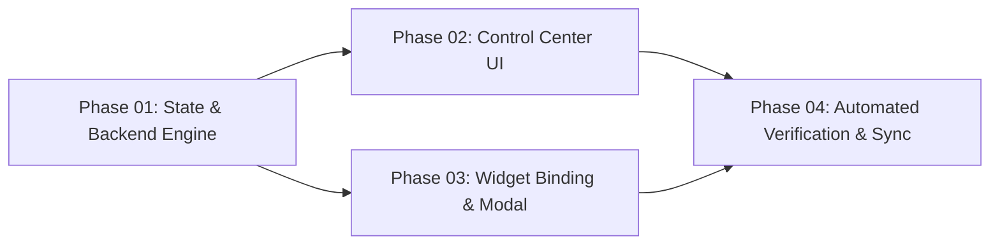

# Master Orchestration Board: AI & Chat Studio Settings Tab (`id: 'chat'`)
## आर्किटेक्चर मास्टर बोर्ड: एआई और चैट स्टूडियो सेटिंग्स टैब

> **Governing Protocol:** Universal Rule 22 (`temp_prompt/` Phase Execution & Cleanup Management)  
> **Master Operational Rules:** [`GEMINI.md`](file:///c:/Users/Atul%20Verma/Desktop/AI%20Document/Interactive%20Cursor-Tracking%20Portfolio/GEMINI.md)  
> **Technical Dossier:** [`memory.md`](file:///c:/Users/Atul%20Verma/Desktop/AI%20Document/Interactive%20Cursor-Tracking%20Portfolio/memory.md) & [`docs/FEATURES_MEMORY.md`](file:///c:/Users/Atul%20Verma/Desktop/AI%20Document/Interactive%20Cursor-Tracking%20Portfolio/docs/FEATURES_MEMORY.md)  
> **Feature Key:** `ai_chat_settings_tab`  
> **Version Target:** v2.4.0 (AI & Control Center Architecture)  
> **Author:** `phase_prompt_architect` subagent  
> **Creation Timestamp:** 2026-10-26 05:45:00 IST  
> **Execution Status:** `[STAGE: READY_FOR_EXECUTION]`  

---

## 1. Executive Architecture Summary (कार्यकारी सारांश)

### 1.1 Objective & Scope
Currently, the portfolio provides a high-performance on-device neural Web Worker (`@huggingface/transformers` with WebGPU/WASM) and an instant 0MB deterministic offline RAG engine inside [`AIChatWidget.jsx`](file:///c:/Users/Atul%20Verma/Desktop/AI%20Document/Interactive%20Cursor-Tracking%20Portfolio/src/components/AIChatWidget.jsx). However, user controls for AI model selection, download triggers, generation temperature, voice playback, and privacy retention are either scattered, non-persistent, or lack a centralized UI console.

This initiative introduces the **7th top-level tab in [`ControlCenterPanel.jsx`](file:///c:/Users/Atul%20Verma/Desktop/AI%20Document/Interactive%20Cursor-Tracking%20Portfolio/src/components/ControlCenterPanel.jsx) and [`LabStudioDrawer.jsx`](file:///c:/Users/Atul%20Verma/Desktop/AI%20Document/Interactive%20Cursor-Tracking%20Portfolio/src/components/LabStudioDrawer.jsx)**:
- **Tab Identifier:** `id: 'chat'`
- **Tab Label:** `AI & Chat Studio` (icon: `BotMessageSquare` / `Sparkles`)
- **Quick Access:** A direct gear shortcut icon in the [`AIChatWidget.jsx`](file:///c:/Users/Atul%20Verma/Desktop/AI%20Document/Interactive%20Cursor-Tracking%20Portfolio/src/components/AIChatWidget.jsx) header which instantly opens the Lab Drawer focused directly on this 7th tab.
- **Bi-Directional State Synchronization:** Reactive state management housed within [`LabContext.jsx`](file:///c:/Users/Atul%20Verma/Desktop/AI%20Document/Interactive%20Cursor-Tracking%20Portfolio/src/context/LabContext.jsx), backed by `localStorage` (`portfolio_ai_chat_settings`), custom event broadcasting (`ai-chat-settings-changed`), and real-time coordination with [`localAIService.js`](file:///c:/Users/Atul%20Verma/Desktop/AI%20Document/Interactive%20Cursor-Tracking%20Portfolio/src/services/localAIService.js).

### 1.2 The 5 Feature Clusters
1. **Cluster 1: Model & Execution Engine (मॉडल और निष्पादन इंजन):**
   - Model Tier selector (`Auto-Detect Tier`, `Deterministic Offline RAG Only [0MB]`, `SmolLM-135M [~90MB]`, `Qwen-0.5B [~350MB]`, `Qwen-1.5B [~950MB]`).
   - AI Load Trigger strategy (`On-Demand / Smart Fallback [Default]`, `On Page Load`, `On Chat Window Open`, `Manual Only`).
   - Download Consent Modal toggle (`Ask for Confirmation [Default]`, `Auto-Confirm Silent`, `Wi-Fi Only`).
   - WebGPU vs WASM Fallback override and Browser Cache management with cache size indicator.
2. **Cluster 2: Generation & Personality Controls (जेनरेशन और व्यक्तित्व नियंत्रण):**
   - Response Streaming (token-by-token typewriter effect).
   - Temperature / Creativity slider (`0.0 - Strict` to `1.0 - Creative`, default `0.7`).
   - Max Generation Tokens (`128 - 1024`, default `512`).
   - Tone Persona selector (`Helpful Professional`, `Concise Technical`, `Creative Mentor`, `Casual Peer`).
3. **Cluster 3: Voice & Sound Studio (आवाज और ऑडियो स्टूडियो):**
   - Neural/Browser Speech Synthesis (TTS) toggle.
   - Voice selector dropdown (filtered by system voices).
   - Pitch (`0.5x` to `1.5x`) and Speech Rate (`0.7x` to `1.5x`) sliders.
   - Procedural Web Audio chat haptic sound effects toggle.
4. **Cluster 4: Privacy & Storage Tools (गोपनीयता और स्टोरेज टूल्स):**
   - Session History Retention policy (`Ephemeral`, `Until Tab Closed [Default]`, `Persistent 7 Days`, `Persistent 30 Days`).
   - 1-Click "Purge All Chat Memory & Transcripts" with double-confirmation modal.
   - 1-Click "Export Chat History (.json / .md)" button.
5. **Cluster 5: UI & Ergonomics (यूजर इंटरफेस और एर्गोनॉमिक्स):**
   - Default Widget Docking Size (`Compact`, `Normal [Default]`, `Expanded 2-Column`, `Fullscreen Modal`).
   - Auto-Greet prompt on widget open toggle.
   - Quick Suggestion Chips toggle.
   - Slash Command auto-complete palette toggle.

---

## 2. Mermaid System Architecture & Data Flow

```mermaid
flowchart TD
    subgraph UI_Triggers ["Trigger & Entry Points"]
        A["AIChatWidget Header Gear Icon"] -->|openDrawer('chat')| B["LabStudioDrawer / ControlCenterPanel"]
        C["Workbench / Lab Studio Navigation"] -->|setActiveTab('chat')| B
    end

    subgraph ControlCenter ["ControlCenterPanel (Tab 7: 'chat')"]
        B --> D["Cluster 1: Model & Engine"]
        B --> E["Cluster 2: Generation & Tone"]
        B --> F["Cluster 3: Voice Studio (TTS)"]
        B --> G["Cluster 4: Privacy & Storage"]
        B --> H["Cluster 5: UI & Ergonomics"]
    end

    subgraph StateManagement ["State & Sync Engine"]
        D & E & F & G & H -->|updateChatSettings()| I["LabContext.jsx (chatSettings state)"]
        I -->|save| J[("localStorage: portfolio_ai_chat_settings")]
        I -->|window.dispatchEvent| K["Event Bus: 'ai-chat-settings-changed'"]
    end

    subgraph Consumers ["Reactive Consumers"]
        K -->|Updates Model & Triggers| L["localAIService.js"]
        K -->|Updates Sound & Voice| M["audio.js / Web Speech API"]
        K -->|Updates UI, Layout & Consent| N["AIChatWidget.jsx"]
        N -->|Triggers On-Demand Load| O{"Consent Policy Check"}
        O -->|Ask for Confirmation| P["Model Download Consent Modal"]
        O -->|Auto-Confirm| Q["Background Neural Download"]
        P -->|User Approved| Q
        P -->|User Declined| R["Fallback to 0MB Deterministic RAG"]
    end
```

---

## 3. Architecture Contracts & Technical Invariants

1. **State Isolation & Encapsulation:**
   - The settings must be structured as a dedicated sub-object: `chatSettings` in [`LabContext.jsx`](file:///c:/Users/Atul%20Verma/Desktop/AI%20Document/Interactive%20Cursor-Tracking%20Portfolio/src/context/LabContext.jsx).
   - Must expose `useLabChat()` hook and `updateChatSettings(partialSettings)` reducer function.
   - Must include `resetChatSettings()` and full integration with global `resetDefaults()`.
2. **Storage Key Contract:**
   - Persistence key: `portfolio_ai_chat_settings`.
   - Backward compatibility: If key is corrupt or absent, gracefully merge with `DEFAULT_AI_CHAT_SETTINGS`.
3. **Event Contract:**
   - Event Name: `'ai-chat-settings-changed'`.
   - Event Payload: `CustomEvent('ai-chat-settings-changed', { detail: { settings: currentChatSettings, source: 'control-center' } })`.
4. **Performance & Memory Budgets:**
   - Zero Unconsented Network Downloads: Heavy on-device model weights (>90MB) must NEVER download automatically on load unless explicit consent mode is set to `'auto_confirm'` AND load trigger is `'on_page_load'`.
   - Render Frame Budget: Settings slider updates must use throttled local state or non-blocking RAF updates to maintain 60-120fps.
   - Zero Layout Shift (CLS): Control center tab panel height and layout must be stabilized with CSS grid/flex containers.
5. **Accessibility & WCAG AAA Compliance:**
   - All interactive inputs (switches, sliders, buttons) must have strict `aria-label`, `role="tabpanel"`, `aria-labelledby`, and keyboard navigation support (`ArrowLeft`, `ArrowRight`, `Home`, `End`).

---

## 4. Phase Execution Matrix (चरणबद्ध निष्पादन मैट्रिक्स)

| Phase # | Phase Descriptor | Target Files | Specialized Subagent | Verification Command | Status |
| :---: | :--- | :--- | :--- | :--- | :---: |
| **01** | **State, Context & Service Integration**<br>`chatSettings` schema, persistence, event bus, and `localAIService` hooks. | `src/context/LabContext.jsx`<br>`src/services/localAIService.js` | `javascript_language_specialist` | `node scripts/verify_chat_settings_tab.mjs --phase 1` | `[ ] PENDING` |
| **02** | **Control Center 7th Tab UI Implementation**<br>Tab button, 5 cluster UI sections, sliders, segmented toggles, badge counters. | `src/components/ControlCenterPanel.jsx`<br>`src/components/LabStudioDrawer.jsx` | `css_styling_specialist` | `node scripts/verify_chat_settings_tab.mjs --phase 2` | `[ ] PENDING` |
| **03** | **AIChatWidget Binding & Consent Modal**<br>Quick gear button, reactive consumer bindings, and model download confirmation modal. | `src/components/AIChatWidget.jsx` | `javascript_language_specialist` | `node scripts/verify_chat_settings_tab.mjs --phase 3` | `[ ] PENDING` |
| **04** | **Automated QA Verification & Memory Dossier Sync**<br>Comprehensive ESM test harness, Oxlint validation, production build, memory updates. | `scripts/verify_chat_settings_tab.mjs`<br>`memory.md`<br>`docs/FEATURES_MEMORY.md` | `qa_verification_tester` | `node scripts/verify_chat_settings_tab.mjs --all` | `[ ] PENDING` |

---

## 5. Execution Order & Inter-Phase Dependencies



- **Strict Dependency:** Phase 01 establishes the `DEFAULT_AI_CHAT_SETTINGS` schema and context hooks, which Phase 02 and Phase 03 consume.
- **Parallelization Window (Universal Rule 2):** Once Phase 01 is implemented, Phase 02 (UI layout in Control Center) and Phase 03 (Chat Widget integration & consent modal) can be executed in parallel or sequentially.
- **Final Gate:** Phase 04 runs all synthetic DOM, state invariant, and build verifications before any clean-up.

---

## 6. Definition of Done (DoD) & Acceptance Invariants (पूर्णता की परिभाषा)

- [ ] **Tab Presence:** Tab `id: 'chat'` appears as the 7th item in `ControlCenterPanel.jsx` with active count/tag.
- [ ] **Shortcut Navigation:** Clicking the gear icon in `AIChatWidget.jsx` header opens `LabStudioDrawer` on the `chat` tab with zero delay.
- [ ] **Default Safe Trigger:** Default `loadTrigger` is `'on_demand'` and `consentMode` is `'always_ask'`. Zero model weights download without confirmation.
- [ ] **Interactive Consent Dialog:** When an unhandled query triggers LLM switch, an accessible confirmation dialog presents model specs, download size, and memory footprint.
- [ ] **Persistence:** All 5 setting clusters survive page reload via `portfolio_ai_chat_settings`.
- [ ] **Reset Integration:** Control Center's global "Reset to Defaults" reverts `chatSettings` to `DEFAULT_AI_CHAT_SETTINGS`.
- [ ] **Automated Test Pass:** `node scripts/verify_chat_settings_tab.mjs` executes and passes 100% of assertion checks.
- [ ] **Zero Regressions:** `npx oxlint` passes with 0 syntax or runtime errors.
