# Pure Icon-Only Sub-Header & Pure Single-Row Chips Carousel — Master Orchestration Board (`INDEX.md`)

> **Governing Protocol:** [Universal Rule 22](file:///c:/Users/Atul%20Verma/Desktop/AI%20Document/Interactive%20Cursor-Tracking%20Portfolio/.agents/skills/phase-prompt-architect/SKILL.md) (`temp_prompt/` Phase Execution & Cleanup Management)  
> **Master Operational Standards:** [`GEMINI.md`](file:///c:/Users/Atul%20Verma/Desktop/AI%20Document/Interactive%20Cursor-Tracking%20Portfolio/GEMINI.md)  
> **System Memory Dossier:** [`memory.md`](file:///c:/Users/Atul%20Verma/Desktop/AI%20Document/Interactive%20Cursor-Tracking%20Portfolio/memory.md) & [`docs/FEATURES_MEMORY.md`](file:///c:/Users/Atul%20Verma/Desktop/AI%20Document/Interactive%20Cursor-Tracking%20Portfolio/docs/FEATURES_MEMORY.md)  
> **Dedicated Architect:** `phase_prompt_architect`  
> **Audit Change Ticket:** `CHG-20261026-083`  
> **Target Version:** `v2.4.1` | **Timestamp:** `2026-10-26 08:45:00 IST`

---

## 1. Top Section Diagnostic Specification

### 1.1 Problem Summary
The recent chat redesign introduced text-heavy button pills (`Audience`, `Role`, `⚡ SmolLM2`, `⚡ AI On`, `••• Tools`) into the sub-header action strip. This text expansion caused excessive horizontal width consumption, clipping and hiding critical control icons on smaller displays, while burying essential everyday utilities inside an extra popover click. Concurrently, `SuggestionChipsDrawer.jsx` retained a redundant top category filter tabs bar (`All`, `🚀 Projects`, `📊 Tax & MIS`, etc.) above the chips track, consuming two vertical rows and cluttering the lower viewport above the chat input dock.

### 1.2 Problem Detailed Bullet Points
- **Sub-Header Text Bloat & Clutter:** Buttons in the sub-header render text labels alongside icons (e.g. `<span>Audience</span>`, `<span>Role</span>`, `<span>⚡ SmolLM2</span>`, `<span>••• Tools</span>`), contradicting the clean, ultra-minimal aesthetic and bloating horizontal real estate.
- **Hidden & Inaccessible Control Icons:** Due to text pill widths, essential controls (View Mode switcher, Prompt Studio, History, Export, Emoji, Clear Chat) were either crowded out, hidden behind nested popover menus, or clipped without reliable horizontal scrolling.
- **Two-Row Drawer Overhead in Suggestion Drawer:** `SuggestionChipsDrawer.jsx` retained a category tabs header row (`CATEGORY_TABS`) above the chips carousel, occupying extra vertical padding and creating a 2-tier visual block when only a single horizontal carousel of prompt chips is required.
- **Inconsistent Touch Target Hierarchy:** Sub-header buttons lacked uniform 28px/32px icon-only square proportions, creating uneven visual weighting across light and dark modes.

---

### 1.3 Solution Summary
Restore a **100% pure Icon-Only sub-header action strip** and a **pure Single-Row chips carousel** with zero text labels in the sub-header, zero category tab overhead in the suggestion drawer, full keyboard accessibility, state-driven color glowing, rich accessible tooltips, and non-clipping horizontal scrolling.

### 1.4 Solution Detailed Bullet Points
- **100% Pure Icon-Only Sub-Header Strip:** Remove all text spans from sub-header buttons. Divide the bar into two clean icon-only groups:
  1. **Left Perspective Group (4 icons):** `<Users />` (Audience), `<Briefcase />` (Role), `<Monitor />` (View Mode), and `<Bot />` (AI Model).
  2. **Right Quick Tools Group (6 icons):** `<Sparkles />` (Prompt Studio), `<Zap />` (AI On/Off Toggle), `<Smile />` (Emoji Toggle), `<History />` (Session History Drawer), `<Download />` (Export Transcript Menu), and `<RotateCcw />` (Clear Chat).
- **Uniform Square Micro-Pill Styling:** Every button is sized uniformly (`w-7 h-7 sm:w-7 sm:h-7 min-w-[28px] min-h-[28px]`) with rounded-lg borders, active state indicator rings, subtle scale transitions, and descriptive `title` & `aria-label` tooltips.
- **Non-Clipping Smooth Horizontal Scroll:** The sub-header container enforces `overflow-x-auto no-scrollbar whitespace-nowrap` so on narrow mobile widths, icons smoothly scroll rather than wrapping or clipping.
- **Pure Single-Row Suggestion Carousel:** Completely strip out `CATEGORY_TABS` and the category filter buttons row from `SuggestionChipsDrawer.jsx`. Render strictly the single horizontal track of suggestion prompt chips with left/right chevrons, smooth mouse drag, touch swipe, and chip deduplication (`seen = new Set()`).

---

## 2. Mandatory 7-Column Diagnostic Matrix

| Component / Feature | Symptom / Defect | Root Cause | File Target | Line Range | Architectural Fix | Verification Metric |
| :--- | :--- | :--- | :--- | :--- | :--- | :--- |
| **Sub-Header Action Strip** | Text labels (`Audience`, `Role`, `⚡ SmolLM2`, `••• Tools`) cause visual bloat and width overflow | Text spans inside sub-header buttons take up excessive horizontal space | [`src/components/AIChatWidget.jsx`](file:///c:/Users/Atul%20Verma/Desktop/AI%20Document/Interactive%20Cursor-Tracking%20Portfolio/src/components/AIChatWidget.jsx) | ~3280–3385 | Remove all text spans; render pure 100% icon-only buttons with active state glow | Sub-header HTML contains 0 text spans; all 10 buttons are pure icon-only |
| **Left Perspective Group** | View Mode icon (`<Monitor />`) missing from primary group; icons clipped | Icons replaced by text pills; View Mode relegated | [`src/components/AIChatWidget.jsx`](file:///c:/Users/Atul%20Verma/Desktop/AI%20Document/Interactive%20Cursor-Tracking%20Portfolio/src/components/AIChatWidget.jsx) | ~3282–3330 | Restore 4-icon perspective cluster: `<Users />`, `<Briefcase />`, `<Monitor />`, `<Bot />` | All 4 perspective buttons present and render respective SVG icons |
| **Right Quick Tools Group** | Everyday tools (Prompt Studio, Emoji, History, Export, Clear) hidden behind popover | Nested popover menu created unnecessary interaction friction | [`src/components/AIChatWidget.jsx`](file:///c:/Users/Atul%20Verma/Desktop/AI%20Document/Interactive%20Cursor-Tracking%20Portfolio/src/components/AIChatWidget.jsx) | ~3332–3430 | Expose all 6 tools as pure icon-only buttons with tooltips in a dedicated right group | 6 tools visible in single row; click triggers respective modals/drawers |
| **Sub-Header Responsiveness** | Icons clip or get cut off on narrow mobile viewports | Container lacked resilient non-wrapping flex layout with smooth horizontal scroll | [`src/components/AIChatWidget.jsx`](file:///c:/Users/Atul%20Verma/Desktop/AI%20Document/Interactive%20Cursor-Tracking%20Portfolio/src/components/AIChatWidget.jsx) | ~3280 | Enforce `flex items-center justify-between gap-1 overflow-x-auto no-scrollbar` | Subheader does not wrap into multiple lines on 360px viewport |
| **Suggestion Chips Drawer** | Bulky 2-row layout with unwanted category tabs row (`All`, `Projects`, `Tax`, etc.) | `CATEGORY_TABS.map(...)` rendered as a separate header row above chips | [`src/components/chat/SuggestionChipsDrawer.jsx`](file:///c:/Users/Atul%20Verma/Desktop/AI%20Document/Interactive%20Cursor-Tracking%20Portfolio/src/components/chat/SuggestionChipsDrawer.jsx) | ~165–195 | Delete category tabs header entirely; render ONLY the single horizontal carousel | Zero category tab buttons; drawer height reduced to single row (~36px) |
| **Chips Deduplication & Scroll** | Risk of duplicate chips or broken chevron scroll when category tabs are removed | `visibleChips` depended on `activeCategory` state | [`src/components/chat/SuggestionChipsDrawer.jsx`](file:///c:/Users/Atul%20Verma/Desktop/AI%20Document/Interactive%20Cursor-Tracking%20Portfolio/src/components/chat/SuggestionChipsDrawer.jsx) | ~33–50 | Simplify `visibleChips` to directly deduplicate input `chips` array | 100% unique chips rendered; left/right chevrons functional |
| **Test Suite Invariants** | Existing tests might expect old text or category buttons | Test harness needs dedicated assertions for pure icon-only strip & pure single-row carousel | [`scripts/verify_icon_only_chat.mjs`](file:///c:/Users/Atul%20Verma/Desktop/AI%20Document/Interactive%20Cursor-Tracking%20Portfolio/scripts/verify_icon_only_chat.mjs) | New | Author comprehensive verification script validating icon-only subheader and pure carousel | `node scripts/verify_icon_only_chat.mjs` exits with 0 errors |

---

## 3. Architecture Layout Comparison

```mermaid
flowchart TD
  subgraph BEFORE["Before: Text-Heavy Subheader + 2-Row Suggestion Drawer"]
    B_HDR["Top Window Header"]
    B_SUB["Sub-Header with Text: [👥 Audience] [💼 Role] [⚡ SmolLM2] [⚡ AI On] [••• Tools]"]
    B_CHAT["Message Body"]
    B_CAT["Suggestion Drawer Header: [All] [🚀 Projects] [📊 Tax] [⚡ Tech] [💼 Experience]"]
    B_CHIPS["Suggestion Chips Row"]
    B_INPUT["Input Dock"]
    
    B_HDR --> B_SUB --> B_CHAT --> B_CAT --> B_CHIPS --> B_INPUT
  end

  subgraph AFTER["After: 100% Pure Icon-Only Subheader + Pure Single-Row Chips Carousel"]
    A_HDR["Top Window Header (Drag Bar + Title + Controls)"]
    A_SUB["Pure Icon-Only Strip: [👥] [💼] [🖥️] [🤖] | [✨] [⚡] [😊] [📜] [📥] [🔄]"]
    A_CHAT["Message Body (Glassmorphic Bubbles + Single-Row Micro-Toolbar)"]
    A_CHIPS["Pure Single-Row Chips Carousel: [◀] [Chip 1] [Chip 2] [Chip 3]... [▶]"]
    A_INPUT["Input Dock (Input + Sparkles + Mic + Send)"]
    
    A_HDR --> A_SUB --> A_CHAT --> A_CHIPS --> A_INPUT
  end
```



---

## 4. Phase Breakdown & Subagent Assignment Matrix

| Phase # | Phase Descriptor | Target Files | Specialized Subagent | Automated Test Command | Status |
| :---: | :--- | :--- | :--- | :--- | :---: |
| **01** | **Pure Icon-Only Sub-Header Restoration**<br>• Replace text pills with 10 pure icon-only buttons<br>• Left Perspective Group (4): Users, Briefcase, Monitor, Bot<br>• Right Quick Tools Group (6): Sparkles, Zap, Smile, History, Download, RotateCcw<br>• Smooth non-clipping horizontal scroll & rich tooltips | [`src/components/AIChatWidget.jsx`](file:///c:/Users/Atul%20Verma/Desktop/AI%20Document/Interactive%20Cursor-Tracking%20Portfolio/src/components/AIChatWidget.jsx) | `javascript_language_specialist` & `css_styling_specialist` | `node scripts/verify_icon_only_chat.mjs --phase=1` | `[ ] PENDING` |
| **02** | **Pure Single-Row Chips Carousel**<br>• Completely eliminate category tabs row (`CATEGORY_TABS`)<br>• Render ONLY the single horizontal carousel of suggestion chips<br>• Preserve chevron navigation, mouse/touch drag, and deduplication | [`src/components/chat/SuggestionChipsDrawer.jsx`](file:///c:/Users/Atul%20Verma/Desktop/AI%20Document/Interactive%20Cursor-Tracking%20Portfolio/src/components/chat/SuggestionChipsDrawer.jsx) | `javascript_language_specialist` & `css_styling_specialist` | `node scripts/verify_icon_only_chat.mjs --phase=2` | `[ ] PENDING` |
| **03** | **Verification, 58 Test Harnesses, Audit & Memory Sync**<br>• Comprehensive test harness `scripts/verify_icon_only_chat.mjs`<br>• Full regression pass: `npm test`<br>• Linter `npx oxlint` & build validation `npm run build`<br>• Memory sync: `memory.md`, `docs/FEATURES_MEMORY.md`<br>• Change ticket logging & safe ephemeral pruning per Rule 22 | [`scripts/verify_icon_only_chat.mjs`](file:///c:/Users/Atul%20Verma/Desktop/AI%20Document/Interactive%20Cursor-Tracking%20Portfolio/scripts/verify_icon_only_chat.mjs)<br>[`memory.md`](file:///c:/Users/Atul%20Verma/Desktop/AI%20Document/Interactive%20Cursor-Tracking%20Portfolio/memory.md)<br>[`docs/FEATURES_MEMORY.md`](file:///c:/Users/Atul%20Verma/Desktop/AI%20Document/Interactive%20Cursor-Tracking%20Portfolio/docs/FEATURES_MEMORY.md)<br>[`changes_log/CHG-20261026-083.md`](file:///c:/Users/Atul%20Verma/Desktop/AI%20Document/Interactive%20Cursor-Tracking%20Portfolio/changes_log/CHG-20261026-083.md) | `qa_verification_tester` & `phase_prompt_architect` | `node scripts/verify_icon_only_chat.mjs`<br>`npm test`<br>`npm run build` | `[ ] PENDING` |

---

## 5. Execution Order & Inter-Phase Dependencies

```
[Phase 1: Pure Icon-Only Sub-Header]
                 │
                 ▼
[Phase 2: Pure Single-Row Chips Carousel]
                 │
                 ▼
[Phase 3: Automated Verification, Audit & Memory Sync]
```

- **Phase 1** surgically updates `AIChatWidget.jsx` sub-header JSX.
- **Phase 2** surgically cleans `SuggestionChipsDrawer.jsx` by removing category tabs.
- **Phase 3** validates all DOM invariants, runs the 58 test harnesses, logs the audit trail, synchronizes permanent memory, and prunes the temporary directory.

---

## 6. Definition of Done (DoD)

1. **Sub-Header Purity:** Sub-header contains **zero text spans** inside buttons. Exactly 10 icon-only buttons are rendered with uniform `w-7 h-7` dimensions, active state colors, and rich accessible tooltips.
2. **Smooth Non-Clipping Scroll:** The sub-header container allows smooth horizontal scrolling on mobile viewports (`360px` - `480px`) without wrapping or truncating any button.
3. **Pure Single-Row Chips:** `SuggestionChipsDrawer.jsx` renders **zero category tab buttons**. Only the single horizontal track of suggestion prompt chips with chevrons is displayed.
4. **Automated Verification:** `node scripts/verify_icon_only_chat.mjs` executes and passes 100% of assertions with 0 errors.
5. **Full Regression Suite:** `npm test` executes all test harnesses with 0 regressions.
6. **Linter & Build:** `npx oxlint` passes with 0 errors; `npm run build` generates clean production assets.
7. **Permanent Memory Sync:** All updates permanently recorded in `memory.md`, `docs/FEATURES_MEMORY.md`, and `changes_log/CHG-20261026-083.md`.
